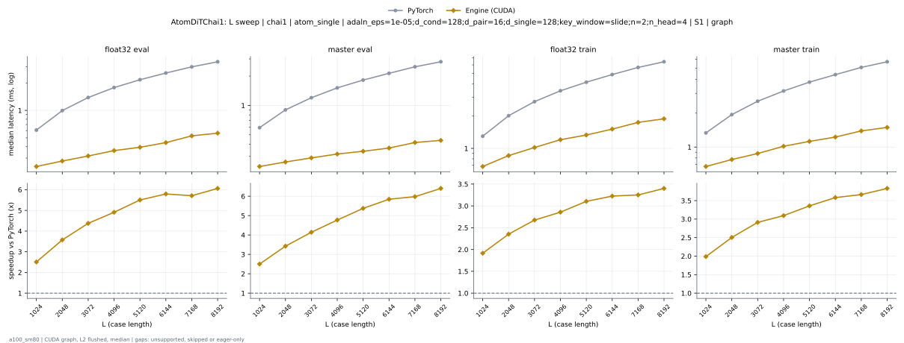
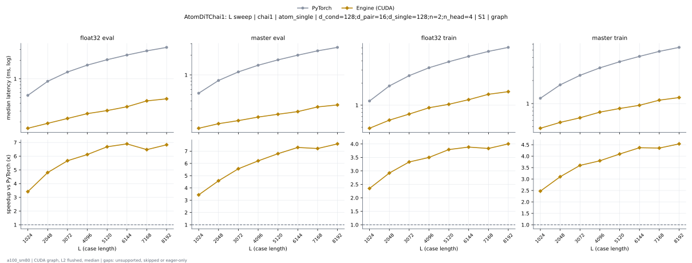

# AtomDiTChai1 on a100_sm80

Generated by `python -m miniworld_engine.measure.plot` from speed tokens `judge/tokens/a100_sm80/`; do not edit.

### L sweep: chai1 | atom_single | adaln_eps=1e-05;d_cond=128;d_pair=16;d_single=128;key_window=slide;n=2;n_head=4 | S1 | graph

**float32 eval** (median ms; x = speedup vs PyTorch)

| L | PyTorch | Engine (Triton) | Engine (CUDA) |
|---|---|---|---|
| 1024 | 0.6083 | 0.4772 (1.27x) | 0.2427 (2.51x) |
| 2048 | 0.9953 | 0.8223 (1.21x) | 0.2785 (3.57x) |
| 3072 | 1.384 | 1.177 (1.18x) | 0.3164 (4.38x) |
| 4096 | 1.78 | 1.539 (1.16x) | 0.3625 (4.91x) |
| 5120 | 2.17 | 1.887 (1.15x) | 0.3942 (5.50x) |
| 6144 | 2.569 | 2.238 (1.15x) | 0.4434 (5.79x) |
| 7168 | 3.002 | 2.622 (1.14x) | 0.5258 (5.71x) |
| 8192 | 3.414 | 2.968 (1.15x) | 0.5632 (6.06x) |

**master eval** (median ms; x = speedup vs PyTorch)

| L | PyTorch | Engine (Triton) | Engine (CUDA) |
|---|---|---|---|
| 1024 | 0.5919 | 0.4516 (1.31x) | 0.2365 (2.50x) |
| 2048 | 0.9011 | 0.7137 (1.26x) | 0.2632 (3.42x) |
| 3072 | 1.2 | 0.9748 (1.23x) | 0.2898 (4.14x) |
| 4096 | 1.514 | 1.237 (1.22x) | 0.3174 (4.77x) |
| 5120 | 1.822 | 1.496 (1.22x) | 0.3389 (5.37x) |
| 6144 | 2.137 | 1.75 (1.22x) | 0.3656 (5.84x) |
| 7168 | 2.491 | 2.051 (1.21x) | 0.4168 (5.98x) |
| 8192 | 2.806 | 2.316 (1.21x) | 0.4383 (6.40x) |

**float32 train** (median ms; x = speedup vs PyTorch)

| L | PyTorch | Engine (Triton) | Engine (CUDA) |
|---|---|---|---|
| 1024 | 1.299 | 1.029 (1.26x) | 0.6784 (1.92x) |
| 2048 | 2.016 | 1.665 (1.21x) | 0.8571 (2.35x) |
| 3072 | 2.728 | 2.307 (1.18x) | 1.02 (2.67x) |
| 4096 | 3.443 | 2.984 (1.15x) | 1.205 (2.86x) |
| 5120 | 4.138 | 3.607 (1.15x) | 1.333 (3.10x) |
| 6144 | 4.877 | 4.241 (1.15x) | 1.512 (3.22x) |
| 7168 | 5.682 | 4.963 (1.14x) | 1.748 (3.25x) |
| 8192 | 6.417 | 5.613 (1.14x) | 1.887 (3.40x) |

**master train** (median ms; x = speedup vs PyTorch)

| L | PyTorch | Engine (Triton) | Engine (CUDA) |
|---|---|---|---|
| 1024 | 1.336 | 1.052 (1.27x) | 0.6723 (1.99x) |
| 2048 | 1.942 | 1.586 (1.22x) | 0.7752 (2.50x) |
| 3072 | 2.553 | 2.127 (1.20x) | 0.8765 (2.91x) |
| 4096 | 3.147 | 2.655 (1.19x) | 1.017 (3.09x) |
| 5120 | 3.772 | 3.196 (1.18x) | 1.123 (3.36x) |
| 6144 | 4.395 | 3.725 (1.18x) | 1.227 (3.58x) |
| 7168 | 5.097 | 4.341 (1.17x) | 1.392 (3.66x) |
| 8192 | 5.719 | 4.835 (1.18x) | 1.494 (3.83x) |

### L sweep: chai1 | atom_single | d_cond=128;d_pair=16;d_single=128;n=2;n_head=4 | S1 | graph

**float32 eval** (median ms; x = speedup vs PyTorch)

| L | PyTorch | Engine (Triton) | Engine (CUDA) |
|---|---|---|---|
| 1024 | 0.5386 | 0.4588 (1.17x) | 0.1577 (3.42x) |
| 2048 | 0.9103 | 0.8049 (1.13x) | 0.1894 (4.81x) |
| 3072 | 1.288 | 1.159 (1.11x) | 0.2273 (5.67x) |
| 4096 | 1.667 | 1.523 (1.09x) | 0.2724 (6.12x) |
| 5120 | 2.04 | 1.869 (1.09x) | 0.3052 (6.68x) |
| 6144 | 2.429 | 2.221 (1.09x) | 0.3523 (6.90x) |
| 7168 | 2.839 | 2.603 (1.09x) | 0.4383 (6.48x) |
| 8192 | 3.23 | 2.952 (1.09x) | 0.4731 (6.83x) |

**master eval** (median ms; x = speedup vs PyTorch)

| L | PyTorch | Engine (Triton) | Engine (CUDA) |
|---|---|---|---|
| 1024 | 0.5243 | 0.4352 (1.20x) | 0.1526 (3.44x) |
| 2048 | 0.8212 | 0.6973 (1.18x) | 0.1792 (4.58x) |
| 3072 | 1.111 | 0.9533 (1.17x) | 0.1997 (5.56x) |
| 4096 | 1.405 | 1.221 (1.15x) | 0.2263 (6.21x) |
| 5120 | 1.698 | 1.477 (1.15x) | 0.2499 (6.80x) |
| 6144 | 2.004 | 1.736 (1.15x) | 0.2744 (7.30x) |
| 7168 | 2.335 | 2.031 (1.15x) | 0.3236 (7.22x) |
| 8192 | 2.636 | 2.297 (1.15x) | 0.3471 (7.59x) |

**float32 train** (median ms; x = speedup vs PyTorch)

| L | PyTorch | Engine (Triton) | Engine (CUDA) |
|---|---|---|---|
| 1024 | 1.14 | 1.014 (1.12x) | 0.4854 (2.35x) |
| 2048 | 1.827 | 1.649 (1.11x) | 0.6257 (2.92x) |
| 3072 | 2.521 | 2.289 (1.10x) | 0.7567 (3.33x) |
| 4096 | 3.229 | 2.963 (1.09x) | 0.9226 (3.50x) |
| 5120 | 3.898 | 3.587 (1.09x) | 1.028 (3.79x) |
| 6144 | 4.614 | 4.228 (1.09x) | 1.188 (3.88x) |
| 7168 | 5.392 | 4.939 (1.09x) | 1.407 (3.83x) |
| 8192 | 6.111 | 5.588 (1.09x) | 1.527 (4.00x) |

**master train** (median ms; x = speedup vs PyTorch)

| L | PyTorch | Engine (Triton) | Engine (CUDA) |
|---|---|---|---|
| 1024 | 1.174 | 1.037 (1.13x) | 0.4751 (2.47x) |
| 2048 | 1.758 | 1.57 (1.12x) | 0.5673 (3.10x) |
| 3072 | 2.342 | 2.106 (1.11x) | 0.6513 (3.60x) |
| 4096 | 2.934 | 2.638 (1.11x) | 0.7726 (3.80x) |
| 5120 | 3.529 | 3.172 (1.11x) | 0.8622 (4.09x) |
| 6144 | 4.147 | 3.716 (1.12x) | 0.9492 (4.37x) |
| 7168 | 4.823 | 4.32 (1.12x) | 1.108 (4.35x) |
| 8192 | 5.439 | 4.826 (1.13x) | 1.199 (4.54x) |

