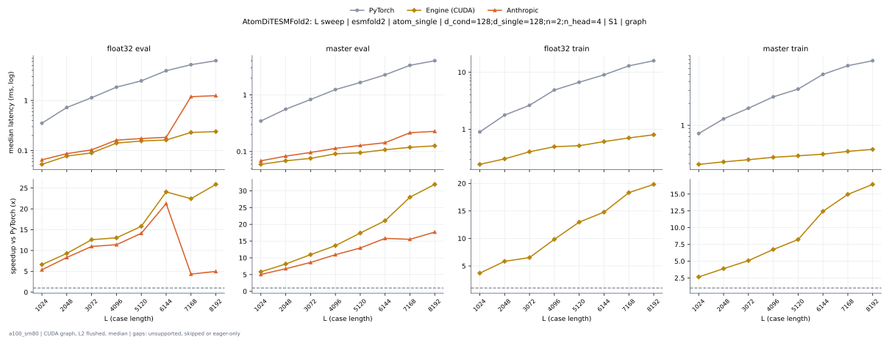

# AtomDiTESMFold2 on a100_sm80

Generated by `python -m miniworld_engine.measure.plot` from speed tokens `judge/tokens/a100_sm80/`; do not edit.

### L sweep: esmfold2 | atom_single | d_cond=128;d_single=128;n=2;n_head=4 | S1 | graph

**float32 eval** (median ms; x = speedup vs PyTorch)

| L | PyTorch | Engine (CUDA) | Anthropic |
|---|---|---|---|
| 1024 | 0.3523 | 0.05325 (6.62x) | 0.06554 (5.38x) |
| 2048 | 0.724 | 0.07782 (9.30x) | 0.08704 (8.32x) |
| 3072 | 1.136 | 0.09011 (12.60x) | 0.1034 (10.98x) |
| 4096 | 1.843 | 0.1413 (13.04x) | 0.1618 (11.39x) |
| 5120 | 2.462 | 0.1556 (15.82x) | 0.1741 (14.14x) |
| 6144 | 3.92 | 0.1628 (24.08x) | 0.1843 (21.27x) |
| 7168 | 5.169 | 0.2304 (22.44x) | 1.19 (4.34x) |
| 8192 | 6.202 | 0.2396 (25.88x) | 1.248 (4.97x) |

**master eval** (median ms; x = speedup vs PyTorch)

| L | PyTorch | Engine (CUDA) | Anthropic |
|---|---|---|---|
| 1024 | 0.3461 | 0.05939 (5.83x) | 0.06861 (5.04x) |
| 2048 | 0.5601 | 0.06861 (8.16x) | 0.08294 (6.75x) |
| 3072 | 0.8305 | 0.07578 (10.96x) | 0.09626 (8.63x) |
| 4096 | 1.243 | 0.09114 (13.64x) | 0.1137 (10.94x) |
| 5120 | 1.657 | 0.09523 (17.40x) | 0.128 (12.94x) |
| 6144 | 2.267 | 0.1075 (21.08x) | 0.1434 (15.81x) |
| 7168 | 3.338 | 0.1188 (28.10x) | 0.215 (15.52x) |
| 8192 | 4.021 | 0.126 (31.93x) | 0.2273 (17.69x) |

**float32 train** (median ms; x = speedup vs PyTorch)

| L | PyTorch | Engine (CUDA) | Anthropic |
|---|---|---|---|
| 1024 | 0.9011 | 0.2437 (3.70x) | 2.709 (eager) |
| 2048 | 1.777 | 0.3041 (5.84x) | 2.714 (eager) |
| 3072 | 2.638 | 0.4045 (6.52x) | 3.334 (eager) |
| 4096 | 4.884 | 0.4966 (9.83x) | 4.076 (eager) |
| 5120 | 6.691 | 0.5161 (12.96x) | 5.022 (eager) |
| 6144 | 9.02 | 0.6103 (14.78x) | 5.97 (eager) |
| 7168 | 12.96 | 0.7076 (18.32x) | 6.978 (eager) |
| 8192 | 15.93 | 0.8038 (19.82x) | 7.945 (eager) |

**master train** (median ms; x = speedup vs PyTorch)

| L | PyTorch | Engine (CUDA) | Anthropic |
|---|---|---|---|
| 1024 | 0.7721 | 0.2918 (2.65x) | 3.173 (eager) |
| 2048 | 1.226 | 0.3154 (3.89x) | 3.181 (eager) |
| 3072 | 1.716 | 0.3379 (5.08x) | 3.807 (eager) |
| 4096 | 2.457 | 0.3645 (6.74x) | 3.768 (eager) |
| 5120 | 3.142 | 0.382 (8.23x) | 4.273 (eager) |
| 6144 | 5.001 | 0.4024 (12.43x) | 4.275 (eager) |
| 7168 | 6.568 | 0.4393 (14.95x) | 4.75 (eager) |
| 8192 | 7.686 | 0.4675 (16.44x) | 5.014 (eager) |

