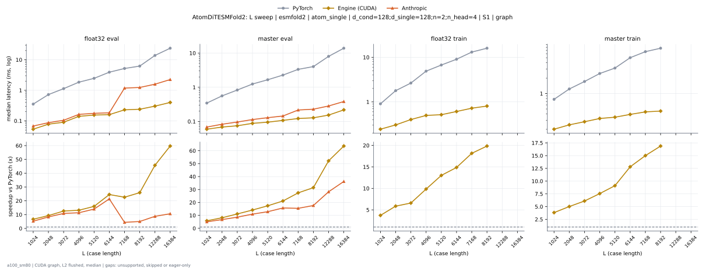

# AtomDiTESMFold2 on a100_sm80

Generated by `python -m miniworld_engine.measure.plot` from speed tokens `judge/tokens/a100_sm80/`; do not edit.

### L sweep: esmfold2 | atom_single | d_cond=128;d_single=128;n=2;n_head=4 | S1 | graph

**float32 eval** (median ms; x = speedup vs PyTorch)

| L | PyTorch | Engine (Triton) | Engine (CUDA) | Anthropic |
|---|---|---|---|---|
| 1024 | 0.3533 | 0.08704 (4.06x) | 0.05325 (6.63x) | 0.06758 (5.23x) |
| 2048 | 0.724 | 0.1044 (6.93x) | 0.07782 (9.30x) | 0.08704 (8.32x) |
| 3072 | 1.135 | 0.1178 (9.63x) | 0.09011 (12.59x) | 0.1044 (10.86x) |
| 4096 | 1.846 | 0.172 (10.73x) | 0.1403 (13.16x) | 0.1628 (11.34x) |
| 5120 | 2.467 | 0.2038 (12.11x) | 0.1546 (15.95x) | 0.1761 (14.01x) |
| 6144 | 3.919 | 0.213 (18.40x) | 0.1597 (24.53x) | 0.1833 (21.38x) |
| 7168 | 5.185 | 0.2703 (19.18x) | 0.2294 (22.60x) | 1.182 (4.39x) |
| 8192 | 6.211 | 0.2816 (22.05x) | 0.2396 (25.92x) | 1.239 (5.01x) |
| 12288 | 13.87 | 0.383 (36.21x) | 0.3031 (45.75x) | 1.585 (8.75x) |
| 16384 | 23.9 | 0.4854 (49.23x) | 0.4004 (59.69x) | 2.25 (10.62x) |

**master eval** (median ms; x = speedup vs PyTorch)

| L | PyTorch | Engine (Triton) | Engine (CUDA) | Anthropic |
|---|---|---|---|---|
| 1024 | 0.3451 | 0.06963 (4.96x) | 0.05939 (5.81x) | 0.06861 (5.03x) |
| 2048 | 0.5601 | 0.07782 (7.20x) | 0.06861 (8.16x) | 0.08294 (6.75x) |
| 3072 | 0.8305 | 0.08704 (9.54x) | 0.07475 (11.11x) | 0.09626 (8.63x) |
| 4096 | 1.245 | 0.1014 (12.28x) | 0.08806 (14.14x) | 0.1137 (10.95x) |
| 5120 | 1.659 | 0.1116 (14.86x) | 0.09523 (17.42x) | 0.129 (12.86x) |
| 6144 | 2.271 | 0.1167 (19.46x) | 0.1075 (21.12x) | 0.1444 (15.73x) |
| 7168 | 3.34 | 0.1526 (21.89x) | 0.1219 (27.41x) | 0.2161 (15.46x) |
| 8192 | 4.026 | 0.1638 (24.58x) | 0.128 (31.46x) | 0.2284 (17.63x) |
| 12288 | 8.011 | 0.2068 (38.73x) | 0.1536 (52.15x) | 0.2836 (28.24x) |
| 16384 | 13.87 | 0.2755 (50.37x) | 0.2181 (63.61x) | 0.383 (36.23x) |

**float32 train** (median ms; x = speedup vs PyTorch)

| L | PyTorch | Engine (Triton) | Engine (CUDA) | Anthropic |
|---|---|---|---|---|
| 1024 | 0.9042 | 0.2744 (3.29x) | 0.2437 (3.71x) | 2.988 (eager) |
| 2048 | 1.783 | 0.3625 (4.92x) | 0.3041 (5.86x) | 2.999 (eager) |
| 3072 | 2.644 | 0.4055 (6.52x) | 0.4014 (6.59x) | 3.668 (eager) |
| 4096 | 4.887 | 0.6103 (8.01x) | 0.4966 (9.84x) | 4.11 (eager) |
| 5120 | 6.707 | 0.6687 (10.03x) | 0.5151 (13.02x) | 5.07 (eager) |
| 6144 | 9.046 | 0.7148 (12.66x) | 0.6083 (14.87x) | 6.027 (eager) |
| 7168 | 13.09 | 0.896 (14.61x) | 0.7209 (18.16x) | 7.043 (eager) |
| 8192 | 15.98 | 0.9446 (16.92x) | 0.8049 (19.86x) | 8.007 (eager) |
| 12288 |  |  |  |  |
| 16384 |  |  |  |  |

**master train** (median ms; x = speedup vs PyTorch)

| L | PyTorch | Engine (Triton) | Engine (CUDA) | Anthropic |
|---|---|---|---|---|
| 1024 | 0.7711 | 0.2109 (3.66x) | 0.2012 (3.83x) | 3.522 (eager) |
| 2048 | 1.228 | 0.258 (4.76x) | 0.2447 (5.02x) | 3.517 (eager) |
| 3072 | 1.718 | 0.2949 (5.83x) | 0.2816 (6.10x) | 4.183 (eager) |
| 4096 | 2.461 | 0.4004 (6.15x) | 0.3256 (7.56x) | 4.15 (eager) |
| 5120 | 3.142 | 0.425 (7.39x) | 0.3451 (9.11x) | 4.656 (eager) |
| 6144 | 5.009 | 0.4649 (10.77x) | 0.3912 (12.80x) | 4.668 (eager) |
| 7168 | 6.575 | 0.5837 (11.26x) | 0.4383 (15.00x) | 5.173 (eager) |
| 8192 | 7.674 | 0.6134 (12.51x) | 0.4547 (16.88x) | 5.145 (eager) |
| 12288 |  |  |  |  |
| 16384 |  |  |  |  |

