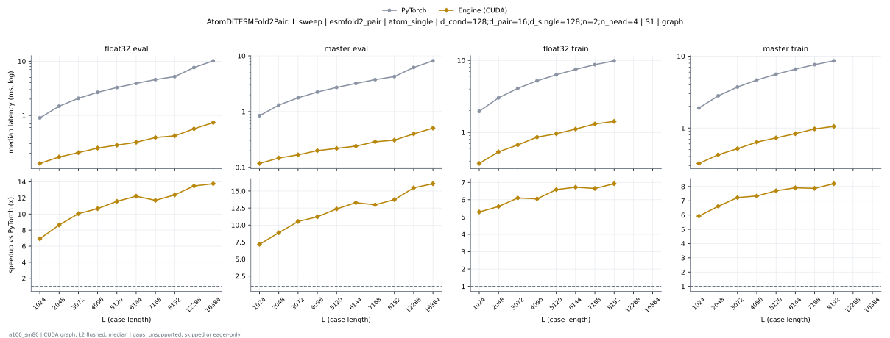
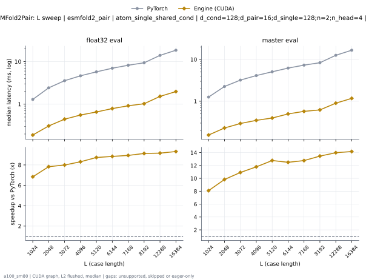

# AtomDiTESMFold2Pair on a100_sm80

Generated by `python -m foldjet_engine.measure.plot` from speed tokens `judge/tokens/a100_sm80/`; do not edit.

### L sweep: esmfold2_pair | atom_single | d_cond=128;d_pair=16;d_single=128;n=2;n_head=4 | S1 | graph

**float32 eval** (median ms; x = speedup vs PyTorch)

| L | PyTorch | Engine (Triton) | Engine (CUDA) |
|---|---|---|---|
| 1024 | 0.8991 | 0.7619 (1.18x) | 0.13 (6.91x) |
| 2048 | 1.477 | 1.284 (1.15x) | 0.171 (8.63x) |
| 3072 | 2.066 | 1.823 (1.13x) | 0.2058 (10.04x) |
| 4096 | 2.665 | 2.338 (1.14x) | 0.2499 (10.67x) |
| 5120 | 3.272 | 2.863 (1.14x) | 0.2826 (11.58x) |
| 6144 | 3.905 | 3.399 (1.15x) | 0.3195 (12.22x) |
| 7168 | 4.576 | 3.975 (1.15x) | 0.3912 (11.70x) |
| 8192 | 5.199 | 4.607 (1.13x) | 0.4198 (12.38x) |
| 12288 | 7.64 | 6.787 (1.13x) | 0.5663 (13.49x) |
| 16384 | 10.17 | 9.068 (1.12x) | 0.7383 (13.77x) |

**master eval** (median ms; x = speedup vs PyTorch)

| L | PyTorch | Engine (Triton) | Engine (CUDA) |
|---|---|---|---|
| 1024 | 0.8448 | 0.6912 (1.22x) | 0.1178 (7.17x) |
| 2048 | 1.308 | 1.081 (1.21x) | 0.1475 (8.87x) |
| 3072 | 1.768 | 1.468 (1.20x) | 0.1679 (10.53x) |
| 4096 | 2.238 | 1.868 (1.20x) | 0.1997 (11.21x) |
| 5120 | 2.711 | 2.261 (1.20x) | 0.2191 (12.37x) |
| 6144 | 3.197 | 2.65 (1.21x) | 0.2406 (13.29x) |
| 7168 | 3.735 | 3.082 (1.21x) | 0.2877 (12.98x) |
| 8192 | 4.234 | 3.473 (1.22x) | 0.3082 (13.74x) |
| 12288 | 6.177 | 5.055 (1.22x) | 0.3994 (15.47x) |
| 16384 | 8.132 | 6.68 (1.22x) | 0.5059 (16.07x) |

**float32 train** (median ms; x = speedup vs PyTorch)

| L | PyTorch | Engine (Triton) | Engine (CUDA) |
|---|---|---|---|
| 1024 | 1.964 | 1.671 (1.18x) | 0.3712 (5.29x) |
| 2048 | 3.019 | 2.609 (1.16x) | 0.5381 (5.61x) |
| 3072 | 4.093 | 3.592 (1.14x) | 0.6707 (6.10x) |
| 4096 | 5.201 | 4.582 (1.13x) | 0.8591 (6.05x) |
| 5120 | 6.31 | 5.534 (1.14x) | 0.9585 (6.58x) |
| 6144 | 7.482 | 6.519 (1.15x) | 1.113 (6.72x) |
| 7168 | 8.722 | 7.598 (1.15x) | 1.312 (6.65x) |
| 8192 | 9.858 | 8.679 (1.14x) | 1.423 (6.93x) |
| 12288 |  |  |  |
| 16384 |  |  |  |

**master train** (median ms; x = speedup vs PyTorch)

| L | PyTorch | Engine (Triton) | Engine (CUDA) |
|---|---|---|---|
| 1024 | 1.9 | 1.573 (1.21x) | 0.3205 (5.93x) |
| 2048 | 2.805 | 2.362 (1.19x) | 0.4239 (6.62x) |
| 3072 | 3.722 | 3.159 (1.18x) | 0.5151 (7.23x) |
| 4096 | 4.659 | 3.965 (1.18x) | 0.6349 (7.34x) |
| 5120 | 5.607 | 4.748 (1.18x) | 0.7281 (7.70x) |
| 6144 | 6.586 | 5.552 (1.19x) | 0.8325 (7.91x) |
| 7168 | 7.634 | 6.417 (1.19x) | 0.9697 (7.87x) |
| 8192 | 8.627 | 7.182 (1.20x) | 1.052 (8.20x) |
| 12288 |  |  |  |
| 16384 |  |  |  |

### L sweep: esmfold2_pair | atom_single_shared_cond | d_cond=128;d_pair=16;d_single=128;n=2;n_head=4 | S5 | graph

**float32 eval** (median ms; x = speedup vs PyTorch)

| L | PyTorch | Engine (Triton) | Engine (CUDA) |
|---|---|---|---|
| 1024 | 1.295 | 0.9247 (1.40x) | 0.1894 (6.84x) |
| 2048 | 2.421 | 1.664 (1.45x) | 0.3092 (7.83x) |
| 3072 | 3.559 | 2.477 (1.44x) | 0.4454 (7.99x) |
| 4096 | 4.638 | 3.147 (1.47x) | 0.5581 (8.31x) |
| 5120 | 5.738 | 3.898 (1.47x) | 0.6574 (8.73x) |
| 6144 | 6.983 | 4.729 (1.48x) | 0.7905 (8.83x) |
| 7168 | 8.2 | 5.52 (1.49x) | 0.918 (8.93x) |
| 8192 | 9.361 | 6.831 (1.37x) | 1.026 (9.12x) |
| 12288 | 13.98 | 10.25 (1.36x) | 1.527 (9.15x) |
| 16384 | 18.45 | 13.51 (1.37x) | 1.98 (9.31x) |

**master eval** (median ms; x = speedup vs PyTorch)

| L | PyTorch | Engine (Triton) | Engine (CUDA) |
|---|---|---|---|
| 1024 | 1.26 | 0.8458 (1.49x) | 0.1556 (8.09x) |
| 2048 | 2.254 | 1.406 (1.60x) | 0.2294 (9.83x) |
| 3072 | 3.208 | 1.992 (1.61x) | 0.2939 (10.92x) |
| 4096 | 4.115 | 2.546 (1.62x) | 0.3492 (11.79x) |
| 5120 | 5.074 | 3.139 (1.62x) | 0.3973 (12.77x) |
| 6144 | 6.218 | 3.854 (1.61x) | 0.4977 (12.49x) |
| 7168 | 7.316 | 4.493 (1.63x) | 0.5734 (12.76x) |
| 8192 | 8.35 | 5.094 (1.64x) | 0.6205 (13.46x) |
| 12288 | 12.59 | 7.759 (1.62x) | 0.9001 (13.98x) |
| 16384 | 16.63 | 10.24 (1.62x) | 1.174 (14.17x) |

