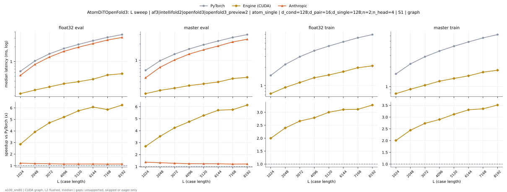
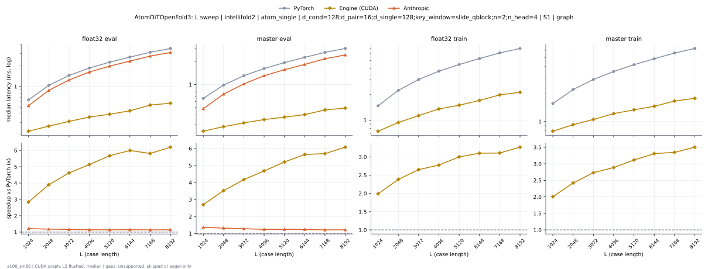

# AtomDiTOpenFold3 on a100_sm80

Generated by `python -m miniworld_engine.measure.plot` from speed tokens `judge/tokens/a100_sm80/`; do not edit.

### L sweep: af3|intellifold2|openfold3|openfold3_preview2 | atom_single | d_cond=128;d_pair=16;d_single=128;n=2;n_head=4 | S1 | graph

**float32 eval** (median ms; x = speedup vs PyTorch)

| L | PyTorch | Engine (Triton) | Engine (CUDA) | Anthropic |
|---|---|---|---|---|
| 1024 | 0.6339 | 0.5233 (1.21x) | 0.2222 (2.85x) | 0.5233 (1.21x) |
| 2048 | 1.031 | 0.8806 (1.17x) | 0.2632 (3.92x) | 0.8745 (1.18x) |
| 3072 | 1.438 | 1.248 (1.15x) | 0.3052 (4.71x) | 1.236 (1.16x) |
| 4096 | 1.845 | 1.624 (1.14x) | 0.3543 (5.21x) | 1.615 (1.14x) |
| 5120 | 2.237 | 1.976 (1.13x) | 0.3891 (5.75x) | 1.961 (1.14x) |
| 6144 | 2.657 | 2.342 (1.13x) | 0.4372 (6.08x) | 2.322 (1.14x) |
| 7168 | 3.118 | 2.754 (1.13x) | 0.5325 (5.86x) | 2.749 (1.13x) |
| 8192 | 3.539 | 3.116 (1.14x) | 0.5663 (6.25x) | 3.097 (1.14x) |

**master eval** (median ms; x = speedup vs PyTorch)

| L | PyTorch | Engine (Triton) | Engine (CUDA) | Anthropic |
|---|---|---|---|---|
| 1024 | 0.6513 | 0.5304 (1.23x) | 0.2417 (2.69x) | 0.4751 (1.37x) |
| 2048 | 0.98 | 0.811 (1.21x) | 0.2775 (3.53x) | 0.7414 (1.32x) |
| 3072 | 1.296 | 1.091 (1.19x) | 0.3057 (4.24x) | 1.012 (1.28x) |
| 4096 | 1.615 | 1.361 (1.19x) | 0.34 (4.75x) | 1.298 (1.24x) |
| 5120 | 1.932 | 1.632 (1.18x) | 0.3666 (5.27x) | 1.56 (1.24x) |
| 6144 | 2.266 | 1.907 (1.19x) | 0.3968 (5.71x) | 1.831 (1.24x) |
| 7168 | 2.635 | 2.223 (1.19x) | 0.4577 (5.76x) | 2.175 (1.21x) |
| 8192 | 2.972 | 2.511 (1.18x) | 0.4838 (6.14x) | 2.437 (1.22x) |

**float32 train** (median ms; x = speedup vs PyTorch)

| L | PyTorch | Engine (Triton) | Engine (CUDA) | Anthropic |
|---|---|---|---|---|
| 1024 | 1.468 | 1.214 (1.21x) | 0.7352 (2.00x) | unsupported |
| 2048 | 2.23 | 1.896 (1.18x) | 0.9308 (2.40x) | unsupported |
| 3072 | 2.986 | 2.586 (1.15x) | 1.122 (2.66x) | unsupported |
| 4096 | 3.753 | 3.305 (1.14x) | 1.346 (2.79x) | unsupported |
| 5120 | 4.487 | 3.962 (1.13x) | 1.494 (3.00x) | unsupported |
| 6144 | 5.266 | 4.653 (1.13x) | 1.696 (3.11x) | unsupported |
| 7168 | 6.141 | 5.441 (1.13x) | 1.97 (3.12x) | unsupported |
| 8192 | 6.929 | 6.113 (1.13x) | 2.112 (3.28x) | unsupported |

**master train** (median ms; x = speedup vs PyTorch)

| L | PyTorch | Engine (Triton) | Engine (CUDA) | Anthropic |
|---|---|---|---|---|
| 1024 | 1.568 | 1.305 (1.20x) | 0.7813 (2.01x) | unsupported |
| 2048 | 2.231 | 1.882 (1.19x) | 0.9134 (2.44x) | unsupported |
| 3072 | 2.873 | 2.466 (1.17x) | 1.051 (2.73x) | unsupported |
| 4096 | 3.516 | 3.046 (1.15x) | 1.212 (2.90x) | unsupported |
| 5120 | 4.171 | 3.619 (1.15x) | 1.336 (3.12x) | unsupported |
| 6144 | 4.849 | 4.199 (1.15x) | 1.464 (3.31x) | unsupported |
| 7168 | 5.594 | 4.865 (1.15x) | 1.667 (3.36x) | unsupported |
| 8192 | 6.281 | 5.417 (1.16x) | 1.787 (3.52x) | unsupported |

### L sweep: intellifold2 | atom_single | d_cond=128;d_pair=16;d_single=128;key_window=slide_qblock;n=2;n_head=4 | S1 | graph

**float32 eval** (median ms; x = speedup vs PyTorch)

| L | PyTorch | Engine (Triton) | Engine (CUDA) | Anthropic |
|---|---|---|---|---|
| 1024 | 0.639 | 0.5284 (1.21x) | 0.2253 (2.84x) | 0.5263 (1.21x) |
| 2048 | 1.037 | 0.8868 (1.17x) | 0.2662 (3.90x) | 0.8786 (1.18x) |
| 3072 | 1.443 | 1.253 (1.15x) | 0.3123 (4.62x) | 1.24 (1.16x) |
| 4096 | 1.849 | 1.628 (1.14x) | 0.3604 (5.13x) | 1.617 (1.14x) |
| 5120 | 2.247 | 1.982 (1.13x) | 0.3963 (5.67x) | 1.97 (1.14x) |
| 6144 | 2.662 | 2.35 (1.13x) | 0.4444 (5.99x) | 2.326 (1.14x) |
| 7168 | 3.123 | 2.759 (1.13x) | 0.5376 (5.81x) | 2.751 (1.14x) |
| 8192 | 3.546 | 3.123 (1.14x) | 0.5724 (6.19x) | 3.103 (1.14x) |

**master eval** (median ms; x = speedup vs PyTorch)

| L | PyTorch | Engine (Triton) | Engine (CUDA) | Anthropic |
|---|---|---|---|---|
| 1024 | 0.6564 | 0.5386 (1.22x) | 0.2437 (2.69x) | 0.4813 (1.36x) |
| 2048 | 0.9841 | 0.8151 (1.21x) | 0.2796 (3.52x) | 0.7475 (1.32x) |
| 3072 | 1.306 | 1.099 (1.19x) | 0.3133 (4.17x) | 1.019 (1.28x) |
| 4096 | 1.62 | 1.368 (1.18x) | 0.3461 (4.68x) | 1.305 (1.24x) |
| 5120 | 1.94 | 1.639 (1.18x) | 0.3727 (5.21x) | 1.564 (1.24x) |
| 6144 | 2.272 | 1.913 (1.19x) | 0.4024 (5.65x) | 1.836 (1.24x) |
| 7168 | 2.64 | 2.228 (1.18x) | 0.4634 (5.70x) | 2.179 (1.21x) |
| 8192 | 2.975 | 2.516 (1.18x) | 0.4895 (6.08x) | 2.445 (1.22x) |

**float32 train** (median ms; x = speedup vs PyTorch)

| L | PyTorch | Engine (Triton) | Engine (CUDA) | Anthropic |
|---|---|---|---|---|
| 1024 | 1.474 | 1.22 (1.21x) | 0.7414 (1.99x) | unsupported |
| 2048 | 2.234 | 1.902 (1.17x) | 0.937 (2.38x) | unsupported |
| 3072 | 2.995 | 2.592 (1.16x) | 1.129 (2.65x) | unsupported |
| 4096 | 3.754 | 3.308 (1.13x) | 1.352 (2.78x) | unsupported |
| 5120 | 4.491 | 3.971 (1.13x) | 1.496 (3.00x) | unsupported |
| 6144 | 5.276 | 4.656 (1.13x) | 1.701 (3.10x) | unsupported |
| 7168 | 6.148 | 5.436 (1.13x) | 1.978 (3.11x) | unsupported |
| 8192 | 6.929 | 6.124 (1.13x) | 2.121 (3.27x) | unsupported |

**master train** (median ms; x = speedup vs PyTorch)

| L | PyTorch | Engine (Triton) | Engine (CUDA) | Anthropic |
|---|---|---|---|---|
| 1024 | 1.572 | 1.311 (1.20x) | 0.7844 (2.00x) | unsupported |
| 2048 | 2.235 | 1.888 (1.18x) | 0.9236 (2.42x) | unsupported |
| 3072 | 2.879 | 2.471 (1.17x) | 1.054 (2.73x) | unsupported |
| 4096 | 3.524 | 3.05 (1.16x) | 1.221 (2.89x) | unsupported |
| 5120 | 4.178 | 3.625 (1.15x) | 1.341 (3.11x) | unsupported |
| 6144 | 4.856 | 4.2 (1.16x) | 1.467 (3.31x) | unsupported |
| 7168 | 5.603 | 4.868 (1.15x) | 1.674 (3.35x) | unsupported |
| 8192 | 6.286 | 5.423 (1.16x) | 1.794 (3.50x) | unsupported |

