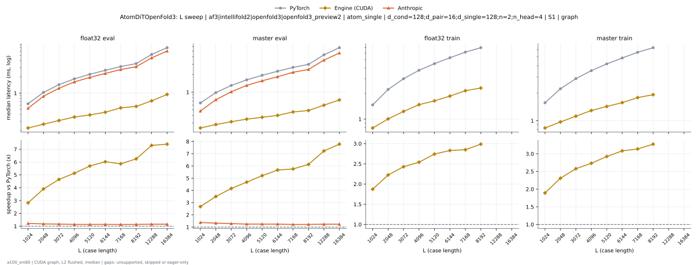
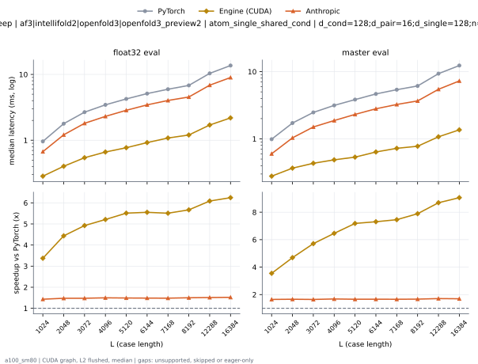
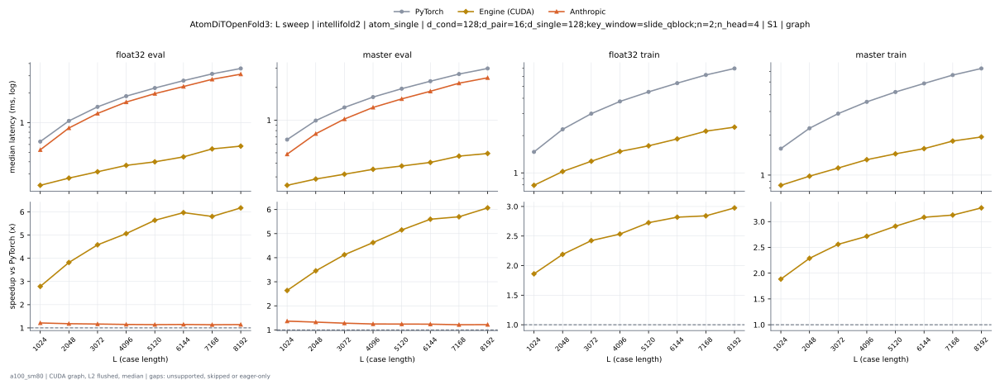
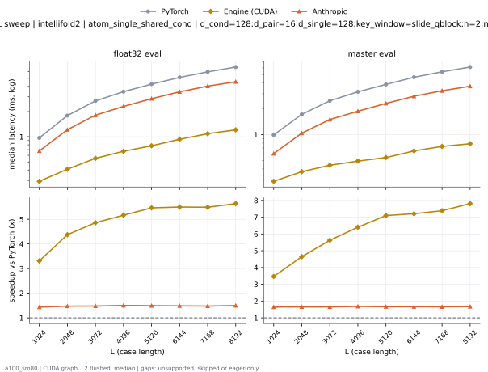

# AtomDiTOpenFold3 on a100_sm80

Generated by `python -m foldjet_engine.measure.plot` from speed tokens `judge/tokens/a100_sm80/`; do not edit.

### L sweep: af3|intellifold2|openfold3|openfold3_preview2 | atom_single | d_cond=128;d_pair=16;d_single=128;n=2;n_head=4 | S1 | graph

**float32 eval** (median ms; x = speedup vs PyTorch)

| L | PyTorch | Engine (Triton) | Engine (CUDA) | Anthropic |
|---|---|---|---|---|
| 1024 | 0.6359 | 0.5222 (1.22x) | 0.2253 (2.82x) | 0.5243 (1.21x) |
| 2048 | 1.035 | 0.8806 (1.18x) | 0.2652 (3.90x) | 0.8765 (1.18x) |
| 3072 | 1.441 | 1.246 (1.16x) | 0.3103 (4.65x) | 1.237 (1.17x) |
| 4096 | 1.849 | 1.62 (1.14x) | 0.3604 (5.13x) | 1.619 (1.14x) |
| 5120 | 2.246 | 1.976 (1.14x) | 0.3942 (5.70x) | 1.968 (1.14x) |
| 6144 | 2.666 | 2.343 (1.14x) | 0.4424 (6.03x) | 2.328 (1.15x) |
| 7168 | 3.129 | 2.749 (1.14x) | 0.5335 (5.87x) | 2.753 (1.14x) |
| 8192 | 3.552 | 3.116 (1.14x) | 0.5683 (6.25x) | 3.108 (1.14x) |
| 12288 | 5.255 | 4.582 (1.15x) | 0.7199 (7.30x) | 4.539 (1.16x) |
| 16384 | 7.013 | 6.147 (1.14x) | 0.9482 (7.40x) | 6.069 (1.16x) |

**master eval** (median ms; x = speedup vs PyTorch)

| L | PyTorch | Engine (Triton) | Engine (CUDA) | Anthropic |
|---|---|---|---|---|
| 1024 | 0.6543 | 0.5294 (1.24x) | 0.2447 (2.67x) | 0.4762 (1.37x) |
| 2048 | 0.982 | 0.809 (1.21x) | 0.2806 (3.50x) | 0.7434 (1.32x) |
| 3072 | 1.303 | 1.09 (1.20x) | 0.3133 (4.16x) | 1.016 (1.28x) |
| 4096 | 1.621 | 1.361 (1.19x) | 0.3466 (4.68x) | 1.304 (1.24x) |
| 5120 | 1.94 | 1.632 (1.19x) | 0.3727 (5.21x) | 1.564 (1.24x) |
| 6144 | 2.274 | 1.903 (1.20x) | 0.4014 (5.67x) | 1.835 (1.24x) |
| 7168 | 2.646 | 2.22 (1.19x) | 0.4598 (5.76x) | 2.183 (1.21x) |
| 8192 | 2.981 | 2.507 (1.19x) | 0.4864 (6.13x) | 2.444 (1.22x) |
| 12288 | 4.337 | 3.602 (1.20x) | 0.6001 (7.23x) | 3.519 (1.23x) |
| 16384 | 5.738 | 4.753 (1.21x) | 0.7373 (7.78x) | 4.66 (1.23x) |

**float32 train** (median ms; x = speedup vs PyTorch)

| L | PyTorch | Engine (Triton) | Engine (CUDA) | Anthropic |
|---|---|---|---|---|
| 1024 | 1.473 | 1.214 (1.21x) | 0.7864 (1.87x) | unsupported |
| 2048 | 2.238 | 1.892 (1.18x) | 1.007 (2.22x) | unsupported |
| 3072 | 2.997 | 2.58 (1.16x) | 1.234 (2.43x) | unsupported |
| 4096 | 3.765 | 3.298 (1.14x) | 1.482 (2.54x) | unsupported |
| 5120 | 4.505 | 3.956 (1.14x) | 1.642 (2.74x) | unsupported |
| 6144 | 5.29 | 4.647 (1.14x) | 1.869 (2.83x) | unsupported |
| 7168 | 6.161 | 5.425 (1.14x) | 2.163 (2.85x) | unsupported |
| 8192 | 6.95 | 6.111 (1.14x) | 2.327 (2.99x) | unsupported |
| 12288 |  |  |  |  |
| 16384 |  |  |  |  |

**master train** (median ms; x = speedup vs PyTorch)

| L | PyTorch | Engine (Triton) | Engine (CUDA) | Anthropic |
|---|---|---|---|---|
| 1024 | 1.573 | 1.298 (1.21x) | 0.8315 (1.89x) | unsupported |
| 2048 | 2.236 | 1.879 (1.19x) | 0.9687 (2.31x) | unsupported |
| 3072 | 2.888 | 2.466 (1.17x) | 1.12 (2.58x) | unsupported |
| 4096 | 3.53 | 3.037 (1.16x) | 1.292 (2.73x) | unsupported |
| 5120 | 4.185 | 3.614 (1.16x) | 1.432 (2.92x) | unsupported |
| 6144 | 4.86 | 4.19 (1.16x) | 1.577 (3.08x) | unsupported |
| 7168 | 5.613 | 4.858 (1.16x) | 1.79 (3.14x) | unsupported |
| 8192 | 6.3 | 5.411 (1.16x) | 1.925 (3.27x) | unsupported |
| 12288 |  |  |  |  |
| 16384 |  |  |  |  |

### L sweep: af3|intellifold2|openfold3|openfold3_preview2 | atom_single_shared_cond | d_cond=128;d_pair=16;d_single=128;n=2;n_head=4 | S5 | graph

**float32 eval** (median ms; x = speedup vs PyTorch)

| L | PyTorch | Engine (Triton) | Engine (CUDA) | Anthropic |
|---|---|---|---|---|
| 1024 | 0.96 | 0.7014 (1.37x) | 0.2847 (3.37x) | 0.6707 (1.43x) |
| 2048 | 1.785 | 1.26 (1.42x) | 0.4024 (4.44x) | 1.209 (1.48x) |
| 3072 | 2.672 | 1.889 (1.41x) | 0.5427 (4.92x) | 1.808 (1.48x) |
| 4096 | 3.452 | 2.437 (1.42x) | 0.6625 (5.21x) | 2.305 (1.50x) |
| 5120 | 4.244 | 2.998 (1.42x) | 0.77 (5.51x) | 2.851 (1.49x) |
| 6144 | 5.116 | 3.626 (1.41x) | 0.9216 (5.55x) | 3.448 (1.48x) |
| 7168 | 5.956 | 4.239 (1.40x) | 1.081 (5.51x) | 4.021 (1.48x) |
| 8192 | 6.811 | 4.852 (1.40x) | 1.202 (5.67x) | 4.539 (1.50x) |
| 12288 | 10.37 | 7.394 (1.40x) | 1.704 (6.09x) | 6.862 (1.51x) |
| 16384 | 13.65 | 9.839 (1.39x) | 2.186 (6.25x) | 8.978 (1.52x) |

**master eval** (median ms; x = speedup vs PyTorch)

| L | PyTorch | Engine (Triton) | Engine (CUDA) | Anthropic |
|---|---|---|---|---|
| 1024 | 0.9882 | 0.6943 (1.42x) | 0.2785 (3.55x) | 0.6001 (1.65x) |
| 2048 | 1.719 | 1.161 (1.48x) | 0.3666 (4.69x) | 1.035 (1.66x) |
| 3072 | 2.474 | 1.648 (1.50x) | 0.4332 (5.71x) | 1.503 (1.65x) |
| 4096 | 3.149 | 2.061 (1.53x) | 0.4874 (6.46x) | 1.873 (1.68x) |
| 5120 | 3.839 | 2.507 (1.53x) | 0.5345 (7.18x) | 2.312 (1.66x) |
| 6144 | 4.66 | 3.067 (1.52x) | 0.638 (7.30x) | 2.803 (1.66x) |
| 7168 | 5.389 | 3.553 (1.52x) | 0.7229 (7.45x) | 3.248 (1.66x) |
| 8192 | 6.125 | 4.009 (1.53x) | 0.7762 (7.89x) | 3.669 (1.67x) |
| 12288 | 9.333 | 6.033 (1.55x) | 1.074 (8.69x) | 5.462 (1.71x) |
| 16384 | 12.34 | 7.99 (1.54x) | 1.362 (9.06x) | 7.277 (1.70x) |

### L sweep: intellifold2 | atom_single | d_cond=128;d_pair=16;d_single=128;key_window=slide_qblock;n=2;n_head=4 | S1 | graph

**float32 eval** (median ms; x = speedup vs PyTorch)

| L | PyTorch | Engine (Triton) | Engine (CUDA) | Anthropic |
|---|---|---|---|---|
| 1024 | 0.642 | 0.5284 (1.22x) | 0.2304 (2.79x) | 0.5294 (1.21x) |
| 2048 | 1.042 | 0.8858 (1.18x) | 0.2729 (3.82x) | 0.8827 (1.18x) |
| 3072 | 1.449 | 1.252 (1.16x) | 0.3164 (4.58x) | 1.242 (1.17x) |
| 4096 | 1.862 | 1.623 (1.15x) | 0.3676 (5.06x) | 1.621 (1.15x) |
| 5120 | 2.252 | 1.985 (1.13x) | 0.3994 (5.64x) | 1.975 (1.14x) |
| 6144 | 2.677 | 2.344 (1.14x) | 0.4485 (5.97x) | 2.333 (1.15x) |
| 7168 | 3.138 | 2.754 (1.14x) | 0.5407 (5.80x) | 2.762 (1.14x) |
| 8192 | 3.561 | 3.121 (1.14x) | 0.577 (6.17x) | 3.116 (1.14x) |

**master eval** (median ms; x = speedup vs PyTorch)

| L | PyTorch | Engine (Triton) | Engine (CUDA) | Anthropic |
|---|---|---|---|---|
| 1024 | 0.6615 | 0.5366 (1.23x) | 0.2509 (2.64x) | 0.4854 (1.36x) |
| 2048 | 0.9902 | 0.8172 (1.21x) | 0.2867 (3.45x) | 0.7485 (1.32x) |
| 3072 | 1.309 | 1.096 (1.19x) | 0.3174 (4.12x) | 1.023 (1.28x) |
| 4096 | 1.63 | 1.366 (1.19x) | 0.3523 (4.63x) | 1.309 (1.25x) |
| 5120 | 1.947 | 1.637 (1.19x) | 0.3779 (5.15x) | 1.568 (1.24x) |
| 6144 | 2.281 | 1.916 (1.19x) | 0.4076 (5.60x) | 1.843 (1.24x) |
| 7168 | 2.655 | 2.225 (1.19x) | 0.4659 (5.70x) | 2.187 (1.21x) |
| 8192 | 2.989 | 2.514 (1.19x) | 0.4925 (6.07x) | 2.454 (1.22x) |

**float32 train** (median ms; x = speedup vs PyTorch)

| L | PyTorch | Engine (Triton) | Engine (CUDA) | Anthropic |
|---|---|---|---|---|
| 1024 | 1.477 | 1.218 (1.21x) | 0.7936 (1.86x) | unsupported |
| 2048 | 2.247 | 1.897 (1.18x) | 1.026 (2.19x) | unsupported |
| 3072 | 3.006 | 2.591 (1.16x) | 1.241 (2.42x) | unsupported |
| 4096 | 3.772 | 3.301 (1.14x) | 1.489 (2.53x) | unsupported |
| 5120 | 4.506 | 3.961 (1.14x) | 1.653 (2.73x) | unsupported |
| 6144 | 5.3 | 4.656 (1.14x) | 1.88 (2.82x) | unsupported |
| 7168 | 6.171 | 5.43 (1.14x) | 2.172 (2.84x) | unsupported |
| 8192 | 6.963 | 6.117 (1.14x) | 2.34 (2.98x) | unsupported |

**master train** (median ms; x = speedup vs PyTorch)

| L | PyTorch | Engine (Triton) | Engine (CUDA) | Anthropic |
|---|---|---|---|---|
| 1024 | 1.579 | 1.305 (1.21x) | 0.8376 (1.89x) | unsupported |
| 2048 | 2.245 | 1.886 (1.19x) | 0.981 (2.29x) | unsupported |
| 3072 | 2.891 | 2.47 (1.17x) | 1.129 (2.56x) | unsupported |
| 4096 | 3.543 | 3.049 (1.16x) | 1.305 (2.72x) | unsupported |
| 5120 | 4.199 | 3.619 (1.16x) | 1.443 (2.91x) | unsupported |
| 6144 | 4.87 | 4.193 (1.16x) | 1.579 (3.08x) | unsupported |
| 7168 | 5.629 | 4.867 (1.16x) | 1.8 (3.13x) | unsupported |
| 8192 | 6.308 | 5.411 (1.17x) | 1.931 (3.27x) | unsupported |

### L sweep: intellifold2 | atom_single_shared_cond | d_cond=128;d_pair=16;d_single=128;key_window=slide_qblock;n=2;n_head=4 | S5 | graph

**float32 eval** (median ms; x = speedup vs PyTorch)

| L | PyTorch | Engine (Triton) | Engine (CUDA) | Anthropic |
|---|---|---|---|---|
| 1024 | 0.9697 | 0.7066 (1.37x) | 0.2929 (3.31x) | 0.6758 (1.43x) |
| 2048 | 1.792 | 1.266 (1.42x) | 0.4096 (4.38x) | 1.214 (1.48x) |
| 3072 | 2.682 | 1.895 (1.42x) | 0.5519 (4.86x) | 1.812 (1.48x) |
| 4096 | 3.464 | 2.443 (1.42x) | 0.6707 (5.16x) | 2.306 (1.50x) |
| 5120 | 4.26 | 3.002 (1.42x) | 0.7798 (5.46x) | 2.853 (1.49x) |
| 6144 | 5.126 | 3.627 (1.41x) | 0.9329 (5.50x) | 3.447 (1.49x) |
| 7168 | 5.967 | 4.246 (1.41x) | 1.087 (5.49x) | 4.033 (1.48x) |
| 8192 | 6.822 | 4.854 (1.41x) | 1.21 (5.64x) | 4.552 (1.50x) |

**master eval** (median ms; x = speedup vs PyTorch)

| L | PyTorch | Engine (Triton) | Engine (CUDA) | Anthropic |
|---|---|---|---|---|
| 1024 | 0.9943 | 0.7014 (1.42x) | 0.2867 (3.47x) | 0.6042 (1.65x) |
| 2048 | 1.727 | 1.167 (1.48x) | 0.3717 (4.65x) | 1.043 (1.66x) |
| 3072 | 2.483 | 1.654 (1.50x) | 0.4413 (5.63x) | 1.503 (1.65x) |
| 4096 | 3.16 | 2.068 (1.53x) | 0.4936 (6.40x) | 1.879 (1.68x) |
| 5120 | 3.851 | 2.504 (1.54x) | 0.5427 (7.10x) | 2.315 (1.66x) |
| 6144 | 4.67 | 3.071 (1.52x) | 0.6482 (7.21x) | 2.807 (1.66x) |
| 7168 | 5.399 | 3.558 (1.52x) | 0.7311 (7.38x) | 3.252 (1.66x) |
| 8192 | 6.135 | 4.015 (1.53x) | 0.7854 (7.81x) | 3.668 (1.67x) |

### Single-length cases (no sweep)

- af3|openfold3|openfold3_preview2 | atom_single | d_cond=128;d_pair=16;d_single=128;mask_form=af3;n=2;n_head=4 | S1 | graph L128 float32 eval anthropic: 0.2284 ms
- af3|openfold3|openfold3_preview2 | atom_single | d_cond=128;d_pair=16;d_single=128;mask_form=af3;n=2;n_head=4 | S1 | graph L128 float32 eval cuda: 0.2048 ms
- af3|openfold3|openfold3_preview2 | atom_single | d_cond=128;d_pair=16;d_single=128;mask_form=af3;n=2;n_head=4 | S1 | graph L128 float32 eval pytorch: 0.3082 ms
- af3|openfold3|openfold3_preview2 | atom_single | d_cond=128;d_pair=16;d_single=128;mask_form=af3;n=2;n_head=4 | S1 | graph L128 float32 eval triton: 0.2202 ms
- af3|openfold3|openfold3_preview2 | atom_single | d_cond=128;d_pair=16;d_single=128;mask_form=af3;n=2;n_head=4 | S1 | graph L128 float32 train anthropic: unsupported
- af3|openfold3|openfold3_preview2 | atom_single | d_cond=128;d_pair=16;d_single=128;mask_form=af3;n=2;n_head=4 | S1 | graph L128 float32 train cuda: 0.6134 ms
- af3|openfold3|openfold3_preview2 | atom_single | d_cond=128;d_pair=16;d_single=128;mask_form=af3;n=2;n_head=4 | S1 | graph L128 float32 train pytorch: 0.7905 ms
- af3|openfold3|openfold3_preview2 | atom_single | d_cond=128;d_pair=16;d_single=128;mask_form=af3;n=2;n_head=4 | S1 | graph L128 float32 train triton: 0.6461 ms
- af3|openfold3|openfold3_preview2 | atom_single | d_cond=128;d_pair=16;d_single=128;mask_form=af3;n=2;n_head=4 | S1 | graph L128 master eval anthropic: 0.2529 ms
- af3|openfold3|openfold3_preview2 | atom_single | d_cond=128;d_pair=16;d_single=128;mask_form=af3;n=2;n_head=4 | S1 | graph L128 master eval cuda: 0.2181 ms
- af3|openfold3|openfold3_preview2 | atom_single | d_cond=128;d_pair=16;d_single=128;mask_form=af3;n=2;n_head=4 | S1 | graph L128 master eval pytorch: 0.3881 ms
- af3|openfold3|openfold3_preview2 | atom_single | d_cond=128;d_pair=16;d_single=128;mask_form=af3;n=2;n_head=4 | S1 | graph L128 master eval triton: 0.2918 ms
- af3|openfold3|openfold3_preview2 | atom_single | d_cond=128;d_pair=16;d_single=128;mask_form=af3;n=2;n_head=4 | S1 | graph L128 master train anthropic: unsupported
- af3|openfold3|openfold3_preview2 | atom_single | d_cond=128;d_pair=16;d_single=128;mask_form=af3;n=2;n_head=4 | S1 | graph L128 master train cuda: 0.6502 ms
- af3|openfold3|openfold3_preview2 | atom_single | d_cond=128;d_pair=16;d_single=128;mask_form=af3;n=2;n_head=4 | S1 | graph L128 master train pytorch: 0.9544 ms
- af3|openfold3|openfold3_preview2 | atom_single | d_cond=128;d_pair=16;d_single=128;mask_form=af3;n=2;n_head=4 | S1 | graph L128 master train triton: 0.7936 ms
- af3|openfold3|openfold3_preview2 | atom_single_shared_cond | d_cond=128;d_pair=16;d_single=128;mask_form=af3;n=2;n_head=4 | S5 | graph L128 float32 eval anthropic: 0.2478 ms
- af3|openfold3|openfold3_preview2 | atom_single_shared_cond | d_cond=128;d_pair=16;d_single=128;mask_form=af3;n=2;n_head=4 | S5 | graph L128 float32 eval cuda: 0.2099 ms
- af3|openfold3|openfold3_preview2 | atom_single_shared_cond | d_cond=128;d_pair=16;d_single=128;mask_form=af3;n=2;n_head=4 | S5 | graph L128 float32 eval pytorch: 0.3492 ms
- af3|openfold3|openfold3_preview2 | atom_single_shared_cond | d_cond=128;d_pair=16;d_single=128;mask_form=af3;n=2;n_head=4 | S5 | graph L128 float32 eval triton: 0.2437 ms
- af3|openfold3|openfold3_preview2 | atom_single_shared_cond | d_cond=128;d_pair=16;d_single=128;mask_form=af3;n=2;n_head=4 | S5 | graph L128 master eval anthropic: 0.2662 ms
- af3|openfold3|openfold3_preview2 | atom_single_shared_cond | d_cond=128;d_pair=16;d_single=128;mask_form=af3;n=2;n_head=4 | S5 | graph L128 master eval cuda: 0.2253 ms
- af3|openfold3|openfold3_preview2 | atom_single_shared_cond | d_cond=128;d_pair=16;d_single=128;mask_form=af3;n=2;n_head=4 | S5 | graph L128 master eval pytorch: 0.4332 ms
- af3|openfold3|openfold3_preview2 | atom_single_shared_cond | d_cond=128;d_pair=16;d_single=128;mask_form=af3;n=2;n_head=4 | S5 | graph L128 master eval triton: 0.3236 ms
