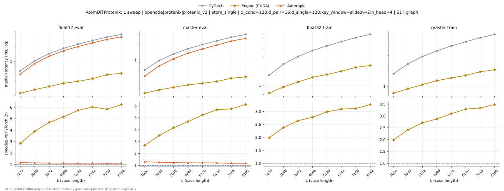
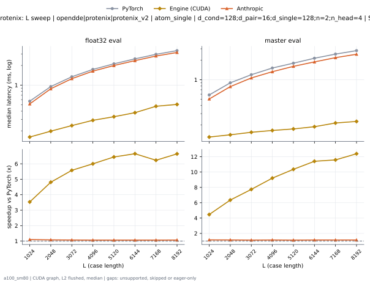
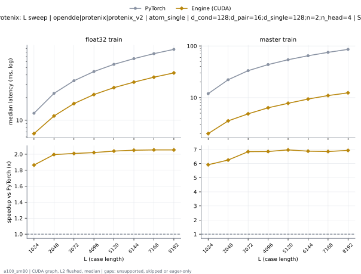

# AtomDiTProtenix on a100_sm80

Generated by `python -m miniworld_engine.measure.plot` from speed tokens `judge/tokens/a100_sm80/`; do not edit.

### L sweep: opendde|protenix|protenix_v2 | atom_single | d_cond=128;d_pair=16;d_single=128;key_window=slide;n=2;n_head=4 | S1 | graph

**float32 eval** (median ms; x = speedup vs PyTorch)

| L | PyTorch | Engine (Triton) | Engine (CUDA) | Anthropic |
|---|---|---|---|---|
| 1024 | 0.638 | 0.5243 (1.22x) | 0.2243 (2.84x) | 0.5478 (1.16x) |
| 2048 | 1.031 | 0.8817 (1.17x) | 0.2642 (3.90x) | 0.9052 (1.14x) |
| 3072 | 1.438 | 1.253 (1.15x) | 0.3072 (4.68x) | 1.276 (1.13x) |
| 4096 | 1.846 | 1.625 (1.14x) | 0.3574 (5.17x) | 1.649 (1.12x) |
| 5120 | 2.242 | 1.983 (1.13x) | 0.3912 (5.73x) | 2.007 (1.12x) |
| 6144 | 2.663 | 2.35 (1.13x) | 0.4424 (6.02x) | 2.377 (1.12x) |
| 7168 | 3.114 | 2.751 (1.13x) | 0.5345 (5.83x) | 2.805 (1.11x) |
| 8192 | 3.548 | 3.122 (1.14x) | 0.5683 (6.24x) | 3.174 (1.12x) |

**master eval** (median ms; x = speedup vs PyTorch)

| L | PyTorch | Engine (Triton) | Engine (CUDA) | Anthropic |
|---|---|---|---|---|
| 1024 | 0.6482 | 0.5284 (1.23x) | 0.2417 (2.68x) | 0.5002 (1.30x) |
| 2048 | 0.9738 | 0.8079 (1.21x) | 0.2775 (3.51x) | 0.7721 (1.26x) |
| 3072 | 1.292 | 1.089 (1.19x) | 0.3103 (4.17x) | 1.052 (1.23x) |
| 4096 | 1.612 | 1.36 (1.19x) | 0.3441 (4.68x) | 1.333 (1.21x) |
| 5120 | 1.931 | 1.63 (1.18x) | 0.3686 (5.24x) | 1.601 (1.21x) |
| 6144 | 2.264 | 1.906 (1.19x) | 0.3983 (5.68x) | 1.884 (1.20x) |
| 7168 | 2.634 | 2.224 (1.18x) | 0.4577 (5.75x) | 2.234 (1.18x) |
| 8192 | 2.971 | 2.51 (1.18x) | 0.4854 (6.12x) | 2.511 (1.18x) |

**float32 train** (median ms; x = speedup vs PyTorch)

| L | PyTorch | Engine (Triton) | Engine (CUDA) | Anthropic |
|---|---|---|---|---|
| 1024 | 1.467 | 1.217 (1.21x) | 0.7383 (1.99x) | unsupported |
| 2048 | 2.228 | 1.894 (1.18x) | 0.9359 (2.38x) | unsupported |
| 3072 | 2.986 | 2.586 (1.15x) | 1.13 (2.64x) | unsupported |
| 4096 | 3.746 | 3.305 (1.13x) | 1.35 (2.78x) | unsupported |
| 5120 | 4.487 | 3.962 (1.13x) | 1.503 (2.99x) | unsupported |
| 6144 | 5.276 | 4.654 (1.13x) | 1.706 (3.09x) | unsupported |
| 7168 | 6.138 | 5.445 (1.13x) | 1.973 (3.11x) | unsupported |
| 8192 | 6.931 | 6.11 (1.13x) | 2.121 (3.27x) | unsupported |

**master train** (median ms; x = speedup vs PyTorch)

| L | PyTorch | Engine (Triton) | Engine (CUDA) | Anthropic |
|---|---|---|---|---|
| 1024 | 1.562 | 1.296 (1.20x) | 0.7864 (1.99x) | unsupported |
| 2048 | 2.222 | 1.884 (1.18x) | 0.9206 (2.41x) | unsupported |
| 3072 | 2.872 | 2.461 (1.17x) | 1.06 (2.71x) | unsupported |
| 4096 | 3.513 | 3.041 (1.16x) | 1.223 (2.87x) | unsupported |
| 5120 | 4.167 | 3.618 (1.15x) | 1.346 (3.10x) | unsupported |
| 6144 | 4.847 | 4.198 (1.15x) | 1.474 (3.29x) | unsupported |
| 7168 | 5.594 | 4.862 (1.15x) | 1.676 (3.34x) | unsupported |
| 8192 | 6.277 | 5.407 (1.16x) | 1.801 (3.48x) | unsupported |

### L sweep: opendde|protenix|protenix_v2 | atom_single | d_cond=128;d_pair=16;d_single=128;n=2;n_head=4 | S1 | graph

**float32 eval** (median ms; x = speedup vs PyTorch)

| L | PyTorch | Engine (Triton) | Engine (CUDA) | Anthropic |
|---|---|---|---|---|
| 1024 | 0.5678 | 0.5079 (1.12x) | 0.1608 (3.53x) | 0.5161 (1.10x) |
| 2048 | 0.9503 | 0.8663 (1.10x) | 0.1976 (4.81x) | 0.8796 (1.08x) |
| 3072 | 1.342 | 1.236 (1.09x) | 0.2406 (5.58x) | 1.254 (1.07x) |
| 4096 | 1.739 | 1.612 (1.08x) | 0.2898 (6.00x) | 1.635 (1.06x) |
| 5120 | 2.118 | 1.968 (1.08x) | 0.3287 (6.44x) | 1.994 (1.06x) |
| 6144 | 2.52 | 2.331 (1.08x) | 0.3789 (6.65x) | 2.367 (1.06x) |
| 7168 | 2.959 | 2.739 (1.08x) | 0.4751 (6.23x) | 2.785 (1.06x) |
| 8192 | 3.367 | 3.108 (1.08x) | 0.5069 (6.64x) | 3.155 (1.07x) |

**master eval** (median ms; x = speedup vs PyTorch)

| L | PyTorch | Engine (Triton) | Engine (CUDA) | Anthropic |
|---|---|---|---|---|
| 1024 | 0.5827 | 0.514 (1.13x) | 0.1306 (4.46x) | 0.5048 (1.15x) |
| 2048 | 0.897 | 0.7926 (1.13x) | 0.1413 (6.35x) | 0.7834 (1.15x) |
| 3072 | 1.197 | 1.072 (1.12x) | 0.1546 (7.74x) | 1.067 (1.12x) |
| 4096 | 1.519 | 1.343 (1.13x) | 0.1649 (9.21x) | 1.332 (1.14x) |
| 5120 | 1.803 | 1.612 (1.12x) | 0.1741 (10.36x) | 1.611 (1.12x) |
| 6144 | 2.149 | 1.888 (1.14x) | 0.1884 (11.41x) | 1.888 (1.14x) |
| 7168 | 2.491 | 2.203 (1.13x) | 0.215 (11.59x) | 2.194 (1.14x) |
| 8192 | 2.817 | 2.492 (1.13x) | 0.2273 (12.39x) | 2.477 (1.14x) |

### L sweep: opendde|protenix|protenix_v2 | atom_single | d_cond=128;d_pair=16;d_single=128;n=2;n_head=4 | S48 | graph

**float32 train** (median ms; x = speedup vs PyTorch)

| L | PyTorch | Engine (Triton) | Engine (CUDA) | Anthropic |
|---|---|---|---|---|
| 1024 | 12.39 | 8.813 (1.41x) | 6.647 (1.86x) | unsupported |
| 2048 | 22.73 | 15.9 (1.43x) | 11.39 (2.00x) | unsupported |
| 3072 | 33.47 | 22.88 (1.46x) | 16.66 (2.01x) | unsupported |
| 4096 | 44.36 | 30.98 (1.43x) | 21.95 (2.02x) | unsupported |
| 5120 | 55.27 | 38.15 (1.45x) | 27.1 (2.04x) | unsupported |
| 6144 | 65.79 | 45.01 (1.46x) | 32.09 (2.05x) | unsupported |
| 7168 | 76.64 | 53.01 (1.45x) | 37.31 (2.05x) | unsupported |
| 8192 | 87.34 | 60.1 (1.45x) | 42.52 (2.05x) | unsupported |

**master train** (median ms; x = speedup vs PyTorch)

| L | PyTorch | Engine (Triton) | Engine (CUDA) | Anthropic |
|---|---|---|---|---|
| 1024 | 11.91 | 8.063 (1.48x) | 2.011 (5.92x) | unsupported |
| 2048 | 22.18 | 15.01 (1.48x) | 3.546 (6.25x) | unsupported |
| 3072 | 33.26 | 22.65 (1.47x) | 4.856 (6.85x) | unsupported |
| 4096 | 43.61 | 29.33 (1.49x) | 6.357 (6.86x) | unsupported |
| 5120 | 54.14 | 35.83 (1.51x) | 7.764 (6.97x) | unsupported |
| 6144 | 64.63 | 43.19 (1.50x) | 9.388 (6.88x) | unsupported |
| 7168 | 75.19 | 50.06 (1.50x) | 10.96 (6.86x) | unsupported |
| 8192 | 85.88 | 55.76 (1.54x) | 12.38 (6.94x) | unsupported |

