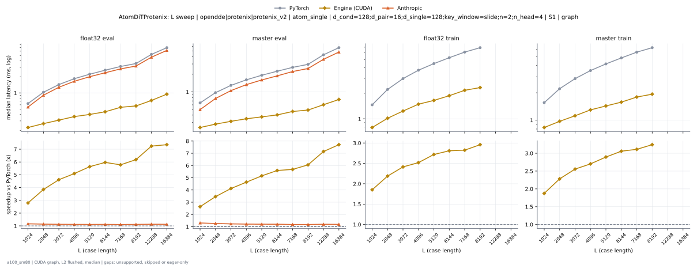
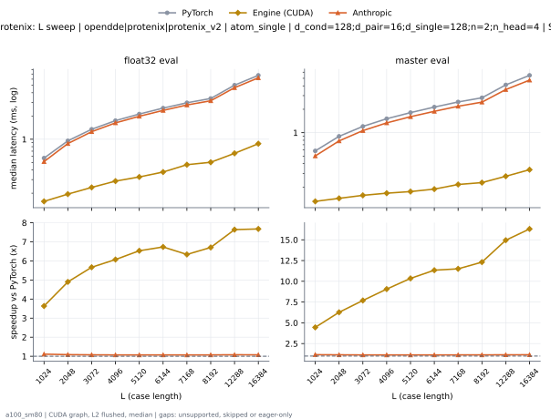
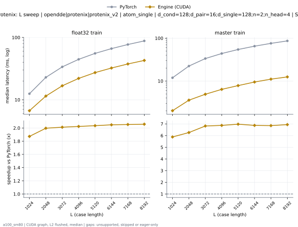
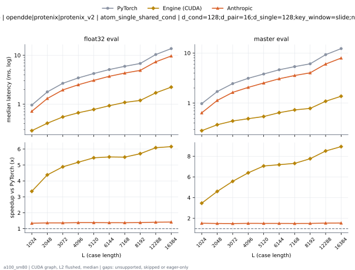
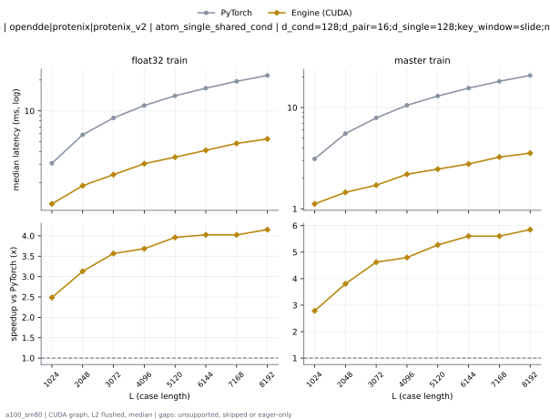
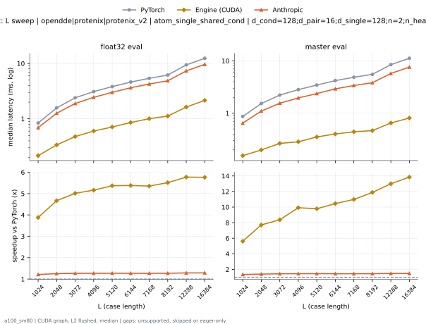
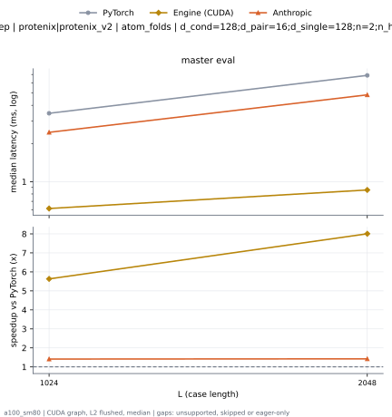
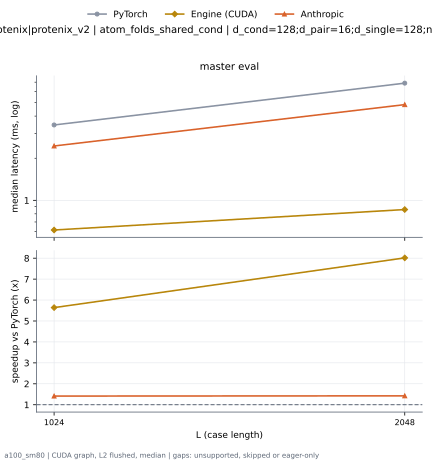

# AtomDiTProtenix on a100_sm80

Generated by `python -m miniworld_engine.measure.plot` from speed tokens `judge/tokens/a100_sm80/`; do not edit.

### L sweep: opendde|protenix|protenix_v2 | atom_single | d_cond=128;d_pair=16;d_single=128;key_window=slide;n=2;n_head=4 | S1 | graph

**float32 eval** (median ms; x = speedup vs PyTorch)

| L | PyTorch | Engine (Triton) | Engine (CUDA) | Anthropic |
|---|---|---|---|---|
| 1024 | 0.6328 | 0.5222 (1.21x) | 0.2263 (2.80x) | 0.5448 (1.16x) |
| 2048 | 1.028 | 0.8806 (1.17x) | 0.2673 (3.85x) | 0.9052 (1.14x) |
| 3072 | 1.432 | 1.247 (1.15x) | 0.3103 (4.61x) | 1.274 (1.12x) |
| 4096 | 1.841 | 1.621 (1.14x) | 0.3615 (5.09x) | 1.649 (1.12x) |
| 5120 | 2.233 | 1.977 (1.13x) | 0.3963 (5.64x) | 2.006 (1.11x) |
| 6144 | 2.652 | 2.341 (1.13x) | 0.4444 (5.97x) | 2.376 (1.12x) |
| 7168 | 3.112 | 2.75 (1.13x) | 0.5386 (5.78x) | 2.808 (1.11x) |
| 8192 | 3.535 | 3.117 (1.13x) | 0.5714 (6.19x) | 3.169 (1.12x) |
| 12288 | 5.232 | 4.58 (1.14x) | 0.7224 (7.24x) | 4.636 (1.13x) |
| 16384 | 6.983 | 6.147 (1.14x) | 0.9492 (7.36x) | 6.211 (1.12x) |

**master eval** (median ms; x = speedup vs PyTorch)

| L | PyTorch | Engine (Triton) | Engine (CUDA) | Anthropic |
|---|---|---|---|---|
| 1024 | 0.6472 | 0.5263 (1.23x) | 0.2458 (2.63x) | 0.4966 (1.30x) |
| 2048 | 0.9697 | 0.8059 (1.20x) | 0.2806 (3.46x) | 0.77 (1.26x) |
| 3072 | 1.29 | 1.085 (1.19x) | 0.3133 (4.12x) | 1.051 (1.23x) |
| 4096 | 1.607 | 1.357 (1.18x) | 0.3466 (4.64x) | 1.33 (1.21x) |
| 5120 | 1.924 | 1.627 (1.18x) | 0.3732 (5.16x) | 1.599 (1.20x) |
| 6144 | 2.256 | 1.898 (1.19x) | 0.4035 (5.59x) | 1.879 (1.20x) |
| 7168 | 2.623 | 2.214 (1.19x) | 0.4618 (5.68x) | 2.228 (1.18x) |
| 8192 | 2.957 | 2.502 (1.18x) | 0.4884 (6.05x) | 2.509 (1.18x) |
| 12288 | 4.308 | 3.596 (1.20x) | 0.6031 (7.14x) | 3.602 (1.20x) |
| 16384 | 5.703 | 4.749 (1.20x) | 0.7404 (7.70x) | 4.798 (1.19x) |

**float32 train** (median ms; x = speedup vs PyTorch)

| L | PyTorch | Engine (Triton) | Engine (CUDA) | Anthropic |
|---|---|---|---|---|
| 1024 | 1.461 | 1.215 (1.20x) | 0.7895 (1.85x) | unsupported |
| 2048 | 2.22 | 1.891 (1.17x) | 1.015 (2.19x) | unsupported |
| 3072 | 2.979 | 2.58 (1.15x) | 1.234 (2.41x) | unsupported |
| 4096 | 3.744 | 3.29 (1.14x) | 1.487 (2.52x) | unsupported |
| 5120 | 4.478 | 3.956 (1.13x) | 1.648 (2.72x) | unsupported |
| 6144 | 5.261 | 4.648 (1.13x) | 1.873 (2.81x) | unsupported |
| 7168 | 6.128 | 5.423 (1.13x) | 2.17 (2.82x) | unsupported |
| 8192 | 6.911 | 6.107 (1.13x) | 2.336 (2.96x) | unsupported |
| 12288 |  |  |  |  |
| 16384 |  |  |  |  |

**master train** (median ms; x = speedup vs PyTorch)

| L | PyTorch | Engine (Triton) | Engine (CUDA) | Anthropic |
|---|---|---|---|---|
| 1024 | 1.558 | 1.296 (1.20x) | 0.8315 (1.87x) | unsupported |
| 2048 | 2.217 | 1.881 (1.18x) | 0.9718 (2.28x) | unsupported |
| 3072 | 2.859 | 2.462 (1.16x) | 1.119 (2.56x) | unsupported |
| 4096 | 3.506 | 3.039 (1.15x) | 1.297 (2.70x) | unsupported |
| 5120 | 4.149 | 3.607 (1.15x) | 1.434 (2.89x) | unsupported |
| 6144 | 4.827 | 4.182 (1.15x) | 1.578 (3.06x) | unsupported |
| 7168 | 5.584 | 4.849 (1.15x) | 1.795 (3.11x) | unsupported |
| 8192 | 6.257 | 5.408 (1.16x) | 1.93 (3.24x) | unsupported |
| 12288 |  |  |  |  |
| 16384 |  |  |  |  |

### L sweep: opendde|protenix|protenix_v2 | atom_single | d_cond=128;d_pair=16;d_single=128;n=2;n_head=4 | S1 | graph

**float32 eval** (median ms; x = speedup vs PyTorch)

| L | PyTorch | Engine (Triton) | Engine (CUDA) | Anthropic |
|---|---|---|---|---|
| 1024 | 0.5693 | 0.5059 (1.13x) | 0.1567 (3.63x) | 0.513 (1.11x) |
| 2048 | 0.9533 | 0.8622 (1.11x) | 0.1946 (4.90x) | 0.8786 (1.09x) |
| 3072 | 1.347 | 1.232 (1.09x) | 0.2376 (5.67x) | 1.252 (1.08x) |
| 4096 | 1.741 | 1.605 (1.09x) | 0.2867 (6.07x) | 1.628 (1.07x) |
| 5120 | 2.121 | 1.958 (1.08x) | 0.3246 (6.53x) | 1.983 (1.07x) |
| 6144 | 2.53 | 2.328 (1.09x) | 0.3758 (6.73x) | 2.362 (1.07x) |
| 7168 | 2.967 | 2.732 (1.09x) | 0.468 (6.34x) | 2.778 (1.07x) |
| 8192 | 3.372 | 3.096 (1.09x) | 0.5028 (6.71x) | 3.149 (1.07x) |
| 12288 | 5.016 | 4.559 (1.10x) | 0.6564 (7.64x) | 4.652 (1.08x) |
| 16384 | 6.722 | 6.128 (1.10x) | 0.8755 (7.68x) | 6.244 (1.08x) |

**master eval** (median ms; x = speedup vs PyTorch)

| L | PyTorch | Engine (Triton) | Engine (CUDA) | Anthropic |
|---|---|---|---|---|
| 1024 | 0.5837 | 0.512 (1.14x) | 0.1311 (4.45x) | 0.5028 (1.16x) |
| 2048 | 0.8986 | 0.7885 (1.14x) | 0.1434 (6.27x) | 0.7844 (1.15x) |
| 3072 | 1.205 | 1.07 (1.13x) | 0.1567 (7.69x) | 1.064 (1.13x) |
| 4096 | 1.512 | 1.339 (1.13x) | 0.1669 (9.06x) | 1.337 (1.13x) |
| 5120 | 1.812 | 1.608 (1.13x) | 0.1751 (10.35x) | 1.607 (1.13x) |
| 6144 | 2.136 | 1.88 (1.14x) | 0.1884 (11.34x) | 1.883 (1.13x) |
| 7168 | 2.485 | 2.196 (1.13x) | 0.2161 (11.50x) | 2.188 (1.14x) |
| 8192 | 2.811 | 2.483 (1.13x) | 0.2284 (12.31x) | 2.471 (1.14x) |
| 12288 | 4.118 | 3.576 (1.15x) | 0.2755 (14.95x) | 3.585 (1.15x) |
| 16384 | 5.46 | 4.727 (1.16x) | 0.3348 (16.31x) | 4.742 (1.15x) |

### L sweep: opendde|protenix|protenix_v2 | atom_single | d_cond=128;d_pair=16;d_single=128;n=2;n_head=4 | S48 | graph

**float32 train** (median ms; x = speedup vs PyTorch)

| L | PyTorch | Engine (Triton) | Engine (CUDA) | Anthropic |
|---|---|---|---|---|
| 1024 | 12.5 | 8.801 (1.42x) | 6.673 (1.87x) | unsupported |
| 2048 | 22.88 | 15.97 (1.43x) | 11.46 (2.00x) | unsupported |
| 3072 | 33.71 | 22.89 (1.47x) | 16.76 (2.01x) | unsupported |
| 4096 | 44.57 | 31.16 (1.43x) | 22.03 (2.02x) | unsupported |
| 5120 | 55.53 | 38.26 (1.45x) | 27.29 (2.04x) | unsupported |
| 6144 | 66.21 | 45.01 (1.47x) | 32.33 (2.05x) | unsupported |
| 7168 | 77.09 | 53.01 (1.45x) | 37.56 (2.05x) | unsupported |
| 8192 | 88.08 | 60.13 (1.46x) | 42.8 (2.06x) | unsupported |

**master train** (median ms; x = speedup vs PyTorch)

| L | PyTorch | Engine (Triton) | Engine (CUDA) | Anthropic |
|---|---|---|---|---|
| 1024 | 11.92 | 8.057 (1.48x) | 2.025 (5.88x) | unsupported |
| 2048 | 22.36 | 15 (1.49x) | 3.569 (6.26x) | unsupported |
| 3072 | 33.49 | 22.71 (1.47x) | 4.909 (6.82x) | unsupported |
| 4096 | 43.91 | 29.37 (1.50x) | 6.387 (6.87x) | unsupported |
| 5120 | 54.52 | 35.77 (1.52x) | 7.813 (6.98x) | unsupported |
| 6144 | 65.16 | 43.16 (1.51x) | 9.477 (6.88x) | unsupported |
| 7168 | 75.82 | 50.01 (1.52x) | 11.06 (6.86x) | unsupported |
| 8192 | 86.56 | 55.75 (1.55x) | 12.47 (6.94x) | unsupported |

### L sweep: opendde|protenix|protenix_v2 | atom_single_shared_cond | d_cond=128;d_pair=16;d_single=128;key_window=slide;n=2;n_head=4 | S5 | graph

**float32 eval** (median ms; x = speedup vs PyTorch)

| L | PyTorch | Engine (Triton) | Engine (CUDA) | Anthropic |
|---|---|---|---|---|
| 1024 | 0.9564 | 0.6984 (1.37x) | 0.2857 (3.35x) | 0.7127 (1.34x) |
| 2048 | 1.778 | 1.258 (1.41x) | 0.406 (4.38x) | 1.303 (1.36x) |
| 3072 | 2.665 | 1.884 (1.41x) | 0.5458 (4.88x) | 1.952 (1.37x) |
| 4096 | 3.438 | 2.432 (1.41x) | 0.6646 (5.17x) | 2.489 (1.38x) |
| 5120 | 4.231 | 2.988 (1.42x) | 0.7762 (5.45x) | 3.062 (1.38x) |
| 6144 | 5.102 | 3.625 (1.41x) | 0.9267 (5.50x) | 3.706 (1.38x) |
| 7168 | 5.942 | 4.225 (1.41x) | 1.082 (5.49x) | 4.321 (1.38x) |
| 8192 | 6.794 | 4.824 (1.41x) | 1.19 (5.71x) | 4.907 (1.38x) |
| 12288 | 10.35 | 7.337 (1.41x) | 1.7 (6.08x) | 7.348 (1.41x) |
| 16384 | 13.7 | 9.736 (1.41x) | 2.226 (6.15x) | 9.665 (1.42x) |

**master eval** (median ms; x = speedup vs PyTorch)

| L | PyTorch | Engine (Triton) | Engine (CUDA) | Anthropic |
|---|---|---|---|---|
| 1024 | 0.9759 | 0.6861 (1.42x) | 0.2816 (3.47x) | 0.639 (1.53x) |
| 2048 | 1.702 | 1.151 (1.48x) | 0.3697 (4.60x) | 1.13 (1.51x) |
| 3072 | 2.451 | 1.634 (1.50x) | 0.4393 (5.58x) | 1.637 (1.50x) |
| 4096 | 3.126 | 2.045 (1.53x) | 0.4884 (6.40x) | 2.06 (1.52x) |
| 5120 | 3.81 | 2.484 (1.53x) | 0.5396 (7.06x) | 2.519 (1.51x) |
| 6144 | 4.627 | 3.047 (1.52x) | 0.6441 (7.18x) | 3.062 (1.51x) |
| 7168 | 5.347 | 3.526 (1.52x) | 0.7311 (7.31x) | 3.556 (1.50x) |
| 8192 | 6.082 | 3.983 (1.53x) | 0.7834 (7.76x) | 4.024 (1.51x) |
| 12288 | 9.264 | 5.983 (1.55x) | 1.089 (8.51x) | 6.017 (1.54x) |
| 16384 | 12.25 | 7.903 (1.55x) | 1.371 (8.93x) | 7.922 (1.55x) |

### L sweep: opendde|protenix|protenix_v2 | atom_single_shared_cond | d_cond=128;d_pair=16;d_single=128;key_window=slide;n=2;n_head=4 | S8 | graph

**float32 train** (median ms; x = speedup vs PyTorch)

| L | PyTorch | Engine (Triton) | Engine (CUDA) | Anthropic |
|---|---|---|---|---|
| 1024 | 3.089 | 2.25 (1.37x) | 1.243 (2.49x) | unsupported |
| 2048 | 5.855 | 4.24 (1.38x) | 1.871 (3.13x) | unsupported |
| 3072 | 8.545 | 6.097 (1.40x) | 2.396 (3.57x) | unsupported |
| 4096 | 11.29 | 8.248 (1.37x) | 3.064 (3.68x) | unsupported |
| 5120 | 14.03 | 10.15 (1.38x) | 3.544 (3.96x) | unsupported |
| 6144 | 16.64 | 11.95 (1.39x) | 4.134 (4.03x) | unsupported |
| 7168 | 19.41 | 14.15 (1.37x) | 4.826 (4.02x) | unsupported |
| 8192 | 22.12 | 15.96 (1.39x) | 5.329 (4.15x) | unsupported |

**master train** (median ms; x = speedup vs PyTorch)

| L | PyTorch | Engine (Triton) | Engine (CUDA) | Anthropic |
|---|---|---|---|---|
| 1024 | 3.109 | 2.222 (1.40x) | 1.117 (2.78x) | unsupported |
| 2048 | 5.532 | 3.837 (1.44x) | 1.454 (3.80x) | unsupported |
| 3072 | 7.899 | 5.471 (1.44x) | 1.71 (4.62x) | unsupported |
| 4096 | 10.53 | 7.344 (1.43x) | 2.194 (4.80x) | unsupported |
| 5120 | 12.99 | 8.98 (1.45x) | 2.464 (5.27x) | unsupported |
| 6144 | 15.54 | 10.73 (1.45x) | 2.772 (5.60x) | unsupported |
| 7168 | 18.17 | 12.64 (1.44x) | 3.243 (5.60x) | unsupported |
| 8192 | 20.73 | 14.16 (1.46x) | 3.544 (5.85x) | unsupported |

### L sweep: opendde|protenix|protenix_v2 | atom_single_shared_cond | d_cond=128;d_pair=16;d_single=128;n=2;n_head=4 | S5 | graph

**float32 eval** (median ms; x = speedup vs PyTorch)

| L | PyTorch | Engine (Triton) | Engine (CUDA) | Anthropic |
|---|---|---|---|---|
| 1024 | 0.8387 | 0.681 (1.23x) | 0.2161 (3.88x) | 0.6922 (1.21x) |
| 2048 | 1.577 | 1.242 (1.27x) | 0.3379 (4.67x) | 1.261 (1.25x) |
| 3072 | 2.397 | 1.866 (1.28x) | 0.4782 (5.01x) | 1.891 (1.27x) |
| 4096 | 3.105 | 2.412 (1.29x) | 0.6016 (5.16x) | 2.449 (1.27x) |
| 5120 | 3.821 | 2.968 (1.29x) | 0.7117 (5.37x) | 3.011 (1.27x) |
| 6144 | 4.616 | 3.606 (1.28x) | 0.8581 (5.38x) | 3.643 (1.27x) |
| 7168 | 5.387 | 4.207 (1.28x) | 1.007 (5.35x) | 4.256 (1.27x) |
| 8192 | 6.17 | 4.804 (1.28x) | 1.119 (5.51x) | 4.863 (1.27x) |
| 12288 | 9.416 | 7.315 (1.29x) | 1.631 (5.77x) | 7.33 (1.28x) |
| 16384 | 12.41 | 9.72 (1.28x) | 2.154 (5.76x) | 9.647 (1.29x) |

**master eval** (median ms; x = speedup vs PyTorch)

| L | PyTorch | Engine (Triton) | Engine (CUDA) | Anthropic |
|---|---|---|---|---|
| 1024 | 0.8684 | 0.6687 (1.30x) | 0.1546 (5.62x) | 0.6472 (1.34x) |
| 2048 | 1.531 | 1.134 (1.35x) | 0.1987 (7.71x) | 1.098 (1.39x) |
| 3072 | 2.22 | 1.617 (1.37x) | 0.2652 (8.37x) | 1.552 (1.43x) |
| 4096 | 2.823 | 2.028 (1.39x) | 0.2847 (9.92x) | 1.957 (1.44x) |
| 5120 | 3.447 | 2.464 (1.40x) | 0.3523 (9.78x) | 2.375 (1.45x) |
| 6144 | 4.196 | 3.026 (1.39x) | 0.4014 (10.45x) | 2.921 (1.44x) |
| 7168 | 4.858 | 3.504 (1.39x) | 0.4424 (10.98x) | 3.375 (1.44x) |
| 8192 | 5.523 | 3.962 (1.39x) | 0.4649 (11.88x) | 3.823 (1.44x) |
| 12288 | 8.462 | 5.961 (1.42x) | 0.6513 (12.99x) | 5.748 (1.47x) |
| 16384 | 11.21 | 7.884 (1.42x) | 0.809 (13.85x) | 7.595 (1.48x) |

### L sweep: protenix|protenix_v2 | atom_folds | d_cond=128;d_pair=16;d_single=128;n=2;n_head=4 | D5 | S5 | graph

**master eval** (median ms; x = speedup vs PyTorch)

| L | PyTorch | Engine (Triton) | Engine (CUDA) | Anthropic |
|---|---|---|---|---|
| 1024 | 3.46 | 2.476 (1.40x) | 0.6144 (5.63x) | 2.448 (1.41x) |
| 2048 | 6.885 | 4.949 (1.39x) | 0.8602 (8.00x) | 4.836 (1.42x) |

### L sweep: protenix|protenix_v2 | atom_folds_shared_cond | d_cond=128;d_pair=16;d_single=128;n=2;n_head=4 | D5 | S5 | graph

**master eval** (median ms; x = speedup vs PyTorch)

| L | PyTorch | Engine (Triton) | Engine (CUDA) | Anthropic |
|---|---|---|---|---|
| 1024 | 3.459 | 2.478 (1.40x) | 0.6134 (5.64x) | 2.447 (1.41x) |
| 2048 | 6.885 | 4.946 (1.39x) | 0.8591 (8.01x) | 4.835 (1.42x) |

