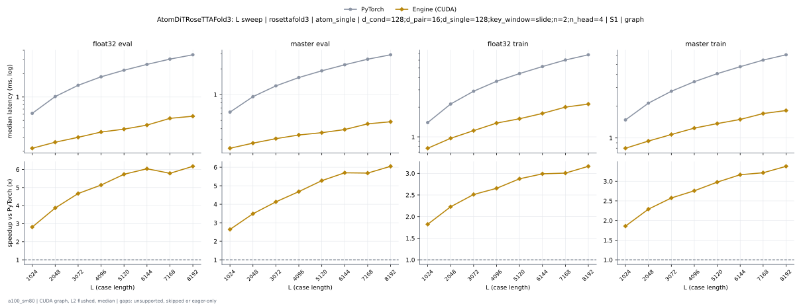
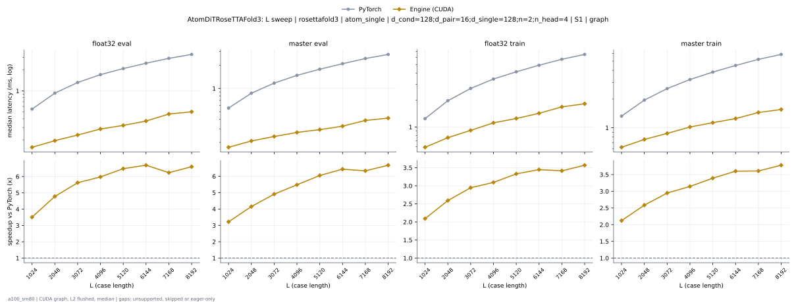

# AtomDiTRoseTTAFold3 on a100_sm80

Generated by `python -m miniworld_engine.measure.plot` from speed tokens `judge/tokens/a100_sm80/`; do not edit.

### L sweep: rosettafold3 | atom_single | d_cond=128;d_pair=16;d_single=128;key_window=slide;n=2;n_head=4 | S1 | graph

**float32 eval** (median ms; x = speedup vs PyTorch)

| L | PyTorch | Engine (Triton) | Engine (CUDA) |
|---|---|---|---|
| 1024 | 0.6164 | 0.5048 (1.22x) | 0.2191 (2.81x) |
| 2048 | 1.014 | 0.8632 (1.17x) | 0.2621 (3.87x) |
| 3072 | 1.415 | 1.228 (1.15x) | 0.3031 (4.67x) |
| 4096 | 1.821 | 1.599 (1.14x) | 0.3543 (5.14x) |
| 5120 | 2.214 | 1.953 (1.13x) | 0.386 (5.73x) |
| 6144 | 2.629 | 2.316 (1.13x) | 0.4352 (6.04x) |
| 7168 | 3.076 | 2.716 (1.13x) | 0.5315 (5.79x) |
| 8192 | 3.497 | 3.079 (1.14x) | 0.5663 (6.18x) |

**master eval** (median ms; x = speedup vs PyTorch)

| L | PyTorch | Engine (Triton) | Engine (CUDA) |
|---|---|---|---|
| 1024 | 0.6246 | 0.5059 (1.23x) | 0.2365 (2.64x) |
| 2048 | 0.9462 | 0.7813 (1.21x) | 0.2714 (3.49x) |
| 3072 | 1.265 | 1.057 (1.20x) | 0.3062 (4.13x) |
| 4096 | 1.583 | 1.329 (1.19x) | 0.3379 (4.68x) |
| 5120 | 1.896 | 1.597 (1.19x) | 0.3594 (5.28x) |
| 6144 | 2.23 | 1.867 (1.19x) | 0.3912 (5.70x) |
| 7168 | 2.591 | 2.175 (1.19x) | 0.4557 (5.69x) |
| 8192 | 2.918 | 2.459 (1.19x) | 0.4823 (6.05x) |

**float32 train** (median ms; x = speedup vs PyTorch)

| L | PyTorch | Engine (Triton) | Engine (CUDA) |
|---|---|---|---|
| 1024 | 1.396 | 1.145 (1.22x) | 0.766 (1.82x) |
| 2048 | 2.153 | 1.824 (1.18x) | 0.9667 (2.23x) |
| 3072 | 2.903 | 2.505 (1.16x) | 1.156 (2.51x) |
| 4096 | 3.66 | 3.215 (1.14x) | 1.379 (2.65x) |
| 5120 | 4.386 | 3.87 (1.13x) | 1.526 (2.87x) |
| 6144 | 5.167 | 4.549 (1.14x) | 1.729 (2.99x) |
| 7168 | 6.022 | 5.314 (1.13x) | 2.003 (3.01x) |
| 8192 | 6.802 | 5.987 (1.14x) | 2.15 (3.16x) |

**master train** (median ms; x = speedup vs PyTorch)

| L | PyTorch | Engine (Triton) | Engine (CUDA) |
|---|---|---|---|
| 1024 | 1.484 | 1.224 (1.21x) | 0.7987 (1.86x) |
| 2048 | 2.14 | 1.793 (1.19x) | 0.9349 (2.29x) |
| 3072 | 2.776 | 2.371 (1.17x) | 1.078 (2.57x) |
| 4096 | 3.419 | 2.947 (1.16x) | 1.24 (2.76x) |
| 5120 | 4.077 | 3.518 (1.16x) | 1.369 (2.98x) |
| 6144 | 4.746 | 4.097 (1.16x) | 1.499 (3.17x) |
| 7168 | 5.483 | 4.741 (1.16x) | 1.705 (3.22x) |
| 8192 | 6.157 | 5.289 (1.16x) | 1.822 (3.38x) |

### L sweep: rosettafold3 | atom_single | d_cond=128;d_pair=16;d_single=128;n=2;n_head=4 | S1 | graph

**float32 eval** (median ms; x = speedup vs PyTorch)

| L | PyTorch | Engine (Triton) | Engine (CUDA) |
|---|---|---|---|
| 1024 | 0.5499 | 0.4895 (1.12x) | 0.1567 (3.51x) |
| 2048 | 0.9298 | 0.8468 (1.10x) | 0.1946 (4.78x) |
| 3072 | 1.318 | 1.212 (1.09x) | 0.2345 (5.62x) |
| 4096 | 1.707 | 1.582 (1.08x) | 0.2857 (5.97x) |
| 5120 | 2.084 | 1.933 (1.08x) | 0.3215 (6.48x) |
| 6144 | 2.484 | 2.298 (1.08x) | 0.3712 (6.69x) |
| 7168 | 2.915 | 2.695 (1.08x) | 0.4675 (6.24x) |
| 8192 | 3.319 | 3.06 (1.08x) | 0.5028 (6.60x) |

**master eval** (median ms; x = speedup vs PyTorch)

| L | PyTorch | Engine (Triton) | Engine (CUDA) |
|---|---|---|---|
| 1024 | 0.5571 | 0.4905 (1.14x) | 0.1731 (3.22x) |
| 2048 | 0.8673 | 0.7629 (1.14x) | 0.2089 (4.15x) |
| 3072 | 1.171 | 1.04 (1.13x) | 0.2386 (4.91x) |
| 4096 | 1.477 | 1.313 (1.12x) | 0.2693 (5.48x) |
| 5120 | 1.773 | 1.579 (1.12x) | 0.2929 (6.05x) |
| 6144 | 2.09 | 1.849 (1.13x) | 0.3246 (6.44x) |
| 7168 | 2.439 | 2.159 (1.13x) | 0.385 (6.34x) |
| 8192 | 2.757 | 2.441 (1.13x) | 0.4127 (6.68x) |

**float32 train** (median ms; x = speedup vs PyTorch)

| L | PyTorch | Engine (Triton) | Engine (CUDA) |
|---|---|---|---|
| 1024 | 1.24 | 1.128 (1.10x) | 0.5929 (2.09x) |
| 2048 | 1.969 | 1.806 (1.09x) | 0.7598 (2.59x) |
| 3072 | 2.701 | 2.486 (1.09x) | 0.9165 (2.95x) |
| 4096 | 3.444 | 3.194 (1.08x) | 1.113 (3.09x) |
| 5120 | 4.147 | 3.852 (1.08x) | 1.245 (3.33x) |
| 6144 | 4.908 | 4.531 (1.08x) | 1.423 (3.45x) |
| 7168 | 5.734 | 5.293 (1.08x) | 1.679 (3.41x) |
| 8192 | 6.492 | 5.975 (1.09x) | 1.819 (3.57x) |

**master train** (median ms; x = speedup vs PyTorch)

| L | PyTorch | Engine (Triton) | Engine (CUDA) |
|---|---|---|---|
| 1024 | 1.325 | 1.206 (1.10x) | 0.6246 (2.12x) |
| 2048 | 1.951 | 1.778 (1.10x) | 0.7547 (2.58x) |
| 3072 | 2.574 | 2.353 (1.09x) | 0.8735 (2.95x) |
| 4096 | 3.204 | 2.932 (1.09x) | 1.019 (3.14x) |
| 5120 | 3.835 | 3.497 (1.10x) | 1.13 (3.39x) |
| 6144 | 4.496 | 4.081 (1.10x) | 1.248 (3.60x) |
| 7168 | 5.216 | 4.726 (1.10x) | 1.446 (3.61x) |
| 8192 | 5.876 | 5.268 (1.12x) | 1.554 (3.78x) |

