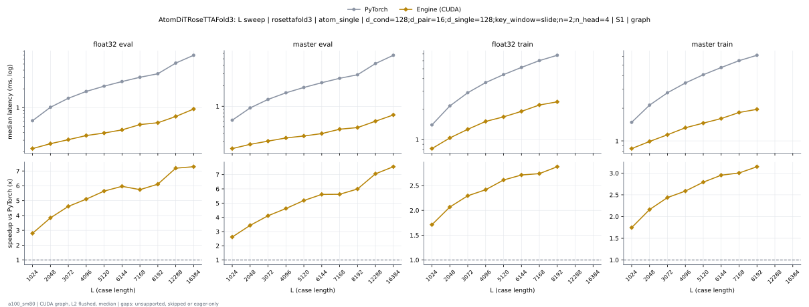
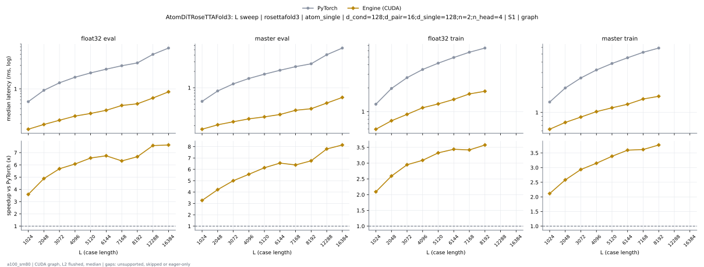
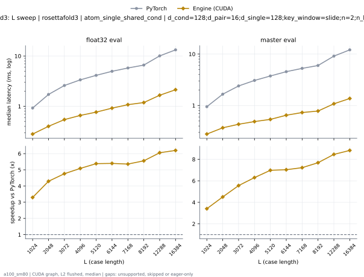
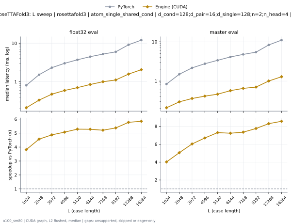

# AtomDiTRoseTTAFold3 on a100_sm80

Generated by `python -m foldjet_engine.measure.plot` from speed tokens `judge/tokens/a100_sm80/`; do not edit.

### L sweep: rosettafold3 | atom_single | d_cond=128;d_pair=16;d_single=128;key_window=slide;n=2;n_head=4 | S1 | graph

**float32 eval** (median ms; x = speedup vs PyTorch)

| L | PyTorch | Engine (Triton) | Engine (CUDA) |
|---|---|---|---|
| 1024 | 0.6164 | 0.5059 (1.22x) | 0.2202 (2.80x) |
| 2048 | 1.013 | 0.8622 (1.17x) | 0.2637 (3.84x) |
| 3072 | 1.413 | 1.228 (1.15x) | 0.3062 (4.62x) |
| 4096 | 1.819 | 1.599 (1.14x) | 0.3564 (5.10x) |
| 5120 | 2.209 | 1.953 (1.13x) | 0.3912 (5.65x) |
| 6144 | 2.621 | 2.314 (1.13x) | 0.4393 (5.97x) |
| 7168 | 3.07 | 2.714 (1.13x) | 0.5345 (5.74x) |
| 8192 | 3.493 | 3.077 (1.14x) | 0.5714 (6.11x) |
| 12288 | 5.185 | 4.536 (1.14x) | 0.7209 (7.19x) |
| 16384 | 6.919 | 6.082 (1.14x) | 0.9492 (7.29x) |

**master eval** (median ms; x = speedup vs PyTorch)

| L | PyTorch | Engine (Triton) | Engine (CUDA) |
|---|---|---|---|
| 1024 | 0.6246 | 0.5069 (1.23x) | 0.2386 (2.62x) |
| 2048 | 0.9462 | 0.7803 (1.21x) | 0.2755 (3.43x) |
| 3072 | 1.263 | 1.057 (1.19x) | 0.3072 (4.11x) |
| 4096 | 1.58 | 1.327 (1.19x) | 0.342 (4.62x) |
| 5120 | 1.894 | 1.595 (1.19x) | 0.3656 (5.18x) |
| 6144 | 2.226 | 1.865 (1.19x) | 0.3968 (5.61x) |
| 7168 | 2.584 | 2.173 (1.19x) | 0.4598 (5.62x) |
| 8192 | 2.914 | 2.455 (1.19x) | 0.4864 (5.99x) |
| 12288 | 4.257 | 3.542 (1.20x) | 0.6031 (7.06x) |
| 16384 | 5.64 | 4.688 (1.20x) | 0.7465 (7.56x) |

**float32 train** (median ms; x = speedup vs PyTorch)

| L | PyTorch | Engine (Triton) | Engine (CUDA) |
|---|---|---|---|
| 1024 | 1.397 | 1.145 (1.22x) | 0.8161 (1.71x) |
| 2048 | 2.149 | 1.821 (1.18x) | 1.039 (2.07x) |
| 3072 | 2.901 | 2.501 (1.16x) | 1.265 (2.29x) |
| 4096 | 3.654 | 3.211 (1.14x) | 1.512 (2.42x) |
| 5120 | 4.381 | 3.867 (1.13x) | 1.677 (2.61x) |
| 6144 | 5.156 | 4.547 (1.13x) | 1.901 (2.71x) |
| 7168 | 6.017 | 5.311 (1.13x) | 2.196 (2.74x) |
| 8192 | 6.793 | 5.992 (1.13x) | 2.359 (2.88x) |
| 12288 |  |  |  |
| 16384 |  |  |  |

**master train** (median ms; x = speedup vs PyTorch)

| L | PyTorch | Engine (Triton) | Engine (CUDA) |
|---|---|---|---|
| 1024 | 1.483 | 1.224 (1.21x) | 0.8494 (1.75x) |
| 2048 | 2.135 | 1.796 (1.19x) | 0.9882 (2.16x) |
| 3072 | 2.775 | 2.375 (1.17x) | 1.139 (2.44x) |
| 4096 | 3.416 | 2.948 (1.16x) | 1.321 (2.59x) |
| 5120 | 4.068 | 3.513 (1.16x) | 1.458 (2.79x) |
| 6144 | 4.738 | 4.095 (1.16x) | 1.606 (2.95x) |
| 7168 | 5.482 | 4.741 (1.16x) | 1.826 (3.00x) |
| 8192 | 6.147 | 5.29 (1.16x) | 1.954 (3.15x) |
| 12288 |  |  |  |
| 16384 |  |  |  |

### L sweep: rosettafold3 | atom_single | d_cond=128;d_pair=16;d_single=128;n=2;n_head=4 | S1 | graph

**float32 eval** (median ms; x = speedup vs PyTorch)

| L | PyTorch | Engine (Triton) | Engine (CUDA) |
|---|---|---|---|
| 1024 | 0.5519 | 0.4895 (1.13x) | 0.1536 (3.59x) |
| 2048 | 0.9349 | 0.8458 (1.11x) | 0.1915 (4.88x) |
| 3072 | 1.324 | 1.209 (1.09x) | 0.233 (5.68x) |
| 4096 | 1.716 | 1.58 (1.09x) | 0.2826 (6.07x) |
| 5120 | 2.096 | 1.93 (1.09x) | 0.3195 (6.56x) |
| 6144 | 2.492 | 2.293 (1.09x) | 0.3697 (6.74x) |
| 7168 | 2.927 | 2.694 (1.09x) | 0.4628 (6.32x) |
| 8192 | 3.331 | 3.059 (1.09x) | 0.4997 (6.67x) |
| 12288 | 4.954 | 4.516 (1.10x) | 0.6538 (7.58x) |
| 16384 | 6.643 | 6.061 (1.10x) | 0.8714 (7.62x) |

**master eval** (median ms; x = speedup vs PyTorch)

| L | PyTorch | Engine (Triton) | Engine (CUDA) |
|---|---|---|---|
| 1024 | 0.5601 | 0.4895 (1.14x) | 0.1715 (3.27x) |
| 2048 | 0.8719 | 0.7629 (1.14x) | 0.2068 (4.22x) |
| 3072 | 1.178 | 1.04 (1.13x) | 0.2355 (5.00x) |
| 4096 | 1.482 | 1.31 (1.13x) | 0.2662 (5.57x) |
| 5120 | 1.78 | 1.577 (1.13x) | 0.2898 (6.14x) |
| 6144 | 2.1 | 1.847 (1.14x) | 0.3205 (6.55x) |
| 7168 | 2.449 | 2.154 (1.14x) | 0.3835 (6.39x) |
| 8192 | 2.766 | 2.437 (1.13x) | 0.4096 (6.75x) |
| 12288 | 4.064 | 3.522 (1.15x) | 0.5212 (7.80x) |
| 16384 | 5.396 | 4.667 (1.16x) | 0.6625 (8.15x) |

**float32 train** (median ms; x = speedup vs PyTorch)

| L | PyTorch | Engine (Triton) | Engine (CUDA) |
|---|---|---|---|
| 1024 | 1.243 | 1.128 (1.10x) | 0.5944 (2.09x) |
| 2048 | 1.976 | 1.802 (1.10x) | 0.7629 (2.59x) |
| 3072 | 2.718 | 2.482 (1.10x) | 0.9216 (2.95x) |
| 4096 | 3.458 | 3.193 (1.08x) | 1.119 (3.09x) |
| 5120 | 4.169 | 3.847 (1.08x) | 1.253 (3.33x) |
| 6144 | 4.925 | 4.53 (1.09x) | 1.432 (3.44x) |
| 7168 | 5.755 | 5.287 (1.09x) | 1.683 (3.42x) |
| 8192 | 6.506 | 5.97 (1.09x) | 1.82 (3.58x) |
| 12288 |  |  |  |
| 16384 |  |  |  |

**master train** (median ms; x = speedup vs PyTorch)

| L | PyTorch | Engine (Triton) | Engine (CUDA) |
|---|---|---|---|
| 1024 | 1.332 | 1.207 (1.10x) | 0.6303 (2.11x) |
| 2048 | 1.961 | 1.78 (1.10x) | 0.7598 (2.58x) |
| 3072 | 2.585 | 2.355 (1.10x) | 0.8806 (2.94x) |
| 4096 | 3.222 | 2.927 (1.10x) | 1.023 (3.15x) |
| 5120 | 3.85 | 3.495 (1.10x) | 1.137 (3.39x) |
| 6144 | 4.508 | 4.086 (1.10x) | 1.253 (3.60x) |
| 7168 | 5.239 | 4.717 (1.11x) | 1.448 (3.62x) |
| 8192 | 5.888 | 5.27 (1.12x) | 1.561 (3.77x) |
| 12288 |  |  |  |
| 16384 |  |  |  |

### L sweep: rosettafold3 | atom_single_shared_cond | d_cond=128;d_pair=16;d_single=128;key_window=slide;n=2;n_head=4 | S5 | graph

**float32 eval** (median ms; x = speedup vs PyTorch)

| L | PyTorch | Engine (Triton) | Engine (CUDA) |
|---|---|---|---|
| 1024 | 0.9277 | 0.6687 (1.39x) | 0.2816 (3.29x) |
| 2048 | 1.723 | 1.207 (1.43x) | 0.4014 (4.29x) |
| 3072 | 2.598 | 1.816 (1.43x) | 0.5458 (4.76x) |
| 4096 | 3.36 | 2.359 (1.42x) | 0.6605 (5.09x) |
| 5120 | 4.133 | 2.898 (1.43x) | 0.768 (5.38x) |
| 6144 | 4.973 | 3.5 (1.42x) | 0.9216 (5.40x) |
| 7168 | 5.785 | 4.077 (1.42x) | 1.08 (5.35x) |
| 8192 | 6.61 | 4.652 (1.42x) | 1.19 (5.56x) |
| 12288 | 10.07 | 7.096 (1.42x) | 1.662 (6.05x) |
| 16384 | 13.26 | 9.43 (1.41x) | 2.14 (6.20x) |

**master eval** (median ms; x = speedup vs PyTorch)

| L | PyTorch | Engine (Triton) | Engine (CUDA) |
|---|---|---|---|
| 1024 | 0.9492 | 0.6584 (1.44x) | 0.2785 (3.41x) |
| 2048 | 1.66 | 1.105 (1.50x) | 0.3686 (4.50x) |
| 3072 | 2.401 | 1.579 (1.52x) | 0.4321 (5.56x) |
| 4096 | 3.071 | 1.986 (1.55x) | 0.4874 (6.30x) |
| 5120 | 3.752 | 2.42 (1.55x) | 0.5376 (6.98x) |
| 6144 | 4.551 | 2.963 (1.54x) | 0.6472 (7.03x) |
| 7168 | 5.274 | 3.44 (1.53x) | 0.7301 (7.22x) |
| 8192 | 5.994 | 3.892 (1.54x) | 0.7803 (7.68x) |
| 12288 | 9.137 | 5.853 (1.56x) | 1.08 (8.46x) |
| 16384 | 12.08 | 7.747 (1.56x) | 1.369 (8.82x) |

### L sweep: rosettafold3 | atom_single_shared_cond | d_cond=128;d_pair=16;d_single=128;n=2;n_head=4 | S5 | graph

**float32 eval** (median ms; x = speedup vs PyTorch)

| L | PyTorch | Engine (Triton) | Engine (CUDA) |
|---|---|---|---|
| 1024 | 0.8079 | 0.6513 (1.24x) | 0.212 (3.81x) |
| 2048 | 1.524 | 1.191 (1.28x) | 0.3338 (4.56x) |
| 3072 | 2.324 | 1.8 (1.29x) | 0.4772 (4.87x) |
| 4096 | 3.015 | 2.341 (1.29x) | 0.5949 (5.07x) |
| 5120 | 3.72 | 2.879 (1.29x) | 0.7045 (5.28x) |
| 6144 | 4.482 | 3.482 (1.29x) | 0.8499 (5.27x) |
| 7168 | 5.222 | 4.058 (1.29x) | 1.004 (5.20x) |
| 8192 | 5.981 | 4.633 (1.29x) | 1.114 (5.37x) |
| 12288 | 9.134 | 7.077 (1.29x) | 1.583 (5.77x) |
| 16384 | 12.04 | 9.41 (1.28x) | 2.06 (5.84x) |

**master eval** (median ms; x = speedup vs PyTorch)

| L | PyTorch | Engine (Triton) | Engine (CUDA) |
|---|---|---|---|
| 1024 | 0.8387 | 0.642 (1.31x) | 0.2089 (4.01x) |
| 2048 | 1.489 | 1.089 (1.37x) | 0.2949 (5.05x) |
| 3072 | 2.167 | 1.562 (1.39x) | 0.3594 (6.03x) |
| 4096 | 2.765 | 1.968 (1.40x) | 0.4127 (6.70x) |
| 5120 | 3.378 | 2.399 (1.41x) | 0.4628 (7.30x) |
| 6144 | 4.116 | 2.944 (1.40x) | 0.5693 (7.23x) |
| 7168 | 4.778 | 3.42 (1.40x) | 0.6502 (7.35x) |
| 8192 | 5.442 | 3.874 (1.40x) | 0.7014 (7.76x) |
| 12288 | 8.331 | 5.834 (1.43x) | 1.004 (8.30x) |
| 16384 | 11.03 | 7.73 (1.43x) | 1.288 (8.57x) |

