# AttentionPairBias on a100_sm80

Generated by `python -m foldjet_engine.measure.plot` from speed tokens `judge/tokens/a100_sm80/`; do not edit.

### L sweep: token_single | d_pair=128;d_single=384;n_head=12 | S1 | graph

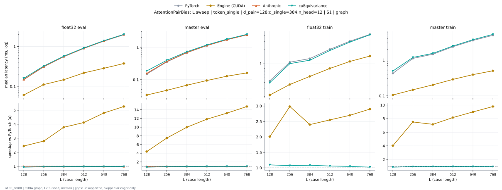

**float32 eval** (median ms; x = speedup vs PyTorch)

| L | PyTorch | Engine (Triton) | Engine (CUDA) | Anthropic | cuEquivariance |
|---|---|---|---|---|---|
| 128 | 0.1475 | 0.126 (1.17x) | 0.06042 (2.44x) | 0.1485 (0.99x) | 0.1587 (0.93x) |
| 256 | 0.3092 | 0.2734 (1.13x) | 0.1106 (2.80x) | 0.3133 (0.99x) | 0.3236 (0.96x) |
| 384 | 0.554 | 0.5007 (1.11x) | 0.1464 (3.78x) | 0.5612 (0.99x) | 0.5724 (0.97x) |
| 512 | 0.895 | 0.8264 (1.08x) | 0.2171 (4.12x) | 0.9032 (0.99x) | 0.9196 (0.97x) |
| 640 | 1.363 | 1.245 (1.09x) | 0.2836 (4.81x) | 1.381 (0.99x) | 1.401 (0.97x) |
| 768 | 1.969 | 1.815 (1.08x) | 0.3738 (5.27x) | 2.009 (0.98x) | 2.02 (0.97x) |

**master eval** (median ms; x = speedup vs PyTorch)

| L | PyTorch | Engine (Triton) | Engine (CUDA) | Anthropic | cuEquivariance |
|---|---|---|---|---|---|
| 128 | 0.1485 | 0.1362 (1.09x) | 0.03379 (4.39x) | 0.1567 (0.95x) | 0.1864 (0.80x) |
| 256 | 0.3533 | 0.3318 (1.06x) | 0.0471 (7.50x) | 0.3635 (0.97x) | 0.3942 (0.90x) |
| 384 | 0.6748 | 0.6431 (1.05x) | 0.06758 (9.98x) | 0.6861 (0.98x) | 0.7219 (0.93x) |
| 512 | 1.115 | 1.072 (1.04x) | 0.09421 (11.84x) | 1.129 (0.99x) | 1.172 (0.95x) |
| 640 | 1.693 | 1.63 (1.04x) | 0.128 (13.22x) | 1.704 (0.99x) | 1.759 (0.96x) |
| 768 | 2.386 | 2.308 (1.03x) | 0.1618 (14.75x) | 2.403 (0.99x) | 2.477 (0.96x) |

**float32 train** (median ms; x = speedup vs PyTorch)

| L | PyTorch | Engine (Triton) | Engine (CUDA) | Anthropic | cuEquivariance |
|---|---|---|---|---|---|
| 128 | 0.4342 | 0.3656 (1.19x) | 0.2161 (2.01x) | unsupported | 0.3963 (1.10x) |
| 256 | 1.08 | 0.9759 (1.11x) | 0.362 (2.98x) | unsupported | 1.008 (1.07x) |
| 384 | 1.292 | 1.143 (1.13x) | 0.5386 (2.40x) | unsupported | 1.192 (1.08x) |
| 512 | 2.03 | 1.837 (1.11x) | 0.7956 (2.55x) | unsupported | 1.916 (1.06x) |
| 640 | 3.028 | 2.724 (1.11x) | 1.121 (2.70x) | unsupported | 2.893 (1.05x) |
| 768 | 4.234 | 3.863 (1.10x) | 1.459 (2.90x) | unsupported | 4.143 (1.02x) |

**master train** (median ms; x = speedup vs PyTorch)

| L | PyTorch | Engine (Triton) | Engine (CUDA) | Anthropic | cuEquivariance |
|---|---|---|---|---|---|
| 128 | 0.4239 | 0.3973 (1.07x) | 0.1055 (4.02x) | unsupported | 0.4915 (0.86x) |
| 256 | 1.108 | 1.061 (1.04x) | 0.1475 (7.51x) | unsupported | 1.182 (0.94x) |
| 384 | 1.452 | 1.382 (1.05x) | 0.2028 (7.16x) | unsupported | 1.538 (0.94x) |
| 512 | 2.349 | 2.252 (1.04x) | 0.2877 (8.16x) | unsupported | 2.463 (0.95x) |
| 640 | 3.517 | 3.386 (1.04x) | 0.3912 (8.99x) | unsupported | 3.695 (0.95x) |
| 768 | 4.9 | 4.741 (1.03x) | 0.5007 (9.79x) | unsupported | 5.213 (0.94x) |

### L sweep: token_single | d_pair=128;d_single=384;n_head=16 | S1 | graph

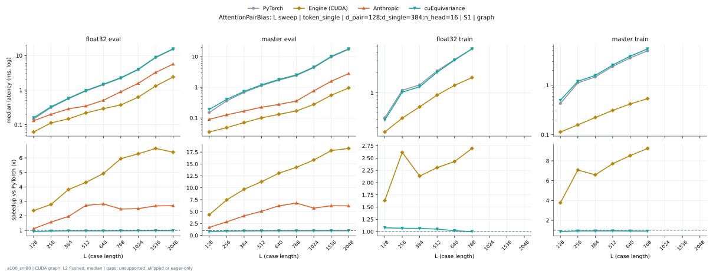

**float32 eval** (median ms; x = speedup vs PyTorch)

| L | PyTorch | Engine (Triton) | Engine (CUDA) | Anthropic | cuEquivariance |
|---|---|---|---|---|---|
| 128 | 0.1454 | 0.127 (1.15x) | 0.06144 (2.37x) | 0.13 (1.12x) | 0.1587 (0.92x) |
| 256 | 0.3144 | 0.2816 (1.12x) | 0.1126 (2.79x) | 0.1997 (1.57x) | 0.3297 (0.95x) |
| 384 | 0.5632 | 0.5171 (1.09x) | 0.1475 (3.82x) | 0.2867 (1.96x) | 0.5827 (0.97x) |
| 512 | 0.9452 | 0.8561 (1.10x) | 0.2191 (4.31x) | 0.3471 (2.72x) | 0.9779 (0.97x) |
| 640 | 1.432 | 1.309 (1.09x) | 0.2908 (4.92x) | 0.5064 (2.83x) | 1.482 (0.97x) |
| 768 | 2.217 | 2.059 (1.08x) | 0.3727 (5.95x) | 0.897 (2.47x) | 2.282 (0.97x) |
| 1024 | 3.932 | 3.694 (1.06x) | 0.6257 (6.28x) | 1.571 (2.50x) | 4.033 (0.97x) |
| 1536 | 8.755 | 8.146 (1.07x) | 1.316 (6.65x) | 3.256 (2.69x) | 8.951 (0.98x) |
| 2048 | 15.33 | 14.44 (1.06x) | 2.397 (6.40x) | 5.667 (2.71x) | 15.67 (0.98x) |

**master eval** (median ms; x = speedup vs PyTorch)

| L | PyTorch | Engine (Triton) | Engine (CUDA) | Anthropic | cuEquivariance |
|---|---|---|---|---|---|
| 128 | 0.1505 | 0.1403 (1.07x) | 0.03482 (4.32x) | 0.09011 (1.67x) | 0.1889 (0.80x) |
| 256 | 0.3584 | 0.34 (1.05x) | 0.04813 (7.45x) | 0.126 (2.85x) | 0.4014 (0.89x) |
| 384 | 0.684 | 0.6574 (1.04x) | 0.07066 (9.68x) | 0.1669 (4.10x) | 0.7352 (0.93x) |
| 512 | 1.132 | 1.093 (1.04x) | 0.1004 (11.28x) | 0.2232 (5.07x) | 1.198 (0.94x) |
| 640 | 1.712 | 1.658 (1.03x) | 0.1311 (13.06x) | 0.276 (6.20x) | 1.798 (0.95x) |
| 768 | 2.417 | 2.343 (1.03x) | 0.169 (14.30x) | 0.3564 (6.78x) | 2.532 (0.95x) |
| 1024 | 4.379 | 4.291 (1.02x) | 0.2765 (15.84x) | 0.7649 (5.72x) | 4.558 (0.96x) |
| 1536 | 9.774 | 9.568 (1.02x) | 0.5489 (17.81x) | 1.57 (6.22x) | 10.12 (0.97x) |
| 2048 | 17.36 | 16.95 (1.02x) | 0.9508 (18.26x) | 2.799 (6.20x) | 17.93 (0.97x) |

**float32 train** (median ms; x = speedup vs PyTorch)

| L | PyTorch | Engine (Triton) | Engine (CUDA) | Anthropic | cuEquivariance |
|---|---|---|---|---|---|
| 128 | 0.4219 | 0.3676 (1.15x) | 0.258 (1.63x) | unsupported | 0.3912 (1.08x) |
| 256 | 1.09 | 0.9943 (1.10x) | 0.4163 (2.62x) | unsupported | 1.02 (1.07x) |
| 384 | 1.311 | 1.179 (1.11x) | 0.6144 (2.13x) | unsupported | 1.23 (1.07x) |
| 512 | 2.128 | 1.913 (1.11x) | 0.9226 (2.31x) | unsupported | 2.025 (1.05x) |
| 640 | 3.138 | 2.833 (1.11x) | 1.291 (2.43x) | unsupported | 3.079 (1.02x) |
| 768 | 4.552 | 4.162 (1.09x) | 1.688 (2.70x) | unsupported | 4.552 (1.00x) |
| 1024 |  |  |  |  |  |
| 1536 |  |  |  |  |  |
| 2048 |  |  |  |  |  |

**master train** (median ms; x = speedup vs PyTorch)

| L | PyTorch | Engine (Triton) | Engine (CUDA) | Anthropic | cuEquivariance |
|---|---|---|---|---|---|
| 128 | 0.428 | 0.4076 (1.05x) | 0.1137 (3.77x) | unsupported | 0.4956 (0.86x) |
| 256 | 1.115 | 1.079 (1.03x) | 0.1577 (7.07x) | unsupported | 1.2 (0.93x) |
| 384 | 1.47 | 1.418 (1.04x) | 0.2232 (6.59x) | unsupported | 1.579 (0.93x) |
| 512 | 2.393 | 2.308 (1.04x) | 0.3103 (7.71x) | unsupported | 2.557 (0.94x) |
| 640 | 3.56 | 3.459 (1.03x) | 0.4178 (8.52x) | unsupported | 3.857 (0.92x) |
| 768 | 4.963 | 4.83 (1.03x) | 0.5366 (9.25x) | unsupported | 5.436 (0.91x) |
| 1024 |  |  |  |  |  |
| 1536 |  |  |  |  |  |
| 2048 |  |  |  |  |  |

### L sweep: token_single | d_pair=128;d_single=384;n_head=24 | S1 | graph

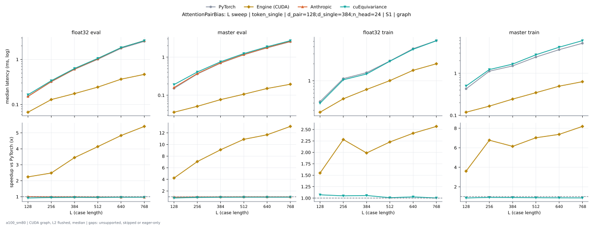

**float32 eval** (median ms; x = speedup vs PyTorch)

| L | PyTorch | Engine (Triton) | Engine (CUDA) | Anthropic | cuEquivariance |
|---|---|---|---|---|---|
| 128 | 0.1516 | 0.128 (1.18x) | 0.06758 (2.24x) | 0.1516 (1.00x) | 0.1649 (0.92x) |
| 256 | 0.3205 | 0.2806 (1.14x) | 0.129 (2.48x) | 0.3246 (0.99x) | 0.3379 (0.95x) |
| 384 | 0.6042 | 0.5263 (1.15x) | 0.1751 (3.45x) | 0.6124 (0.99x) | 0.6313 (0.96x) |
| 512 | 1.009 | 0.8909 (1.13x) | 0.2437 (4.14x) | 1.033 (0.98x) | 1.058 (0.95x) |
| 640 | 1.767 | 1.576 (1.12x) | 0.3656 (4.83x) | 1.826 (0.97x) | 1.833 (0.96x) |
| 768 | 2.524 | 2.281 (1.11x) | 0.4669 (5.41x) | 2.615 (0.97x) | 2.612 (0.97x) |

**master eval** (median ms; x = speedup vs PyTorch)

| L | PyTorch | Engine (Triton) | Engine (CUDA) | Anthropic | cuEquivariance |
|---|---|---|---|---|---|
| 128 | 0.1516 | 0.1393 (1.09x) | 0.03584 (4.23x) | 0.1597 (0.95x) | 0.1905 (0.80x) |
| 256 | 0.3615 | 0.3369 (1.07x) | 0.0512 (7.06x) | 0.3707 (0.98x) | 0.4076 (0.89x) |
| 384 | 0.6984 | 0.6584 (1.06x) | 0.0768 (9.09x) | 0.7117 (0.98x) | 0.7567 (0.92x) |
| 512 | 1.16 | 1.1 (1.05x) | 0.1065 (10.89x) | 1.174 (0.99x) | 1.242 (0.93x) |
| 640 | 1.757 | 1.671 (1.05x) | 0.1505 (11.67x) | 1.785 (0.98x) | 1.876 (0.94x) |
| 768 | 2.551 | 2.433 (1.05x) | 0.1946 (13.11x) | 2.605 (0.98x) | 2.713 (0.94x) |

**float32 train** (median ms; x = speedup vs PyTorch)

| L | PyTorch | Engine (Triton) | Engine (CUDA) | Anthropic | cuEquivariance |
|---|---|---|---|---|---|
| 128 | 0.428 | 0.3615 (1.18x) | 0.2765 (1.55x) | unsupported | 0.3994 (1.07x) |
| 256 | 1.091 | 0.9718 (1.12x) | 0.4782 (2.28x) | unsupported | 1.039 (1.05x) |
| 384 | 1.392 | 1.175 (1.18x) | 0.7004 (1.99x) | unsupported | 1.317 (1.06x) |
| 512 | 2.237 | 1.916 (1.17x) | 1.005 (2.23x) | unsupported | 2.218 (1.01x) |
| 640 | 3.7 | 3.143 (1.18x) | 1.53 (2.42x) | unsupported | 3.604 (1.03x) |
| 768 | 5.131 | 4.417 (1.16x) | 1.998 (2.57x) | unsupported | 5.119 (1.00x) |

**master train** (median ms; x = speedup vs PyTorch)

| L | PyTorch | Engine (Triton) | Engine (CUDA) | Anthropic | cuEquivariance |
|---|---|---|---|---|---|
| 128 | 0.428 | 0.4014 (1.07x) | 0.1188 (3.60x) | unsupported | 0.4987 (0.86x) |
| 256 | 1.123 | 1.07 (1.05x) | 0.1659 (6.77x) | unsupported | 1.227 (0.92x) |
| 384 | 1.497 | 1.404 (1.07x) | 0.2437 (6.14x) | unsupported | 1.655 (0.90x) |
| 512 | 2.431 | 2.304 (1.06x) | 0.3461 (7.02x) | unsupported | 2.753 (0.88x) |
| 640 | 3.645 | 3.463 (1.05x) | 0.4946 (7.37x) | unsupported | 4.174 (0.87x) |
| 768 | 5.171 | 4.929 (1.05x) | 0.6318 (8.18x) | unsupported | 5.965 (0.87x) |

### L sweep: token_single | d_pair=128;d_single=512;n_head=16 | S1 | graph

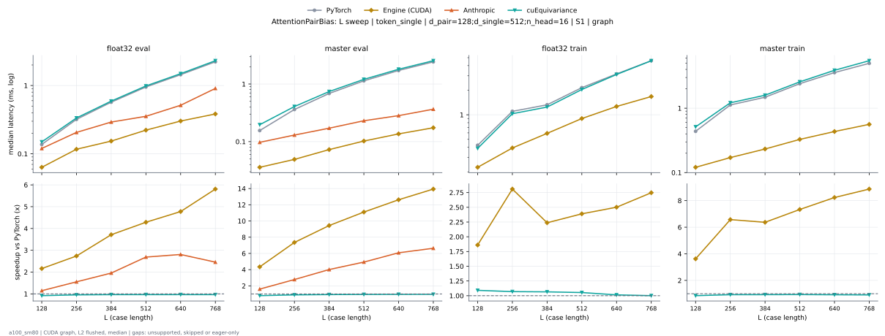

**float32 eval** (median ms; x = speedup vs PyTorch)

| L | PyTorch | Engine (Triton) | Engine (CUDA) | Anthropic | cuEquivariance |
|---|---|---|---|---|---|
| 128 | 0.1372 | 0.1167 (1.18x) | 0.06349 (2.16x) | 0.1198 (1.15x) | 0.1495 (0.92x) |
| 256 | 0.3195 | 0.2826 (1.13x) | 0.1167 (2.74x) | 0.2058 (1.55x) | 0.3348 (0.95x) |
| 384 | 0.5704 | 0.5181 (1.10x) | 0.1536 (3.71x) | 0.2918 (1.95x) | 0.5908 (0.97x) |
| 512 | 0.9523 | 0.8571 (1.11x) | 0.2222 (4.29x) | 0.3543 (2.69x) | 0.9856 (0.97x) |
| 640 | 1.443 | 1.312 (1.10x) | 0.3021 (4.78x) | 0.514 (2.81x) | 1.492 (0.97x) |
| 768 | 2.227 | 2.058 (1.08x) | 0.3835 (5.81x) | 0.9073 (2.45x) | 2.309 (0.96x) |

**master eval** (median ms; x = speedup vs PyTorch)

| L | PyTorch | Engine (Triton) | Engine (CUDA) | Anthropic | cuEquivariance |
|---|---|---|---|---|---|
| 128 | 0.1556 | 0.1434 (1.09x) | 0.03584 (4.34x) | 0.09728 (1.60x) | 0.1966 (0.79x) |
| 256 | 0.3615 | 0.3389 (1.07x) | 0.04915 (7.35x) | 0.13 (2.78x) | 0.4065 (0.89x) |
| 384 | 0.6861 | 0.6533 (1.05x) | 0.0727 (9.44x) | 0.171 (4.01x) | 0.7404 (0.93x) |
| 512 | 1.137 | 1.09 (1.04x) | 0.1024 (11.10x) | 0.2304 (4.93x) | 1.205 (0.94x) |
| 640 | 1.718 | 1.652 (1.04x) | 0.1362 (12.62x) | 0.2826 (6.08x) | 1.803 (0.95x) |
| 768 | 2.426 | 2.339 (1.04x) | 0.1741 (13.94x) | 0.3656 (6.64x) | 2.54 (0.96x) |

**float32 train** (median ms; x = speedup vs PyTorch)

| L | PyTorch | Engine (Triton) | Engine (CUDA) | Anthropic | cuEquivariance |
|---|---|---|---|---|---|
| 128 | 0.4229 | 0.3604 (1.17x) | 0.2273 (1.86x) | unsupported | 0.3876 (1.09x) |
| 256 | 1.102 | 0.9984 (1.10x) | 0.3922 (2.81x) | unsupported | 1.03 (1.07x) |
| 384 | 1.325 | 1.177 (1.13x) | 0.5919 (2.24x) | unsupported | 1.243 (1.07x) |
| 512 | 2.148 | 1.904 (1.13x) | 0.8991 (2.39x) | unsupported | 2.039 (1.05x) |
| 640 | 3.162 | 2.838 (1.11x) | 1.264 (2.50x) | unsupported | 3.117 (1.01x) |
| 768 | 4.594 | 4.148 (1.11x) | 1.672 (2.75x) | unsupported | 4.59 (1.00x) |

**master train** (median ms; x = speedup vs PyTorch)

| L | PyTorch | Engine (Triton) | Engine (CUDA) | Anthropic | cuEquivariance |
|---|---|---|---|---|---|
| 128 | 0.4378 | 0.4147 (1.06x) | 0.1208 (3.62x) | unsupported | 0.513 (0.85x) |
| 256 | 1.124 | 1.074 (1.05x) | 0.171 (6.57x) | unsupported | 1.213 (0.93x) |
| 384 | 1.481 | 1.407 (1.05x) | 0.2324 (6.37x) | unsupported | 1.591 (0.93x) |
| 512 | 2.403 | 2.298 (1.05x) | 0.3277 (7.33x) | unsupported | 2.566 (0.94x) |
| 640 | 3.575 | 3.438 (1.04x) | 0.4342 (8.23x) | unsupported | 3.878 (0.92x) |
| 768 | 4.977 | 4.809 (1.03x) | 0.5612 (8.87x) | unsupported | 5.466 (0.91x) |

### L sweep: token_single | d_pair=256;d_single=384;gate_bias=1.0;n_head=16 | S1 | graph

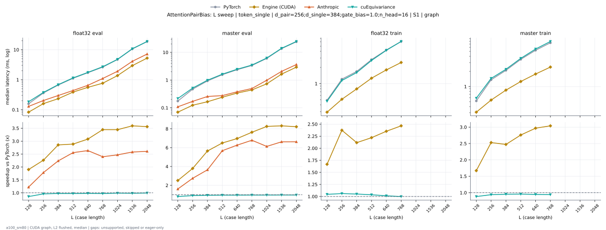

**float32 eval** (median ms; x = speedup vs PyTorch)

| L | PyTorch | Engine (Triton) | Engine (CUDA) | Anthropic | cuEquivariance |
|---|---|---|---|---|---|
| 128 | 0.1577 | 0.1393 (1.13x) | 0.08294 (1.90x) | 0.129 (1.22x) | 0.1843 (0.86x) |
| 256 | 0.3615 | 0.3287 (1.10x) | 0.1597 (2.26x) | 0.2028 (1.78x) | 0.3768 (0.96x) |
| 384 | 0.6666 | 0.6195 (1.08x) | 0.2335 (2.86x) | 0.298 (2.24x) | 0.6851 (0.97x) |
| 512 | 1.117 | 1.028 (1.09x) | 0.3871 (2.89x) | 0.4372 (2.56x) | 1.15 (0.97x) |
| 640 | 1.716 | 1.606 (1.07x) | 0.5571 (3.08x) | 0.6513 (2.64x) | 1.753 (0.98x) |
| 768 | 2.632 | 2.486 (1.06x) | 0.7639 (3.45x) | 1.098 (2.40x) | 2.708 (0.97x) |
| 1024 | 4.723 | 4.48 (1.05x) | 1.371 (3.44x) | 1.912 (2.47x) | 4.782 (0.99x) |
| 1536 | 10.6 | 9.986 (1.06x) | 2.949 (3.59x) | 4.107 (2.58x) | 10.79 (0.98x) |
| 2048 | 18.72 | 17.69 (1.06x) | 5.256 (3.56x) | 7.181 (2.61x) | 18.86 (0.99x) |

**master eval** (median ms; x = speedup vs PyTorch)

| L | PyTorch | Engine (Triton) | Engine (CUDA) | Anthropic | cuEquivariance |
|---|---|---|---|---|---|
| 128 | 0.1751 | 0.1649 (1.06x) | 0.06963 (2.51x) | 0.1085 (1.61x) | 0.2161 (0.81x) |
| 256 | 0.47 | 0.4526 (1.04x) | 0.1239 (3.79x) | 0.171 (2.75x) | 0.5151 (0.91x) |
| 384 | 0.9339 | 0.9073 (1.03x) | 0.1654 (5.65x) | 0.256 (3.65x) | 0.9882 (0.95x) |
| 512 | 1.563 | 1.522 (1.03x) | 0.2406 (6.50x) | 0.2755 (5.67x) | 1.63 (0.96x) |
| 640 | 2.369 | 2.316 (1.02x) | 0.34 (6.97x) | 0.3779 (6.27x) | 2.461 (0.96x) |
| 768 | 3.37 | 3.291 (1.02x) | 0.4413 (7.64x) | 0.4966 (6.79x) | 3.48 (0.97x) |
| 1024 | 6.053 | 5.971 (1.01x) | 0.7332 (8.26x) | 0.9871 (6.13x) | 6.241 (0.97x) |
| 1536 | 13.64 | 13.43 (1.02x) | 1.639 (8.32x) | 2.059 (6.62x) | 13.99 (0.97x) |
| 2048 | 24.07 | 23.79 (1.01x) | 2.929 (8.22x) | 3.633 (6.63x) | 24.73 (0.97x) |

**float32 train** (median ms; x = speedup vs PyTorch)

| L | PyTorch | Engine (Triton) | Engine (CUDA) | Anthropic | cuEquivariance |
|---|---|---|---|---|---|
| 128 | 0.4884 | 0.4311 (1.13x) | 0.2929 (1.67x) | unsupported | 0.468 (1.04x) |
| 256 | 1.21 | 1.116 (1.08x) | 0.51 (2.37x) | unsupported | 1.141 (1.06x) |
| 384 | 1.684 | 1.553 (1.08x) | 0.7956 (2.12x) | unsupported | 1.603 (1.05x) |
| 512 | 2.798 | 2.588 (1.08x) | 1.261 (2.22x) | unsupported | 2.701 (1.04x) |
| 640 | 4.237 | 3.931 (1.08x) | 1.801 (2.35x) | unsupported | 4.179 (1.01x) |
| 768 | 6.106 | 5.728 (1.07x) | 2.477 (2.47x) | unsupported | 6.116 (1.00x) |
| 1024 |  |  |  |  |  |
| 1536 |  |  |  |  |  |
| 2048 |  |  |  |  |  |

**master train** (median ms; x = speedup vs PyTorch)

| L | PyTorch | Engine (Triton) | Engine (CUDA) | Anthropic | cuEquivariance |
|---|---|---|---|---|---|
| 128 | 0.5171 | 0.4997 (1.03x) | 0.3092 (1.67x) | unsupported | 0.5868 (0.88x) |
| 256 | 1.362 | 1.331 (1.02x) | 0.5386 (2.53x) | unsupported | 1.452 (0.94x) |
| 384 | 2.098 | 2.045 (1.03x) | 0.8489 (2.47x) | unsupported | 2.206 (0.95x) |
| 512 | 3.475 | 3.391 (1.02x) | 1.26 (2.76x) | unsupported | 3.635 (0.96x) |
| 640 | 5.268 | 5.164 (1.02x) | 1.775 (2.97x) | unsupported | 5.574 (0.95x) |
| 768 | 7.414 | 7.311 (1.01x) | 2.439 (3.04x) | unsupported | 7.891 (0.94x) |
| 1024 |  |  |  |  |  |
| 1536 |  |  |  |  |  |
| 2048 |  |  |  |  |  |

### L sweep: token_single | d_pair=256;d_single=384;n_head=16 | S1 | graph

**float32 eval** (median ms; x = speedup vs PyTorch)

| L | PyTorch | Engine (Triton) | Engine (CUDA) | Anthropic | cuEquivariance |
|---|---|---|---|---|---|
| 128 | 0.1577 | 0.1382 (1.14x) | 0.08499 (1.86x) | 0.1239 (1.27x) | 0.171 (0.92x) |
| 256 | 0.3574 | 0.3246 (1.10x) | 0.1592 (2.24x) | 0.1997 (1.79x) | 0.3727 (0.96x) |
| 384 | 0.6615 | 0.6144 (1.08x) | 0.2355 (2.81x) | 0.2959 (2.24x) | 0.682 (0.97x) |
| 512 | 1.116 | 1.027 (1.09x) | 0.383 (2.91x) | 0.4347 (2.57x) | 1.149 (0.97x) |
| 640 | 1.725 | 1.613 (1.07x) | 0.5622 (3.07x) | 0.6441 (2.68x) | 1.764 (0.98x) |
| 768 | 2.643 | 2.506 (1.05x) | 0.7793 (3.39x) | 1.092 (2.42x) | 2.706 (0.98x) |
| 1024 | 4.719 | 4.477 (1.05x) | 1.362 (3.46x) | 1.911 (2.47x) | 4.818 (0.98x) |
| 1536 | 10.6 | 10.01 (1.06x) | 2.951 (3.59x) | 4.107 (2.58x) | 10.8 (0.98x) |
| 2048 | 18.74 | 17.83 (1.05x) | 5.321 (3.52x) | 7.177 (2.61x) | 19.07 (0.98x) |

**master eval** (median ms; x = speedup vs PyTorch)

| L | PyTorch | Engine (Triton) | Engine (CUDA) | Anthropic | cuEquivariance |
|---|---|---|---|---|---|
| 128 | 0.1741 | 0.1628 (1.07x) | 0.06963 (2.50x) | 0.1065 (1.63x) | 0.213 (0.82x) |
| 256 | 0.468 | 0.4506 (1.04x) | 0.1239 (3.78x) | 0.169 (2.77x) | 0.511 (0.92x) |
| 384 | 0.9318 | 0.9052 (1.03x) | 0.1649 (5.65x) | 0.254 (3.67x) | 0.983 (0.95x) |
| 512 | 1.559 | 1.519 (1.03x) | 0.2396 (6.51x) | 0.2734 (5.70x) | 1.625 (0.96x) |
| 640 | 2.369 | 2.312 (1.02x) | 0.3389 (6.99x) | 0.3717 (6.37x) | 2.451 (0.97x) |
| 768 | 3.357 | 3.284 (1.02x) | 0.4413 (7.61x) | 0.4946 (6.79x) | 3.471 (0.97x) |
| 1024 | 6.045 | 5.996 (1.01x) | 0.7404 (8.17x) | 0.9856 (6.13x) | 6.227 (0.97x) |
| 1536 | 13.64 | 13.43 (1.02x) | 1.706 (7.99x) | 2.052 (6.64x) | 13.98 (0.98x) |
| 2048 | 24.37 | 23.95 (1.02x) | 2.956 (8.25x) | 3.633 (6.71x) | 24.94 (0.98x) |

**float32 train** (median ms; x = speedup vs PyTorch)

| L | PyTorch | Engine (Triton) | Engine (CUDA) | Anthropic | cuEquivariance |
|---|---|---|---|---|---|
| 128 | 0.4864 | 0.4291 (1.13x) | 0.2929 (1.66x) | unsupported | 0.4547 (1.07x) |
| 256 | 1.208 | 1.116 (1.08x) | 0.51 (2.37x) | unsupported | 1.141 (1.06x) |
| 384 | 1.68 | 1.546 (1.09x) | 0.7946 (2.11x) | unsupported | 1.601 (1.05x) |
| 512 | 2.794 | 2.597 (1.08x) | 1.255 (2.23x) | unsupported | 2.704 (1.03x) |
| 640 | 4.232 | 3.932 (1.08x) | 1.798 (2.35x) | unsupported | 4.179 (1.01x) |
| 768 | 6.111 | 5.724 (1.07x) | 2.484 (2.46x) | unsupported | 6.081 (1.00x) |
| 1024 |  |  |  |  |  |
| 1536 |  |  |  |  |  |
| 2048 |  |  |  |  |  |

**master train** (median ms; x = speedup vs PyTorch)

| L | PyTorch | Engine (Triton) | Engine (CUDA) | Anthropic | cuEquivariance |
|---|---|---|---|---|---|
| 128 | 0.5171 | 0.4987 (1.04x) | 0.3103 (1.67x) | unsupported | 0.5847 (0.88x) |
| 256 | 1.36 | 1.329 (1.02x) | 0.5402 (2.52x) | unsupported | 1.451 (0.94x) |
| 384 | 2.093 | 2.042 (1.03x) | 0.8479 (2.47x) | unsupported | 2.204 (0.95x) |
| 512 | 3.467 | 3.387 (1.02x) | 1.256 (2.76x) | unsupported | 3.633 (0.95x) |
| 640 | 5.261 | 5.162 (1.02x) | 1.779 (2.96x) | unsupported | 5.562 (0.95x) |
| 768 | 7.444 | 7.305 (1.02x) | 2.447 (3.04x) | unsupported | 7.906 (0.94x) |
| 1024 |  |  |  |  |  |
| 1536 |  |  |  |  |  |
| 2048 |  |  |  |  |  |

### L sweep: token_single | d_pair=384;d_single=384;n_head=16 | S1 | graph

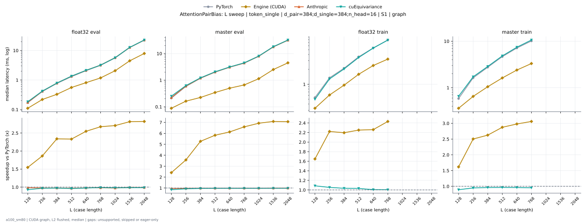

**float32 eval** (median ms; x = speedup vs PyTorch)

| L | PyTorch | Engine (Triton) | Engine (CUDA) | Anthropic | cuEquivariance |
|---|---|---|---|---|---|
| 128 | 0.171 | 0.1516 (1.13x) | 0.1106 (1.55x) | 0.1741 (0.98x) | 0.1843 (0.93x) |
| 256 | 0.4086 | 0.3758 (1.09x) | 0.2191 (1.86x) | 0.4188 (0.98x) | 0.4219 (0.97x) |
| 384 | 0.769 | 0.7291 (1.05x) | 0.3287 (2.34x) | 0.7885 (0.98x) | 0.7895 (0.97x) |
| 512 | 1.303 | 1.248 (1.04x) | 0.5586 (2.33x) | 1.345 (0.97x) | 1.356 (0.96x) |
| 640 | 2.075 | 1.963 (1.06x) | 0.8141 (2.55x) | 2.122 (0.98x) | 2.129 (0.97x) |
| 768 | 3.158 | 3.005 (1.05x) | 1.181 (2.67x) | 3.214 (0.98x) | 3.198 (0.99x) |
| 1024 | 5.598 | 5.395 (1.04x) | 2.067 (2.71x) | 5.751 (0.97x) | 5.705 (0.98x) |
| 1536 | 12.6 | 12.05 (1.05x) | 4.477 (2.82x) | 12.69 (0.99x) | 12.8 (0.98x) |
| 2048 | 22.39 | 21.5 (1.04x) | 7.937 (2.82x) | 22.64 (0.99x) | 22.7 (0.99x) |

**master eval** (median ms; x = speedup vs PyTorch)

| L | PyTorch | Engine (Triton) | Engine (CUDA) | Anthropic | cuEquivariance |
|---|---|---|---|---|---|
| 128 | 0.212 | 0.1987 (1.07x) | 0.08806 (2.41x) | 0.2222 (0.95x) | 0.2509 (0.84x) |
| 256 | 0.5816 | 0.5632 (1.03x) | 0.1628 (3.57x) | 0.599 (0.97x) | 0.6267 (0.93x) |
| 384 | 1.183 | 1.148 (1.03x) | 0.2243 (5.27x) | 1.199 (0.99x) | 1.227 (0.96x) |
| 512 | 2.006 | 1.955 (1.03x) | 0.3441 (5.83x) | 2.025 (0.99x) | 2.062 (0.97x) |
| 640 | 3.065 | 3.014 (1.02x) | 0.4997 (6.13x) | 3.089 (0.99x) | 3.137 (0.98x) |
| 768 | 4.363 | 4.315 (1.01x) | 0.6615 (6.60x) | 4.403 (0.99x) | 4.479 (0.97x) |
| 1024 | 7.885 | 7.791 (1.01x) | 1.138 (6.93x) | 7.974 (0.99x) | 8.074 (0.98x) |
| 1536 | 17.78 | 17.62 (1.01x) | 2.508 (7.09x) | 17.87 (1.00x) | 18.15 (0.98x) |
| 2048 | 31.67 | 31.35 (1.01x) | 4.479 (7.07x) | 31.79 (1.00x) | 32.29 (0.98x) |

**float32 train** (median ms; x = speedup vs PyTorch)

| L | PyTorch | Engine (Triton) | Engine (CUDA) | Anthropic | cuEquivariance |
|---|---|---|---|---|---|
| 128 | 0.5417 | 0.4731 (1.15x) | 0.3287 (1.65x) | unsupported | 0.4987 (1.09x) |
| 256 | 1.354 | 1.26 (1.07x) | 0.6093 (2.22x) | unsupported | 1.285 (1.05x) |
| 384 | 2.116 | 1.979 (1.07x) | 0.9636 (2.20x) | unsupported | 2.045 (1.03x) |
| 512 | 3.591 | 3.354 (1.07x) | 1.595 (2.25x) | unsupported | 3.481 (1.03x) |
| 640 | 5.425 | 5.148 (1.05x) | 2.4 (2.26x) | unsupported | 5.39 (1.01x) |
| 768 | 7.855 | 7.441 (1.06x) | 3.23 (2.43x) | unsupported | 7.816 (1.00x) |
| 1024 |  |  |  |  |  |
| 1536 |  |  |  |  |  |
| 2048 |  |  |  |  |  |

**master train** (median ms; x = speedup vs PyTorch)

| L | PyTorch | Engine (Triton) | Engine (CUDA) | Anthropic | cuEquivariance |
|---|---|---|---|---|---|
| 128 | 0.5847 | 0.5673 (1.03x) | 0.3615 (1.62x) | unsupported | 0.6554 (0.89x) |
| 256 | 1.63 | 1.602 (1.02x) | 0.6513 (2.50x) | unsupported | 1.719 (0.95x) |
| 384 | 2.759 | 2.704 (1.02x) | 1.051 (2.63x) | unsupported | 2.867 (0.96x) |
| 512 | 4.667 | 4.602 (1.01x) | 1.624 (2.87x) | unsupported | 4.84 (0.96x) |
| 640 | 7.159 | 7.059 (1.01x) | 2.402 (2.98x) | unsupported | 7.442 (0.96x) |
| 768 | 10.15 | 10.02 (1.01x) | 3.318 (3.06x) | unsupported | 10.64 (0.95x) |
| 1024 |  |  |  |  |  |
| 1536 |  |  |  |  |  |
| 2048 |  |  |  |  |  |

### L sweep: token_single | d_pair=384;d_single=384;n_head=8 | S1 | graph

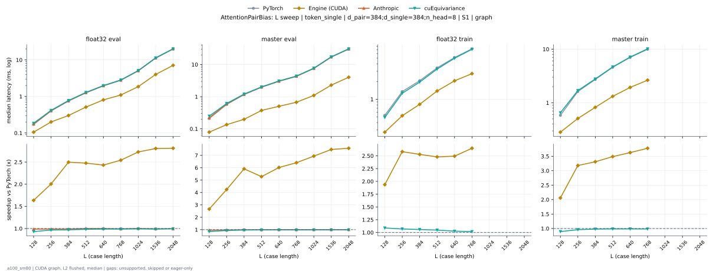

**float32 eval** (median ms; x = speedup vs PyTorch)

| L | PyTorch | Engine (Triton) | Engine (CUDA) | Anthropic | cuEquivariance |
|---|---|---|---|---|---|
| 128 | 0.1725 | 0.1505 (1.15x) | 0.1055 (1.64x) | 0.1751 (0.99x) | 0.1853 (0.93x) |
| 256 | 0.4024 | 0.3666 (1.10x) | 0.2007 (2.01x) | 0.4076 (0.99x) | 0.4168 (0.97x) |
| 384 | 0.7516 | 0.7035 (1.07x) | 0.3011 (2.50x) | 0.7619 (0.99x) | 0.7741 (0.97x) |
| 512 | 1.269 | 1.198 (1.06x) | 0.5125 (2.48x) | 1.266 (1.00x) | 1.292 (0.98x) |
| 640 | 1.959 | 1.888 (1.04x) | 0.8059 (2.43x) | 1.96 (1.00x) | 1.986 (0.99x) |
| 768 | 2.785 | 2.698 (1.03x) | 1.096 (2.54x) | 2.807 (0.99x) | 2.822 (0.99x) |
| 1024 | 5.062 | 4.943 (1.02x) | 1.855 (2.73x) | 5.062 (1.00x) | 5.106 (0.99x) |
| 1536 | 11.24 | 11.03 (1.02x) | 4.006 (2.80x) | 11.32 (0.99x) | 11.39 (0.99x) |
| 2048 | 20.01 | 19.95 (1.00x) | 7.118 (2.81x) | 20.13 (0.99x) | 20.12 (0.99x) |

**master eval** (median ms; x = speedup vs PyTorch)

| L | PyTorch | Engine (Triton) | Engine (CUDA) | Anthropic | cuEquivariance |
|---|---|---|---|---|---|
| 128 | 0.2099 | 0.1976 (1.06x) | 0.07885 (2.66x) | 0.2202 (0.95x) | 0.2488 (0.84x) |
| 256 | 0.5734 | 0.554 (1.04x) | 0.1352 (4.24x) | 0.5908 (0.97x) | 0.6154 (0.93x) |
| 384 | 1.168 | 1.132 (1.03x) | 0.1976 (5.91x) | 1.179 (0.99x) | 1.206 (0.97x) |
| 512 | 1.974 | 1.948 (1.01x) | 0.3738 (5.28x) | 1.992 (0.99x) | 2.016 (0.98x) |
| 640 | 3.026 | 2.993 (1.01x) | 0.5028 (6.02x) | 3.029 (1.00x) | 3.086 (0.98x) |
| 768 | 4.297 | 4.266 (1.01x) | 0.6707 (6.41x) | 4.309 (1.00x) | 4.386 (0.98x) |
| 1024 | 7.602 | 7.515 (1.01x) | 1.096 (6.94x) | 7.606 (1.00x) | 7.72 (0.98x) |
| 1536 | 17.15 | 16.97 (1.01x) | 2.294 (7.48x) | 17.18 (1.00x) | 17.39 (0.99x) |
| 2048 | 30.48 | 30.37 (1.00x) | 4.024 (7.57x) | 30.43 (1.00x) | 30.85 (0.99x) |

**float32 train** (median ms; x = speedup vs PyTorch)

| L | PyTorch | Engine (Triton) | Engine (CUDA) | Anthropic | cuEquivariance |
|---|---|---|---|---|---|
| 128 | 0.5315 | 0.468 (1.14x) | 0.2744 (1.94x) | unsupported | 0.4884 (1.09x) |
| 256 | 1.351 | 1.251 (1.08x) | 0.5233 (2.58x) | unsupported | 1.264 (1.07x) |
| 384 | 2.071 | 1.939 (1.07x) | 0.8192 (2.53x) | unsupported | 1.957 (1.06x) |
| 512 | 3.424 | 3.25 (1.05x) | 1.381 (2.48x) | unsupported | 3.27 (1.05x) |
| 640 | 5.134 | 4.939 (1.04x) | 2.059 (2.49x) | unsupported | 5.003 (1.03x) |
| 768 | 7.236 | 6.971 (1.04x) | 2.733 (2.65x) | unsupported | 7.11 (1.02x) |
| 1024 |  |  |  |  |  |
| 1536 |  |  |  |  |  |
| 2048 |  |  |  |  |  |

**master train** (median ms; x = speedup vs PyTorch)

| L | PyTorch | Engine (Triton) | Engine (CUDA) | Anthropic | cuEquivariance |
|---|---|---|---|---|---|
| 128 | 0.5837 | 0.5622 (1.04x) | 0.2836 (2.06x) | unsupported | 0.6533 (0.89x) |
| 256 | 1.621 | 1.582 (1.02x) | 0.51 (3.18x) | unsupported | 1.69 (0.96x) |
| 384 | 2.725 | 2.666 (1.02x) | 0.8233 (3.31x) | unsupported | 2.783 (0.98x) |
| 512 | 4.601 | 4.541 (1.01x) | 1.319 (3.49x) | unsupported | 4.669 (0.99x) |
| 640 | 7.023 | 6.964 (1.01x) | 1.936 (3.63x) | unsupported | 7.126 (0.99x) |
| 768 | 9.978 | 9.876 (1.01x) | 2.642 (3.78x) | unsupported | 10.15 (0.98x) |
| 1024 |  |  |  |  |  |
| 1536 |  |  |  |  |  |
| 2048 |  |  |  |  |  |

### L sweep: token_single | d_pair=512;d_single=384;n_head=16 | S1 | graph

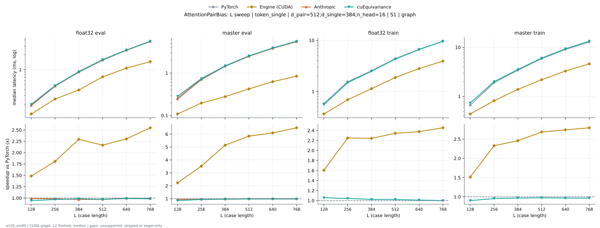

**float32 eval** (median ms; x = speedup vs PyTorch)

| L | PyTorch | Engine (Triton) | Engine (CUDA) | Anthropic | cuEquivariance |
|---|---|---|---|---|---|
| 128 | 0.1884 | 0.1669 (1.13x) | 0.127 (1.48x) | 0.1905 (0.99x) | 0.1997 (0.94x) |
| 256 | 0.4608 | 0.428 (1.08x) | 0.255 (1.81x) | 0.468 (0.98x) | 0.4762 (0.97x) |
| 384 | 0.8904 | 0.8509 (1.05x) | 0.3881 (2.29x) | 0.919 (0.97x) | 0.9052 (0.98x) |
| 512 | 1.55 | 1.481 (1.05x) | 0.7163 (2.16x) | 1.594 (0.97x) | 1.597 (0.97x) |
| 640 | 2.474 | 2.383 (1.04x) | 1.074 (2.30x) | 2.487 (0.99x) | 2.502 (0.99x) |
| 768 | 3.705 | 3.534 (1.05x) | 1.455 (2.55x) | 3.74 (0.99x) | 3.767 (0.98x) |

**master eval** (median ms; x = speedup vs PyTorch)

| L | PyTorch | Engine (Triton) | Engine (CUDA) | Anthropic | cuEquivariance |
|---|---|---|---|---|---|
| 128 | 0.2427 | 0.2314 (1.05x) | 0.1085 (2.24x) | 0.256 (0.95x) | 0.2836 (0.86x) |
| 256 | 0.6932 | 0.6748 (1.03x) | 0.1966 (3.53x) | 0.7188 (0.96x) | 0.7373 (0.94x) |
| 384 | 1.431 | 1.402 (1.02x) | 0.278 (5.15x) | 1.467 (0.97x) | 1.473 (0.97x) |
| 512 | 2.473 | 2.439 (1.01x) | 0.4229 (5.85x) | 2.483 (1.00x) | 2.529 (0.98x) |
| 640 | 3.816 | 3.762 (1.01x) | 0.6262 (6.09x) | 3.824 (1.00x) | 3.887 (0.98x) |
| 768 | 5.47 | 5.371 (1.02x) | 0.8428 (6.49x) | 5.476 (1.00x) | 5.591 (0.98x) |

**float32 train** (median ms; x = speedup vs PyTorch)

| L | PyTorch | Engine (Triton) | Engine (CUDA) | Anthropic | cuEquivariance |
|---|---|---|---|---|---|
| 128 | 0.5837 | 0.5263 (1.11x) | 0.3635 (1.61x) | unsupported | 0.5519 (1.06x) |
| 256 | 1.552 | 1.41 (1.10x) | 0.6902 (2.25x) | unsupported | 1.488 (1.04x) |
| 384 | 2.543 | 2.429 (1.05x) | 1.135 (2.24x) | unsupported | 2.482 (1.02x) |
| 512 | 4.388 | 4.158 (1.06x) | 1.873 (2.34x) | unsupported | 4.292 (1.02x) |
| 640 | 6.664 | 6.356 (1.05x) | 2.806 (2.37x) | unsupported | 6.597 (1.01x) |
| 768 | 9.6 | 9.214 (1.04x) | 3.916 (2.45x) | unsupported | 9.596 (1.00x) |

**master train** (median ms; x = speedup vs PyTorch)

| L | PyTorch | Engine (Triton) | Engine (CUDA) | Anthropic | cuEquivariance |
|---|---|---|---|---|---|
| 128 | 0.6646 | 0.6482 (1.03x) | 0.4393 (1.51x) | unsupported | 0.7383 (0.90x) |
| 256 | 1.906 | 1.876 (1.02x) | 0.8182 (2.33x) | unsupported | 1.998 (0.95x) |
| 384 | 3.419 | 3.386 (1.01x) | 1.39 (2.46x) | unsupported | 3.536 (0.97x) |
| 512 | 5.88 | 5.796 (1.01x) | 2.189 (2.69x) | unsupported | 6.05 (0.97x) |
| 640 | 9.039 | 8.935 (1.01x) | 3.296 (2.74x) | unsupported | 9.35 (0.97x) |
| 768 | 12.87 | 12.75 (1.01x) | 4.604 (2.80x) | unsupported | 13.34 (0.97x) |

### L sweep: token_single_extra_bias | d_pair=384;d_single=384;n_head=8 | S1 | graph

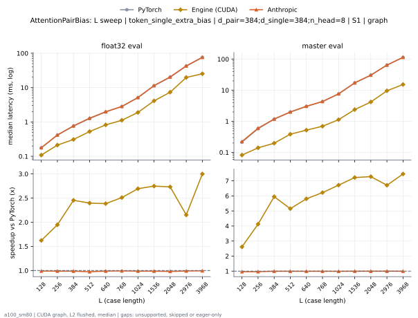

**float32 eval** (median ms; x = speedup vs PyTorch)

| L | PyTorch | Engine (Triton) | Engine (CUDA) | Anthropic | cuEquivariance |
|---|---|---|---|---|---|
| 128 | 0.1761 | 0.1536 (1.15x) | 0.1085 (1.62x) | 0.1782 (0.99x) | unsupported |
| 256 | 0.4127 | 0.3768 (1.10x) | 0.212 (1.95x) | 0.4178 (0.99x) | unsupported |
| 384 | 0.7588 | 0.7086 (1.07x) | 0.3092 (2.45x) | 0.769 (0.99x) | unsupported |
| 512 | 1.258 | 1.213 (1.04x) | 0.5253 (2.40x) | 1.291 (0.97x) | unsupported |
| 640 | 1.96 | 1.901 (1.03x) | 0.8218 (2.39x) | 1.983 (0.99x) | unsupported |
| 768 | 2.809 | 2.723 (1.03x) | 1.119 (2.51x) | 2.832 (0.99x) | unsupported |
| 1024 | 5.097 | 4.955 (1.03x) | 1.892 (2.69x) | 5.161 (0.99x) | unsupported |
| 1536 | 11.3 | 11.17 (1.01x) | 4.111 (2.75x) | 11.45 (0.99x) | unsupported |
| 2048 | 20.06 | 19.95 (1.01x) | 7.345 (2.73x) | 20.45 (0.98x) | unsupported |
| 2976 | 42.42 | 41.66 (1.02x) | 19.72 (2.15x) | 42.85 (0.99x) | unsupported |
| 3968 | 75.76 | 74.33 (1.02x) | 25.26 (3.00x) | 76.24 (0.99x) | unsupported |

**master eval** (median ms; x = speedup vs PyTorch)

| L | PyTorch | Engine (Triton) | Engine (CUDA) | Anthropic | cuEquivariance |
|---|---|---|---|---|---|
| 128 | 0.214 | 0.2028 (1.06x) | 0.08192 (2.61x) | 0.2232 (0.96x) | unsupported |
| 256 | 0.5786 | 0.5581 (1.04x) | 0.1403 (4.12x) | 0.6011 (0.96x) | unsupported |
| 384 | 1.176 | 1.142 (1.03x) | 0.1976 (5.95x) | 1.186 (0.99x) | unsupported |
| 512 | 1.983 | 1.934 (1.03x) | 0.385 (5.15x) | 2.001 (0.99x) | unsupported |
| 640 | 3.021 | 2.984 (1.01x) | 0.5202 (5.81x) | 3.054 (0.99x) | unsupported |
| 768 | 4.318 | 4.26 (1.01x) | 0.6943 (6.22x) | 4.349 (0.99x) | unsupported |
| 1024 | 7.586 | 7.554 (1.00x) | 1.129 (6.72x) | 7.687 (0.99x) | unsupported |
| 1536 | 17.23 | 17.18 (1.00x) | 2.387 (7.22x) | 17.31 (1.00x) | unsupported |
| 2048 | 30.51 | 30.53 (1.00x) | 4.191 (7.28x) | 30.71 (0.99x) | unsupported |
| 2976 | 64.39 | 63.87 (1.01x) | 9.599 (6.71x) | 64.62 (1.00x) | unsupported |
| 3968 | 114.2 | 113.3 (1.01x) | 15.32 (7.46x) | 114.9 (0.99x) | unsupported |

### d_pair sweep at L768: token_single | - | S1 | graph

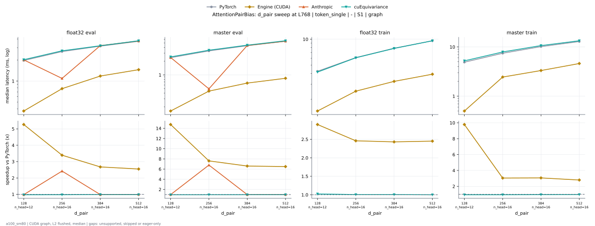

**float32 eval** (median ms; x = speedup vs PyTorch)

| d_pair | PyTorch | Engine (Triton) | Engine (CUDA) | Anthropic | cuEquivariance |
|---|---|---|---|---|---|
| 128 n_head=12 | 1.969 | 1.815 (1.08x) | 0.3738 (5.27x) | 2.009 (0.98x) | 2.02 (0.97x) |
| 256 n_head=16 | 2.643 | 2.506 (1.05x) | 0.7793 (3.39x) | 1.092 (2.42x) | 2.706 (0.98x) |
| 384 n_head=16 | 3.158 | 3.005 (1.05x) | 1.181 (2.67x) | 3.214 (0.98x) | 3.198 (0.99x) |
| 512 n_head=16 | 3.705 | 3.534 (1.05x) | 1.455 (2.55x) | 3.74 (0.99x) | 3.767 (0.98x) |

**master eval** (median ms; x = speedup vs PyTorch)

| d_pair | PyTorch | Engine (Triton) | Engine (CUDA) | Anthropic | cuEquivariance |
|---|---|---|---|---|---|
| 128 n_head=12 | 2.386 | 2.308 (1.03x) | 0.1618 (14.75x) | 2.403 (0.99x) | 2.477 (0.96x) |
| 256 n_head=16 | 3.357 | 3.284 (1.02x) | 0.4413 (7.61x) | 0.4946 (6.79x) | 3.471 (0.97x) |
| 384 n_head=16 | 4.363 | 4.315 (1.01x) | 0.6615 (6.60x) | 4.403 (0.99x) | 4.479 (0.97x) |
| 512 n_head=16 | 5.47 | 5.371 (1.02x) | 0.8428 (6.49x) | 5.476 (1.00x) | 5.591 (0.98x) |

**float32 train** (median ms; x = speedup vs PyTorch)

| d_pair | PyTorch | Engine (Triton) | Engine (CUDA) | Anthropic | cuEquivariance |
|---|---|---|---|---|---|
| 128 n_head=12 | 4.234 | 3.863 (1.10x) | 1.459 (2.90x) | unsupported | 4.143 (1.02x) |
| 256 n_head=16 | 6.111 | 5.724 (1.07x) | 2.484 (2.46x) | unsupported | 6.081 (1.00x) |
| 384 n_head=16 | 7.855 | 7.441 (1.06x) | 3.23 (2.43x) | unsupported | 7.816 (1.00x) |
| 512 n_head=16 | 9.6 | 9.214 (1.04x) | 3.916 (2.45x) | unsupported | 9.596 (1.00x) |

**master train** (median ms; x = speedup vs PyTorch)

| d_pair | PyTorch | Engine (Triton) | Engine (CUDA) | Anthropic | cuEquivariance |
|---|---|---|---|---|---|
| 128 n_head=12 | 4.9 | 4.741 (1.03x) | 0.5007 (9.79x) | unsupported | 5.213 (0.94x) |
| 256 n_head=16 | 7.444 | 7.305 (1.02x) | 2.447 (3.04x) | unsupported | 7.906 (0.94x) |
| 384 n_head=16 | 10.15 | 10.02 (1.01x) | 3.318 (3.06x) | unsupported | 10.64 (0.95x) |
| 512 n_head=16 | 12.87 | 12.75 (1.01x) | 4.604 (2.80x) | unsupported | 13.34 (0.97x) |

### n_head sweep at L768: token_single | - | S1 | graph

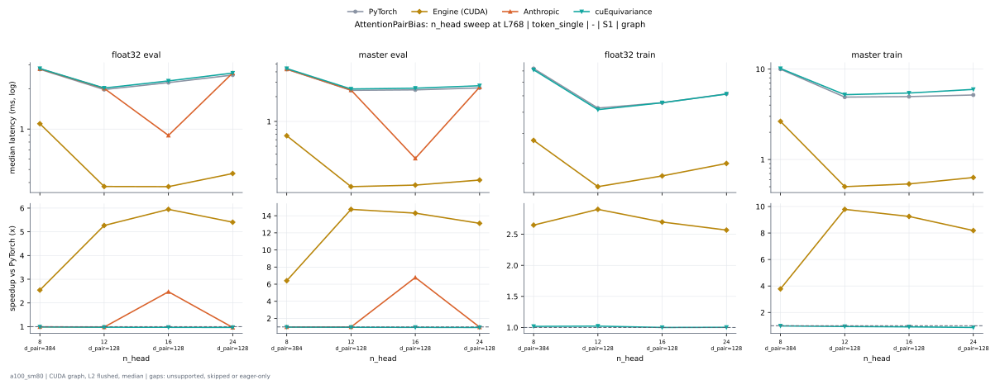

**float32 eval** (median ms; x = speedup vs PyTorch)

| n_head | PyTorch | Engine (Triton) | Engine (CUDA) | Anthropic | cuEquivariance |
|---|---|---|---|---|---|
| 8 d_pair=384 | 2.785 | 2.698 (1.03x) | 1.096 (2.54x) | 2.807 (0.99x) | 2.822 (0.99x) |
| 12 d_pair=128 | 1.969 | 1.815 (1.08x) | 0.3738 (5.27x) | 2.009 (0.98x) | 2.02 (0.97x) |
| 16 d_pair=128 | 2.217 | 2.059 (1.08x) | 0.3727 (5.95x) | 0.897 (2.47x) | 2.282 (0.97x) |
| 24 d_pair=128 | 2.524 | 2.281 (1.11x) | 0.4669 (5.41x) | 2.615 (0.97x) | 2.612 (0.97x) |

**master eval** (median ms; x = speedup vs PyTorch)

| n_head | PyTorch | Engine (Triton) | Engine (CUDA) | Anthropic | cuEquivariance |
|---|---|---|---|---|---|
| 8 d_pair=384 | 4.297 | 4.266 (1.01x) | 0.6707 (6.41x) | 4.309 (1.00x) | 4.386 (0.98x) |
| 12 d_pair=128 | 2.386 | 2.308 (1.03x) | 0.1618 (14.75x) | 2.403 (0.99x) | 2.477 (0.96x) |
| 16 d_pair=128 | 2.417 | 2.343 (1.03x) | 0.169 (14.30x) | 0.3564 (6.78x) | 2.532 (0.95x) |
| 24 d_pair=128 | 2.551 | 2.433 (1.05x) | 0.1946 (13.11x) | 2.605 (0.98x) | 2.713 (0.94x) |

**float32 train** (median ms; x = speedup vs PyTorch)

| n_head | PyTorch | Engine (Triton) | Engine (CUDA) | Anthropic | cuEquivariance |
|---|---|---|---|---|---|
| 8 d_pair=384 | 7.236 | 6.971 (1.04x) | 2.733 (2.65x) | unsupported | 7.11 (1.02x) |
| 12 d_pair=128 | 4.234 | 3.863 (1.10x) | 1.459 (2.90x) | unsupported | 4.143 (1.02x) |
| 16 d_pair=128 | 4.552 | 4.162 (1.09x) | 1.688 (2.70x) | unsupported | 4.552 (1.00x) |
| 24 d_pair=128 | 5.131 | 4.417 (1.16x) | 1.998 (2.57x) | unsupported | 5.119 (1.00x) |

**master train** (median ms; x = speedup vs PyTorch)

| n_head | PyTorch | Engine (Triton) | Engine (CUDA) | Anthropic | cuEquivariance |
|---|---|---|---|---|---|
| 8 d_pair=384 | 9.978 | 9.876 (1.01x) | 2.642 (3.78x) | unsupported | 10.15 (0.98x) |
| 12 d_pair=128 | 4.9 | 4.741 (1.03x) | 0.5007 (9.79x) | unsupported | 5.213 (0.94x) |
| 16 d_pair=128 | 4.963 | 4.83 (1.03x) | 0.5366 (9.25x) | unsupported | 5.436 (0.91x) |
| 24 d_pair=128 | 5.171 | 4.929 (1.05x) | 0.6318 (8.18x) | unsupported | 5.965 (0.87x) |

