# AttentionPairBias on a100_sm80

Generated by `python -m miniworld_engine.measure.plot` from speed tokens `judge/tokens/a100_sm80/`; do not edit.

### L sweep: token_single | d_pair=128;d_single=384;n_head=12 | S1 | graph

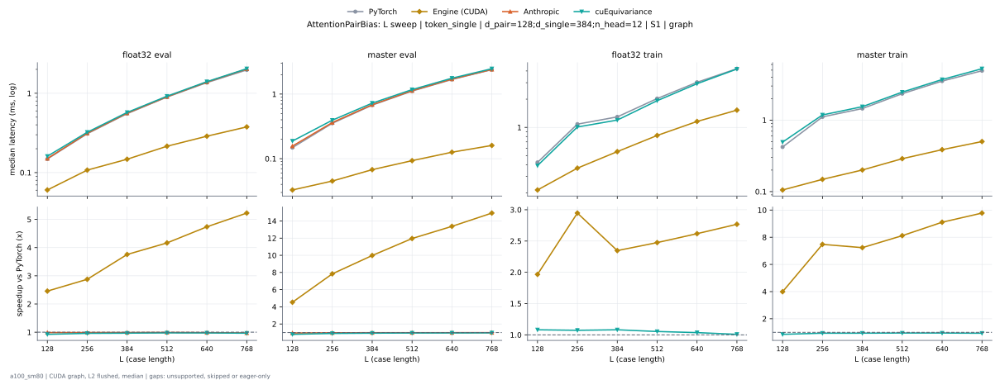

**float32 eval** (median ms; x = speedup vs PyTorch)

| L | PyTorch | Engine (Triton) | Engine (CUDA) | Anthropic | cuEquivariance |
|---|---|---|---|---|---|
| 128 | 0.1495 | 0.1249 (1.20x) | 0.0727 (2.06x) | 0.1505 (0.99x) | 0.1608 (0.93x) |
| 256 | 0.3092 | 0.2744 (1.13x) | 0.1219 (2.54x) | 0.3133 (0.99x) | 0.3226 (0.96x) |
| 384 | 0.553 | 0.5028 (1.10x) | 0.1567 (3.53x) | 0.5612 (0.99x) | 0.5734 (0.96x) |
| 512 | 0.8929 | 0.8253 (1.08x) | 0.2314 (3.86x) | 0.9042 (0.99x) | 0.9185 (0.97x) |
| 640 | 1.364 | 1.247 (1.09x) | 0.2949 (4.62x) | 1.384 (0.99x) | 1.401 (0.97x) |
| 768 | 1.973 | 1.823 (1.08x) | 0.3891 (5.07x) | 2.022 (0.98x) | 2.041 (0.97x) |

**master eval** (median ms; x = speedup vs PyTorch)

| L | PyTorch | Engine (Triton) | Engine (CUDA) | Anthropic | cuEquivariance |
|---|---|---|---|---|---|
| 128 | 0.1485 | 0.1372 (1.08x) | 0.0471 (3.15x) | 0.1567 (0.95x) | 0.1874 (0.79x) |
| 256 | 0.3523 | 0.3318 (1.06x) | 0.06144 (5.73x) | 0.3625 (0.97x) | 0.3942 (0.89x) |
| 384 | 0.6738 | 0.6441 (1.05x) | 0.08397 (8.02x) | 0.6851 (0.98x) | 0.724 (0.93x) |
| 512 | 1.121 | 1.074 (1.04x) | 0.1085 (10.33x) | 1.129 (0.99x) | 1.174 (0.96x) |
| 640 | 1.699 | 1.633 (1.04x) | 0.1423 (11.94x) | 1.706 (1.00x) | 1.762 (0.96x) |
| 768 | 2.394 | 2.311 (1.04x) | 0.1761 (13.59x) | 2.408 (0.99x) | 2.473 (0.97x) |

**float32 train** (median ms; x = speedup vs PyTorch)

| L | PyTorch | Engine (Triton) | Engine (CUDA) | Anthropic | cuEquivariance |
|---|---|---|---|---|---|
| 128 | 0.4239 | 0.3707 (1.14x) | 0.2161 (1.96x) | unsupported | 0.3912 (1.08x) |
| 256 | 1.082 | 0.9923 (1.09x) | 0.3697 (2.93x) | unsupported | 1.01 (1.07x) |
| 384 | 1.294 | 1.169 (1.11x) | 0.5499 (2.35x) | unsupported | 1.197 (1.08x) |
| 512 | 2.023 | 1.873 (1.08x) | 0.812 (2.49x) | unsupported | 1.927 (1.05x) |
| 640 | 3.056 | 2.854 (1.07x) | 1.151 (2.66x) | unsupported | 2.924 (1.05x) |
| 768 | 4.292 | 4.001 (1.07x) | 1.519 (2.83x) | unsupported | 4.194 (1.02x) |

**master train** (median ms; x = speedup vs PyTorch)

| L | PyTorch | Engine (Triton) | Engine (CUDA) | Anthropic | cuEquivariance |
|---|---|---|---|---|---|
| 128 | 0.4239 | 0.4157 (1.02x) | 0.1044 (4.06x) | unsupported | 0.4925 (0.86x) |
| 256 | 1.11 | 1.102 (1.01x) | 0.1531 (7.25x) | unsupported | 1.182 (0.94x) |
| 384 | 1.454 | 1.463 (0.99x) | 0.2007 (7.24x) | unsupported | 1.543 (0.94x) |
| 512 | 2.35 | 2.385 (0.99x) | 0.2877 (8.17x) | unsupported | 2.465 (0.95x) |
| 640 | 3.517 | 3.596 (0.98x) | 0.3876 (9.08x) | unsupported | 3.696 (0.95x) |
| 768 | 4.917 | 5.087 (0.97x) | 0.5018 (9.80x) | unsupported | 5.24 (0.94x) |

### L sweep: token_single | d_pair=128;d_single=384;n_head=16 | S1 | graph

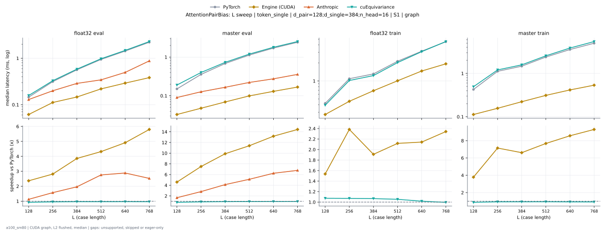

**float32 eval** (median ms; x = speedup vs PyTorch)

| L | PyTorch | Engine (Triton) | Engine (CUDA) | Anthropic | cuEquivariance |
|---|---|---|---|---|---|
| 128 | 0.1454 | 0.127 (1.15x) | 0.1014 (1.43x) | 0.129 (1.13x) | 0.1577 (0.92x) |
| 256 | 0.3133 | 0.2806 (1.12x) | 0.1526 (2.05x) | 0.1997 (1.57x) | 0.3287 (0.95x) |
| 384 | 0.5637 | 0.5171 (1.09x) | 0.1884 (2.99x) | 0.2877 (1.96x) | 0.5837 (0.97x) |
| 512 | 0.9441 | 0.855 (1.10x) | 0.258 (3.66x) | 0.343 (2.75x) | 0.9779 (0.97x) |
| 640 | 1.428 | 1.308 (1.09x) | 0.3287 (4.35x) | 0.4966 (2.88x) | 1.479 (0.97x) |
| 768 | 2.216 | 2.059 (1.08x) | 0.4142 (5.35x) | 0.8796 (2.52x) | 2.296 (0.97x) |

**master eval** (median ms; x = speedup vs PyTorch)

| L | PyTorch | Engine (Triton) | Engine (CUDA) | Anthropic | cuEquivariance |
|---|---|---|---|---|---|
| 128 | 0.1495 | 0.1403 (1.07x) | 0.04915 (3.04x) | 0.09011 (1.66x) | 0.1894 (0.79x) |
| 256 | 0.3564 | 0.3389 (1.05x) | 0.06451 (5.52x) | 0.127 (2.81x) | 0.4004 (0.89x) |
| 384 | 0.683 | 0.6564 (1.04x) | 0.08602 (7.94x) | 0.1659 (4.12x) | 0.7322 (0.93x) |
| 512 | 1.128 | 1.091 (1.03x) | 0.1147 (9.84x) | 0.2212 (5.10x) | 1.197 (0.94x) |
| 640 | 1.713 | 1.655 (1.04x) | 0.1454 (11.78x) | 0.2744 (6.24x) | 1.796 (0.95x) |
| 768 | 2.421 | 2.34 (1.03x) | 0.1823 (13.28x) | 0.3574 (6.77x) | 2.526 (0.96x) |

**float32 train** (median ms; x = speedup vs PyTorch)

| L | PyTorch | Engine (Triton) | Engine (CUDA) | Anthropic | cuEquivariance |
|---|---|---|---|---|---|
| 128 | 0.4229 | 0.3779 (1.12x) | 0.2724 (1.55x) | unsupported | 0.3942 (1.07x) |
| 256 | 1.089 | 1.011 (1.08x) | 0.4557 (2.39x) | unsupported | 1.019 (1.07x) |
| 384 | 1.311 | 1.22 (1.07x) | 0.6851 (1.91x) | unsupported | 1.23 (1.07x) |
| 512 | 2.127 | 1.96 (1.08x) | 1.006 (2.12x) | unsupported | 2.026 (1.05x) |
| 640 | 3.135 | 2.938 (1.07x) | 1.453 (2.16x) | unsupported | 3.088 (1.02x) |
| 768 | 4.548 | 4.306 (1.06x) | 1.912 (2.38x) | unsupported | 4.553 (1.00x) |

**master train** (median ms; x = speedup vs PyTorch)

| L | PyTorch | Engine (Triton) | Engine (CUDA) | Anthropic | cuEquivariance |
|---|---|---|---|---|---|
| 128 | 0.426 | 0.425 (1.00x) | 0.1126 (3.78x) | unsupported | 0.4925 (0.86x) |
| 256 | 1.118 | 1.118 (1.00x) | 0.1567 (7.14x) | unsupported | 1.204 (0.93x) |
| 384 | 1.467 | 1.47 (1.00x) | 0.2222 (6.60x) | unsupported | 1.577 (0.93x) |
| 512 | 2.389 | 2.403 (0.99x) | 0.3113 (7.67x) | unsupported | 2.548 (0.94x) |
| 640 | 3.556 | 3.603 (0.99x) | 0.4157 (8.55x) | unsupported | 3.856 (0.92x) |
| 768 | 4.962 | 5.035 (0.99x) | 0.5622 (8.83x) | unsupported | 5.438 (0.91x) |

### L sweep: token_single | d_pair=128;d_single=384;n_head=24 | S1 | graph

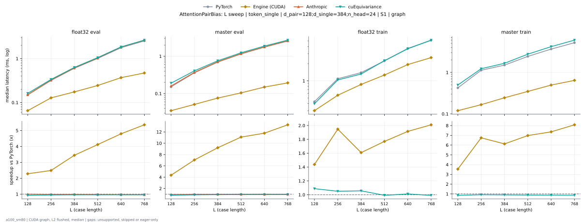

**float32 eval** (median ms; x = speedup vs PyTorch)

| L | PyTorch | Engine (Triton) | Engine (CUDA) | Anthropic | cuEquivariance |
|---|---|---|---|---|---|
| 128 | 0.1505 | 0.127 (1.19x) | 0.1085 (1.39x) | 0.1505 (1.00x) | 0.1618 (0.93x) |
| 256 | 0.3185 | 0.2796 (1.14x) | 0.171 (1.86x) | 0.3246 (0.98x) | 0.3359 (0.95x) |
| 384 | 0.6031 | 0.5263 (1.15x) | 0.2202 (2.74x) | 0.6144 (0.98x) | 0.6298 (0.96x) |
| 512 | 1.007 | 0.8878 (1.13x) | 0.2877 (3.50x) | 1.033 (0.97x) | 1.054 (0.95x) |
| 640 | 1.779 | 1.587 (1.12x) | 0.4127 (4.31x) | 1.829 (0.97x) | 1.843 (0.96x) |
| 768 | 2.544 | 2.298 (1.11x) | 0.5156 (4.93x) | 2.616 (0.97x) | 2.631 (0.97x) |

**master eval** (median ms; x = speedup vs PyTorch)

| L | PyTorch | Engine (Triton) | Engine (CUDA) | Anthropic | cuEquivariance |
|---|---|---|---|---|---|
| 128 | 0.1516 | 0.1382 (1.10x) | 0.04915 (3.08x) | 0.1597 (0.95x) | 0.1905 (0.80x) |
| 256 | 0.3604 | 0.3359 (1.07x) | 0.06656 (5.42x) | 0.3707 (0.97x) | 0.4065 (0.89x) |
| 384 | 0.6984 | 0.6584 (1.06x) | 0.09114 (7.66x) | 0.7137 (0.98x) | 0.7578 (0.92x) |
| 512 | 1.166 | 1.1 (1.06x) | 0.1198 (9.73x) | 1.174 (0.99x) | 1.242 (0.94x) |
| 640 | 1.768 | 1.673 (1.06x) | 0.1649 (10.72x) | 1.779 (0.99x) | 1.878 (0.94x) |
| 768 | 2.565 | 2.436 (1.05x) | 0.2079 (12.34x) | 2.607 (0.98x) | 2.714 (0.95x) |

**float32 train** (median ms; x = speedup vs PyTorch)

| L | PyTorch | Engine (Triton) | Engine (CUDA) | Anthropic | cuEquivariance |
|---|---|---|---|---|---|
| 128 | 0.4291 | 0.3707 (1.16x) | 0.298 (1.44x) | unsupported | 0.3963 (1.08x) |
| 256 | 1.09 | 1.001 (1.09x) | 0.556 (1.96x) | unsupported | 1.036 (1.05x) |
| 384 | 1.392 | 1.228 (1.13x) | 0.8622 (1.61x) | unsupported | 1.317 (1.06x) |
| 512 | 2.261 | 2.039 (1.11x) | 1.263 (1.79x) | unsupported | 2.256 (1.00x) |
| 640 | 3.755 | 3.35 (1.12x) | 1.922 (1.95x) | unsupported | 3.652 (1.03x) |
| 768 | 5.208 | 4.684 (1.11x) | 2.545 (2.05x) | unsupported | 5.174 (1.01x) |

**master train** (median ms; x = speedup vs PyTorch)

| L | PyTorch | Engine (Triton) | Engine (CUDA) | Anthropic | cuEquivariance |
|---|---|---|---|---|---|
| 128 | 0.426 | 0.4127 (1.03x) | 0.1188 (3.59x) | unsupported | 0.4966 (0.86x) |
| 256 | 1.126 | 1.097 (1.03x) | 0.1664 (6.77x) | unsupported | 1.226 (0.92x) |
| 384 | 1.497 | 1.447 (1.03x) | 0.2447 (6.12x) | unsupported | 1.658 (0.90x) |
| 512 | 2.432 | 2.377 (1.02x) | 0.3482 (6.99x) | unsupported | 2.75 (0.88x) |
| 640 | 3.65 | 3.595 (1.02x) | 0.4956 (7.36x) | unsupported | 4.175 (0.87x) |
| 768 | 5.206 | 5.152 (1.01x) | 0.6431 (8.10x) | unsupported | 5.997 (0.87x) |

### L sweep: token_single | d_pair=128;d_single=512;n_head=16 | S1 | graph

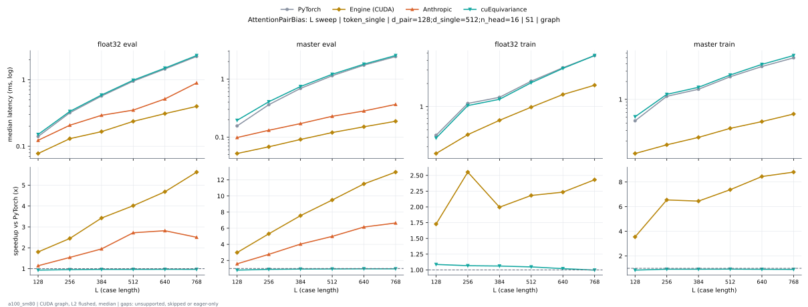

**float32 eval** (median ms; x = speedup vs PyTorch)

| L | PyTorch | Engine (Triton) | Engine (CUDA) | Anthropic | cuEquivariance |
|---|---|---|---|---|---|
| 128 | 0.1403 | 0.1178 (1.19x) | 0.07782 (1.80x) | 0.1229 (1.14x) | 0.1505 (0.93x) |
| 256 | 0.3185 | 0.2816 (1.13x) | 0.13 (2.45x) | 0.2068 (1.54x) | 0.3338 (0.95x) |
| 384 | 0.5683 | 0.5161 (1.10x) | 0.1659 (3.43x) | 0.2918 (1.95x) | 0.5888 (0.97x) |
| 512 | 0.9503 | 0.855 (1.11x) | 0.2365 (4.02x) | 0.3492 (2.72x) | 0.983 (0.97x) |
| 640 | 1.449 | 1.324 (1.09x) | 0.3092 (4.69x) | 0.514 (2.82x) | 1.494 (0.97x) |
| 768 | 2.235 | 2.063 (1.08x) | 0.3973 (5.63x) | 0.8929 (2.50x) | 2.309 (0.97x) |

**master eval** (median ms; x = speedup vs PyTorch)

| L | PyTorch | Engine (Triton) | Engine (CUDA) | Anthropic | cuEquivariance |
|---|---|---|---|---|---|
| 128 | 0.1556 | 0.1423 (1.09x) | 0.05222 (2.98x) | 0.0983 (1.58x) | 0.1946 (0.80x) |
| 256 | 0.3615 | 0.34 (1.06x) | 0.0681 (5.31x) | 0.1311 (2.76x) | 0.4065 (0.89x) |
| 384 | 0.6892 | 0.6533 (1.05x) | 0.09114 (7.56x) | 0.171 (4.03x) | 0.7424 (0.93x) |
| 512 | 1.139 | 1.089 (1.05x) | 0.1198 (9.50x) | 0.2284 (4.99x) | 1.207 (0.94x) |
| 640 | 1.732 | 1.649 (1.05x) | 0.1505 (11.50x) | 0.2816 (6.15x) | 1.801 (0.96x) |
| 768 | 2.43 | 2.343 (1.04x) | 0.1874 (12.97x) | 0.3656 (6.65x) | 2.538 (0.96x) |

**float32 train** (median ms; x = speedup vs PyTorch)

| L | PyTorch | Engine (Triton) | Engine (CUDA) | Anthropic | cuEquivariance |
|---|---|---|---|---|---|
| 128 | 0.4229 | 0.3707 (1.14x) | 0.2447 (1.73x) | unsupported | 0.3891 (1.09x) |
| 256 | 1.1 | 1.012 (1.09x) | 0.4311 (2.55x) | unsupported | 1.031 (1.07x) |
| 384 | 1.322 | 1.215 (1.09x) | 0.6625 (2.00x) | unsupported | 1.245 (1.06x) |
| 512 | 2.145 | 1.962 (1.09x) | 0.983 (2.18x) | unsupported | 2.047 (1.05x) |
| 640 | 3.212 | 2.972 (1.08x) | 1.438 (2.23x) | unsupported | 3.148 (1.02x) |
| 768 | 4.621 | 4.323 (1.07x) | 1.901 (2.43x) | unsupported | 4.636 (1.00x) |

**master train** (median ms; x = speedup vs PyTorch)

| L | PyTorch | Engine (Triton) | Engine (CUDA) | Anthropic | cuEquivariance |
|---|---|---|---|---|---|
| 128 | 0.4362 | 0.428 (1.02x) | 0.1229 (3.55x) | unsupported | 0.51 (0.86x) |
| 256 | 1.126 | 1.112 (1.01x) | 0.172 (6.55x) | unsupported | 1.214 (0.93x) |
| 384 | 1.48 | 1.459 (1.01x) | 0.2294 (6.45x) | unsupported | 1.596 (0.93x) |
| 512 | 2.402 | 2.387 (1.01x) | 0.3256 (7.38x) | unsupported | 2.571 (0.93x) |
| 640 | 3.572 | 3.58 (1.00x) | 0.4229 (8.45x) | unsupported | 3.88 (0.92x) |
| 768 | 4.994 | 5.018 (1.00x) | 0.5673 (8.80x) | unsupported | 5.472 (0.91x) |

### L sweep: token_single | d_pair=256;d_single=384;gate_bias=1.0;n_head=16 | S1 | graph

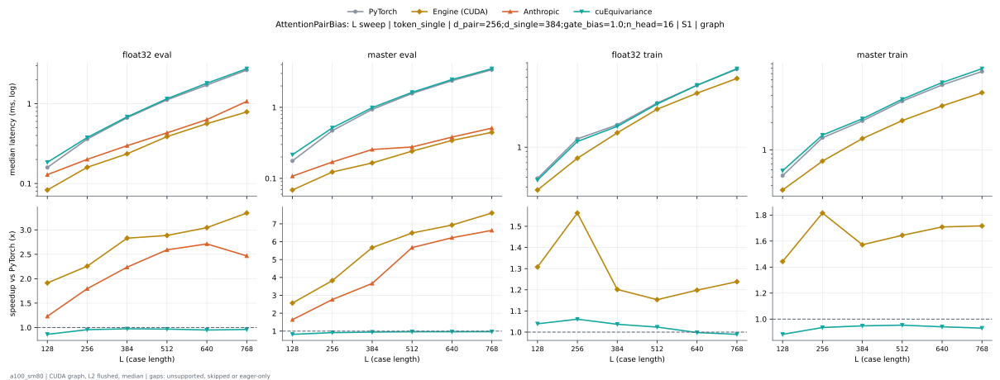

**float32 eval** (median ms; x = speedup vs PyTorch)

| L | PyTorch | Engine (Triton) | Engine (CUDA) | Anthropic | cuEquivariance |
|---|---|---|---|---|---|
| 128 | 0.1608 | 0.1393 (1.15x) | 0.1229 (1.31x) | 0.129 (1.25x) | 0.1843 (0.87x) |
| 256 | 0.3615 | 0.3277 (1.10x) | 0.1997 (1.81x) | 0.2007 (1.80x) | 0.3768 (0.96x) |
| 384 | 0.6646 | 0.6175 (1.08x) | 0.2744 (2.42x) | 0.298 (2.23x) | 0.684 (0.97x) |
| 512 | 1.121 | 1.041 (1.08x) | 0.4275 (2.62x) | 0.4311 (2.60x) | 1.153 (0.97x) |
| 640 | 1.76 | 1.627 (1.08x) | 0.5985 (2.94x) | 0.6318 (2.79x) | 1.805 (0.97x) |
| 768 | 2.708 | 2.54 (1.07x) | 0.7885 (3.43x) | 1.069 (2.53x) | 2.744 (0.99x) |

**master eval** (median ms; x = speedup vs PyTorch)

| L | PyTorch | Engine (Triton) | Engine (CUDA) | Anthropic | cuEquivariance |
|---|---|---|---|---|---|
| 128 | 0.1751 | 0.1649 (1.06x) | 0.1167 (1.50x) | 0.1075 (1.63x) | 0.215 (0.81x) |
| 256 | 0.471 | 0.4506 (1.05x) | 0.172 (2.74x) | 0.17 (2.77x) | 0.514 (0.92x) |
| 384 | 0.9421 | 0.9073 (1.04x) | 0.214 (4.40x) | 0.255 (3.69x) | 0.9892 (0.95x) |
| 512 | 1.568 | 1.52 (1.03x) | 0.2877 (5.45x) | 0.2765 (5.67x) | 1.626 (0.96x) |
| 640 | 2.384 | 2.333 (1.02x) | 0.386 (6.18x) | 0.3809 (6.26x) | 2.461 (0.97x) |
| 768 | 3.417 | 3.329 (1.03x) | 0.4946 (6.91x) | 0.5094 (6.71x) | 3.496 (0.98x) |

**float32 train** (median ms; x = speedup vs PyTorch)

| L | PyTorch | Engine (Triton) | Engine (CUDA) | Anthropic | cuEquivariance |
|---|---|---|---|---|---|
| 128 | 0.4864 | 0.4403 (1.10x) | 0.3717 (1.31x) | unsupported | 0.469 (1.04x) |
| 256 | 1.21 | 1.136 (1.07x) | 0.7711 (1.57x) | unsupported | 1.142 (1.06x) |
| 384 | 1.689 | 1.582 (1.07x) | 1.396 (1.21x) | unsupported | 1.615 (1.05x) |
| 512 | 2.809 | 2.641 (1.06x) | 2.385 (1.18x) | unsupported | 2.706 (1.04x) |
| 640 | 4.237 | 4.006 (1.06x) | 3.482 (1.22x) | unsupported | 4.177 (1.01x) |
| 768 | 6.116 | 5.843 (1.05x) | 4.867 (1.26x) | unsupported | 6.113 (1.00x) |

**master train** (median ms; x = speedup vs PyTorch)

| L | PyTorch | Engine (Triton) | Engine (CUDA) | Anthropic | cuEquivariance |
|---|---|---|---|---|---|
| 128 | 0.5171 | 0.5222 (0.99x) | 0.3564 (1.45x) | unsupported | 0.5857 (0.88x) |
| 256 | 1.362 | 1.395 (0.98x) | 0.7475 (1.82x) | unsupported | 1.455 (0.94x) |
| 384 | 2.094 | 2.157 (0.97x) | 1.331 (1.57x) | unsupported | 2.209 (0.95x) |
| 512 | 3.467 | 3.585 (0.97x) | 2.106 (1.65x) | unsupported | 3.636 (0.95x) |
| 640 | 5.274 | 5.459 (0.97x) | 3.065 (1.72x) | unsupported | 5.572 (0.95x) |
| 768 | 7.459 | 7.706 (0.97x) | 4.297 (1.74x) | unsupported | 7.933 (0.94x) |

### L sweep: token_single | d_pair=256;d_single=384;n_head=16 | S1 | graph

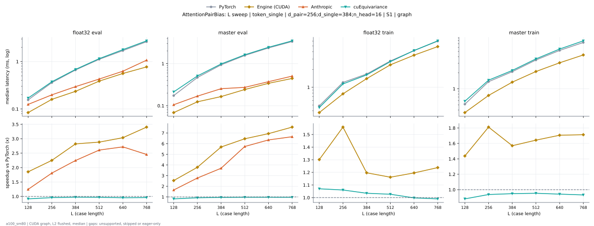

**float32 eval** (median ms; x = speedup vs PyTorch)

| L | PyTorch | Engine (Triton) | Engine (CUDA) | Anthropic | cuEquivariance |
|---|---|---|---|---|---|
| 128 | 0.1567 | 0.1372 (1.14x) | 0.1229 (1.28x) | 0.1249 (1.25x) | 0.17 (0.92x) |
| 256 | 0.3594 | 0.3267 (1.10x) | 0.1997 (1.80x) | 0.1987 (1.81x) | 0.3748 (0.96x) |
| 384 | 0.6625 | 0.6154 (1.08x) | 0.2744 (2.41x) | 0.2959 (2.24x) | 0.683 (0.97x) |
| 512 | 1.115 | 1.034 (1.08x) | 0.427 (2.61x) | 0.428 (2.61x) | 1.151 (0.97x) |
| 640 | 1.742 | 1.623 (1.07x) | 0.598 (2.91x) | 0.6262 (2.78x) | 1.784 (0.98x) |
| 768 | 2.683 | 2.538 (1.06x) | 0.7864 (3.41x) | 1.069 (2.51x) | 2.735 (0.98x) |

**master eval** (median ms; x = speedup vs PyTorch)

| L | PyTorch | Engine (Triton) | Engine (CUDA) | Anthropic | cuEquivariance |
|---|---|---|---|---|---|
| 128 | 0.1741 | 0.1628 (1.07x) | 0.1167 (1.49x) | 0.1055 (1.65x) | 0.213 (0.82x) |
| 256 | 0.468 | 0.4495 (1.04x) | 0.1731 (2.70x) | 0.169 (2.77x) | 0.51 (0.92x) |
| 384 | 0.9411 | 0.9042 (1.04x) | 0.214 (4.40x) | 0.254 (3.71x) | 0.9841 (0.96x) |
| 512 | 1.571 | 1.518 (1.04x) | 0.2867 (5.48x) | 0.2734 (5.75x) | 1.625 (0.97x) |
| 640 | 2.381 | 2.326 (1.02x) | 0.386 (6.17x) | 0.3727 (6.39x) | 2.455 (0.97x) |
| 768 | 3.393 | 3.315 (1.02x) | 0.4905 (6.92x) | 0.5059 (6.71x) | 3.494 (0.97x) |

**float32 train** (median ms; x = speedup vs PyTorch)

| L | PyTorch | Engine (Triton) | Engine (CUDA) | Anthropic | cuEquivariance |
|---|---|---|---|---|---|
| 128 | 0.4854 | 0.4393 (1.10x) | 0.3717 (1.31x) | unsupported | 0.4547 (1.07x) |
| 256 | 1.209 | 1.133 (1.07x) | 0.7741 (1.56x) | unsupported | 1.14 (1.06x) |
| 384 | 1.687 | 1.585 (1.06x) | 1.386 (1.22x) | unsupported | 1.618 (1.04x) |
| 512 | 2.804 | 2.645 (1.06x) | 2.386 (1.18x) | unsupported | 2.708 (1.04x) |
| 640 | 4.205 | 4.004 (1.05x) | 3.481 (1.21x) | unsupported | 4.175 (1.01x) |
| 768 | 6.11 | 5.831 (1.05x) | 4.874 (1.25x) | unsupported | 6.084 (1.00x) |

**master train** (median ms; x = speedup vs PyTorch)

| L | PyTorch | Engine (Triton) | Engine (CUDA) | Anthropic | cuEquivariance |
|---|---|---|---|---|---|
| 128 | 0.5151 | 0.5207 (0.99x) | 0.3553 (1.45x) | unsupported | 0.5847 (0.88x) |
| 256 | 1.361 | 1.393 (0.98x) | 0.7485 (1.82x) | unsupported | 1.451 (0.94x) |
| 384 | 2.09 | 2.156 (0.97x) | 1.329 (1.57x) | unsupported | 2.206 (0.95x) |
| 512 | 3.463 | 3.583 (0.97x) | 2.103 (1.65x) | unsupported | 3.633 (0.95x) |
| 640 | 5.27 | 5.421 (0.97x) | 3.066 (1.72x) | unsupported | 5.561 (0.95x) |
| 768 | 7.452 | 7.698 (0.97x) | 4.305 (1.73x) | unsupported | 7.92 (0.94x) |

### L sweep: token_single | d_pair=384;d_single=384;n_head=16 | S1 | graph

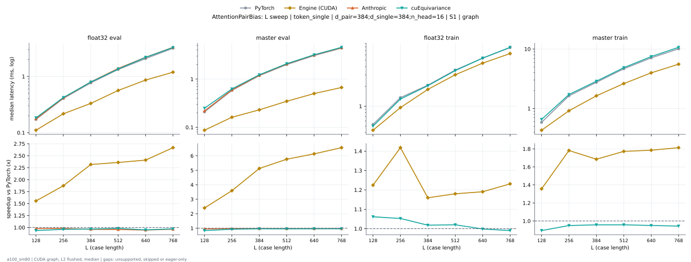

**float32 eval** (median ms; x = speedup vs PyTorch)

| L | PyTorch | Engine (Triton) | Engine (CUDA) | Anthropic | cuEquivariance |
|---|---|---|---|---|---|
| 128 | 0.172 | 0.1505 (1.14x) | 0.1516 (1.14x) | 0.1761 (0.98x) | 0.1838 (0.94x) |
| 256 | 0.4076 | 0.3748 (1.09x) | 0.257 (1.59x) | 0.4147 (0.98x) | 0.4229 (0.96x) |
| 384 | 0.7736 | 0.7378 (1.05x) | 0.3717 (2.08x) | 0.7997 (0.97x) | 0.7946 (0.97x) |
| 512 | 1.355 | 1.273 (1.06x) | 0.6042 (2.24x) | 1.39 (0.97x) | 1.358 (1.00x) |
| 640 | 2.127 | 2.015 (1.06x) | 0.875 (2.43x) | 2.196 (0.97x) | 2.187 (0.97x) |
| 768 | 3.232 | 3.092 (1.05x) | 1.229 (2.63x) | 3.298 (0.98x) | 3.274 (0.99x) |

**master eval** (median ms; x = speedup vs PyTorch)

| L | PyTorch | Engine (Triton) | Engine (CUDA) | Anthropic | cuEquivariance |
|---|---|---|---|---|---|
| 128 | 0.2089 | 0.1976 (1.06x) | 0.1331 (1.57x) | 0.2191 (0.95x) | 0.2488 (0.84x) |
| 256 | 0.5827 | 0.5632 (1.03x) | 0.2109 (2.76x) | 0.596 (0.98x) | 0.6257 (0.93x) |
| 384 | 1.18 | 1.156 (1.02x) | 0.2755 (4.28x) | 1.202 (0.98x) | 1.229 (0.96x) |
| 512 | 2.022 | 1.99 (1.02x) | 0.3994 (5.06x) | 2.055 (0.98x) | 2.088 (0.97x) |
| 640 | 3.127 | 3.072 (1.02x) | 0.5489 (5.70x) | 3.158 (0.99x) | 3.195 (0.98x) |
| 768 | 4.454 | 4.399 (1.01x) | 0.7137 (6.24x) | 4.491 (0.99x) | 4.564 (0.98x) |

**float32 train** (median ms; x = speedup vs PyTorch)

| L | PyTorch | Engine (Triton) | Engine (CUDA) | Anthropic | cuEquivariance |
|---|---|---|---|---|---|
| 128 | 0.5294 | 0.4833 (1.10x) | 0.4301 (1.23x) | unsupported | 0.4997 (1.06x) |
| 256 | 1.356 | 1.276 (1.06x) | 0.9533 (1.42x) | unsupported | 1.287 (1.05x) |
| 384 | 2.127 | 2.023 (1.05x) | 1.796 (1.18x) | unsupported | 2.055 (1.04x) |
| 512 | 3.591 | 3.437 (1.04x) | 2.994 (1.20x) | unsupported | 3.481 (1.03x) |
| 640 | 5.467 | 5.248 (1.04x) | 4.506 (1.21x) | unsupported | 5.391 (1.01x) |
| 768 | 7.873 | 7.689 (1.02x) | 6.303 (1.25x) | unsupported | 7.855 (1.00x) |

**master train** (median ms; x = speedup vs PyTorch)

| L | PyTorch | Engine (Triton) | Engine (CUDA) | Anthropic | cuEquivariance |
|---|---|---|---|---|---|
| 128 | 0.5847 | 0.5939 (0.98x) | 0.4291 (1.36x) | unsupported | 0.6543 (0.89x) |
| 256 | 1.632 | 1.661 (0.98x) | 0.9114 (1.79x) | unsupported | 1.718 (0.95x) |
| 384 | 2.763 | 2.83 (0.98x) | 1.631 (1.69x) | unsupported | 2.876 (0.96x) |
| 512 | 4.712 | 4.799 (0.98x) | 2.628 (1.79x) | unsupported | 4.857 (0.97x) |
| 640 | 7.175 | 7.366 (0.97x) | 3.965 (1.81x) | unsupported | 7.476 (0.96x) |
| 768 | 10.19 | 10.46 (0.97x) | 5.539 (1.84x) | unsupported | 10.68 (0.95x) |

### L sweep: token_single | d_pair=384;d_single=384;n_head=8 | S1 | graph

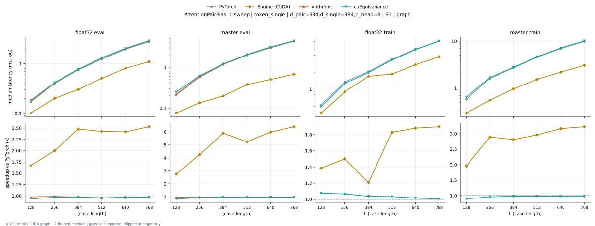

**float32 eval** (median ms; x = speedup vs PyTorch)

| L | PyTorch | Engine (Triton) | Engine (CUDA) | Anthropic | cuEquivariance |
|---|---|---|---|---|---|
| 128 | 0.1731 | 0.1495 (1.16x) | 0.1157 (1.50x) | 0.1751 (0.99x) | 0.1833 (0.94x) |
| 256 | 0.4035 | 0.3666 (1.10x) | 0.213 (1.89x) | 0.4096 (0.99x) | 0.4168 (0.97x) |
| 384 | 0.7526 | 0.7086 (1.06x) | 0.3133 (2.40x) | 0.7736 (0.97x) | 0.7731 (0.97x) |
| 512 | 1.293 | 1.212 (1.07x) | 0.5274 (2.45x) | 1.298 (1.00x) | 1.31 (0.99x) |
| 640 | 1.991 | 1.923 (1.04x) | 0.8172 (2.44x) | 2.037 (0.98x) | 2.004 (0.99x) |
| 768 | 2.835 | 2.75 (1.03x) | 1.11 (2.55x) | 2.879 (0.98x) | 2.876 (0.99x) |

**master eval** (median ms; x = speedup vs PyTorch)

| L | PyTorch | Engine (Triton) | Engine (CUDA) | Anthropic | cuEquivariance |
|---|---|---|---|---|---|
| 128 | 0.2079 | 0.1966 (1.06x) | 0.09728 (2.14x) | 0.2191 (0.95x) | 0.2478 (0.84x) |
| 256 | 0.5734 | 0.554 (1.04x) | 0.1587 (3.61x) | 0.5878 (0.98x) | 0.6175 (0.93x) |
| 384 | 1.166 | 1.134 (1.03x) | 0.213 (5.48x) | 1.187 (0.98x) | 1.208 (0.97x) |
| 512 | 1.989 | 1.963 (1.01x) | 0.4004 (4.97x) | 2.019 (0.98x) | 2.043 (0.97x) |
| 640 | 3.064 | 3.012 (1.02x) | 0.5253 (5.83x) | 3.097 (0.99x) | 3.129 (0.98x) |
| 768 | 4.353 | 4.315 (1.01x) | 0.6943 (6.27x) | 4.421 (0.98x) | 4.426 (0.98x) |

**float32 train** (median ms; x = speedup vs PyTorch)

| L | PyTorch | Engine (Triton) | Engine (CUDA) | Anthropic | cuEquivariance |
|---|---|---|---|---|---|
| 128 | 0.5274 | 0.4772 (1.11x) | 0.3799 (1.39x) | unsupported | 0.4905 (1.08x) |
| 256 | 1.351 | 1.264 (1.07x) | 0.897 (1.51x) | unsupported | 1.266 (1.07x) |
| 384 | 2.078 | 1.957 (1.06x) | 1.688 (1.23x) | unsupported | 1.973 (1.05x) |
| 512 | 3.445 | 3.288 (1.05x) | 1.853 (1.86x) | unsupported | 3.287 (1.05x) |
| 640 | 5.152 | 4.975 (1.04x) | 2.712 (1.90x) | unsupported | 5.02 (1.03x) |
| 768 | 7.264 | 7.047 (1.03x) | 3.764 (1.93x) | unsupported | 7.115 (1.02x) |

**master train** (median ms; x = speedup vs PyTorch)

| L | PyTorch | Engine (Triton) | Engine (CUDA) | Anthropic | cuEquivariance |
|---|---|---|---|---|---|
| 128 | 0.5837 | 0.5857 (1.00x) | 0.2959 (1.97x) | unsupported | 0.6523 (0.89x) |
| 256 | 1.623 | 1.638 (0.99x) | 0.5581 (2.91x) | unsupported | 1.69 (0.96x) |
| 384 | 2.736 | 2.769 (0.99x) | 0.9615 (2.85x) | unsupported | 2.787 (0.98x) |
| 512 | 4.618 | 4.713 (0.98x) | 1.541 (3.00x) | unsupported | 4.691 (0.98x) |
| 640 | 7.055 | 7.216 (0.98x) | 2.23 (3.16x) | unsupported | 7.163 (0.98x) |
| 768 | 10.02 | 10.25 (0.98x) | 3.07 (3.26x) | unsupported | 10.18 (0.98x) |

### L sweep: token_single | d_pair=512;d_single=384;n_head=16 | S1 | graph

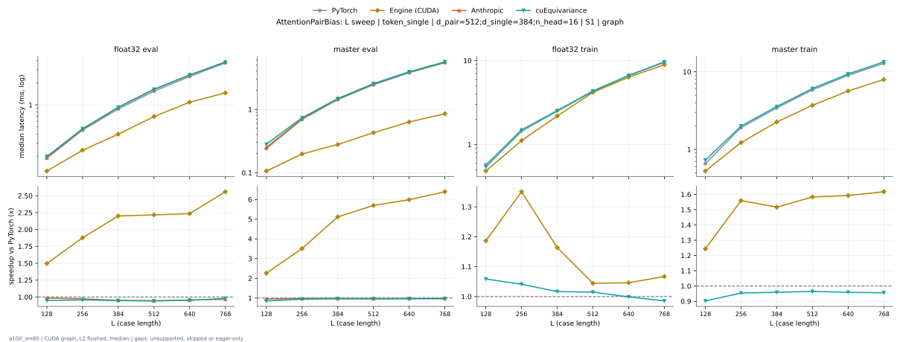

**float32 eval** (median ms; x = speedup vs PyTorch)

| L | PyTorch | Engine (Triton) | Engine (CUDA) | Anthropic | cuEquivariance |
|---|---|---|---|---|---|
| 128 | 0.1884 | 0.1659 (1.14x) | 0.1669 (1.13x) | 0.1915 (0.98x) | 0.1987 (0.95x) |
| 256 | 0.4547 | 0.425 (1.07x) | 0.2867 (1.59x) | 0.4659 (0.98x) | 0.4741 (0.96x) |
| 384 | 0.8858 | 0.8632 (1.03x) | 0.4311 (2.05x) | 0.9252 (0.96x) | 0.9277 (0.95x) |
| 512 | 1.584 | 1.495 (1.06x) | 0.7224 (2.19x) | 1.63 (0.97x) | 1.627 (0.97x) |
| 640 | 2.503 | 2.39 (1.05x) | 1.12 (2.23x) | 2.547 (0.98x) | 2.556 (0.98x) |
| 768 | 3.763 | 3.627 (1.04x) | 1.501 (2.51x) | 3.857 (0.98x) | 3.804 (0.99x) |

**master eval** (median ms; x = speedup vs PyTorch)

| L | PyTorch | Engine (Triton) | Engine (CUDA) | Anthropic | cuEquivariance |
|---|---|---|---|---|---|
| 128 | 0.2406 | 0.2294 (1.05x) | 0.1546 (1.56x) | 0.2519 (0.96x) | 0.2816 (0.85x) |
| 256 | 0.6994 | 0.6738 (1.04x) | 0.2447 (2.86x) | 0.7107 (0.98x) | 0.7383 (0.95x) |
| 384 | 1.437 | 1.409 (1.02x) | 0.3287 (4.37x) | 1.461 (0.98x) | 1.483 (0.97x) |
| 512 | 2.484 | 2.461 (1.01x) | 0.4731 (5.25x) | 2.516 (0.99x) | 2.556 (0.97x) |
| 640 | 3.845 | 3.807 (1.01x) | 0.6779 (5.67x) | 3.908 (0.98x) | 3.933 (0.98x) |
| 768 | 5.529 | 5.445 (1.02x) | 0.9093 (6.08x) | 5.576 (0.99x) | 5.645 (0.98x) |

**float32 train** (median ms; x = speedup vs PyTorch)

| L | PyTorch | Engine (Triton) | Engine (CUDA) | Anthropic | cuEquivariance |
|---|---|---|---|---|---|
| 128 | 0.5724 | 0.5253 (1.09x) | 0.4813 (1.19x) | unsupported | 0.5417 (1.06x) |
| 256 | 1.506 | 1.438 (1.05x) | 1.102 (1.37x) | unsupported | 1.444 (1.04x) |
| 384 | 2.57 | 2.469 (1.04x) | 2.176 (1.18x) | unsupported | 2.499 (1.03x) |
| 512 | 4.406 | 4.247 (1.04x) | 4.15 (1.06x) | unsupported | 4.293 (1.03x) |
| 640 | 6.704 | 6.486 (1.03x) | 6.35 (1.06x) | unsupported | 6.632 (1.01x) |
| 768 | 9.654 | 9.43 (1.02x) | 8.898 (1.09x) | unsupported | 9.644 (1.00x) |

**master train** (median ms; x = speedup vs PyTorch)

| L | PyTorch | Engine (Triton) | Engine (CUDA) | Anthropic | cuEquivariance |
|---|---|---|---|---|---|
| 128 | 0.6543 | 0.6666 (0.98x) | 0.5243 (1.25x) | unsupported | 0.725 (0.90x) |
| 256 | 1.908 | 1.894 (1.01x) | 1.219 (1.56x) | unsupported | 1.998 (0.95x) |
| 384 | 3.445 | 3.443 (1.00x) | 2.253 (1.53x) | unsupported | 3.567 (0.97x) |
| 512 | 5.903 | 5.904 (1.00x) | 3.695 (1.60x) | unsupported | 6.072 (0.97x) |
| 640 | 9.071 | 9.097 (1.00x) | 5.649 (1.61x) | unsupported | 9.383 (0.97x) |
| 768 | 12.96 | 12.99 (1.00x) | 7.919 (1.64x) | unsupported | 13.44 (0.96x) |

### d_pair sweep at L768: token_single | - | S1 | graph

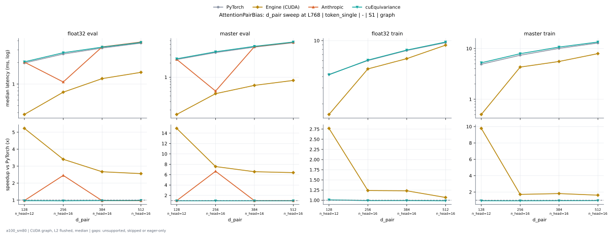

**float32 eval** (median ms; x = speedup vs PyTorch)

| d_pair | PyTorch | Engine (Triton) | Engine (CUDA) | Anthropic | cuEquivariance |
|---|---|---|---|---|---|
| 128 n_head=12 | 1.973 | 1.823 (1.08x) | 0.3891 (5.07x) | 2.022 (0.98x) | 2.041 (0.97x) |
| 256 n_head=16 | 2.683 | 2.538 (1.06x) | 0.7864 (3.41x) | 1.069 (2.51x) | 2.735 (0.98x) |
| 384 n_head=16 | 3.232 | 3.092 (1.05x) | 1.229 (2.63x) | 3.298 (0.98x) | 3.274 (0.99x) |
| 512 n_head=16 | 3.763 | 3.627 (1.04x) | 1.501 (2.51x) | 3.857 (0.98x) | 3.804 (0.99x) |

**master eval** (median ms; x = speedup vs PyTorch)

| d_pair | PyTorch | Engine (Triton) | Engine (CUDA) | Anthropic | cuEquivariance |
|---|---|---|---|---|---|
| 128 n_head=12 | 2.394 | 2.311 (1.04x) | 0.1761 (13.59x) | 2.408 (0.99x) | 2.473 (0.97x) |
| 256 n_head=16 | 3.393 | 3.315 (1.02x) | 0.4905 (6.92x) | 0.5059 (6.71x) | 3.494 (0.97x) |
| 384 n_head=16 | 4.454 | 4.399 (1.01x) | 0.7137 (6.24x) | 4.491 (0.99x) | 4.564 (0.98x) |
| 512 n_head=16 | 5.529 | 5.445 (1.02x) | 0.9093 (6.08x) | 5.576 (0.99x) | 5.645 (0.98x) |

**float32 train** (median ms; x = speedup vs PyTorch)

| d_pair | PyTorch | Engine (Triton) | Engine (CUDA) | Anthropic | cuEquivariance |
|---|---|---|---|---|---|
| 128 n_head=12 | 4.292 | 4.001 (1.07x) | 1.519 (2.83x) | unsupported | 4.194 (1.02x) |
| 256 n_head=16 | 6.11 | 5.831 (1.05x) | 4.874 (1.25x) | unsupported | 6.084 (1.00x) |
| 384 n_head=16 | 7.873 | 7.689 (1.02x) | 6.303 (1.25x) | unsupported | 7.855 (1.00x) |
| 512 n_head=16 | 9.654 | 9.43 (1.02x) | 8.898 (1.09x) | unsupported | 9.644 (1.00x) |

**master train** (median ms; x = speedup vs PyTorch)

| d_pair | PyTorch | Engine (Triton) | Engine (CUDA) | Anthropic | cuEquivariance |
|---|---|---|---|---|---|
| 128 n_head=12 | 4.917 | 5.087 (0.97x) | 0.5018 (9.80x) | unsupported | 5.24 (0.94x) |
| 256 n_head=16 | 7.452 | 7.698 (0.97x) | 4.305 (1.73x) | unsupported | 7.92 (0.94x) |
| 384 n_head=16 | 10.19 | 10.46 (0.97x) | 5.539 (1.84x) | unsupported | 10.68 (0.95x) |
| 512 n_head=16 | 12.96 | 12.99 (1.00x) | 7.919 (1.64x) | unsupported | 13.44 (0.96x) |

### n_head sweep at L768: token_single | - | S1 | graph

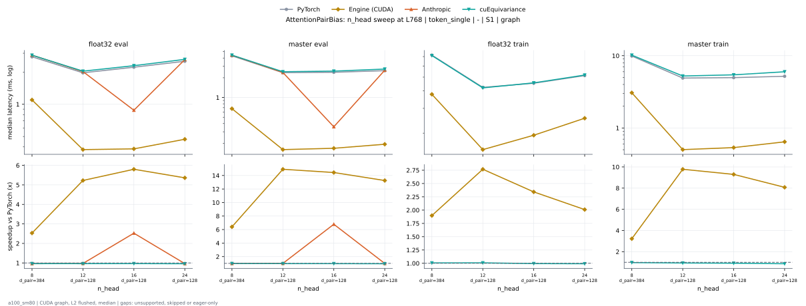

**float32 eval** (median ms; x = speedup vs PyTorch)

| n_head | PyTorch | Engine (Triton) | Engine (CUDA) | Anthropic | cuEquivariance |
|---|---|---|---|---|---|
| 8 d_pair=384 | 2.835 | 2.75 (1.03x) | 1.11 (2.55x) | 2.879 (0.98x) | 2.876 (0.99x) |
| 12 d_pair=128 | 1.973 | 1.823 (1.08x) | 0.3891 (5.07x) | 2.022 (0.98x) | 2.041 (0.97x) |
| 16 d_pair=128 | 2.216 | 2.059 (1.08x) | 0.4142 (5.35x) | 0.8796 (2.52x) | 2.296 (0.97x) |
| 24 d_pair=128 | 2.544 | 2.298 (1.11x) | 0.5156 (4.93x) | 2.616 (0.97x) | 2.631 (0.97x) |

**master eval** (median ms; x = speedup vs PyTorch)

| n_head | PyTorch | Engine (Triton) | Engine (CUDA) | Anthropic | cuEquivariance |
|---|---|---|---|---|---|
| 8 d_pair=384 | 4.353 | 4.315 (1.01x) | 0.6943 (6.27x) | 4.421 (0.98x) | 4.426 (0.98x) |
| 12 d_pair=128 | 2.394 | 2.311 (1.04x) | 0.1761 (13.59x) | 2.408 (0.99x) | 2.473 (0.97x) |
| 16 d_pair=128 | 2.421 | 2.34 (1.03x) | 0.1823 (13.28x) | 0.3574 (6.77x) | 2.526 (0.96x) |
| 24 d_pair=128 | 2.565 | 2.436 (1.05x) | 0.2079 (12.34x) | 2.607 (0.98x) | 2.714 (0.95x) |

**float32 train** (median ms; x = speedup vs PyTorch)

| n_head | PyTorch | Engine (Triton) | Engine (CUDA) | Anthropic | cuEquivariance |
|---|---|---|---|---|---|
| 8 d_pair=384 | 7.264 | 7.047 (1.03x) | 3.764 (1.93x) | unsupported | 7.115 (1.02x) |
| 12 d_pair=128 | 4.292 | 4.001 (1.07x) | 1.519 (2.83x) | unsupported | 4.194 (1.02x) |
| 16 d_pair=128 | 4.548 | 4.306 (1.06x) | 1.912 (2.38x) | unsupported | 4.553 (1.00x) |
| 24 d_pair=128 | 5.208 | 4.684 (1.11x) | 2.545 (2.05x) | unsupported | 5.174 (1.01x) |

**master train** (median ms; x = speedup vs PyTorch)

| n_head | PyTorch | Engine (Triton) | Engine (CUDA) | Anthropic | cuEquivariance |
|---|---|---|---|---|---|
| 8 d_pair=384 | 10.02 | 10.25 (0.98x) | 3.07 (3.26x) | unsupported | 10.18 (0.98x) |
| 12 d_pair=128 | 4.917 | 5.087 (0.97x) | 0.5018 (9.80x) | unsupported | 5.24 (0.94x) |
| 16 d_pair=128 | 4.962 | 5.035 (0.99x) | 0.5622 (8.83x) | unsupported | 5.438 (0.91x) |
| 24 d_pair=128 | 5.206 | 5.152 (1.01x) | 0.6431 (8.10x) | unsupported | 5.997 (0.87x) |

