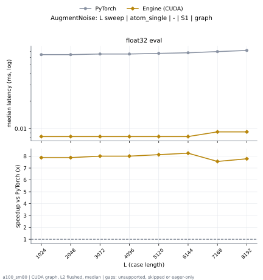
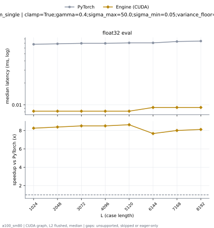

# AugmentNoise on a100_sm80

Generated by `python -m miniworld_engine.measure.plot` from speed tokens `judge/tokens/a100_sm80/`; do not edit.

### L sweep: atom_single | - | S1 | graph

**float32 eval** (median ms; x = speedup vs PyTorch)

| L | PyTorch | Engine (Triton) | Engine (CUDA) |
|---|---|---|---|
| 1024 | 0.06451 | 0.01024 (6.30x) | 0.008192 (7.87x) |
| 2048 | 0.06451 | 0.01024 (6.30x) | 0.008192 (7.87x) |
| 3072 | 0.06554 | 0.01024 (6.40x) | 0.008192 (8.00x) |
| 4096 | 0.06554 | 0.009216 (7.11x) | 0.008192 (8.00x) |
| 5120 | 0.06656 | 0.01024 (6.50x) | 0.008192 (8.13x) |
| 6144 | 0.06758 | 0.01024 (6.60x) | 0.008192 (8.25x) |
| 7168 | 0.06963 | 0.01024 (6.80x) | 0.009216 (7.56x) |
| 8192 | 0.07168 | 0.01024 (7.00x) | 0.009216 (7.78x) |

### L sweep: atom_single | clamp=True;gamma=0.4;sigma_max=50.0;sigma_min=0.05;variance_floor=1e-06;window=1 | S1 | graph

**float32 eval** (median ms; x = speedup vs PyTorch)

| L | PyTorch | Engine (Triton) | Engine (CUDA) |
|---|---|---|---|
| 1024 | 0.06758 | 0.009728 (6.95x) | 0.008192 (8.25x) |
| 2048 | 0.06861 | 0.01024 (6.70x) | 0.008192 (8.38x) |
| 3072 | 0.06963 | 0.01024 (6.80x) | 0.008192 (8.50x) |
| 4096 | 0.06963 | 0.01024 (6.80x) | 0.008192 (8.50x) |
| 5120 | 0.07066 | 0.01024 (6.90x) | 0.008192 (8.63x) |
| 6144 | 0.07066 | 0.01024 (6.90x) | 0.009216 (7.67x) |
| 7168 | 0.07373 | 0.01024 (7.20x) | 0.009216 (8.00x) |
| 8192 | 0.07475 | 0.01024 (7.30x) | 0.009216 (8.11x) |

