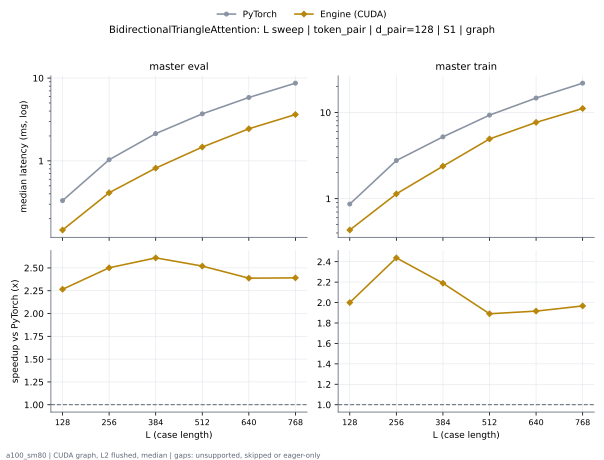

# BidirectionalTriangleAttention on a100_sm80

Generated by `python -m miniworld_engine.measure.plot` from speed tokens `judge/tokens/a100_sm80/`; do not edit.

### L sweep: token_pair | d_pair=128 | S1 | graph

**master eval** (median ms; x = speedup vs PyTorch)

| L | PyTorch | Engine (CUDA) |
|---|---|---|
| 128 | 0.3318 | 0.1464 (2.27x) |
| 256 | 1.032 | 0.4127 (2.50x) |
| 384 | 2.134 | 0.8177 (2.61x) |
| 512 | 3.698 | 1.467 (2.52x) |
| 640 | 5.829 | 2.442 (2.39x) |
| 768 | 8.676 | 3.629 (2.39x) |

**master train** (median ms; x = speedup vs PyTorch)

| L | PyTorch | Engine (CUDA) |
|---|---|---|
| 128 | 0.8663 | 0.4332 (2.00x) |
| 256 | 2.77 | 1.137 (2.44x) |
| 384 | 5.216 | 2.382 (2.19x) |
| 512 | 9.322 | 4.932 (1.89x) |
| 640 | 14.71 | 7.678 (1.92x) |
| 768 | 21.9 | 11.13 (1.97x) |

