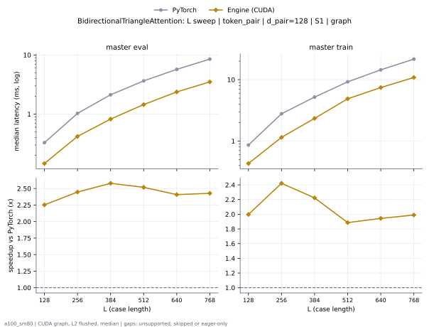

# BidirectionalTriangleAttention on a100_sm80

Generated by `python -m miniworld_engine.measure.plot` from speed tokens `judge/tokens/a100_sm80/`; do not edit.

### L sweep: token_pair | d_pair=128 | S1 | graph

**master eval** (median ms; x = speedup vs PyTorch)

| L | PyTorch | Engine (CUDA) |
|---|---|---|
| 128 | 0.3287 | 0.1459 (2.25x) |
| 256 | 1.027 | 0.4198 (2.45x) |
| 384 | 2.123 | 0.8233 (2.58x) |
| 512 | 3.645 | 1.448 (2.52x) |
| 640 | 5.711 | 2.372 (2.41x) |
| 768 | 8.513 | 3.507 (2.43x) |

**master train** (median ms; x = speedup vs PyTorch)

| L | PyTorch | Engine (CUDA) |
|---|---|---|
| 128 | 0.8622 | 0.4316 (2.00x) |
| 256 | 2.783 | 1.149 (2.42x) |
| 384 | 5.209 | 2.343 (2.22x) |
| 512 | 9.212 | 4.883 (1.89x) |
| 640 | 14.47 | 7.442 (1.94x) |
| 768 | 21.61 | 10.86 (1.99x) |

