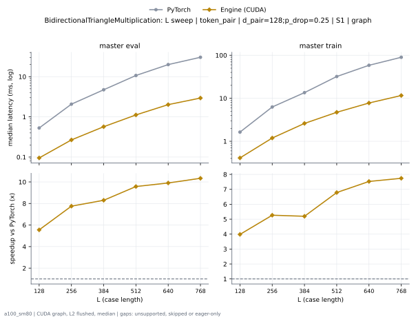
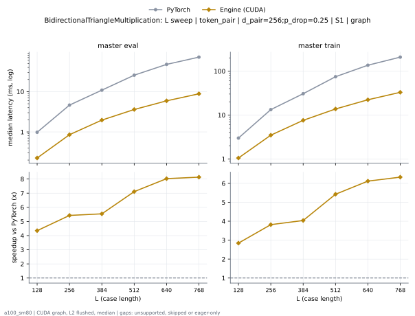
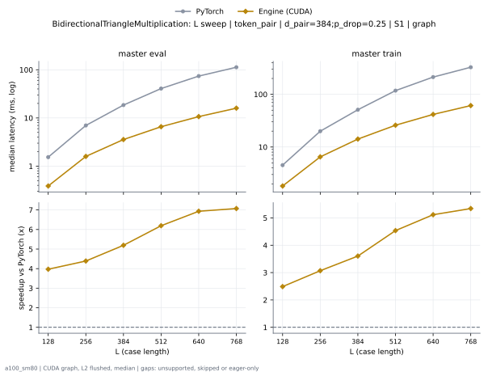
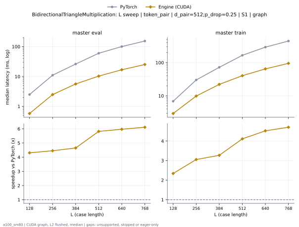
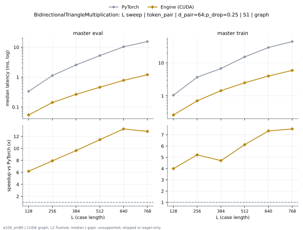
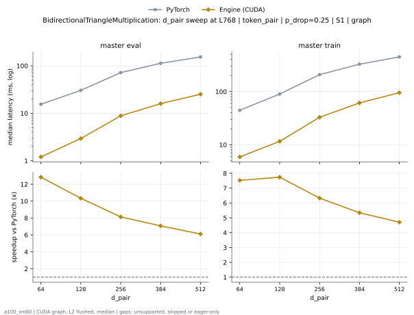

# BidirectionalTriangleMultiplication on a100_sm80

Generated by `python -m foldjet_engine.measure.plot` from speed tokens `judge/tokens/a100_sm80/`; do not edit.

### L sweep: token_pair | d_pair=128;p_drop=0.25 | S1 | graph

**master eval** (median ms; x = speedup vs PyTorch)

| L | PyTorch | Engine (Triton) | Engine (CUDA) |
|---|---|---|---|
| 128 | 0.5289 | 0.1597 (3.31x) | 0.09523 (5.55x) |
| 256 | 2.073 | 0.4311 (4.81x) | 0.2673 (7.75x) |
| 384 | 4.725 | 0.8643 (5.47x) | 0.5693 (8.30x) |
| 512 | 10.71 | 1.584 (6.76x) | 1.119 (9.57x) |
| 640 | 19.98 | 2.632 (7.59x) | 2.017 (9.90x) |
| 768 | 30.39 | 3.856 (7.88x) | 2.939 (10.34x) |

**master train** (median ms; x = speedup vs PyTorch)

| L | PyTorch | Engine (Triton) | Engine (CUDA) |
|---|---|---|---|
| 128 | 1.635 | 0.5366 (3.05x) | 0.4106 (3.98x) |
| 256 | 6.275 | 1.583 (3.96x) | 1.191 (5.27x) |
| 384 | 13.54 | 3.306 (4.09x) | 2.605 (5.20x) |
| 512 | 32.06 | 5.869 (5.46x) | 4.725 (6.79x) |
| 640 | 58.48 | 9.762 (5.99x) | 7.769 (7.53x) |
| 768 | 89.82 | 14.45 (6.22x) | 11.61 (7.74x) |

### L sweep: token_pair | d_pair=256;p_drop=0.25 | S1 | graph

**master eval** (median ms; x = speedup vs PyTorch)

| L | PyTorch | Engine (Triton) | Engine (CUDA) |
|---|---|---|---|
| 128 | 0.98 | 0.3686 (2.66x) | 0.2253 (4.35x) |
| 256 | 4.638 | 1.076 (4.31x) | 0.8545 (5.43x) |
| 384 | 10.9 | 2.321 (4.69x) | 1.967 (5.54x) |
| 512 | 25.64 | 4.133 (6.20x) | 3.606 (7.11x) |
| 640 | 47.47 | 6.708 (7.08x) | 5.914 (8.03x) |
| 768 | 71.95 | 9.93 (7.25x) | 8.846 (8.13x) |

**master train** (median ms; x = speedup vs PyTorch)

| L | PyTorch | Engine (Triton) | Engine (CUDA) |
|---|---|---|---|
| 128 | 2.985 | 1.077 (2.77x) | 1.05 (2.84x) |
| 256 | 13.27 | 3.694 (3.59x) | 3.474 (3.82x) |
| 384 | 30.55 | 7.876 (3.88x) | 7.564 (4.04x) |
| 512 | 74.45 | 14.24 (5.23x) | 13.72 (5.43x) |
| 640 | 136 | 24.76 (5.50x) | 22.24 (6.12x) |
| 768 | 208 | 36.54 (5.69x) | 32.87 (6.33x) |

### L sweep: token_pair | d_pair=384;p_drop=0.25 | S1 | graph

**master eval** (median ms; x = speedup vs PyTorch)

| L | PyTorch | Engine (Triton) | Engine (CUDA) |
|---|---|---|---|
| 128 | 1.537 | 0.6743 (2.28x) | 0.3871 (3.97x) |
| 256 | 6.987 | 2.075 (3.37x) | 1.592 (4.39x) |
| 384 | 18.52 | 4.491 (4.12x) | 3.566 (5.19x) |
| 512 | 40.75 | 7.922 (5.14x) | 6.579 (6.19x) |
| 640 | 73.97 | 12.92 (5.73x) | 10.67 (6.93x) |
| 768 | 112.8 | 19.11 (5.90x) | 15.96 (7.07x) |

**master train** (median ms; x = speedup vs PyTorch)

| L | PyTorch | Engine (Triton) | Engine (CUDA) |
|---|---|---|---|
| 128 | 4.528 | 1.932 (2.34x) | 1.82 (2.49x) |
| 256 | 19.95 | 6.921 (2.88x) | 6.502 (3.07x) |
| 384 | 51.02 | 15.14 (3.37x) | 14.16 (3.60x) |
| 512 | 117.6 | 27.39 (4.29x) | 25.93 (4.54x) |
| 640 | 212.7 | 45.01 (4.73x) | 41.59 (5.12x) |
| 768 | 326.9 | 66.24 (4.93x) | 61.2 (5.34x) |

### L sweep: token_pair | d_pair=512;p_drop=0.25 | S1 | graph

**master eval** (median ms; x = speedup vs PyTorch)

| L | PyTorch | Engine (Triton) | Engine (CUDA) |
|---|---|---|---|
| 128 | 2.487 | 1.141 (2.18x) | 0.5775 (4.31x) |
| 256 | 11.06 | 3.658 (3.02x) | 2.483 (4.45x) |
| 384 | 26.14 | 8.109 (3.22x) | 5.621 (4.65x) |
| 512 | 59.95 | 14.51 (4.13x) | 10.3 (5.82x) |
| 640 | 100.4 | 23.37 (4.29x) | 16.81 (5.97x) |
| 768 | 153.8 | 34.64 (4.44x) | 25.17 (6.11x) |

**master train** (median ms; x = speedup vs PyTorch)

| L | PyTorch | Engine (Triton) | Engine (CUDA) |
|---|---|---|---|
| 128 | 6.866 | 2.929 (2.34x) | 2.932 (2.34x) |
| 256 | 30.08 | 10.66 (2.82x) | 9.847 (3.05x) |
| 384 | 72.35 | 23.54 (3.07x) | 22.13 (3.27x) |
| 512 | 166.3 | 43.21 (3.85x) | 40.44 (4.11x) |
| 640 | 293.2 | 77.26 (3.79x) | 64.84 (4.52x) |
| 768 | 448 | 131.9 (3.40x) | 95.24 (4.70x) |

### L sweep: token_pair | d_pair=64;p_drop=0.25 | S1 | graph

**master eval** (median ms; x = speedup vs PyTorch)

| L | PyTorch | Engine (Triton) | Engine (CUDA) |
|---|---|---|---|
| 128 | 0.3359 | 0.09523 (3.53x) | 0.05427 (6.19x) |
| 256 | 1.128 | 0.2038 (5.54x) | 0.1423 (7.93x) |
| 384 | 2.567 | 0.3768 (6.81x) | 0.2662 (9.64x) |
| 512 | 5.269 | 0.6292 (8.37x) | 0.4598 (11.46x) |
| 640 | 10.37 | 1.035 (10.02x) | 0.7828 (13.25x) |
| 768 | 15.47 | 1.553 (9.96x) | 1.205 (12.84x) |

**master train** (median ms; x = speedup vs PyTorch)

| L | PyTorch | Engine (Triton) | Engine (CUDA) |
|---|---|---|---|
| 128 | 1.043 | 0.3174 (3.29x) | 0.2611 (4.00x) |
| 256 | 3.675 | 0.7956 (4.62x) | 0.7045 (5.22x) |
| 384 | 6.756 | 1.625 (4.16x) | 1.435 (4.71x) |
| 512 | 15.24 | 2.763 (5.52x) | 2.488 (6.13x) |
| 640 | 29.33 | 4.462 (6.57x) | 3.993 (7.35x) |
| 768 | 44.46 | 6.528 (6.81x) | 5.911 (7.52x) |

### d_pair sweep at L768: token_pair | p_drop=0.25 | S1 | graph

**master eval** (median ms; x = speedup vs PyTorch)

| d_pair | PyTorch | Engine (Triton) | Engine (CUDA) |
|---|---|---|---|
| 64 | 15.47 | 1.553 (9.96x) | 1.205 (12.84x) |
| 128 | 30.39 | 3.856 (7.88x) | 2.939 (10.34x) |
| 256 | 71.95 | 9.93 (7.25x) | 8.846 (8.13x) |
| 384 | 112.8 | 19.11 (5.90x) | 15.96 (7.07x) |
| 512 | 153.8 | 34.64 (4.44x) | 25.17 (6.11x) |

**master train** (median ms; x = speedup vs PyTorch)

| d_pair | PyTorch | Engine (Triton) | Engine (CUDA) |
|---|---|---|---|
| 64 | 44.46 | 6.528 (6.81x) | 5.911 (7.52x) |
| 128 | 89.82 | 14.45 (6.22x) | 11.61 (7.74x) |
| 256 | 208 | 36.54 (5.69x) | 32.87 (6.33x) |
| 384 | 326.9 | 66.24 (4.93x) | 61.2 (5.34x) |
| 512 | 448 | 131.9 (3.40x) | 95.24 (4.70x) |

