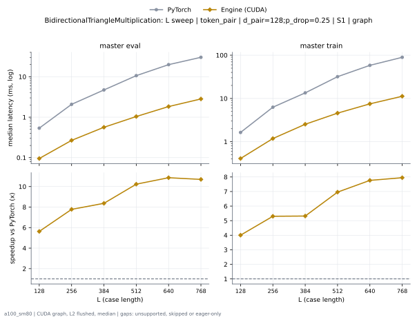
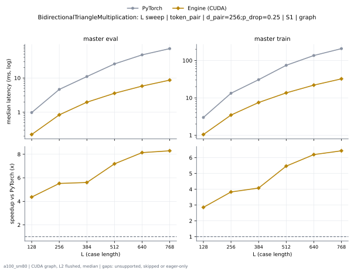
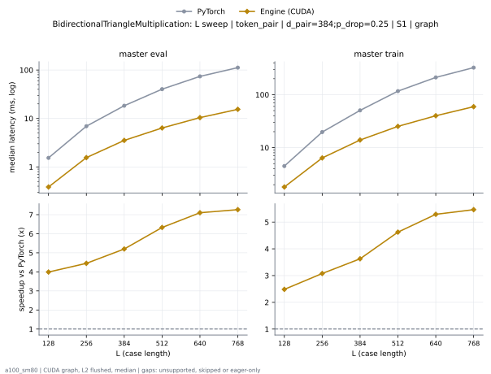
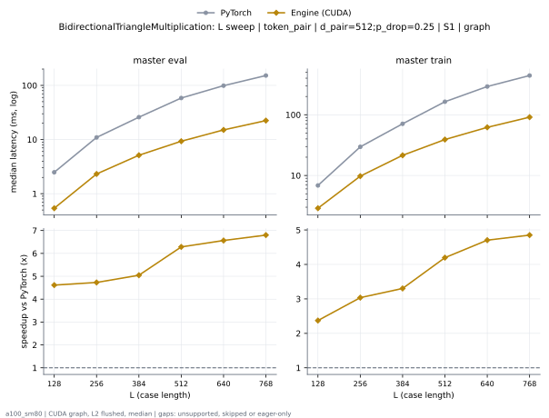
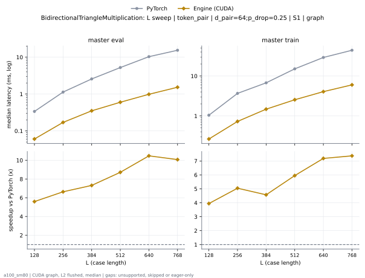
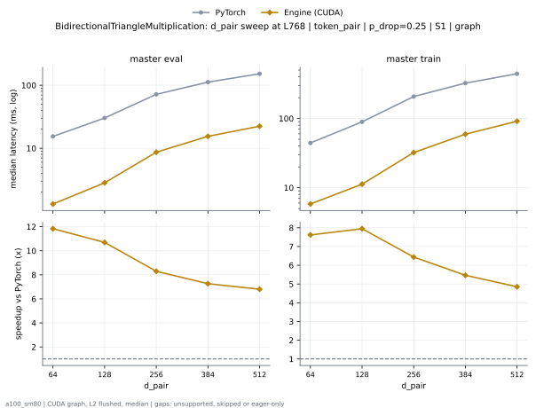

# BidirectionalTriangleMultiplication on a100_sm80

Generated by `python -m miniworld_engine.measure.plot` from speed tokens `judge/tokens/a100_sm80/`; do not edit.

### L sweep: token_pair | d_pair=128;p_drop=0.25 | S1 | graph

**master eval** (median ms; x = speedup vs PyTorch)

| L | PyTorch | Engine (Triton) | Engine (CUDA) |
|---|---|---|---|
| 128 | 0.5361 | 0.1608 (3.33x) | 0.09523 (5.63x) |
| 256 | 2.079 | 0.4291 (4.84x) | 0.2673 (7.78x) |
| 384 | 4.712 | 0.8576 (5.49x) | 0.5632 (8.37x) |
| 512 | 10.64 | 1.548 (6.87x) | 1.039 (10.23x) |
| 640 | 19.89 | 2.55 (7.80x) | 1.831 (10.86x) |
| 768 | 30.21 | 3.747 (8.06x) | 2.824 (10.70x) |

**master train** (median ms; x = speedup vs PyTorch)

| L | PyTorch | Engine (Triton) | Engine (CUDA) |
|---|---|---|---|
| 128 | 1.639 | 0.5396 (3.04x) | 0.4096 (4.00x) |
| 256 | 6.28 | 1.565 (4.01x) | 1.185 (5.30x) |
| 384 | 13.47 | 3.265 (4.12x) | 2.533 (5.32x) |
| 512 | 31.87 | 5.763 (5.53x) | 4.58 (6.96x) |
| 640 | 58.28 | 9.647 (6.04x) | 7.505 (7.77x) |
| 768 | 89.36 | 14.1 (6.34x) | 11.24 (7.95x) |

### L sweep: token_pair | d_pair=256;p_drop=0.25 | S1 | graph

**master eval** (median ms; x = speedup vs PyTorch)

| L | PyTorch | Engine (Triton) | Engine (CUDA) |
|---|---|---|---|
| 128 | 0.9789 | 0.3707 (2.64x) | 0.2243 (4.37x) |
| 256 | 4.636 | 1.097 (4.23x) | 0.8397 (5.52x) |
| 384 | 11 | 2.289 (4.81x) | 1.964 (5.60x) |
| 512 | 25.7 | 4.086 (6.29x) | 3.577 (7.19x) |
| 640 | 47.17 | 6.724 (7.02x) | 5.795 (8.14x) |
| 768 | 71.73 | 9.866 (7.27x) | 8.649 (8.29x) |

**master train** (median ms; x = speedup vs PyTorch)

| L | PyTorch | Engine (Triton) | Engine (CUDA) |
|---|---|---|---|
| 128 | 2.99 | 1.08 (2.77x) | 1.047 (2.86x) |
| 256 | 13.28 | 3.696 (3.59x) | 3.466 (3.83x) |
| 384 | 30.62 | 7.899 (3.88x) | 7.509 (4.08x) |
| 512 | 74.27 | 14.21 (5.23x) | 13.59 (5.47x) |
| 640 | 135.7 | 24.64 (5.51x) | 21.9 (6.20x) |
| 768 | 207.3 | 36.29 (5.71x) | 32.22 (6.44x) |

### L sweep: token_pair | d_pair=384;p_drop=0.25 | S1 | graph

**master eval** (median ms; x = speedup vs PyTorch)

| L | PyTorch | Engine (Triton) | Engine (CUDA) |
|---|---|---|---|
| 128 | 1.537 | 0.6835 (2.25x) | 0.385 (3.99x) |
| 256 | 6.922 | 2.088 (3.32x) | 1.556 (4.45x) |
| 384 | 18.33 | 4.501 (4.07x) | 3.526 (5.20x) |
| 512 | 40.28 | 7.968 (5.06x) | 6.365 (6.33x) |
| 640 | 73.9 | 12.85 (5.75x) | 10.41 (7.10x) |
| 768 | 112.2 | 18.94 (5.92x) | 15.45 (7.26x) |

**master train** (median ms; x = speedup vs PyTorch)

| L | PyTorch | Engine (Triton) | Engine (CUDA) |
|---|---|---|---|
| 128 | 4.495 | 1.927 (2.33x) | 1.809 (2.48x) |
| 256 | 19.69 | 6.922 (2.84x) | 6.397 (3.08x) |
| 384 | 50.54 | 15.08 (3.35x) | 13.93 (3.63x) |
| 512 | 116.7 | 27.38 (4.26x) | 25.23 (4.62x) |
| 640 | 211.7 | 44.93 (4.71x) | 40.01 (5.29x) |
| 768 | 324.3 | 65.76 (4.93x) | 59.33 (5.46x) |

### L sweep: token_pair | d_pair=512;p_drop=0.25 | S1 | graph

**master eval** (median ms; x = speedup vs PyTorch)

| L | PyTorch | Engine (Triton) | Engine (CUDA) |
|---|---|---|---|
| 128 | 2.485 | 1.142 (2.18x) | 0.5386 (4.61x) |
| 256 | 10.94 | 3.703 (2.96x) | 2.314 (4.73x) |
| 384 | 25.89 | 8.077 (3.21x) | 5.131 (5.05x) |
| 512 | 58.47 | 14.35 (4.07x) | 9.307 (6.28x) |
| 640 | 98.9 | 23.13 (4.28x) | 15.07 (6.56x) |
| 768 | 152.3 | 34.06 (4.47x) | 22.39 (6.80x) |

**master train** (median ms; x = speedup vs PyTorch)

| L | PyTorch | Engine (Triton) | Engine (CUDA) |
|---|---|---|---|
| 128 | 6.849 | 2.982 (2.30x) | 2.888 (2.37x) |
| 256 | 29.61 | 10.6 (2.79x) | 9.752 (3.04x) |
| 384 | 70.97 | 23.44 (3.03x) | 21.49 (3.30x) |
| 512 | 163.9 | 42.7 (3.84x) | 39.05 (4.20x) |
| 640 | 291.8 | 76.19 (3.83x) | 62.03 (4.70x) |
| 768 | 442.6 | 131.1 (3.38x) | 91.23 (4.85x) |

### L sweep: token_pair | d_pair=64;p_drop=0.25 | S1 | graph

**master eval** (median ms; x = speedup vs PyTorch)

| L | PyTorch | Engine (Triton) | Engine (CUDA) |
|---|---|---|---|
| 128 | 0.3369 | 0.09523 (3.54x) | 0.05632 (5.98x) |
| 256 | 1.13 | 0.2038 (5.55x) | 0.1398 (8.09x) |
| 384 | 2.571 | 0.3748 (6.86x) | 0.2898 (8.87x) |
| 512 | 5.238 | 0.6103 (8.58x) | 0.4925 (10.63x) |
| 640 | 10.35 | 0.9999 (10.36x) | 0.8172 (12.67x) |
| 768 | 15.4 | 1.517 (10.15x) | 1.302 (11.83x) |

**master train** (median ms; x = speedup vs PyTorch)

| L | PyTorch | Engine (Triton) | Engine (CUDA) |
|---|---|---|---|
| 128 | 1.039 | 0.3164 (3.28x) | 0.2627 (3.96x) |
| 256 | 3.663 | 0.7967 (4.60x) | 0.7045 (5.20x) |
| 384 | 6.754 | 1.592 (4.24x) | 1.435 (4.71x) |
| 512 | 15.15 | 2.693 (5.63x) | 2.464 (6.15x) |
| 640 | 29.24 | 4.39 (6.66x) | 3.956 (7.39x) |
| 768 | 44.29 | 6.37 (6.95x) | 5.815 (7.62x) |

### d_pair sweep at L768: token_pair | p_drop=0.25 | S1 | graph

**master eval** (median ms; x = speedup vs PyTorch)

| d_pair | PyTorch | Engine (Triton) | Engine (CUDA) |
|---|---|---|---|
| 64 | 15.4 | 1.517 (10.15x) | 1.302 (11.83x) |
| 128 | 30.21 | 3.747 (8.06x) | 2.824 (10.70x) |
| 256 | 71.73 | 9.866 (7.27x) | 8.649 (8.29x) |
| 384 | 112.2 | 18.94 (5.92x) | 15.45 (7.26x) |
| 512 | 152.3 | 34.06 (4.47x) | 22.39 (6.80x) |

**master train** (median ms; x = speedup vs PyTorch)

| d_pair | PyTorch | Engine (Triton) | Engine (CUDA) |
|---|---|---|---|
| 64 | 44.29 | 6.37 (6.95x) | 5.815 (7.62x) |
| 128 | 89.36 | 14.1 (6.34x) | 11.24 (7.95x) |
| 256 | 207.3 | 36.29 (5.71x) | 32.22 (6.44x) |
| 384 | 324.3 | 65.76 (4.93x) | 59.33 (5.46x) |
| 512 | 442.6 | 131.1 (3.38x) | 91.23 (4.85x) |

