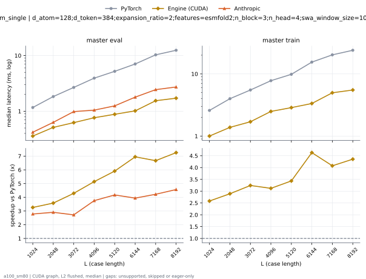
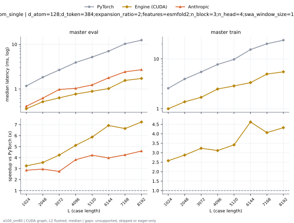
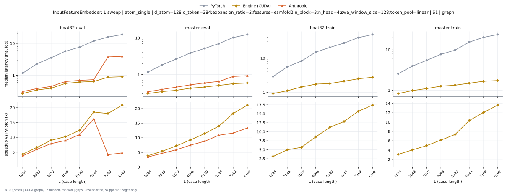
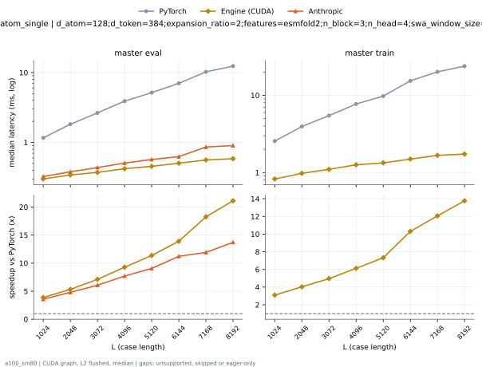
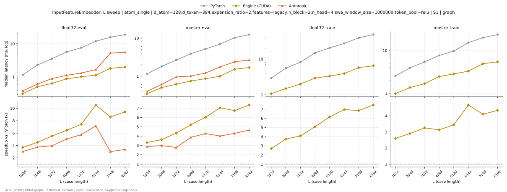

# InputFeatureEmbedder on a100_sm80

Generated by `python -m miniworld_engine.measure.plot` from speed tokens `judge/tokens/a100_sm80/`; do not edit.

### L sweep: atom_single | d_atom=128;d_token=384;expansion_ratio=2;features=esmfold2;n_block=3;n_head=4;swa_window_size=1000000;token_pool=linear | S1 | graph

**master eval** (median ms; x = speedup vs PyTorch)

| L | PyTorch | Engine (Triton) | Engine (CUDA) | Anthropic |
|---|---|---|---|---|
| 1024 | 1.168 | 0.3809 (3.07x) | 0.3584 (3.26x) | 0.4198 (2.78x) |
| 2048 | 1.835 | 0.511 (3.59x) | 0.513 (3.58x) | 0.6318 (2.90x) |
| 3072 | 2.679 | 0.6349 (4.22x) | 0.6246 (4.29x) | 0.9856 (2.72x) |
| 4096 | 3.933 | 0.8991 (4.37x) | 0.7649 (5.14x) | 1.048 (3.75x) |
| 5120 | 5.21 | 1.061 (4.91x) | 0.8817 (5.91x) | 1.249 (4.17x) |
| 6144 | 7.058 | 1.389 (5.08x) | 1.016 (6.95x) | 1.792 (3.94x) |
| 7168 | 10.31 | 1.933 (5.33x) | 1.546 (6.67x) | 2.443 (4.22x) |
| 8192 | 12.45 | 2.165 (5.75x) | 1.716 (7.25x) | 2.728 (4.56x) |

**master train** (median ms; x = speedup vs PyTorch)

| L | PyTorch | Engine (Triton) | Engine (CUDA) | Anthropic |
|---|---|---|---|---|
| 1024 | 2.585 | 1.113 (2.32x) | 1 (2.58x) | 13.53 (eager) |
| 2048 | 3.992 | 1.65 (2.42x) | 1.38 (2.89x) | 13.91 (eager) |
| 3072 | 5.509 | 2.213 (2.49x) | 1.699 (3.24x) | 15.97 (eager) |
| 4096 | 7.774 | 3.187 (2.44x) | 2.491 (3.12x) | 15.94 (eager) |
| 5120 | 9.85 | 3.814 (2.58x) | 2.868 (3.43x) | 17.8 (eager) |
| 6144 | 15.48 | 5.971 (2.59x) | 3.342 (4.63x) | 21.08 (eager) |
| 7168 | 20.25 | 7.608 (2.66x) | 4.968 (4.08x) | 31.86 (eager) |
| 8192 | 23.99 | 8.56 (2.80x) | 5.509 (4.36x) | 37.61 (eager) |

### L sweep: atom_single | d_atom=128;d_token=384;expansion_ratio=2;features=esmfold2;n_block=3;n_head=4;swa_window_size=1000000;token_pool=relu | S1 | graph

**master eval** (median ms; x = speedup vs PyTorch)

| L | PyTorch | Engine (Triton) | Engine (CUDA) | Anthropic |
|---|---|---|---|---|
| 1024 | 1.165 | 0.382 (3.05x) | 0.3584 (3.25x) | 0.4086 (2.85x) |
| 2048 | 1.831 | 0.511 (3.58x) | 0.5151 (3.55x) | 0.6205 (2.95x) |
| 3072 | 2.665 | 0.64 (4.16x) | 0.6298 (4.23x) | 0.9718 (2.74x) |
| 4096 | 3.92 | 0.9006 (4.35x) | 0.766 (5.12x) | 1.029 (3.81x) |
| 5120 | 5.188 | 1.062 (4.89x) | 0.8837 (5.87x) | 1.23 (4.22x) |
| 6144 | 7.038 | 1.391 (5.06x) | 1.017 (6.92x) | 1.772 (3.97x) |
| 7168 | 10.29 | 1.932 (5.32x) | 1.548 (6.64x) | 2.421 (4.25x) |
| 8192 | 12.42 | 2.167 (5.73x) | 1.715 (7.24x) | 2.7 (4.60x) |

**master train** (median ms; x = speedup vs PyTorch)

| L | PyTorch | Engine (Triton) | Engine (CUDA) | Anthropic |
|---|---|---|---|---|
| 1024 | 2.569 | 1.109 (2.32x) | 0.9964 (2.58x) | 13.83 (eager) |
| 2048 | 3.955 | 1.638 (2.41x) | 1.375 (2.88x) | 13.58 (eager) |
| 3072 | 5.47 | 2.206 (2.48x) | 1.692 (3.23x) | 15.66 (eager) |
| 4096 | 7.731 | 3.178 (2.43x) | 2.482 (3.11x) | 15.55 (eager) |
| 5120 | 9.791 | 3.805 (2.57x) | 2.867 (3.42x) | 17.39 (eager) |
| 6144 | 15.42 | 5.96 (2.59x) | 3.335 (4.62x) | 21 (eager) |
| 7168 | 20.16 | 7.606 (2.65x) | 4.962 (4.06x) | 31.71 (eager) |
| 8192 | 23.8 | 8.54 (2.79x) | 5.504 (4.32x) | 37.55 (eager) |

### L sweep: atom_single | d_atom=128;d_token=384;expansion_ratio=2;features=esmfold2;n_block=3;n_head=4;swa_window_size=128;token_pool=linear | S1 | graph

**float32 eval** (median ms; x = speedup vs PyTorch)

| L | PyTorch | Engine (Triton) | Engine (CUDA) | Anthropic |
|---|---|---|---|---|
| 1024 | 1.172 | 0.3656 (3.21x) | 0.2693 (4.35x) | 0.3103 (3.78x) |
| 2048 | 2.308 | 0.4332 (5.33x) | 0.3482 (6.63x) | 0.385 (5.99x) |
| 3072 | 3.561 | 0.4844 (7.35x) | 0.3953 (9.01x) | 0.4506 (7.90x) |
| 4096 | 5.703 | 0.6543 (8.72x) | 0.5581 (10.22x) | 0.64 (8.91x) |
| 5120 | 7.599 | 0.7567 (10.04x) | 0.6154 (12.35x) | 0.6963 (10.91x) |
| 6144 | 11.93 | 0.7987 (14.94x) | 0.6441 (18.52x) | 0.7352 (16.23x) |
| 7168 | 15.73 | 0.9815 (16.03x) | 0.8724 (18.04x) | 3.779 (4.16x) |
| 8192 | 18.88 | 1.037 (18.20x) | 0.9052 (20.86x) | 3.945 (4.79x) |

**master eval** (median ms; x = speedup vs PyTorch)

| L | PyTorch | Engine (Triton) | Engine (CUDA) | Anthropic |
|---|---|---|---|---|
| 1024 | 1.165 | 0.3267 (3.57x) | 0.3011 (3.87x) | 0.3369 (3.46x) |
| 2048 | 1.832 | 0.3604 (5.08x) | 0.34 (5.39x) | 0.3912 (4.68x) |
| 3072 | 2.666 | 0.4035 (6.61x) | 0.3692 (7.22x) | 0.4506 (5.92x) |
| 4096 | 3.922 | 0.4588 (8.55x) | 0.4229 (9.27x) | 0.5233 (7.50x) |
| 5120 | 5.186 | 0.5028 (10.31x) | 0.4536 (11.43x) | 0.5888 (8.81x) |
| 6144 | 7.041 | 0.5294 (13.30x) | 0.5028 (14.00x) | 0.6472 (10.88x) |
| 7168 | 10.27 | 0.6513 (15.76x) | 0.5612 (18.29x) | 0.8847 (11.60x) |
| 8192 | 12.4 | 0.6994 (17.73x) | 0.5857 (21.18x) | 0.9288 (13.36x) |

**float32 train** (median ms; x = speedup vs PyTorch)

| L | PyTorch | Engine (Triton) | Engine (CUDA) | Anthropic |
|---|---|---|---|---|
| 1024 | 2.921 | 1.041 (2.80x) | 0.9318 (3.13x) | 11.98 (eager) |
| 2048 | 5.593 | 1.305 (4.29x) | 1.122 (4.98x) | 11.94 (eager) |
| 3072 | 8.214 | 1.449 (5.67x) | 1.448 (5.67x) | 14.28 (eager) |
| 4096 | 14.99 | 2.097 (7.15x) | 1.751 (8.56x) | 14.33 (eager) |
| 5120 | 20.51 | 2.265 (9.05x) | 1.826 (11.23x) | 16.35 (eager) |
| 6144 | 27.43 | 2.438 (11.25x) | 2.133 (12.86x) | 18.71 (eager) |
| 7168 | 39.35 | 3.019 (13.04x) | 2.506 (15.71x) | 21.78 (eager) |
| 8192 | 48.41 | 3.184 (15.20x) | 2.78 (17.41x) | 24.68 (eager) |

**master train** (median ms; x = speedup vs PyTorch)

| L | PyTorch | Engine (Triton) | Engine (CUDA) | Anthropic |
|---|---|---|---|---|
| 1024 | 2.572 | 0.8561 (3.00x) | 0.8325 (3.09x) | 14.03 (eager) |
| 2048 | 3.975 | 1.006 (3.95x) | 0.983 (4.04x) | 14.05 (eager) |
| 3072 | 5.491 | 1.142 (4.81x) | 1.106 (4.96x) | 16.34 (eager) |
| 4096 | 7.761 | 1.478 (5.25x) | 1.266 (6.13x) | 16.25 (eager) |
| 5120 | 9.829 | 1.57 (6.26x) | 1.339 (7.34x) | 17.98 (eager) |
| 6144 | 15.47 | 1.714 (9.02x) | 1.498 (10.33x) | 18.04 (eager) |
| 7168 | 20.2 | 2.089 (9.67x) | 1.675 (12.06x) | 19.92 (eager) |
| 8192 | 23.75 | 2.199 (10.80x) | 1.742 (13.64x) | 19.85 (eager) |

### L sweep: atom_single | d_atom=128;d_token=384;expansion_ratio=2;features=esmfold2;n_block=3;n_head=4;swa_window_size=128;token_pool=relu | S1 | graph

**master eval** (median ms; x = speedup vs PyTorch)

| L | PyTorch | Engine (Triton) | Engine (CUDA) | Anthropic |
|---|---|---|---|---|
| 1024 | 1.162 | 0.3277 (3.55x) | 0.3 (3.87x) | 0.3256 (3.57x) |
| 2048 | 1.822 | 0.3604 (5.05x) | 0.342 (5.33x) | 0.3799 (4.80x) |
| 3072 | 2.65 | 0.4045 (6.55x) | 0.3727 (7.11x) | 0.4372 (6.06x) |
| 4096 | 3.903 | 0.4577 (8.53x) | 0.4209 (9.27x) | 0.5069 (7.70x) |
| 5120 | 5.166 | 0.5038 (10.25x) | 0.4547 (11.36x) | 0.5704 (9.06x) |
| 6144 | 7.017 | 0.5304 (13.23x) | 0.5048 (13.90x) | 0.6257 (11.22x) |
| 7168 | 10.24 | 0.6543 (15.65x) | 0.5612 (18.25x) | 0.8602 (11.91x) |
| 8192 | 12.37 | 0.6963 (17.76x) | 0.5857 (21.11x) | 0.9021 (13.71x) |

**master train** (median ms; x = speedup vs PyTorch)

| L | PyTorch | Engine (Triton) | Engine (CUDA) | Anthropic |
|---|---|---|---|---|
| 1024 | 2.555 | 0.8509 (3.00x) | 0.8264 (3.09x) | 13.52 (eager) |
| 2048 | 3.945 | 0.9984 (3.95x) | 0.9779 (4.03x) | 13.56 (eager) |
| 3072 | 5.457 | 1.133 (4.82x) | 1.101 (4.96x) | 15.83 (eager) |
| 4096 | 7.717 | 1.473 (5.24x) | 1.261 (6.12x) | 15.79 (eager) |
| 5120 | 9.765 | 1.566 (6.24x) | 1.334 (7.32x) | 17.49 (eager) |
| 6144 | 15.4 | 1.705 (9.03x) | 1.494 (10.31x) | 17.57 (eager) |
| 7168 | 20.14 | 2.086 (9.65x) | 1.67 (12.06x) | 19.37 (eager) |
| 8192 | 23.88 | 2.198 (10.87x) | 1.734 (13.77x) | 19.27 (eager) |

### L sweep: atom_single | d_atom=128;d_token=384;expansion_ratio=2;features=legacy;n_block=3;n_head=4;swa_window_size=1000000;token_pool=relu | S1 | graph

**float32 eval** (median ms; x = speedup vs PyTorch)

| L | PyTorch | Engine (Triton) | Engine (CUDA) | Anthropic |
|---|---|---|---|---|
| 1024 | 1.167 | 0.4127 (2.83x) | 0.3164 (3.69x) | 0.385 (3.03x) |
| 2048 | 2.302 | 0.5734 (4.01x) | 0.51 (4.51x) | 0.6154 (3.74x) |
| 3072 | 3.549 | 0.7045 (5.04x) | 0.6431 (5.52x) | 0.897 (3.96x) |
| 4096 | 5.692 | 1.079 (5.27x) | 0.8806 (6.46x) | 1.127 (5.05x) |
| 5120 | 7.579 | 1.302 (5.82x) | 1.021 (7.42x) | 1.317 (5.76x) |
| 6144 | 11.94 | 1.638 (7.29x) | 1.134 (10.54x) | 1.665 (7.17x) |
| 7168 | 15.72 | 2.244 (7.01x) | 1.826 (8.61x) | 5.219 (3.01x) |
| 8192 | 18.87 | 2.479 (7.61x) | 1.999 (9.44x) | 5.604 (3.37x) |

**master eval** (median ms; x = speedup vs PyTorch)

| L | PyTorch | Engine (Triton) | Engine (CUDA) | Anthropic |
|---|---|---|---|---|
| 1024 | 1.151 | 0.3748 (3.07x) | 0.3471 (3.32x) | 0.3994 (2.88x) |
| 2048 | 1.815 | 0.4987 (3.64x) | 0.5007 (3.62x) | 0.6072 (2.99x) |
| 3072 | 2.653 | 0.6236 (4.25x) | 0.6134 (4.33x) | 0.9533 (2.78x) |
| 4096 | 3.899 | 0.8852 (4.40x) | 0.7455 (5.23x) | 1.008 (3.87x) |
| 5120 | 5.165 | 1.039 (4.97x) | 0.8581 (6.02x) | 1.206 (4.28x) |
| 6144 | 7.011 | 1.372 (5.11x) | 0.9943 (7.05x) | 1.746 (4.02x) |
| 7168 | 10.26 | 1.913 (5.36x) | 1.523 (6.74x) | 2.387 (4.30x) |
| 8192 | 12.39 | 2.153 (5.75x) | 1.688 (7.34x) | 2.663 (4.65x) |

**float32 train** (median ms; x = speedup vs PyTorch)

| L | PyTorch | Engine (Triton) | Engine (CUDA) | Anthropic |
|---|---|---|---|---|
| 1024 | 2.896 | 1.291 (2.24x) | 1.075 (2.69x) | 11.43 (eager) |
| 2048 | 5.569 | 1.924 (2.89x) | 1.492 (3.73x) | 11.39 (eager) |
| 3072 | 8.162 | 2.492 (3.27x) | 2.001 (4.08x) | 13.51 (eager) |
| 4096 | 14.91 | 3.766 (3.96x) | 2.931 (5.09x) | 18.52 (eager) |
| 5120 | 20.44 | 4.476 (4.57x) | 3.325 (6.15x) | 28.16 (eager) |
| 6144 | 27.35 | 6.644 (4.12x) | 3.928 (6.96x) | 33.95 (eager) |
| 7168 | 39.27 | 8.475 (4.63x) | 5.737 (6.85x) | 52.53 (eager) |
| 8192 | 48.33 | 9.47 (5.10x) | 6.486 (7.45x) | 61.73 (eager) |

**master train** (median ms; x = speedup vs PyTorch)

| L | PyTorch | Engine (Triton) | Engine (CUDA) | Anthropic |
|---|---|---|---|---|
| 1024 | 2.53 | 1.094 (2.31x) | 0.9738 (2.60x) | 13.39 (eager) |
| 2048 | 3.925 | 1.616 (2.43x) | 1.353 (2.90x) | 13.47 (eager) |
| 3072 | 5.426 | 2.17 (2.50x) | 1.667 (3.25x) | 15.53 (eager) |
| 4096 | 7.677 | 3.148 (2.44x) | 2.45 (3.13x) | 15.46 (eager) |
| 5120 | 9.732 | 3.775 (2.58x) | 2.825 (3.44x) | 17.65 (eager) |
| 6144 | 15.35 | 5.92 (2.59x) | 3.283 (4.68x) | 20.92 (eager) |
| 7168 | 20.1 | 7.545 (2.66x) | 4.898 (4.10x) | 31.59 (eager) |
| 8192 | 23.66 | 8.477 (2.79x) | 5.445 (4.35x) | 37.39 (eager) |

### L sweep: atom_single | d_atom=128;d_token=384;expansion_ratio=2;features=legacy;n_block=3;n_head=4;swa_window_size=128;token_pool=relu | S1 | graph

**float32 eval** (median ms; x = speedup vs PyTorch)

| L | PyTorch | Engine (Triton) | Engine (CUDA) | Anthropic |
|---|---|---|---|---|
| 1024 | 1.162 | 0.3574 (3.25x) | 0.256 (4.54x) | 0.3 (3.87x) |
| 2048 | 2.29 | 0.426 (5.38x) | 0.3369 (6.80x) | 0.3656 (6.26x) |
| 3072 | 3.536 | 0.469 (7.54x) | 0.382 (9.26x) | 0.425 (8.32x) |
| 4096 | 5.674 | 0.641 (8.85x) | 0.5458 (10.40x) | 0.6093 (9.31x) |
| 5120 | 7.565 | 0.7383 (10.25x) | 0.597 (12.67x) | 0.6615 (11.44x) |
| 6144 | 11.89 | 0.7813 (15.22x) | 0.6246 (19.04x) | 0.6963 (17.08x) |
| 7168 | 15.68 | 0.9559 (16.40x) | 0.8448 (18.56x) | 3.726 (4.21x) |
| 8192 | 18.82 | 1.008 (18.67x) | 0.8745 (21.52x) | 3.887 (4.84x) |

**master eval** (median ms; x = speedup vs PyTorch)

| L | PyTorch | Engine (Triton) | Engine (CUDA) | Anthropic |
|---|---|---|---|---|
| 1024 | 1.148 | 0.3195 (3.59x) | 0.2898 (3.96x) | 0.3154 (3.64x) |
| 2048 | 1.804 | 0.3523 (5.12x) | 0.3277 (5.51x) | 0.3666 (4.92x) |
| 3072 | 2.631 | 0.3912 (6.73x) | 0.3553 (7.40x) | 0.4188 (6.28x) |
| 4096 | 3.881 | 0.4424 (8.77x) | 0.4116 (9.43x) | 0.4854 (8.00x) |
| 5120 | 5.139 | 0.4854 (10.59x) | 0.4332 (11.87x) | 0.5458 (9.42x) |
| 6144 | 6.99 | 0.513 (13.62x) | 0.4803 (14.55x) | 0.598 (11.69x) |
| 7168 | 10.21 | 0.6318 (16.16x) | 0.5315 (19.21x) | 0.8264 (12.35x) |
| 8192 | 12.33 | 0.6769 (18.22x) | 0.556 (22.18x) | 0.8622 (14.30x) |

**float32 train** (median ms; x = speedup vs PyTorch)

| L | PyTorch | Engine (Triton) | Engine (CUDA) | Anthropic |
|---|---|---|---|---|
| 1024 | 2.889 | 1.026 (2.82x) | 0.9124 (3.17x) | 11.56 (eager) |
| 2048 | 5.558 | 1.281 (4.34x) | 1.1 (5.05x) | 11.49 (eager) |
| 3072 | 8.14 | 1.418 (5.74x) | 1.413 (5.76x) | 13.83 (eager) |
| 4096 | 14.9 | 2.062 (7.22x) | 1.718 (8.67x) | 13.84 (eager) |
| 5120 | 20.41 | 2.233 (9.14x) | 1.787 (11.42x) | 16.13 (eager) |
| 6144 | 27.31 | 2.39 (11.43x) | 2.078 (13.14x) | 18.62 (eager) |
| 7168 | 39.2 | 2.958 (13.25x) | 2.436 (16.09x) | 21.61 (eager) |
| 8192 | 48.25 | 3.129 (15.42x) | 2.714 (17.78x) | 24.52 (eager) |

**master train** (median ms; x = speedup vs PyTorch)

| L | PyTorch | Engine (Triton) | Engine (CUDA) | Anthropic |
|---|---|---|---|---|
| 1024 | 2.524 | 0.8294 (3.04x) | 0.8069 (3.13x) | 13.52 (eager) |
| 2048 | 3.913 | 0.9769 (4.01x) | 0.9513 (4.11x) | 13.59 (eager) |
| 3072 | 5.407 | 1.101 (4.91x) | 1.071 (5.05x) | 15.9 (eager) |
| 4096 | 7.653 | 1.44 (5.32x) | 1.23 (6.22x) | 15.8 (eager) |
| 5120 | 9.709 | 1.532 (6.34x) | 1.291 (7.52x) | 17.71 (eager) |
| 6144 | 15.33 | 1.658 (9.25x) | 1.443 (10.62x) | 17.88 (eager) |
| 7168 | 20.01 | 2.03 (9.86x) | 1.607 (12.46x) | 19.67 (eager) |
| 8192 | 23.59 | 2.134 (11.05x) | 1.673 (14.10x) | 19.56 (eager) |

