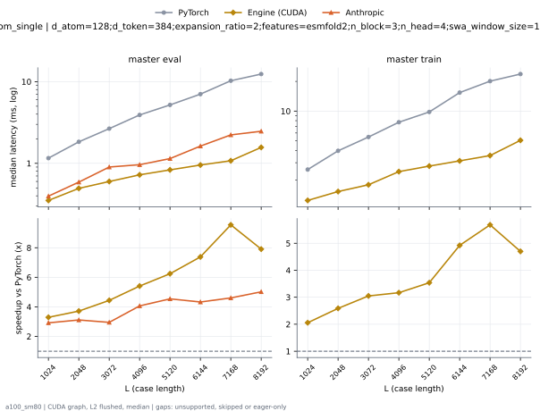
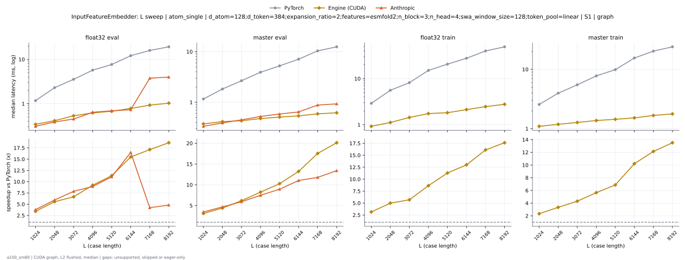
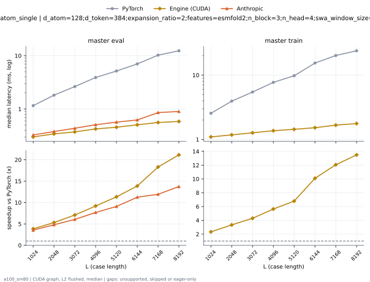
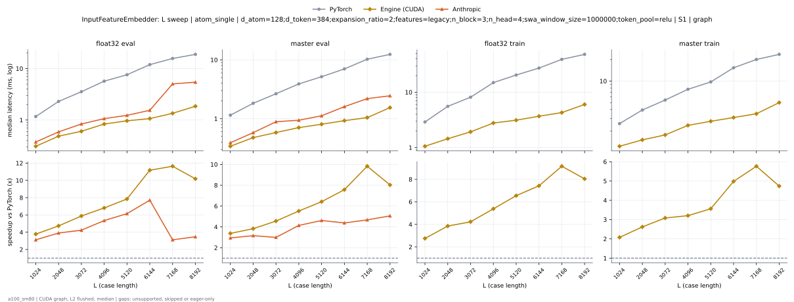
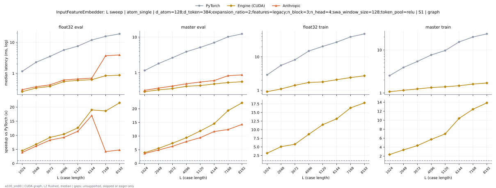

# InputFeatureEmbedder on a100_sm80

Generated by `python -m miniworld_engine.measure.plot` from speed tokens `judge/tokens/a100_sm80/`; do not edit.

### L sweep: atom_single | d_atom=128;d_token=384;expansion_ratio=2;features=esmfold2;n_block=3;n_head=4;swa_window_size=1000000;token_pool=linear | S1 | graph

**master eval** (median ms; x = speedup vs PyTorch)

| L | PyTorch | Engine (Triton) | Engine (CUDA) | Anthropic |
|---|---|---|---|---|
| 1024 | 1.164 | unsupported | 0.3502 (3.32x) | 0.4035 (2.88x) |
| 2048 | 1.837 | unsupported | 0.4905 (3.75x) | 0.6001 (3.06x) |
| 3072 | 2.663 | unsupported | 0.5898 (4.52x) | 0.9155 (2.91x) |
| 4096 | 3.935 | unsupported | 0.7219 (5.45x) | 0.981 (4.01x) |
| 5120 | 5.207 | unsupported | 0.8279 (6.29x) | 1.162 (4.48x) |
| 6144 | 7.036 | unsupported | 0.9503 (7.40x) | 1.645 (4.28x) |
| 7168 | 10.27 | unsupported | 1.07 (9.60x) | 2.253 (4.56x) |
| 8192 | 12.35 | unsupported | 1.568 (7.88x) | 2.495 (4.95x) |

**master train** (median ms; x = speedup vs PyTorch)

| L | PyTorch | Engine (Triton) | Engine (CUDA) | Anthropic |
|---|---|---|---|---|
| 1024 | 2.579 | unsupported | 1.246 (2.07x) | 11.76 (eager) |
| 2048 | 3.982 | unsupported | 1.534 (2.60x) | 11.49 (eager) |
| 3072 | 5.497 | unsupported | 1.795 (3.06x) | 13.47 (eager) |
| 4096 | 7.763 | unsupported | 2.443 (3.18x) | 13.44 (eager) |
| 5120 | 9.84 | unsupported | 2.775 (3.55x) | 16.13 (eager) |
| 6144 | 15.45 | unsupported | 3.135 (4.93x) | 21.11 (eager) |
| 7168 | 20.2 | unsupported | 3.545 (5.70x) | 31.87 (eager) |
| 8192 | 23.65 | unsupported | 5.063 (4.67x) | 37.69 (eager) |

### L sweep: atom_single | d_atom=128;d_token=384;expansion_ratio=2;features=esmfold2;n_block=3;n_head=4;swa_window_size=1000000;token_pool=relu | S1 | graph

**master eval** (median ms; x = speedup vs PyTorch)

| L | PyTorch | Engine (Triton) | Engine (CUDA) | Anthropic |
|---|---|---|---|---|
| 1024 | 1.152 | unsupported | 0.3502 (3.29x) | 0.3963 (2.91x) |
| 2048 | 1.822 | unsupported | 0.4915 (3.71x) | 0.5888 (3.09x) |
| 3072 | 2.656 | unsupported | 0.6001 (4.43x) | 0.9006 (2.95x) |
| 4096 | 3.918 | unsupported | 0.724 (5.41x) | 0.9615 (4.07x) |
| 5120 | 5.185 | unsupported | 0.8274 (6.27x) | 1.143 (4.54x) |
| 6144 | 7.017 | unsupported | 0.9472 (7.41x) | 1.625 (4.32x) |
| 7168 | 10.25 | unsupported | 1.068 (9.60x) | 2.229 (4.60x) |
| 8192 | 12.32 | unsupported | 1.567 (7.87x) | 2.469 (4.99x) |

**master train** (median ms; x = speedup vs PyTorch)

| L | PyTorch | Engine (Triton) | Engine (CUDA) | Anthropic |
|---|---|---|---|---|
| 1024 | 2.561 | unsupported | 1.24 (2.07x) | 11.59 (eager) |
| 2048 | 3.95 | unsupported | 1.529 (2.58x) | 11.6 (eager) |
| 3072 | 5.458 | unsupported | 1.789 (3.05x) | 13.45 (eager) |
| 4096 | 7.72 | unsupported | 2.431 (3.18x) | 13.19 (eager) |
| 5120 | 9.794 | unsupported | 2.765 (3.54x) | 15.85 (eager) |
| 6144 | 15.4 | unsupported | 3.129 (4.92x) | 21.05 (eager) |
| 7168 | 20.13 | unsupported | 3.541 (5.68x) | 31.84 (eager) |
| 8192 | 23.58 | unsupported | 5.05 (4.67x) | 37.65 (eager) |

### L sweep: atom_single | d_atom=128;d_token=384;expansion_ratio=2;features=esmfold2;n_block=3;n_head=4;swa_window_size=128;token_pool=linear | S1 | graph

**float32 eval** (median ms; x = speedup vs PyTorch)

| L | PyTorch | Engine (Triton) | Engine (CUDA) | Anthropic |
|---|---|---|---|---|
| 1024 | 1.168 | unsupported | 0.2652 (4.41x) | 0.3092 (3.78x) |
| 2048 | 2.3 | unsupported | 0.3441 (6.68x) | 0.3871 (5.94x) |
| 3072 | 3.549 | unsupported | 0.3973 (8.93x) | 0.4516 (7.86x) |
| 4096 | 5.689 | unsupported | 0.5591 (10.18x) | 0.64 (8.89x) |
| 5120 | 7.56 | unsupported | 0.6124 (12.35x) | 0.6917 (10.93x) |
| 6144 | 11.96 | unsupported | 0.6446 (18.55x) | 0.7332 (16.31x) |
| 7168 | 15.75 | unsupported | 0.8724 (18.05x) | 3.76 (4.19x) |
| 8192 | 18.84 | unsupported | 0.9057 (20.80x) | 3.988 (4.72x) |

**master eval** (median ms; x = speedup vs PyTorch)

| L | PyTorch | Engine (Triton) | Engine (CUDA) | Anthropic |
|---|---|---|---|---|
| 1024 | 1.162 | unsupported | 0.3021 (3.85x) | 0.3348 (3.47x) |
| 2048 | 1.824 | unsupported | 0.3379 (5.40x) | 0.3907 (4.67x) |
| 3072 | 2.65 | unsupported | 0.3727 (7.11x) | 0.4495 (5.90x) |
| 4096 | 3.917 | unsupported | 0.428 (9.15x) | 0.5243 (7.47x) |
| 5120 | 5.18 | unsupported | 0.4557 (11.37x) | 0.5857 (8.84x) |
| 6144 | 7.031 | unsupported | 0.5038 (13.96x) | 0.6441 (10.92x) |
| 7168 | 10.25 | unsupported | 0.5581 (18.37x) | 0.8796 (11.66x) |
| 8192 | 12.32 | unsupported | 0.5827 (21.14x) | 0.9298 (13.25x) |

**float32 train** (median ms; x = speedup vs PyTorch)

| L | PyTorch | Engine (Triton) | Engine (CUDA) | Anthropic |
|---|---|---|---|---|
| 1024 | 2.917 | unsupported | 0.9288 (3.14x) | 10.08 (eager) |
| 2048 | 5.574 | unsupported | 1.117 (4.99x) | 10.02 (eager) |
| 3072 | 8.179 | unsupported | 1.44 (5.68x) | 11.83 (eager) |
| 4096 | 14.99 | unsupported | 1.746 (8.59x) | 12.98 (eager) |
| 5120 | 20.45 | unsupported | 1.82 (11.24x) | 15.69 (eager) |
| 6144 | 27.45 | unsupported | 2.124 (12.92x) | 18.58 (eager) |
| 7168 | 39.52 | unsupported | 2.469 (16.01x) | 21.65 (eager) |
| 8192 | 48.34 | unsupported | 2.775 (17.42x) | 24.65 (eager) |

**master train** (median ms; x = speedup vs PyTorch)

| L | PyTorch | Engine (Triton) | Engine (CUDA) | Anthropic |
|---|---|---|---|---|
| 1024 | 2.578 | unsupported | 1.1 (2.34x) | 11.72 (eager) |
| 2048 | 3.97 | unsupported | 1.184 (3.35x) | 11.66 (eager) |
| 3072 | 5.477 | unsupported | 1.273 (4.30x) | 13.84 (eager) |
| 4096 | 7.75 | unsupported | 1.372 (5.65x) | 13.49 (eager) |
| 5120 | 9.812 | unsupported | 1.435 (6.84x) | 15.04 (eager) |
| 6144 | 15.43 | unsupported | 1.524 (10.13x) | 14.98 (eager) |
| 7168 | 20.16 | unsupported | 1.672 (12.06x) | 16.58 (eager) |
| 8192 | 23.6 | unsupported | 1.768 (13.34x) | 16.82 (eager) |

### L sweep: atom_single | d_atom=128;d_token=384;expansion_ratio=2;features=esmfold2;n_block=3;n_head=4;swa_window_size=128;token_pool=relu | S1 | graph

**master eval** (median ms; x = speedup vs PyTorch)

| L | PyTorch | Engine (Triton) | Engine (CUDA) | Anthropic |
|---|---|---|---|---|
| 1024 | 1.157 | unsupported | 0.298 (3.88x) | 0.3267 (3.54x) |
| 2048 | 1.815 | unsupported | 0.343 (5.29x) | 0.3789 (4.79x) |
| 3072 | 2.641 | unsupported | 0.3707 (7.12x) | 0.4362 (6.05x) |
| 4096 | 3.903 | unsupported | 0.425 (9.19x) | 0.5079 (7.69x) |
| 5120 | 5.161 | unsupported | 0.4536 (11.38x) | 0.5683 (9.08x) |
| 6144 | 7.011 | unsupported | 0.5048 (13.89x) | 0.6236 (11.24x) |
| 7168 | 10.23 | unsupported | 0.556 (18.40x) | 0.8581 (11.92x) |
| 8192 | 12.29 | unsupported | 0.5816 (21.14x) | 0.9001 (13.66x) |

**master train** (median ms; x = speedup vs PyTorch)

| L | PyTorch | Engine (Triton) | Engine (CUDA) | Anthropic |
|---|---|---|---|---|
| 1024 | 2.555 | unsupported | 1.094 (2.34x) | 11.67 (eager) |
| 2048 | 3.941 | unsupported | 1.179 (3.34x) | 11.66 (eager) |
| 3072 | 5.446 | unsupported | 1.269 (4.29x) | 13.74 (eager) |
| 4096 | 7.709 | unsupported | 1.364 (5.65x) | 13.59 (eager) |
| 5120 | 9.767 | unsupported | 1.434 (6.81x) | 15.52 (eager) |
| 6144 | 15.38 | unsupported | 1.518 (10.14x) | 15.1 (eager) |
| 7168 | 20.11 | unsupported | 1.67 (12.04x) | 16.79 (eager) |
| 8192 | 23.75 | unsupported | 1.762 (13.48x) | 17.19 (eager) |

### L sweep: atom_single | d_atom=128;d_token=384;expansion_ratio=2;features=legacy;n_block=3;n_head=4;swa_window_size=1000000;token_pool=relu | S1 | graph

**float32 eval** (median ms; x = speedup vs PyTorch)

| L | PyTorch | Engine (Triton) | Engine (CUDA) | Anthropic |
|---|---|---|---|---|
| 1024 | 1.169 | unsupported | 0.3062 (3.82x) | 0.3748 (3.12x) |
| 2048 | 2.296 | unsupported | 0.4844 (4.74x) | 0.5878 (3.91x) |
| 3072 | 3.542 | unsupported | 0.6042 (5.86x) | 0.8376 (4.23x) |
| 4096 | 5.682 | unsupported | 0.8335 (6.82x) | 1.064 (5.34x) |
| 5120 | 7.553 | unsupported | 0.962 (7.85x) | 1.233 (6.13x) |
| 6144 | 11.93 | unsupported | 1.066 (11.19x) | 1.546 (7.72x) |
| 7168 | 15.72 | unsupported | 1.347 (11.68x) | 5.027 (3.13x) |
| 8192 | 18.81 | unsupported | 1.851 (10.16x) | 5.437 (3.46x) |

**master eval** (median ms; x = speedup vs PyTorch)

| L | PyTorch | Engine (Triton) | Engine (CUDA) | Anthropic |
|---|---|---|---|---|
| 1024 | 1.146 | unsupported | 0.3348 (3.42x) | 0.3901 (2.94x) |
| 2048 | 1.818 | unsupported | 0.4762 (3.82x) | 0.5786 (3.14x) |
| 3072 | 2.644 | unsupported | 0.5796 (4.56x) | 0.8868 (2.98x) |
| 4096 | 3.902 | unsupported | 0.7076 (5.52x) | 0.9411 (4.15x) |
| 5120 | 5.167 | unsupported | 0.8018 (6.44x) | 1.12 (4.61x) |
| 6144 | 7.001 | unsupported | 0.9242 (7.58x) | 1.601 (4.37x) |
| 7168 | 10.23 | unsupported | 1.04 (9.83x) | 2.192 (4.67x) |
| 8192 | 12.29 | unsupported | 1.538 (7.99x) | 2.449 (5.02x) |

**float32 train** (median ms; x = speedup vs PyTorch)

| L | PyTorch | Engine (Triton) | Engine (CUDA) | Anthropic |
|---|---|---|---|---|
| 1024 | 2.899 | unsupported | 1.046 (2.77x) | 9.684 (eager) |
| 2048 | 5.553 | unsupported | 1.437 (3.87x) | 9.842 (eager) |
| 3072 | 8.15 | unsupported | 1.915 (4.26x) | 11.62 (eager) |
| 4096 | 14.96 | unsupported | 2.774 (5.39x) | 18.54 (eager) |
| 5120 | 20.4 | unsupported | 3.114 (6.55x) | 28.21 (eager) |
| 6144 | 27.35 | unsupported | 3.677 (7.44x) | 33.98 (eager) |
| 7168 | 39.59 | unsupported | 4.275 (9.26x) | 52.72 (eager) |
| 8192 | 48.19 | unsupported | 5.997 (8.04x) | 61.99 (eager) |

**master train** (median ms; x = speedup vs PyTorch)

| L | PyTorch | Engine (Triton) | Engine (CUDA) | Anthropic |
|---|---|---|---|---|
| 1024 | 2.537 | unsupported | 1.217 (2.09x) | 11.49 (eager) |
| 2048 | 3.921 | unsupported | 1.501 (2.61x) | 11.66 (eager) |
| 3072 | 5.42 | unsupported | 1.755 (3.09x) | 13.21 (eager) |
| 4096 | 7.674 | unsupported | 2.399 (3.20x) | 13.47 (eager) |
| 5120 | 9.733 | unsupported | 2.727 (3.57x) | 16.14 (eager) |
| 6144 | 15.34 | unsupported | 3.078 (4.98x) | 20.96 (eager) |
| 7168 | 20.06 | unsupported | 3.481 (5.76x) | 31.72 (eager) |
| 8192 | 23.41 | unsupported | 4.988 (4.69x) | 37.47 (eager) |

### L sweep: atom_single | d_atom=128;d_token=384;expansion_ratio=2;features=legacy;n_block=3;n_head=4;swa_window_size=128;token_pool=relu | S1 | graph

**float32 eval** (median ms; x = speedup vs PyTorch)

| L | PyTorch | Engine (Triton) | Engine (CUDA) | Anthropic |
|---|---|---|---|---|
| 1024 | 1.161 | unsupported | 0.255 (4.55x) | 0.299 (3.88x) |
| 2048 | 2.291 | unsupported | 0.3338 (6.86x) | 0.3717 (6.16x) |
| 3072 | 3.528 | unsupported | 0.3789 (9.31x) | 0.427 (8.26x) |
| 4096 | 5.667 | unsupported | 0.5427 (10.44x) | 0.6134 (9.24x) |
| 5120 | 7.537 | unsupported | 0.596 (12.65x) | 0.6625 (11.38x) |
| 6144 | 11.93 | unsupported | 0.6246 (19.10x) | 0.6999 (17.04x) |
| 7168 | 15.71 | unsupported | 0.8371 (18.77x) | 3.71 (4.23x) |
| 8192 | 18.78 | unsupported | 0.8735 (21.51x) | 3.935 (4.77x) |

**master eval** (median ms; x = speedup vs PyTorch)

| L | PyTorch | Engine (Triton) | Engine (CUDA) | Anthropic |
|---|---|---|---|---|
| 1024 | 1.146 | unsupported | 0.2877 (3.98x) | 0.3185 (3.60x) |
| 2048 | 1.803 | unsupported | 0.3236 (5.57x) | 0.3686 (4.89x) |
| 3072 | 2.628 | unsupported | 0.3564 (7.37x) | 0.4209 (6.24x) |
| 4096 | 3.885 | unsupported | 0.4127 (9.41x) | 0.4869 (7.98x) |
| 5120 | 5.136 | unsupported | 0.4321 (11.89x) | 0.5458 (9.41x) |
| 6144 | 6.987 | unsupported | 0.4813 (14.52x) | 0.5996 (11.65x) |
| 7168 | 10.2 | unsupported | 0.5263 (19.38x) | 0.8243 (12.38x) |
| 8192 | 12.26 | unsupported | 0.553 (22.17x) | 0.8648 (14.18x) |

**float32 train** (median ms; x = speedup vs PyTorch)

| L | PyTorch | Engine (Triton) | Engine (CUDA) | Anthropic |
|---|---|---|---|---|
| 1024 | 2.891 | unsupported | 0.9052 (3.19x) | 9.924 (eager) |
| 2048 | 5.544 | unsupported | 1.091 (5.08x) | 9.551 (eager) |
| 3072 | 8.125 | unsupported | 1.404 (5.79x) | 11.64 (eager) |
| 4096 | 14.92 | unsupported | 1.715 (8.70x) | 12.93 (eager) |
| 5120 | 20.35 | unsupported | 1.781 (11.43x) | 15.71 (eager) |
| 6144 | 27.35 | unsupported | 2.07 (13.22x) | 18.48 (eager) |
| 7168 | 39.37 | unsupported | 2.398 (16.42x) | 21.56 (eager) |
| 8192 | 48.15 | unsupported | 2.706 (17.79x) | 24.47 (eager) |

**master train** (median ms; x = speedup vs PyTorch)

| L | PyTorch | Engine (Triton) | Engine (CUDA) | Anthropic |
|---|---|---|---|---|
| 1024 | 2.531 | unsupported | 1.067 (2.37x) | 11.7 (eager) |
| 2048 | 3.911 | unsupported | 1.151 (3.40x) | 11.46 (eager) |
| 3072 | 5.397 | unsupported | 1.238 (4.36x) | 13.38 (eager) |
| 4096 | 7.657 | unsupported | 1.328 (5.77x) | 13.34 (eager) |
| 5120 | 9.698 | unsupported | 1.392 (6.97x) | 14.59 (eager) |
| 6144 | 15.31 | unsupported | 1.468 (10.43x) | 15 (eager) |
| 7168 | 20 | unsupported | 1.603 (12.48x) | 17.1 (eager) |
| 8192 | 23.38 | unsupported | 1.699 (13.76x) | 16.97 (eager) |

