# LayerNorm on a100_sm80

Generated by `python -m miniworld_engine.measure.plot` from speed tokens `judge/tokens/a100_sm80/`; do not edit.

### L sweep: atom_single | bias=False;elementwise_affine=True;normalized_shape=128 | S1 | graph

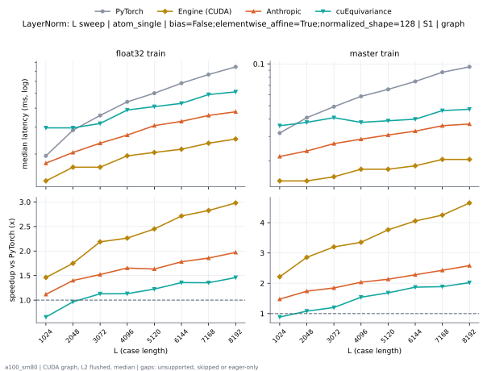

**float32 train** (median ms; x = speedup vs PyTorch)

| L | PyTorch | Engine (Triton) | Engine (CUDA) | Anthropic | cuEquivariance |
|---|---|---|---|---|---|
| 1024 | 0.01946 | 0.01638 (1.19x) | 0.01331 (1.46x) | 0.01741 (1.12x) | 0.0297 (0.66x) |
| 2048 | 0.02765 | 0.01741 (1.59x) | 0.01638 (1.69x) | 0.02048 (1.35x) | 0.0297 (0.93x) |
| 3072 | 0.03584 | 0.01894 (1.89x) | 0.01638 (2.19x) | 0.02355 (1.52x) | 0.03174 (1.13x) |
| 4096 | 0.04352 | 0.02048 (2.13x) | 0.01946 (2.24x) | 0.02662 (1.63x) | 0.03891 (1.12x) |
| 5120 | 0.05018 | 0.0215 (2.33x) | 0.02048 (2.45x) | 0.03072 (1.63x) | 0.04096 (1.22x) |
| 6144 | 0.05837 | 0.02253 (2.59x) | 0.0215 (2.71x) | 0.03277 (1.78x) | 0.04301 (1.36x) |
| 7168 | 0.06554 | 0.02458 (2.67x) | 0.02355 (2.78x) | 0.03584 (1.83x) | 0.04915 (1.33x) |
| 8192 | 0.07475 | 0.0256 (2.92x) | 0.02458 (3.04x) | 0.03789 (1.97x) | 0.0512 (1.46x) |

**master train** (median ms; x = speedup vs PyTorch)

| L | PyTorch | Engine (Triton) | Engine (CUDA) | Anthropic | cuEquivariance |
|---|---|---|---|---|---|
| 1024 | 0.03174 | 0.01434 (2.21x) | 0.01331 (2.38x) | 0.0215 (1.48x) | 0.03584 (0.89x) |
| 2048 | 0.04096 | 0.01843 (2.22x) | 0.01434 (2.86x) | 0.02355 (1.74x) | 0.03789 (1.08x) |
| 3072 | 0.04915 | 0.01843 (2.67x) | 0.01536 (3.20x) | 0.02662 (1.85x) | 0.04096 (1.20x) |
| 4096 | 0.05837 | 0.01946 (3.00x) | 0.01741 (3.35x) | 0.02867 (2.04x) | 0.03789 (1.54x) |
| 5120 | 0.06554 | 0.01946 (3.37x) | 0.01638 (4.00x) | 0.03072 (2.13x) | 0.03891 (1.68x) |
| 6144 | 0.07475 | 0.02048 (3.65x) | 0.01741 (4.29x) | 0.03277 (2.28x) | 0.03994 (1.87x) |
| 7168 | 0.08704 | 0.02253 (3.86x) | 0.01946 (4.47x) | 0.03584 (2.43x) | 0.04608 (1.89x) |
| 8192 | 0.09523 | 0.02458 (3.87x) | 0.02048 (4.65x) | 0.03686 (2.58x) | 0.0471 (2.02x) |

### L sweep: atom_single | bias=False;elementwise_affine=True;normalized_shape=128 | S5 | graph

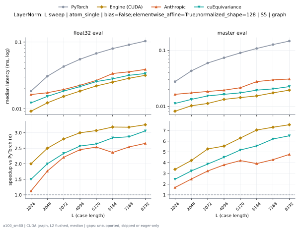

**float32 eval** (median ms; x = speedup vs PyTorch)

| L | PyTorch | Engine (Triton) | Engine (CUDA) | Anthropic | cuEquivariance |
|---|---|---|---|---|---|
| 1024 | 0.01843 | 0.01024 (1.80x) | 0.008192 (2.25x) | 0.01638 (1.13x) | 0.01229 (1.50x) |
| 2048 | 0.03072 | 0.01331 (2.31x) | 0.01229 (2.50x) | 0.01741 (1.76x) | 0.01536 (2.00x) |
| 3072 | 0.04301 | 0.01741 (2.47x) | 0.01536 (2.80x) | 0.01946 (2.21x) | 0.01843 (2.33x) |
| 4096 | 0.0553 | 0.01946 (2.84x) | 0.01843 (3.00x) | 0.02253 (2.45x) | 0.0215 (2.57x) |
| 5120 | 0.06758 | 0.02355 (2.87x) | 0.0215 (3.14x) | 0.02662 (2.54x) | 0.0256 (2.64x) |
| 6144 | 0.07885 | 0.0256 (3.08x) | 0.02458 (3.21x) | 0.03379 (2.33x) | 0.02816 (2.80x) |
| 7168 | 0.09114 | 0.0297 (3.07x) | 0.02867 (3.18x) | 0.03584 (2.54x) | 0.03174 (2.87x) |
| 8192 | 0.1034 | 0.03379 (3.06x) | 0.03174 (3.26x) | 0.03891 (2.66x) | 0.03379 (3.06x) |

**master eval** (median ms; x = speedup vs PyTorch)

| L | PyTorch | Engine (Triton) | Engine (CUDA) | Anthropic | cuEquivariance |
|---|---|---|---|---|---|
| 1024 | 0.02662 | 0.008192 (3.25x) | 0.008192 (3.25x) | 0.01638 (1.62x) | 0.01126 (2.36x) |
| 2048 | 0.04301 | 0.01126 (3.82x) | 0.009728 (4.42x) | 0.01741 (2.47x) | 0.01331 (3.23x) |
| 3072 | 0.05939 | 0.01331 (4.46x) | 0.01126 (5.27x) | 0.01843 (3.22x) | 0.01536 (3.87x) |
| 4096 | 0.07373 | 0.01331 (5.54x) | 0.01229 (6.00x) | 0.01946 (3.79x) | 0.01638 (4.50x) |
| 5120 | 0.09011 | 0.01536 (5.87x) | 0.01434 (6.29x) | 0.0215 (4.19x) | 0.01741 (5.18x) |
| 6144 | 0.1075 | 0.01741 (6.18x) | 0.01536 (7.00x) | 0.02765 (3.89x) | 0.01946 (5.53x) |
| 7168 | 0.127 | 0.01843 (6.89x) | 0.01741 (7.29x) | 0.0297 (4.28x) | 0.02048 (6.20x) |
| 8192 | 0.1464 | 0.02048 (7.15x) | 0.01843 (7.94x) | 0.03072 (4.77x) | 0.02253 (6.50x) |

### L sweep: atom_single | bias=True;elementwise_affine=True;normalized_shape=128 | S1 | graph

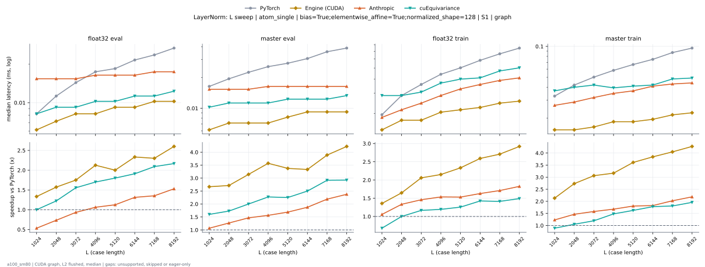

**float32 eval** (median ms; x = speedup vs PyTorch)

| L | PyTorch | Engine (Triton) | Engine (CUDA) | Anthropic | cuEquivariance |
|---|---|---|---|---|---|
| 1024 | 0.008192 | 0.007168 (1.14x) | 0.006144 (1.33x) | 0.01536 (0.53x) | 0.008192 (1.00x) |
| 2048 | 0.01126 | 0.007168 (1.57x) | 0.007168 (1.57x) | 0.01536 (0.73x) | 0.009216 (1.22x) |
| 3072 | 0.01434 | 0.008192 (1.75x) | 0.007168 (2.00x) | 0.01536 (0.93x) | 0.009216 (1.56x) |
| 4096 | 0.0169 | 0.009216 (1.83x) | 0.008192 (2.06x) | 0.01638 (1.03x) | 0.01024 (1.65x) |
| 5120 | 0.01843 | 0.009216 (2.00x) | 0.009216 (2.00x) | 0.01638 (1.13x) | 0.01024 (1.80x) |
| 6144 | 0.0215 | 0.01024 (2.10x) | 0.009216 (2.33x) | 0.01638 (1.31x) | 0.01126 (1.91x) |
| 7168 | 0.02355 | 0.01024 (2.30x) | 0.009728 (2.42x) | 0.01741 (1.35x) | 0.01126 (2.09x) |
| 8192 | 0.02662 | 0.01126 (2.36x) | 0.01024 (2.60x) | 0.01741 (1.53x) | 0.01229 (2.17x) |

**master eval** (median ms; x = speedup vs PyTorch)

| L | PyTorch | Engine (Triton) | Engine (CUDA) | Anthropic | cuEquivariance |
|---|---|---|---|---|---|
| 1024 | 0.01536 | 0.006144 (2.50x) | 0.006144 (2.50x) | 0.01536 (1.00x) | 0.01024 (1.50x) |
| 2048 | 0.01946 | 0.007168 (2.71x) | 0.006144 (3.17x) | 0.01536 (1.27x) | 0.01126 (1.73x) |
| 3072 | 0.02253 | 0.007168 (3.14x) | 0.007168 (3.14x) | 0.01536 (1.47x) | 0.01126 (2.00x) |
| 4096 | 0.02458 | 0.007168 (3.43x) | 0.007168 (3.43x) | 0.01638 (1.50x) | 0.01126 (2.18x) |
| 5120 | 0.02765 | 0.007168 (3.86x) | 0.008192 (3.38x) | 0.01638 (1.69x) | 0.01229 (2.25x) |
| 6144 | 0.03072 | 0.008192 (3.75x) | 0.008192 (3.75x) | 0.01638 (1.87x) | 0.01229 (2.50x) |
| 7168 | 0.03584 | 0.008192 (4.38x) | 0.009216 (3.89x) | 0.01638 (2.19x) | 0.01229 (2.92x) |
| 8192 | 0.03891 | 0.009216 (4.22x) | 0.009216 (4.22x) | 0.01638 (2.37x) | 0.01331 (2.92x) |

**float32 train** (median ms; x = speedup vs PyTorch)

| L | PyTorch | Engine (Triton) | Engine (CUDA) | Anthropic | cuEquivariance |
|---|---|---|---|---|---|
| 1024 | 0.01946 | 0.01536 (1.27x) | 0.01434 (1.36x) | 0.01843 (1.06x) | 0.02867 (0.68x) |
| 2048 | 0.02867 | 0.01741 (1.65x) | 0.0169 (1.70x) | 0.0215 (1.33x) | 0.02867 (1.00x) |
| 3072 | 0.03584 | 0.02048 (1.75x) | 0.01741 (2.06x) | 0.02458 (1.46x) | 0.03072 (1.17x) |
| 4096 | 0.04403 | 0.01946 (2.26x) | 0.02048 (2.15x) | 0.02867 (1.54x) | 0.03686 (1.19x) |
| 5120 | 0.05018 | 0.0215 (2.33x) | 0.0215 (2.33x) | 0.03277 (1.53x) | 0.03994 (1.26x) |
| 6144 | 0.05837 | 0.0215 (2.71x) | 0.02253 (2.59x) | 0.03584 (1.63x) | 0.04096 (1.43x) |
| 7168 | 0.06554 | 0.02355 (2.78x) | 0.02458 (2.67x) | 0.03891 (1.68x) | 0.0471 (1.39x) |
| 8192 | 0.07475 | 0.02458 (3.04x) | 0.0256 (2.92x) | 0.04096 (1.83x) | 0.05018 (1.49x) |

**master train** (median ms; x = speedup vs PyTorch)

| L | PyTorch | Engine (Triton) | Engine (CUDA) | Anthropic | cuEquivariance |
|---|---|---|---|---|---|
| 1024 | 0.03174 | 0.01536 (2.07x) | 0.01485 (2.14x) | 0.02662 (1.19x) | 0.03686 (0.86x) |
| 2048 | 0.04096 | 0.01741 (2.35x) | 0.01536 (2.67x) | 0.02867 (1.43x) | 0.03994 (1.03x) |
| 3072 | 0.05018 | 0.01741 (2.88x) | 0.01536 (3.27x) | 0.03174 (1.58x) | 0.04198 (1.20x) |
| 4096 | 0.05837 | 0.01843 (3.17x) | 0.01843 (3.17x) | 0.03482 (1.68x) | 0.03942 (1.48x) |
| 5120 | 0.06554 | 0.01843 (3.56x) | 0.01843 (3.56x) | 0.03686 (1.78x) | 0.04096 (1.60x) |
| 6144 | 0.07475 | 0.01946 (3.84x) | 0.01946 (3.84x) | 0.04096 (1.83x) | 0.04198 (1.78x) |
| 7168 | 0.08704 | 0.0215 (4.05x) | 0.0215 (4.05x) | 0.04301 (2.02x) | 0.04813 (1.81x) |
| 8192 | 0.09523 | 0.02355 (4.04x) | 0.0215 (4.43x) | 0.04403 (2.16x) | 0.04915 (1.94x) |

### L sweep: token_pair | bias=False;elementwise_affine=True;normalized_shape=128 | S1 | graph

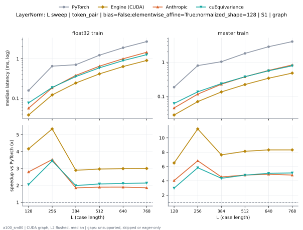

**float32 train** (median ms; x = speedup vs PyTorch)

| L | PyTorch | Engine (Triton) | Engine (CUDA) | Anthropic | cuEquivariance |
|---|---|---|---|---|---|
| 128 | 0.1577 | 0.03891 (4.05x) | 0.03789 (4.16x) | 0.05632 (2.80x) | 0.0768 (2.05x) |
| 256 | 0.6502 | 0.1198 (5.43x) | 0.1219 (5.34x) | 0.1843 (3.53x) | 0.1884 (3.45x) |
| 384 | 0.7055 | 0.2437 (2.89x) | 0.2437 (2.89x) | 0.3799 (1.86x) | 0.3543 (1.99x) |
| 512 | 1.231 | 0.4168 (2.95x) | 0.4147 (2.97x) | 0.6487 (1.90x) | 0.5898 (2.09x) |
| 640 | 1.9 | 0.642 (2.96x) | 0.6349 (2.99x) | 0.9999 (1.90x) | 0.897 (2.12x) |
| 768 | 2.717 | 0.9257 (2.93x) | 0.9052 (3.00x) | 1.459 (1.86x) | 1.269 (2.14x) |

**master train** (median ms; x = speedup vs PyTorch)

| L | PyTorch | Engine (Triton) | Engine (CUDA) | Anthropic | cuEquivariance |
|---|---|---|---|---|---|
| 128 | 0.1864 | 0.02867 (6.50x) | 0.02867 (6.50x) | 0.04608 (4.04x) | 0.06246 (2.98x) |
| 256 | 0.7946 | 0.07475 (10.63x) | 0.07066 (11.25x) | 0.1167 (6.81x) | 0.1362 (5.83x) |
| 384 | 1.031 | 0.1434 (7.19x) | 0.1352 (7.63x) | 0.2268 (4.55x) | 0.2365 (4.36x) |
| 512 | 1.805 | 0.2345 (7.70x) | 0.2222 (8.12x) | 0.3753 (4.81x) | 0.3758 (4.80x) |
| 640 | 2.829 | 0.3492 (8.10x) | 0.34 (8.32x) | 0.5745 (4.93x) | 0.5601 (5.05x) |
| 768 | 3.996 | 0.491 (8.14x) | 0.4803 (8.32x) | 0.8305 (4.81x) | 0.7828 (5.10x) |

### L sweep: token_pair | bias=False;elementwise_affine=True;normalized_shape=128 | S5 | graph

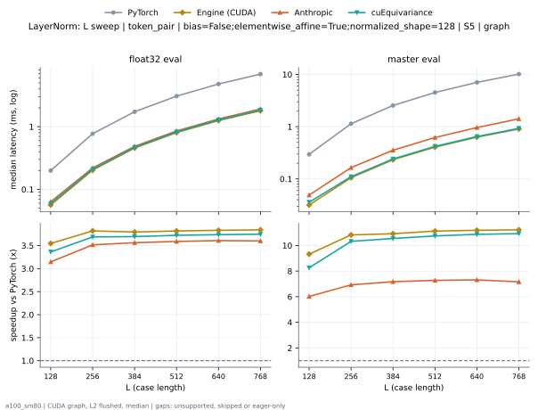

**float32 eval** (median ms; x = speedup vs PyTorch)

| L | PyTorch | Engine (Triton) | Engine (CUDA) | Anthropic | cuEquivariance |
|---|---|---|---|---|---|
| 128 | 0.1987 | 0.05837 (3.40x) | 0.05632 (3.53x) | 0.06349 (3.13x) | 0.05939 (3.34x) |
| 256 | 0.7711 | 0.2058 (3.75x) | 0.2017 (3.82x) | 0.2202 (3.50x) | 0.2099 (3.67x) |
| 384 | 1.726 | 0.4608 (3.75x) | 0.4577 (3.77x) | 0.4864 (3.55x) | 0.469 (3.68x) |
| 512 | 3.065 | 0.811 (3.78x) | 0.8069 (3.80x) | 0.8571 (3.58x) | 0.8264 (3.71x) |
| 640 | 4.801 | 1.256 (3.82x) | 1.255 (3.82x) | 1.331 (3.61x) | 1.285 (3.74x) |
| 768 | 6.907 | 1.799 (3.84x) | 1.795 (3.85x) | 1.919 (3.60x) | 1.844 (3.75x) |

**master eval** (median ms; x = speedup vs PyTorch)

| L | PyTorch | Engine (Triton) | Engine (CUDA) | Anthropic | cuEquivariance |
|---|---|---|---|---|---|
| 128 | 0.2939 | 0.03379 (8.70x) | 0.03174 (9.26x) | 0.04915 (5.98x) | 0.03584 (8.20x) |
| 256 | 1.141 | 0.1096 (10.41x) | 0.1075 (10.61x) | 0.1649 (6.92x) | 0.1106 (10.31x) |
| 384 | 2.548 | 0.2396 (10.63x) | 0.2324 (10.96x) | 0.3553 (7.17x) | 0.2417 (10.54x) |
| 512 | 4.522 | 0.4168 (10.85x) | 0.4076 (11.10x) | 0.6216 (7.28x) | 0.4209 (10.74x) |
| 640 | 7.054 | 0.6441 (10.95x) | 0.6318 (11.17x) | 0.9646 (7.31x) | 0.6492 (10.87x) |
| 768 | 10.16 | 0.9216 (11.02x) | 0.9062 (11.21x) | 1.418 (7.16x) | 0.9298 (10.92x) |

### L sweep: token_pair | bias=False;elementwise_affine=True;normalized_shape=256 | S1 | graph

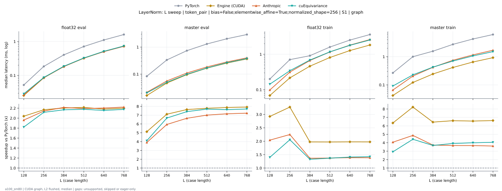

**float32 eval** (median ms; x = speedup vs PyTorch)

| L | PyTorch | Engine (Triton) | Engine (CUDA) | Anthropic | cuEquivariance |
|---|---|---|---|---|---|
| 128 | 0.05222 | 0.02867 (1.82x) | 0.02662 (1.96x) | 0.02662 (1.96x) | 0.02867 (1.82x) |
| 256 | 0.1823 | 0.08704 (2.09x) | 0.08499 (2.14x) | 0.08602 (2.12x) | 0.08704 (2.09x) |
| 384 | 0.4014 | 0.1853 (2.17x) | 0.1823 (2.20x) | 0.1823 (2.20x) | 0.1864 (2.15x) |
| 512 | 0.7076 | 0.3236 (2.19x) | 0.3277 (2.16x) | 0.3246 (2.18x) | 0.3267 (2.17x) |
| 640 | 1.11 | 0.512 (2.17x) | 0.5079 (2.19x) | 0.5028 (2.21x) | 0.514 (2.16x) |
| 768 | 1.606 | 0.7363 (2.18x) | 0.7291 (2.20x) | 0.7219 (2.22x) | 0.7373 (2.18x) |

**master eval** (median ms; x = speedup vs PyTorch)

| L | PyTorch | Engine (Triton) | Engine (CUDA) | Anthropic | cuEquivariance |
|---|---|---|---|---|---|
| 128 | 0.08397 | 0.01843 (4.56x) | 0.01638 (5.12x) | 0.0215 (3.90x) | 0.02048 (4.10x) |
| 256 | 0.3338 | 0.04915 (6.79x) | 0.0471 (7.09x) | 0.05632 (5.93x) | 0.05018 (6.65x) |
| 384 | 0.7322 | 0.0983 (7.45x) | 0.09626 (7.61x) | 0.1106 (6.62x) | 0.09933 (7.37x) |
| 512 | 1.289 | 0.1695 (7.61x) | 0.1669 (7.72x) | 0.1853 (6.96x) | 0.169 (7.63x) |
| 640 | 2.023 | 0.2632 (7.69x) | 0.257 (7.87x) | 0.2826 (7.16x) | 0.2652 (7.63x) |
| 768 | 2.885 | 0.3748 (7.70x) | 0.3656 (7.89x) | 0.4004 (7.20x) | 0.3758 (7.68x) |

**float32 train** (median ms; x = speedup vs PyTorch)

| L | PyTorch | Engine (Triton) | Engine (CUDA) | Anthropic | cuEquivariance |
|---|---|---|---|---|---|
| 128 | 0.1997 | 0.07475 (2.67x) | 0.06861 (2.91x) | 0.0983 (2.03x) | 0.1434 (1.39x) |
| 256 | 0.7086 | 0.2294 (3.09x) | 0.2161 (3.28x) | 0.3144 (2.25x) | 0.3441 (2.06x) |
| 384 | 0.9093 | 0.4731 (1.92x) | 0.4618 (1.97x) | 0.6676 (1.36x) | 0.6881 (1.32x) |
| 512 | 1.61 | 0.8166 (1.97x) | 0.8074 (1.99x) | 1.168 (1.38x) | 1.172 (1.37x) |
| 640 | 2.534 | 1.286 (1.97x) | 1.28 (1.98x) | 1.82 (1.39x) | 1.792 (1.41x) |
| 768 | 3.614 | 1.845 (1.96x) | 1.836 (1.97x) | 2.613 (1.38x) | 2.539 (1.42x) |

**master train** (median ms; x = speedup vs PyTorch)

| L | PyTorch | Engine (Triton) | Engine (CUDA) | Anthropic | cuEquivariance |
|---|---|---|---|---|---|
| 128 | 0.2652 | 0.04915 (5.40x) | 0.04198 (6.32x) | 0.06554 (4.05x) | 0.09114 (2.91x) |
| 256 | 1.001 | 0.1434 (6.99x) | 0.1208 (8.29x) | 0.2058 (4.87x) | 0.2273 (4.41x) |
| 384 | 1.569 | 0.2785 (5.63x) | 0.2478 (6.33x) | 0.4219 (3.72x) | 0.427 (3.67x) |
| 512 | 2.744 | 0.4424 (6.20x) | 0.4239 (6.47x) | 0.7491 (3.66x) | 0.7025 (3.91x) |
| 640 | 4.273 | 0.6728 (6.35x) | 0.6502 (6.57x) | 1.163 (3.67x) | 1.067 (4.00x) |
| 768 | 6.115 | 0.9482 (6.45x) | 0.9257 (6.61x) | 1.7 (3.60x) | 1.514 (4.04x) |

### L sweep: token_pair | bias=False;elementwise_affine=True;normalized_shape=267 | S1 | graph

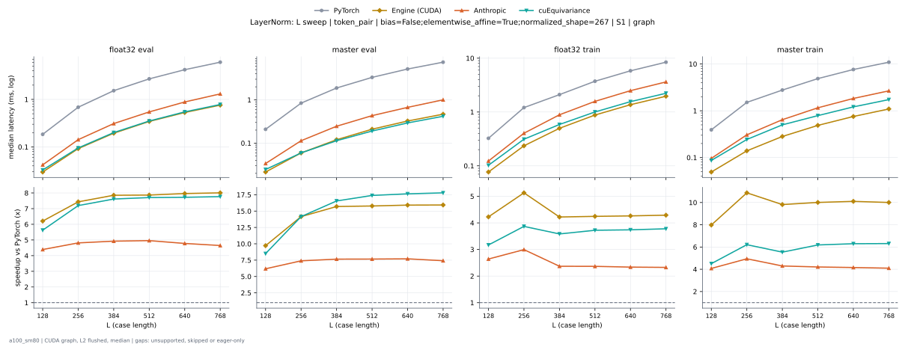

**float32 eval** (median ms; x = speedup vs PyTorch)

| L | PyTorch | Engine (Triton) | Engine (CUDA) | Anthropic | cuEquivariance |
|---|---|---|---|---|---|
| 128 | 0.1843 | 0.03379 (5.45x) | 0.0297 (6.21x) | 0.04198 (4.39x) | 0.03277 (5.63x) |
| 256 | 0.6851 | 0.09421 (7.27x) | 0.09011 (7.60x) | 0.1423 (4.81x) | 0.09523 (7.19x) |
| 384 | 1.527 | 0.1966 (7.77x) | 0.1925 (7.93x) | 0.3103 (4.92x) | 0.2007 (7.61x) |
| 512 | 2.705 | 0.341 (7.93x) | 0.3441 (7.86x) | 0.5458 (4.96x) | 0.3512 (7.70x) |
| 640 | 4.22 | 0.5366 (7.86x) | 0.5335 (7.91x) | 0.8837 (4.78x) | 0.5468 (7.72x) |
| 768 | 6.069 | 0.7654 (7.93x) | 0.7649 (7.93x) | 1.308 (4.64x) | 0.7823 (7.76x) |

**master eval** (median ms; x = speedup vs PyTorch)

| L | PyTorch | Engine (Triton) | Engine (CUDA) | Anthropic | cuEquivariance |
|---|---|---|---|---|---|
| 128 | 0.2079 | 0.02458 (8.46x) | 0.02048 (10.15x) | 0.03379 (6.15x) | 0.02458 (8.46x) |
| 256 | 0.8397 | 0.06861 (12.24x) | 0.0512 (16.40x) | 0.1137 (7.39x) | 0.05939 (14.14x) |
| 384 | 1.888 | 0.1321 (14.29x) | 0.1044 (18.07x) | 0.2458 (7.68x) | 0.1137 (16.61x) |
| 512 | 3.311 | 0.2248 (14.73x) | 0.1782 (18.58x) | 0.4321 (7.66x) | 0.1905 (17.38x) |
| 640 | 5.162 | 0.3456 (14.94x) | 0.2724 (18.95x) | 0.6707 (7.70x) | 0.2929 (17.63x) |
| 768 | 7.424 | 0.4956 (14.98x) | 0.3881 (19.13x) | 1.002 (7.41x) | 0.4178 (17.77x) |

**float32 train** (median ms; x = speedup vs PyTorch)

| L | PyTorch | Engine (Triton) | Engine (CUDA) | Anthropic | cuEquivariance |
|---|---|---|---|---|---|
| 128 | 0.3287 | 0.08704 (3.78x) | 0.07578 (4.34x) | 0.1229 (2.68x) | 0.1024 (3.21x) |
| 256 | 1.209 | 0.2765 (4.37x) | 0.2345 (5.16x) | 0.4035 (3.00x) | 0.3123 (3.87x) |
| 384 | 2.083 | 0.6154 (3.38x) | 0.5018 (4.15x) | 0.8878 (2.35x) | 0.5868 (3.55x) |
| 512 | 3.695 | 1.08 (3.42x) | 0.8755 (4.22x) | 1.577 (2.34x) | 1.002 (3.69x) |
| 640 | 5.751 | 1.68 (3.42x) | 1.374 (4.19x) | 2.493 (2.31x) | 1.559 (3.69x) |
| 768 | 8.361 | 2.419 (3.46x) | 1.968 (4.25x) | 3.623 (2.31x) | 2.23 (3.75x) |

**master train** (median ms; x = speedup vs PyTorch)

| L | PyTorch | Engine (Triton) | Engine (CUDA) | Anthropic | cuEquivariance |
|---|---|---|---|---|---|
| 128 | 0.3932 | 0.0727 (5.41x) | 0.04915 (8.00x) | 0.09626 (4.09x) | 0.08704 (4.52x) |
| 256 | 1.513 | 0.2191 (6.91x) | 0.1341 (11.28x) | 0.3062 (4.94x) | 0.2437 (6.21x) |
| 384 | 2.772 | 0.4157 (6.67x) | 0.2724 (10.18x) | 0.6456 (4.29x) | 0.5007 (5.54x) |
| 512 | 4.874 | 0.7107 (6.86x) | 0.4654 (10.47x) | 1.159 (4.20x) | 0.7885 (6.18x) |
| 640 | 7.575 | 1.1 (6.89x) | 0.7117 (10.64x) | 1.836 (4.13x) | 1.212 (6.25x) |
| 768 | 10.94 | 1.585 (6.90x) | 1.013 (10.81x) | 2.671 (4.10x) | 1.735 (6.31x) |

### L sweep: token_pair | bias=False;elementwise_affine=True;normalized_shape=384 | S1 | graph

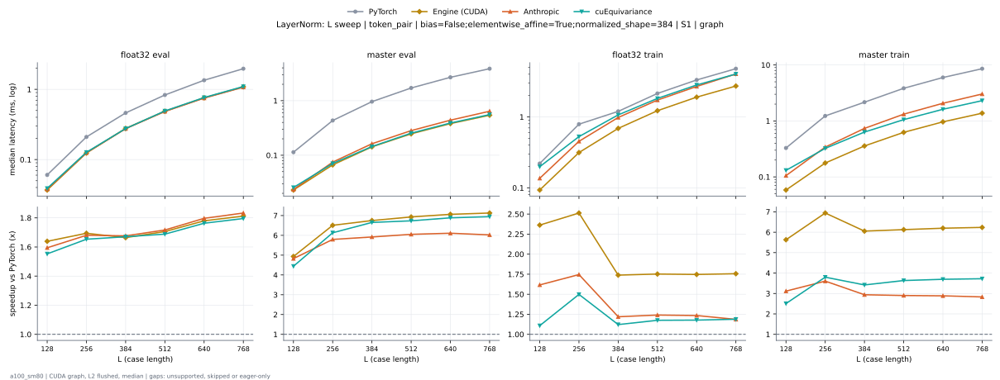

**float32 eval** (median ms; x = speedup vs PyTorch)

| L | PyTorch | Engine (Triton) | Engine (CUDA) | Anthropic | cuEquivariance |
|---|---|---|---|---|---|
| 128 | 0.06144 | 0.03891 (1.58x) | 0.03686 (1.67x) | 0.03789 (1.62x) | 0.03891 (1.58x) |
| 256 | 0.2089 | 0.126 (1.66x) | 0.1239 (1.69x) | 0.1249 (1.67x) | 0.127 (1.65x) |
| 384 | 0.4608 | 0.2749 (1.68x) | 0.2749 (1.68x) | 0.2755 (1.67x) | 0.2765 (1.67x) |
| 512 | 0.8141 | 0.4905 (1.66x) | 0.4874 (1.67x) | 0.4844 (1.68x) | 0.4925 (1.65x) |
| 640 | 1.326 | 0.7629 (1.74x) | 0.7588 (1.75x) | 0.7506 (1.77x) | 0.7649 (1.73x) |
| 768 | 1.949 | 1.095 (1.78x) | 1.09 (1.79x) | 1.074 (1.81x) | 1.097 (1.78x) |

**master eval** (median ms; x = speedup vs PyTorch)

| L | PyTorch | Engine (Triton) | Engine (CUDA) | Anthropic | cuEquivariance |
|---|---|---|---|---|---|
| 128 | 0.1137 | 0.02458 (4.62x) | 0.02253 (5.05x) | 0.02355 (4.83x) | 0.0256 (4.44x) |
| 256 | 0.4321 | 0.06963 (6.21x) | 0.06707 (6.44x) | 0.07475 (5.78x) | 0.07066 (6.12x) |
| 384 | 0.9564 | 0.1423 (6.72x) | 0.1434 (6.67x) | 0.1623 (5.89x) | 0.1444 (6.62x) |
| 512 | 1.697 | 0.2509 (6.76x) | 0.2468 (6.88x) | 0.2826 (6.00x) | 0.254 (6.68x) |
| 640 | 2.661 | 0.386 (6.89x) | 0.3809 (6.99x) | 0.4393 (6.06x) | 0.3896 (6.83x) |
| 768 | 3.842 | 0.5519 (6.96x) | 0.5437 (7.06x) | 0.641 (5.99x) | 0.556 (6.91x) |

**float32 train** (median ms; x = speedup vs PyTorch)

| L | PyTorch | Engine (Triton) | Engine (CUDA) | Anthropic | cuEquivariance |
|---|---|---|---|---|---|
| 128 | 0.2212 | 0.1096 (2.02x) | 0.09318 (2.37x) | 0.1362 (1.62x) | 0.1987 (1.11x) |
| 256 | 0.7885 | 0.3185 (2.48x) | 0.3144 (2.51x) | 0.4526 (1.74x) | 0.5274 (1.50x) |
| 384 | 1.192 | 0.6927 (1.72x) | 0.6825 (1.75x) | 0.9825 (1.21x) | 1.068 (1.12x) |
| 512 | 2.12 | 1.238 (1.71x) | 1.223 (1.73x) | 1.727 (1.23x) | 1.824 (1.16x) |
| 640 | 3.303 | 1.927 (1.71x) | 1.903 (1.74x) | 2.691 (1.23x) | 2.821 (1.17x) |
| 768 | 4.762 | 2.757 (1.73x) | 2.729 (1.75x) | 4.036 (1.18x) | 4.03 (1.18x) |

**master train** (median ms; x = speedup vs PyTorch)

| L | PyTorch | Engine (Triton) | Engine (CUDA) | Anthropic | cuEquivariance |
|---|---|---|---|---|---|
| 128 | 0.3277 | 0.07066 (4.64x) | 0.05837 (5.61x) | 0.1055 (3.11x) | 0.1311 (2.50x) |
| 256 | 1.228 | 0.2109 (5.82x) | 0.1772 (6.93x) | 0.341 (3.60x) | 0.3236 (3.79x) |
| 384 | 2.158 | 0.4429 (4.87x) | 0.3645 (5.92x) | 0.7363 (2.93x) | 0.6328 (3.41x) |
| 512 | 3.816 | 0.7895 (4.83x) | 0.6267 (6.09x) | 1.321 (2.89x) | 1.055 (3.62x) |
| 640 | 5.942 | 1.224 (4.86x) | 0.9646 (6.16x) | 2.07 (2.87x) | 1.616 (3.68x) |
| 768 | 8.527 | 1.771 (4.81x) | 1.378 (6.19x) | 3.031 (2.81x) | 2.305 (3.70x) |

### L sweep: token_pair | bias=False;elementwise_affine=True;normalized_shape=512 | S1 | graph

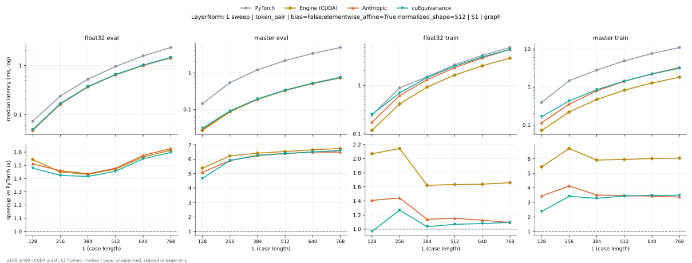

**float32 eval** (median ms; x = speedup vs PyTorch)

| L | PyTorch | Engine (Triton) | Engine (CUDA) | Anthropic | cuEquivariance |
|---|---|---|---|---|---|
| 128 | 0.06861 | 0.04915 (1.40x) | 0.04813 (1.43x) | 0.04813 (1.43x) | 0.04915 (1.40x) |
| 256 | 0.2365 | 0.1654 (1.43x) | 0.1628 (1.45x) | 0.1628 (1.45x) | 0.1669 (1.42x) |
| 384 | 0.5222 | 0.3697 (1.41x) | 0.3676 (1.42x) | 0.3666 (1.42x) | 0.3717 (1.40x) |
| 512 | 0.9687 | 0.6538 (1.48x) | 0.6482 (1.49x) | 0.6461 (1.50x) | 0.6564 (1.48x) |
| 640 | 1.561 | 1.015 (1.54x) | 1.009 (1.55x) | 1.001 (1.56x) | 1.018 (1.53x) |
| 768 | 2.29 | 1.456 (1.57x) | 1.45 (1.58x) | 1.433 (1.60x) | 1.46 (1.57x) |

**master eval** (median ms; x = speedup vs PyTorch)

| L | PyTorch | Engine (Triton) | Engine (CUDA) | Anthropic | cuEquivariance |
|---|---|---|---|---|---|
| 128 | 0.1434 | 0.0297 (4.83x) | 0.02662 (5.38x) | 0.02816 (5.09x) | 0.03072 (4.67x) |
| 256 | 0.5325 | 0.08909 (5.98x) | 0.08602 (6.19x) | 0.09011 (5.91x) | 0.09011 (5.91x) |
| 384 | 1.192 | 0.191 (6.24x) | 0.1874 (6.36x) | 0.1915 (6.23x) | 0.1925 (6.19x) |
| 512 | 2.119 | 0.3328 (6.37x) | 0.3277 (6.47x) | 0.3338 (6.35x) | 0.3338 (6.35x) |
| 640 | 3.319 | 0.514 (6.46x) | 0.5069 (6.55x) | 0.5161 (6.43x) | 0.5151 (6.44x) |
| 768 | 4.785 | 0.7352 (6.51x) | 0.727 (6.58x) | 0.7485 (6.39x) | 0.7363 (6.50x) |

**float32 train** (median ms; x = speedup vs PyTorch)

| L | PyTorch | Engine (Triton) | Engine (CUDA) | Anthropic | cuEquivariance |
|---|---|---|---|---|---|
| 128 | 0.2499 | 0.1331 (1.88x) | 0.1198 (2.09x) | 0.1731 (1.44x) | 0.2519 (0.99x) |
| 256 | 0.8847 | 0.4168 (2.12x) | 0.4132 (2.14x) | 0.6134 (1.44x) | 0.6973 (1.27x) |
| 384 | 1.484 | 0.9293 (1.60x) | 0.9236 (1.61x) | 1.312 (1.13x) | 1.445 (1.03x) |
| 512 | 2.642 | 1.644 (1.61x) | 1.63 (1.62x) | 2.306 (1.15x) | 2.491 (1.06x) |
| 640 | 4.127 | 2.56 (1.61x) | 2.533 (1.63x) | 3.68 (1.12x) | 3.843 (1.07x) |
| 768 | 5.955 | 3.681 (1.62x) | 3.635 (1.64x) | 5.505 (1.08x) | 5.498 (1.08x) |

**master train** (median ms; x = speedup vs PyTorch)

| L | PyTorch | Engine (Triton) | Engine (CUDA) | Anthropic | cuEquivariance |
|---|---|---|---|---|---|
| 128 | 0.3901 | 0.09318 (4.19x) | 0.07168 (5.44x) | 0.1137 (3.43x) | 0.1649 (2.37x) |
| 256 | 1.465 | 0.2949 (4.97x) | 0.2202 (6.66x) | 0.3553 (4.12x) | 0.4301 (3.41x) |
| 384 | 2.77 | 0.6313 (4.39x) | 0.4741 (5.84x) | 0.7941 (3.49x) | 0.8499 (3.26x) |
| 512 | 4.897 | 1.107 (4.42x) | 0.8264 (5.93x) | 1.417 (3.46x) | 1.427 (3.43x) |
| 640 | 7.637 | 1.707 (4.47x) | 1.278 (5.98x) | 2.234 (3.42x) | 2.201 (3.47x) |
| 768 | 10.98 | 2.459 (4.47x) | 1.827 (6.01x) | 3.274 (3.35x) | 3.156 (3.48x) |

### L sweep: token_pair | bias=False;elementwise_affine=True;normalized_shape=651 | S1 | graph

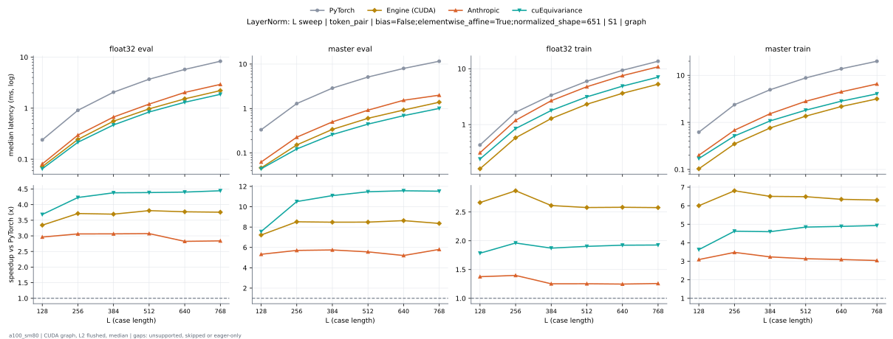

**float32 eval** (median ms; x = speedup vs PyTorch)

| L | PyTorch | Engine (Triton) | Engine (CUDA) | Anthropic | cuEquivariance |
|---|---|---|---|---|---|
| 128 | 0.2396 | 0.07168 (3.34x) | 0.06144 (3.90x) | 0.0809 (2.96x) | 0.06502 (3.69x) |
| 256 | 0.9073 | 0.2355 (3.85x) | 0.2089 (4.34x) | 0.297 (3.06x) | 0.215 (4.22x) |
| 384 | 2.063 | 0.5171 (3.99x) | 0.4695 (4.39x) | 0.6717 (3.07x) | 0.47 (4.39x) |
| 512 | 3.694 | 0.9211 (4.01x) | 0.8264 (4.47x) | 1.203 (3.07x) | 0.8428 (4.38x) |
| 640 | 5.759 | 1.478 (3.90x) | 1.279 (4.50x) | 2.037 (2.83x) | 1.307 (4.41x) |
| 768 | 8.313 | 2.148 (3.87x) | 1.83 (4.54x) | 2.93 (2.84x) | 1.872 (4.44x) |

**master eval** (median ms; x = speedup vs PyTorch)

| L | PyTorch | Engine (Triton) | Engine (CUDA) | Anthropic | cuEquivariance |
|---|---|---|---|---|---|
| 128 | 0.3318 | 0.04506 (7.36x) | 0.03584 (9.26x) | 0.06246 (5.31x) | 0.04403 (7.53x) |
| 256 | 1.29 | 0.1362 (9.47x) | 0.1147 (11.25x) | 0.2263 (5.70x) | 0.1229 (10.50x) |
| 384 | 2.881 | 0.2959 (9.73x) | 0.2417 (11.92x) | 0.4997 (5.76x) | 0.2591 (11.12x) |
| 512 | 5.106 | 0.513 (9.95x) | 0.4209 (12.13x) | 0.9185 (5.56x) | 0.4454 (11.46x) |
| 640 | 7.978 | 0.8008 (9.96x) | 0.6492 (12.29x) | 1.534 (5.20x) | 0.6902 (11.56x) |
| 768 | 11.49 | 1.16 (9.91x) | 0.9288 (12.37x) | 1.995 (5.76x) | 1.005 (11.44x) |

**float32 train** (median ms; x = speedup vs PyTorch)

| L | PyTorch | Engine (Triton) | Engine (CUDA) | Anthropic | cuEquivariance |
|---|---|---|---|---|---|
| 128 | 0.4424 | 0.2099 (2.11x) | 0.1556 (2.84x) | 0.3133 (1.41x) | 0.2417 (1.83x) |
| 256 | 1.648 | 0.748 (2.20x) | 0.5437 (3.03x) | 1.192 (1.38x) | 0.8494 (1.94x) |
| 384 | 3.352 | 1.704 (1.97x) | 1.221 (2.74x) | 2.68 (1.25x) | 1.792 (1.87x) |
| 512 | 5.98 | 2.993 (2.00x) | 2.177 (2.75x) | 4.763 (1.26x) | 3.137 (1.91x) |
| 640 | 9.422 | 4.815 (1.96x) | 3.39 (2.78x) | 7.523 (1.25x) | 4.879 (1.93x) |
| 768 | 13.62 | 6.743 (2.02x) | 4.942 (2.76x) | 10.84 (1.26x) | 7.072 (1.93x) |

**master train** (median ms; x = speedup vs PyTorch)

| L | PyTorch | Engine (Triton) | Engine (CUDA) | Anthropic | cuEquivariance |
|---|---|---|---|---|---|
| 128 | 0.6195 | 0.1434 (4.32x) | 0.09523 (6.51x) | 0.2007 (3.09x) | 0.171 (3.62x) |
| 256 | 2.375 | 0.5315 (4.47x) | 0.3103 (7.65x) | 0.683 (3.48x) | 0.514 (4.62x) |
| 384 | 4.935 | 1.118 (4.41x) | 0.6717 (7.35x) | 1.528 (3.23x) | 1.076 (4.59x) |
| 512 | 8.806 | 2.029 (4.34x) | 1.192 (7.39x) | 2.808 (3.14x) | 1.819 (4.84x) |
| 640 | 13.78 | 3.45 (3.99x) | 1.93 (7.14x) | 4.462 (3.09x) | 2.827 (4.88x) |
| 768 | 19.93 | 4.952 (4.03x) | 2.767 (7.20x) | 6.555 (3.04x) | 4.044 (4.93x) |

### L sweep: token_pair | bias=True;elementwise_affine=True;normalized_shape=128 | S1 | graph

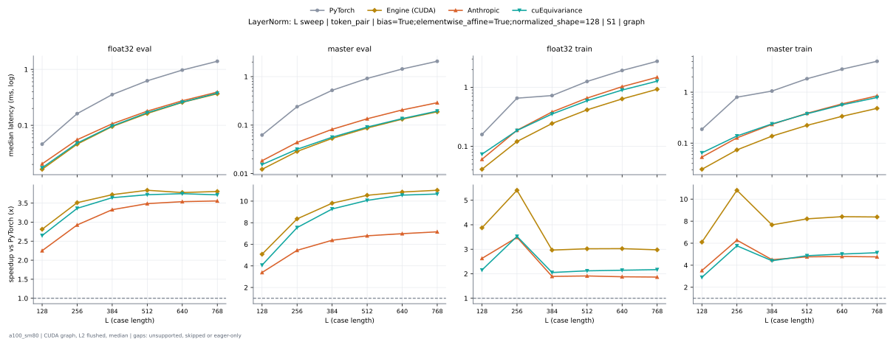

**float32 eval** (median ms; x = speedup vs PyTorch)

| L | PyTorch | Engine (Triton) | Engine (CUDA) | Anthropic | cuEquivariance |
|---|---|---|---|---|---|
| 128 | 0.04608 | 0.01638 (2.81x) | 0.01638 (2.81x) | 0.02048 (2.25x) | 0.01741 (2.65x) |
| 256 | 0.1608 | 0.0471 (3.41x) | 0.04608 (3.49x) | 0.0553 (2.91x) | 0.04813 (3.34x) |
| 384 | 0.3543 | 0.09523 (3.72x) | 0.09523 (3.72x) | 0.1065 (3.33x) | 0.09728 (3.64x) |
| 512 | 0.6246 | 0.1649 (3.79x) | 0.1628 (3.84x) | 0.1792 (3.49x) | 0.1679 (3.72x) |
| 640 | 0.9718 | 0.2529 (3.84x) | 0.2499 (3.89x) | 0.2744 (3.54x) | 0.2591 (3.75x) |
| 768 | 1.389 | 0.3686 (3.77x) | 0.3671 (3.78x) | 0.3922 (3.54x) | 0.3753 (3.70x) |

**master eval** (median ms; x = speedup vs PyTorch)

| L | PyTorch | Engine (Triton) | Engine (CUDA) | Anthropic | cuEquivariance |
|---|---|---|---|---|---|
| 128 | 0.06246 | 0.01024 (6.10x) | 0.01229 (5.08x) | 0.01843 (3.39x) | 0.01536 (4.07x) |
| 256 | 0.2386 | 0.02662 (8.96x) | 0.02765 (8.63x) | 0.04403 (5.42x) | 0.03174 (7.52x) |
| 384 | 0.5212 | 0.0512 (10.18x) | 0.05325 (9.79x) | 0.08192 (6.36x) | 0.05632 (9.25x) |
| 512 | 0.9185 | 0.08806 (10.43x) | 0.08806 (10.43x) | 0.1352 (6.80x) | 0.09114 (10.08x) |
| 640 | 1.436 | 0.1321 (10.87x) | 0.1331 (10.79x) | 0.2058 (6.98x) | 0.1362 (10.55x) |
| 768 | 2.061 | 0.1915 (10.76x) | 0.1884 (10.94x) | 0.2898 (7.11x) | 0.1946 (10.59x) |

**float32 train** (median ms; x = speedup vs PyTorch)

| L | PyTorch | Engine (Triton) | Engine (CUDA) | Anthropic | cuEquivariance |
|---|---|---|---|---|---|
| 128 | 0.1587 | 0.03891 (4.08x) | 0.03994 (3.97x) | 0.06042 (2.63x) | 0.07373 (2.15x) |
| 256 | 0.6513 | 0.1229 (5.30x) | 0.1208 (5.39x) | 0.1874 (3.48x) | 0.1853 (3.51x) |
| 384 | 0.7219 | 0.2437 (2.96x) | 0.2437 (2.96x) | 0.382 (1.89x) | 0.3523 (2.05x) |
| 512 | 1.25 | 0.425 (2.94x) | 0.4147 (3.01x) | 0.6554 (1.91x) | 0.5908 (2.12x) |
| 640 | 1.913 | 0.639 (2.99x) | 0.6349 (3.01x) | 1.023 (1.87x) | 0.896 (2.13x) |
| 768 | 2.745 | 0.9242 (2.97x) | 0.9042 (3.04x) | 1.474 (1.86x) | 1.268 (2.17x) |

**master train** (median ms; x = speedup vs PyTorch)

| L | PyTorch | Engine (Triton) | Engine (CUDA) | Anthropic | cuEquivariance |
|---|---|---|---|---|---|
| 128 | 0.1874 | 0.02765 (6.78x) | 0.0297 (6.31x) | 0.05325 (3.52x) | 0.06451 (2.90x) |
| 256 | 0.7946 | 0.07373 (10.78x) | 0.0727 (10.93x) | 0.127 (6.26x) | 0.1382 (5.75x) |
| 384 | 1.052 | 0.1413 (7.44x) | 0.1372 (7.66x) | 0.2335 (4.50x) | 0.2386 (4.41x) |
| 512 | 1.831 | 0.2509 (7.30x) | 0.2232 (8.20x) | 0.385 (4.76x) | 0.3768 (4.86x) |
| 640 | 2.822 | 0.3476 (8.12x) | 0.3348 (8.43x) | 0.5888 (4.79x) | 0.5632 (5.01x) |
| 768 | 4.031 | 0.4884 (8.25x) | 0.4813 (8.38x) | 0.8474 (4.76x) | 0.7854 (5.13x) |

### L sweep: token_pair | bias=True;elementwise_affine=True;normalized_shape=256 | S1 | graph

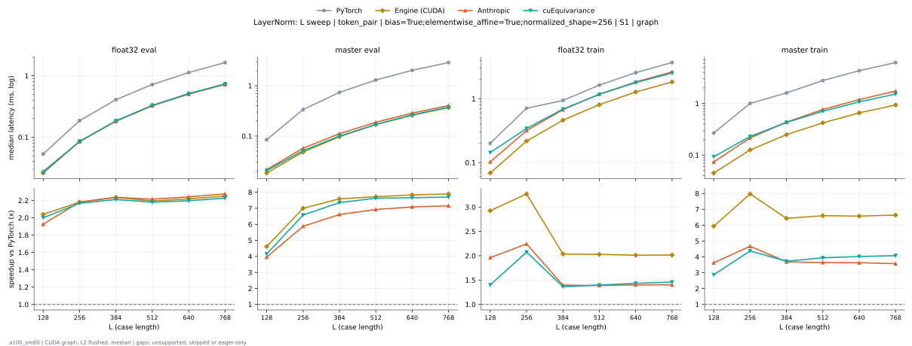

**float32 eval** (median ms; x = speedup vs PyTorch)

| L | PyTorch | Engine (Triton) | Engine (CUDA) | Anthropic | cuEquivariance |
|---|---|---|---|---|---|
| 128 | 0.05325 | 0.02765 (1.93x) | 0.02765 (1.93x) | 0.02765 (1.93x) | 0.02662 (2.00x) |
| 256 | 0.1853 | 0.08499 (2.18x) | 0.08499 (2.18x) | 0.08499 (2.18x) | 0.0855 (2.17x) |
| 384 | 0.4076 | 0.1843 (2.21x) | 0.1823 (2.24x) | 0.1823 (2.24x) | 0.1843 (2.21x) |
| 512 | 0.7178 | 0.3261 (2.20x) | 0.3277 (2.19x) | 0.3246 (2.21x) | 0.3297 (2.18x) |
| 640 | 1.118 | 0.512 (2.18x) | 0.5079 (2.20x) | 0.5028 (2.22x) | 0.513 (2.18x) |
| 768 | 1.64 | 0.7342 (2.23x) | 0.7291 (2.25x) | 0.7209 (2.28x) | 0.7363 (2.23x) |

**master eval** (median ms; x = speedup vs PyTorch)

| L | PyTorch | Engine (Triton) | Engine (CUDA) | Anthropic | cuEquivariance |
|---|---|---|---|---|---|
| 128 | 0.08397 | 0.01741 (4.82x) | 0.01843 (4.56x) | 0.0215 (3.90x) | 0.02048 (4.10x) |
| 256 | 0.3369 | 0.0471 (7.15x) | 0.04813 (7.00x) | 0.05734 (5.87x) | 0.0512 (6.58x) |
| 384 | 0.7363 | 0.09626 (7.65x) | 0.0983 (7.49x) | 0.1116 (6.60x) | 0.1004 (7.34x) |
| 512 | 1.304 | 0.17 (7.67x) | 0.17 (7.67x) | 0.1884 (6.92x) | 0.171 (7.63x) |
| 640 | 2.031 | 0.2621 (7.75x) | 0.2591 (7.84x) | 0.2867 (7.08x) | 0.2652 (7.66x) |
| 768 | 2.907 | 0.3727 (7.80x) | 0.3676 (7.91x) | 0.4055 (7.17x) | 0.3768 (7.71x) |

**float32 train** (median ms; x = speedup vs PyTorch)

| L | PyTorch | Engine (Triton) | Engine (CUDA) | Anthropic | cuEquivariance |
|---|---|---|---|---|---|
| 128 | 0.2007 | 0.07373 (2.72x) | 0.06861 (2.93x) | 0.1024 (1.96x) | 0.1434 (1.40x) |
| 256 | 0.7107 | 0.2263 (3.14x) | 0.2171 (3.27x) | 0.3164 (2.25x) | 0.342 (2.08x) |
| 384 | 0.9375 | 0.4741 (1.98x) | 0.4618 (2.03x) | 0.6738 (1.39x) | 0.6892 (1.36x) |
| 512 | 1.647 | 0.8166 (2.02x) | 0.809 (2.04x) | 1.18 (1.40x) | 1.172 (1.40x) |
| 640 | 2.565 | 1.285 (2.00x) | 1.278 (2.01x) | 1.834 (1.40x) | 1.792 (1.43x) |
| 768 | 3.666 | 1.844 (1.99x) | 1.835 (2.00x) | 2.637 (1.39x) | 2.533 (1.45x) |

**master train** (median ms; x = speedup vs PyTorch)

| L | PyTorch | Engine (Triton) | Engine (CUDA) | Anthropic | cuEquivariance |
|---|---|---|---|---|---|
| 128 | 0.2673 | 0.04813 (5.55x) | 0.04506 (5.93x) | 0.07373 (3.62x) | 0.09318 (2.87x) |
| 256 | 1.004 | 0.1423 (7.05x) | 0.126 (7.97x) | 0.215 (4.67x) | 0.2294 (4.37x) |
| 384 | 1.599 | 0.2755 (5.81x) | 0.2529 (6.32x) | 0.4342 (3.68x) | 0.4291 (3.73x) |
| 512 | 2.78 | 0.4413 (6.30x) | 0.4301 (6.46x) | 0.7644 (3.64x) | 0.7066 (3.93x) |
| 640 | 4.302 | 0.6717 (6.40x) | 0.6574 (6.54x) | 1.188 (3.62x) | 1.072 (4.01x) |
| 768 | 6.166 | 0.9482 (6.50x) | 0.9349 (6.59x) | 1.736 (3.55x) | 1.52 (4.06x) |

### L sweep: token_pair | bias=True;elementwise_affine=True;normalized_shape=384 | S1 | graph

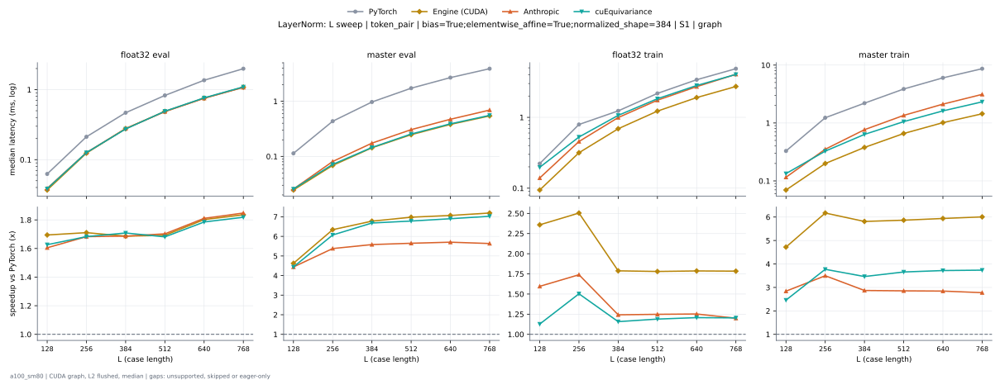

**float32 eval** (median ms; x = speedup vs PyTorch)

| L | PyTorch | Engine (Triton) | Engine (CUDA) | Anthropic | cuEquivariance |
|---|---|---|---|---|---|
| 128 | 0.06246 | 0.03789 (1.65x) | 0.03686 (1.69x) | 0.03891 (1.61x) | 0.0384 (1.63x) |
| 256 | 0.212 | 0.1249 (1.70x) | 0.1239 (1.71x) | 0.126 (1.68x) | 0.126 (1.68x) |
| 384 | 0.4669 | 0.2734 (1.71x) | 0.2744 (1.70x) | 0.2775 (1.68x) | 0.2739 (1.70x) |
| 512 | 0.855 | 0.4895 (1.75x) | 0.4884 (1.75x) | 0.4854 (1.76x) | 0.4915 (1.74x) |
| 640 | 1.35 | 0.7619 (1.77x) | 0.7578 (1.78x) | 0.7521 (1.80x) | 0.7629 (1.77x) |
| 768 | 1.983 | 1.093 (1.82x) | 1.089 (1.82x) | 1.077 (1.84x) | 1.095 (1.81x) |

**master eval** (median ms; x = speedup vs PyTorch)

| L | PyTorch | Engine (Triton) | Engine (CUDA) | Anthropic | cuEquivariance |
|---|---|---|---|---|---|
| 128 | 0.1137 | 0.02355 (4.83x) | 0.02355 (4.83x) | 0.0256 (4.44x) | 0.0256 (4.44x) |
| 256 | 0.4352 | 0.06758 (6.44x) | 0.06758 (6.44x) | 0.0809 (5.38x) | 0.07168 (6.07x) |
| 384 | 0.9626 | 0.1403 (6.86x) | 0.1434 (6.71x) | 0.1741 (5.53x) | 0.1454 (6.62x) |
| 512 | 1.711 | 0.2499 (6.85x) | 0.2478 (6.90x) | 0.3062 (5.59x) | 0.255 (6.71x) |
| 640 | 2.68 | 0.385 (6.96x) | 0.382 (7.02x) | 0.4721 (5.68x) | 0.3901 (6.87x) |
| 768 | 3.877 | 0.5499 (7.05x) | 0.5448 (7.12x) | 0.6932 (5.59x) | 0.556 (6.97x) |

**float32 train** (median ms; x = speedup vs PyTorch)

| L | PyTorch | Engine (Triton) | Engine (CUDA) | Anthropic | cuEquivariance |
|---|---|---|---|---|---|
| 128 | 0.2263 | 0.1085 (2.08x) | 0.09728 (2.33x) | 0.1393 (1.62x) | 0.1971 (1.15x) |
| 256 | 0.7905 | 0.3174 (2.49x) | 0.3164 (2.50x) | 0.4557 (1.73x) | 0.5274 (1.50x) |
| 384 | 1.224 | 0.6917 (1.77x) | 0.6851 (1.79x) | 0.9933 (1.23x) | 1.066 (1.15x) |
| 512 | 2.169 | 1.234 (1.76x) | 1.224 (1.77x) | 1.745 (1.24x) | 1.831 (1.18x) |
| 640 | 3.37 | 1.923 (1.75x) | 1.904 (1.77x) | 2.713 (1.24x) | 2.814 (1.20x) |
| 768 | 4.847 | 2.759 (1.76x) | 2.729 (1.78x) | 4.054 (1.20x) | 4.038 (1.20x) |

**master train** (median ms; x = speedup vs PyTorch)

| L | PyTorch | Engine (Triton) | Engine (CUDA) | Anthropic | cuEquivariance |
|---|---|---|---|---|---|
| 128 | 0.3287 | 0.06963 (4.72x) | 0.07066 (4.65x) | 0.1157 (2.84x) | 0.1336 (2.46x) |
| 256 | 1.231 | 0.2099 (5.86x) | 0.1997 (6.16x) | 0.3523 (3.49x) | 0.3267 (3.77x) |
| 384 | 2.189 | 0.4413 (4.96x) | 0.386 (5.67x) | 0.7665 (2.86x) | 0.6349 (3.45x) |
| 512 | 3.857 | 0.7936 (4.86x) | 0.6605 (5.84x) | 1.353 (2.85x) | 1.056 (3.65x) |
| 640 | 5.991 | 1.235 (4.85x) | 1.013 (5.92x) | 2.117 (2.83x) | 1.619 (3.70x) |
| 768 | 8.597 | 1.774 (4.85x) | 1.443 (5.96x) | 3.121 (2.75x) | 2.319 (3.71x) |

### L sweep: token_pair | bias=True;elementwise_affine=True;normalized_shape=512 | S1 | graph

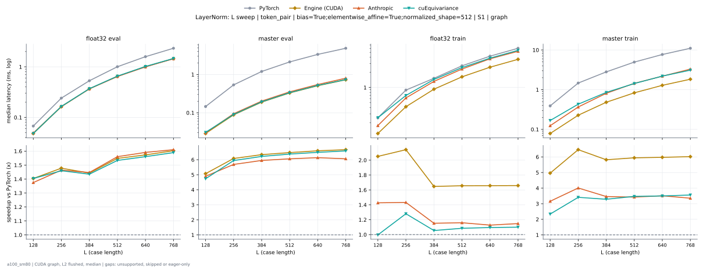

**float32 eval** (median ms; x = speedup vs PyTorch)

| L | PyTorch | Engine (Triton) | Engine (CUDA) | Anthropic | cuEquivariance |
|---|---|---|---|---|---|
| 128 | 0.06758 | 0.0471 (1.43x) | 0.04813 (1.40x) | 0.04915 (1.37x) | 0.04813 (1.40x) |
| 256 | 0.2406 | 0.1644 (1.46x) | 0.1628 (1.48x) | 0.1644 (1.46x) | 0.1649 (1.46x) |
| 384 | 0.5304 | 0.3676 (1.44x) | 0.3676 (1.44x) | 0.3666 (1.45x) | 0.3697 (1.43x) |
| 512 | 1.004 | 0.6523 (1.54x) | 0.6482 (1.55x) | 0.6431 (1.56x) | 0.6543 (1.53x) |
| 640 | 1.585 | 1.014 (1.56x) | 1.008 (1.57x) | 0.9964 (1.59x) | 1.016 (1.56x) |
| 768 | 2.324 | 1.454 (1.60x) | 1.45 (1.60x) | 1.443 (1.61x) | 1.462 (1.59x) |

**master eval** (median ms; x = speedup vs PyTorch)

| L | PyTorch | Engine (Triton) | Engine (CUDA) | Anthropic | cuEquivariance |
|---|---|---|---|---|---|
| 128 | 0.1454 | 0.02765 (5.26x) | 0.02867 (5.07x) | 0.0297 (4.90x) | 0.03072 (4.73x) |
| 256 | 0.5356 | 0.08704 (6.15x) | 0.08806 (6.08x) | 0.09421 (5.68x) | 0.09011 (5.94x) |
| 384 | 1.2 | 0.1894 (6.34x) | 0.1894 (6.34x) | 0.2017 (5.95x) | 0.193 (6.22x) |
| 512 | 2.134 | 0.3318 (6.43x) | 0.3297 (6.47x) | 0.3523 (6.06x) | 0.3348 (6.37x) |
| 640 | 3.355 | 0.513 (6.54x) | 0.5089 (6.59x) | 0.5468 (6.13x) | 0.5171 (6.49x) |
| 768 | 4.853 | 0.7332 (6.62x) | 0.7281 (6.67x) | 0.8008 (6.06x) | 0.7373 (6.58x) |

**float32 train** (median ms; x = speedup vs PyTorch)

| L | PyTorch | Engine (Triton) | Engine (CUDA) | Anthropic | cuEquivariance |
|---|---|---|---|---|---|
| 128 | 0.2499 | 0.1331 (1.88x) | 0.1219 (2.05x) | 0.1751 (1.43x) | 0.2509 (1.00x) |
| 256 | 0.8888 | 0.4157 (2.14x) | 0.4152 (2.14x) | 0.6205 (1.43x) | 0.6943 (1.28x) |
| 384 | 1.525 | 0.9283 (1.64x) | 0.9257 (1.65x) | 1.323 (1.15x) | 1.445 (1.05x) |
| 512 | 2.7 | 1.642 (1.64x) | 1.63 (1.66x) | 2.329 (1.16x) | 2.488 (1.08x) |
| 640 | 4.198 | 2.558 (1.64x) | 2.533 (1.66x) | 3.724 (1.13x) | 3.834 (1.10x) |
| 768 | 6.026 | 3.683 (1.64x) | 3.633 (1.66x) | 5.249 (1.15x) | 5.478 (1.10x) |

**master train** (median ms; x = speedup vs PyTorch)

| L | PyTorch | Engine (Triton) | Engine (CUDA) | Anthropic | cuEquivariance |
|---|---|---|---|---|---|
| 128 | 0.3912 | 0.09318 (4.20x) | 0.07885 (4.96x) | 0.1239 (3.16x) | 0.1674 (2.34x) |
| 256 | 1.469 | 0.2939 (5.00x) | 0.2273 (6.46x) | 0.3666 (4.01x) | 0.4311 (3.41x) |
| 384 | 2.806 | 0.6246 (4.49x) | 0.4823 (5.82x) | 0.811 (3.46x) | 0.854 (3.29x) |
| 512 | 4.953 | 1.103 (4.49x) | 0.8335 (5.94x) | 1.446 (3.43x) | 1.427 (3.47x) |
| 640 | 7.689 | 1.706 (4.51x) | 1.287 (5.97x) | 2.191 (3.51x) | 2.198 (3.50x) |
| 768 | 11.04 | 2.461 (4.49x) | 1.835 (6.02x) | 3.293 (3.35x) | 3.103 (3.56x) |

### L sweep: token_pair | bias=True;elementwise_affine=True;normalized_shape=64 | S1 | graph

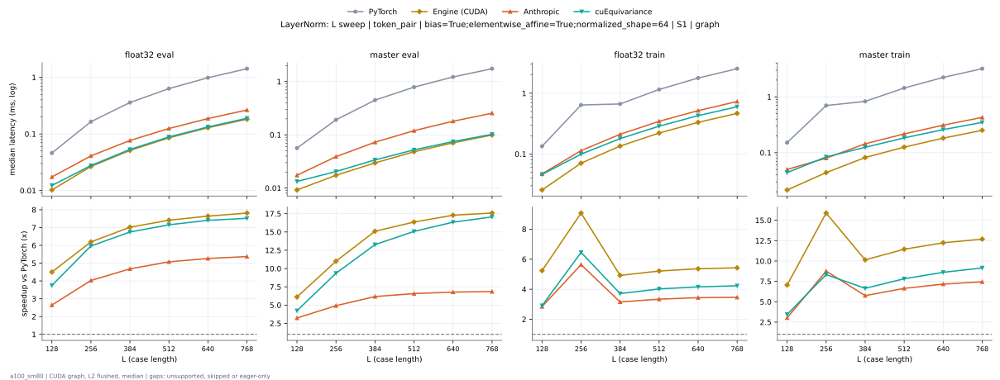

**float32 eval** (median ms; x = speedup vs PyTorch)

| L | PyTorch | Engine (Triton) | Engine (CUDA) | Anthropic | cuEquivariance |
|---|---|---|---|---|---|
| 128 | 0.04608 | 0.01126 (4.09x) | 0.01024 (4.50x) | 0.01741 (2.65x) | 0.01229 (3.75x) |
| 256 | 0.1649 | 0.02662 (6.19x) | 0.02662 (6.19x) | 0.04096 (4.03x) | 0.02765 (5.96x) |
| 384 | 0.3594 | 0.0512 (7.02x) | 0.0512 (7.02x) | 0.0768 (4.68x) | 0.05325 (6.75x) |
| 512 | 0.6339 | 0.08602 (7.37x) | 0.0855 (7.41x) | 0.1249 (5.07x) | 0.08858 (7.16x) |
| 640 | 0.9861 | 0.1311 (7.52x) | 0.129 (7.64x) | 0.1874 (5.26x) | 0.1331 (7.41x) |
| 768 | 1.424 | 0.1853 (7.69x) | 0.1823 (7.81x) | 0.2652 (5.37x) | 0.1894 (7.52x) |

**master eval** (median ms; x = speedup vs PyTorch)

| L | PyTorch | Engine (Triton) | Engine (CUDA) | Anthropic | cuEquivariance |
|---|---|---|---|---|---|
| 128 | 0.05632 | 0.009216 (6.11x) | 0.009216 (6.11x) | 0.01741 (3.24x) | 0.01331 (4.23x) |
| 256 | 0.1915 | 0.01638 (11.69x) | 0.01741 (11.00x) | 0.03891 (4.92x) | 0.02048 (9.35x) |
| 384 | 0.4485 | 0.0297 (15.10x) | 0.0297 (15.10x) | 0.0727 (6.17x) | 0.03379 (13.27x) |
| 512 | 0.7875 | 0.04813 (16.36x) | 0.04813 (16.36x) | 0.1198 (6.57x) | 0.05222 (15.08x) |
| 640 | 1.222 | 0.07066 (17.29x) | 0.07066 (17.29x) | 0.1802 (6.78x) | 0.07475 (16.34x) |
| 768 | 1.747 | 0.0983 (17.77x) | 0.09933 (17.59x) | 0.255 (6.85x) | 0.1024 (17.06x) |

**float32 train** (median ms; x = speedup vs PyTorch)

| L | PyTorch | Engine (Triton) | Engine (CUDA) | Anthropic | cuEquivariance |
|---|---|---|---|---|---|
| 128 | 0.1341 | 0.02355 (5.70x) | 0.0256 (5.24x) | 0.0471 (2.85x) | 0.04608 (2.91x) |
| 256 | 0.641 | 0.06758 (9.48x) | 0.07066 (9.07x) | 0.1137 (5.64x) | 0.09933 (6.45x) |
| 384 | 0.6656 | 0.1311 (5.08x) | 0.1352 (4.92x) | 0.2109 (3.16x) | 0.1792 (3.71x) |
| 512 | 1.153 | 0.2181 (5.29x) | 0.2212 (5.21x) | 0.3451 (3.34x) | 0.2867 (4.02x) |
| 640 | 1.78 | 0.3297 (5.40x) | 0.3318 (5.37x) | 0.5176 (3.44x) | 0.428 (4.16x) |
| 768 | 2.534 | 0.468 (5.42x) | 0.4669 (5.43x) | 0.7311 (3.47x) | 0.599 (4.23x) |

**master train** (median ms; x = speedup vs PyTorch)

| L | PyTorch | Engine (Triton) | Engine (CUDA) | Anthropic | cuEquivariance |
|---|---|---|---|---|---|
| 128 | 0.1516 | 0.02048 (7.40x) | 0.0215 (7.05x) | 0.05018 (3.02x) | 0.04403 (3.44x) |
| 256 | 0.6994 | 0.04301 (16.26x) | 0.04403 (15.88x) | 0.07987 (8.76x) | 0.08397 (8.33x) |
| 384 | 0.8305 | 0.07987 (10.40x) | 0.08192 (10.14x) | 0.1444 (5.75x) | 0.1249 (6.65x) |
| 512 | 1.442 | 0.1249 (11.54x) | 0.126 (11.45x) | 0.2171 (6.64x) | 0.1843 (7.82x) |
| 640 | 2.23 | 0.1823 (12.24x) | 0.1823 (12.24x) | 0.3113 (7.16x) | 0.2591 (8.61x) |
| 768 | 3.196 | 0.254 (12.58x) | 0.2519 (12.69x) | 0.4291 (7.45x) | 0.3492 (9.15x) |

### L sweep: token_single | bias=False;elementwise_affine=True;normalized_shape=384 | S1 | graph

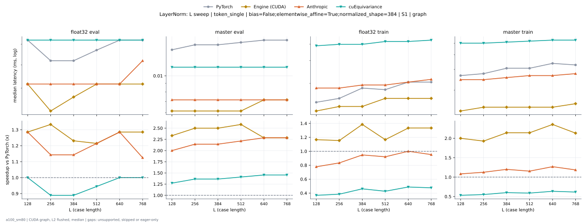

**float32 eval** (median ms; x = speedup vs PyTorch)

| L | PyTorch | Engine (Triton) | Engine (CUDA) | Anthropic | cuEquivariance |
|---|---|---|---|---|---|
| 128 | 0.008704 | 0.01024 (0.85x) | 0.006144 (1.42x) | 0.007168 (1.21x) | 0.009216 (0.94x) |
| 256 | 0.008192 | 0.009216 (0.89x) | 0.006144 (1.33x) | 0.007168 (1.14x) | 0.009216 (0.89x) |
| 384 | 0.008192 | 0.009216 (0.89x) | 0.007168 (1.14x) | 0.007168 (1.14x) | 0.009216 (0.89x) |
| 512 | 0.008192 | 0.009216 (0.89x) | 0.007168 (1.14x) | 0.007168 (1.14x) | 0.009216 (0.89x) |
| 640 | 0.009216 | 0.009216 (1.00x) | 0.007168 (1.29x) | 0.007168 (1.29x) | 0.009216 (1.00x) |
| 768 | 0.009216 | 0.01024 (0.90x) | 0.007168 (1.29x) | 0.008192 (1.13x) | 0.009216 (1.00x) |

**master eval** (median ms; x = speedup vs PyTorch)

| L | PyTorch | Engine (Triton) | Engine (CUDA) | Anthropic | cuEquivariance |
|---|---|---|---|---|---|
| 128 | 0.01536 | 0.008192 (1.87x) | 0.006144 (2.50x) | 0.007168 (2.14x) | 0.01126 (1.36x) |
| 256 | 0.01536 | 0.008192 (1.87x) | 0.006144 (2.50x) | 0.007168 (2.14x) | 0.01126 (1.36x) |
| 384 | 0.01536 | 0.008192 (1.87x) | 0.006144 (2.50x) | 0.007168 (2.14x) | 0.01126 (1.36x) |
| 512 | 0.01536 | 0.008192 (1.87x) | 0.006144 (2.50x) | 0.007168 (2.14x) | 0.01126 (1.36x) |
| 640 | 0.01638 | 0.009216 (1.78x) | 0.007168 (2.29x) | 0.007168 (2.29x) | 0.01126 (1.45x) |
| 768 | 0.01638 | 0.008192 (2.00x) | 0.007168 (2.29x) | 0.007168 (2.29x) | 0.01126 (1.45x) |

**float32 train** (median ms; x = speedup vs PyTorch)

| L | PyTorch | Engine (Triton) | Engine (CUDA) | Anthropic | cuEquivariance |
|---|---|---|---|---|---|
| 128 | 0.01536 | 0.01741 (0.88x) | 0.01331 (1.15x) | 0.01843 (0.83x) | 0.03891 (0.39x) |
| 256 | 0.01536 | 0.01741 (0.88x) | 0.01331 (1.15x) | 0.01843 (0.83x) | 0.03994 (0.38x) |
| 384 | 0.01843 | 0.01843 (1.00x) | 0.01331 (1.38x) | 0.01946 (0.95x) | 0.03994 (0.46x) |
| 512 | 0.01741 | 0.01946 (0.89x) | 0.01434 (1.21x) | 0.01946 (0.89x) | 0.04198 (0.41x) |
| 640 | 0.02048 | 0.01946 (1.05x) | 0.01536 (1.33x) | 0.02048 (1.00x) | 0.04198 (0.49x) |
| 768 | 0.02048 | 0.02048 (1.00x) | 0.01536 (1.33x) | 0.0215 (0.95x) | 0.04301 (0.48x) |

**master train** (median ms; x = speedup vs PyTorch)

| L | PyTorch | Engine (Triton) | Engine (CUDA) | Anthropic | cuEquivariance |
|---|---|---|---|---|---|
| 128 | 0.02662 | 0.01638 (1.62x) | 0.01331 (2.00x) | 0.02458 (1.08x) | 0.05018 (0.53x) |
| 256 | 0.02765 | 0.01741 (1.59x) | 0.01331 (2.08x) | 0.02458 (1.12x) | 0.05018 (0.55x) |
| 384 | 0.03072 | 0.01946 (1.58x) | 0.01331 (2.31x) | 0.0256 (1.20x) | 0.0512 (0.60x) |
| 512 | 0.03072 | 0.02048 (1.50x) | 0.01434 (2.14x) | 0.02662 (1.15x) | 0.05222 (0.59x) |
| 640 | 0.03379 | 0.01946 (1.74x) | 0.01434 (2.36x) | 0.02662 (1.27x) | 0.05325 (0.63x) |
| 768 | 0.03277 | 0.02048 (1.60x) | 0.01536 (2.13x) | 0.02765 (1.19x) | 0.05325 (0.62x) |

### L sweep: token_single | bias=False;elementwise_affine=True;normalized_shape=768 | S1 | graph

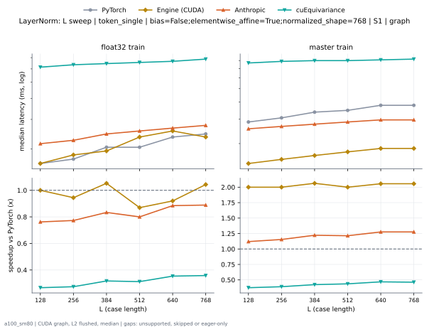

**float32 train** (median ms; x = speedup vs PyTorch)

| L | PyTorch | Engine (Triton) | Engine (CUDA) | Anthropic | cuEquivariance |
|---|---|---|---|---|---|
| 128 | 0.01638 | 0.02355 (0.70x) | 0.01638 (1.00x) | 0.0215 (0.76x) | 0.06144 (0.27x) |
| 256 | 0.01741 | 0.02458 (0.71x) | 0.01843 (0.94x) | 0.02253 (0.77x) | 0.06349 (0.27x) |
| 384 | 0.02048 | 0.0256 (0.80x) | 0.01946 (1.05x) | 0.02458 (0.83x) | 0.06451 (0.32x) |
| 512 | 0.02048 | 0.02867 (0.71x) | 0.02355 (0.87x) | 0.0256 (0.80x) | 0.06554 (0.31x) |
| 640 | 0.02355 | 0.02867 (0.82x) | 0.0256 (0.92x) | 0.02662 (0.88x) | 0.06656 (0.35x) |
| 768 | 0.02458 | 0.02867 (0.86x) | 0.02355 (1.04x) | 0.02765 (0.89x) | 0.06861 (0.36x) |

**master train** (median ms; x = speedup vs PyTorch)

| L | PyTorch | Engine (Triton) | Engine (CUDA) | Anthropic | cuEquivariance |
|---|---|---|---|---|---|
| 128 | 0.02867 | 0.02253 (1.27x) | 0.01434 (2.00x) | 0.0256 (1.12x) | 0.0768 (0.37x) |
| 256 | 0.03072 | 0.02765 (1.11x) | 0.01536 (2.00x) | 0.02662 (1.15x) | 0.07885 (0.39x) |
| 384 | 0.03379 | 0.02662 (1.27x) | 0.01638 (2.06x) | 0.02765 (1.22x) | 0.07987 (0.42x) |
| 512 | 0.03482 | 0.0297 (1.17x) | 0.01741 (2.00x) | 0.02867 (1.21x) | 0.07987 (0.44x) |
| 640 | 0.03789 | 0.03072 (1.23x) | 0.01843 (2.06x) | 0.0297 (1.28x) | 0.0809 (0.47x) |
| 768 | 0.03789 | 0.0297 (1.28x) | 0.01843 (2.06x) | 0.0297 (1.28x) | 0.08192 (0.46x) |

### L sweep: token_single | bias=False;elementwise_affine=True;normalized_shape=768 | S5 | graph

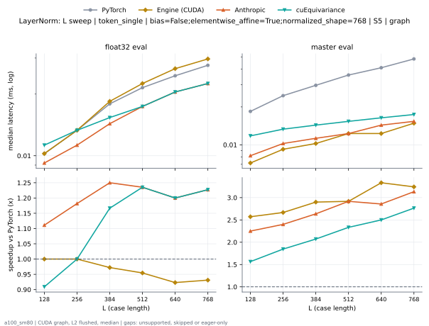

**float32 eval** (median ms; x = speedup vs PyTorch)

| L | PyTorch | Engine (Triton) | Engine (CUDA) | Anthropic | cuEquivariance |
|---|---|---|---|---|---|
| 128 | 0.01024 | 0.01229 (0.83x) | 0.01024 (1.00x) | 0.009216 (1.11x) | 0.01126 (0.91x) |
| 256 | 0.01331 | 0.01331 (1.00x) | 0.01331 (1.00x) | 0.01126 (1.18x) | 0.01331 (1.00x) |
| 384 | 0.01792 | 0.01536 (1.17x) | 0.01843 (0.97x) | 0.01434 (1.25x) | 0.01536 (1.17x) |
| 512 | 0.0215 | 0.01741 (1.24x) | 0.02253 (0.95x) | 0.01741 (1.24x) | 0.01741 (1.24x) |
| 640 | 0.02458 | 0.02048 (1.20x) | 0.02662 (0.92x) | 0.02048 (1.20x) | 0.02048 (1.20x) |
| 768 | 0.02765 | 0.02304 (1.20x) | 0.0297 (0.93x) | 0.02253 (1.23x) | 0.02253 (1.23x) |

**master eval** (median ms; x = speedup vs PyTorch)

| L | PyTorch | Engine (Triton) | Engine (CUDA) | Anthropic | cuEquivariance |
|---|---|---|---|---|---|
| 128 | 0.01843 | 0.01126 (1.64x) | 0.007168 (2.57x) | 0.008192 (2.25x) | 0.01178 (1.57x) |
| 256 | 0.02458 | 0.01229 (2.00x) | 0.009216 (2.67x) | 0.01024 (2.40x) | 0.01331 (1.85x) |
| 384 | 0.0297 | 0.01229 (2.42x) | 0.01024 (2.90x) | 0.01126 (2.64x) | 0.01434 (2.07x) |
| 512 | 0.03584 | 0.01331 (2.69x) | 0.01229 (2.92x) | 0.01229 (2.92x) | 0.01536 (2.33x) |
| 640 | 0.04096 | 0.01434 (2.86x) | 0.01229 (3.33x) | 0.01434 (2.86x) | 0.01638 (2.50x) |
| 768 | 0.04813 | 0.01536 (3.13x) | 0.01485 (3.24x) | 0.01536 (3.13x) | 0.01741 (2.76x) |

### L sweep: token_single | bias=False;elementwise_affine=True;normalized_shape=831 | S1 | graph

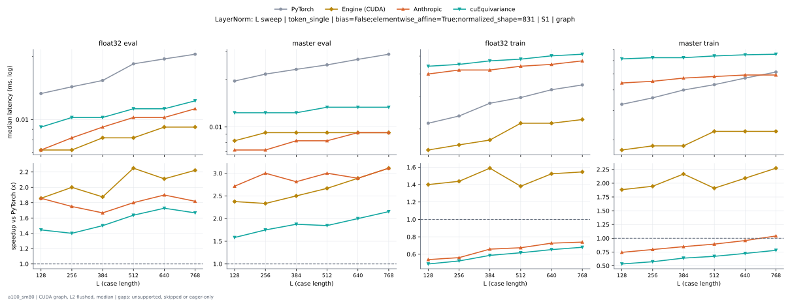

**float32 eval** (median ms; x = speedup vs PyTorch)

| L | PyTorch | Engine (Triton) | Engine (CUDA) | Anthropic | cuEquivariance |
|---|---|---|---|---|---|
| 128 | 0.01229 | 0.01229 (1.00x) | 0.006144 (2.00x) | 0.007168 (1.71x) | 0.009216 (1.33x) |
| 256 | 0.01434 | 0.01229 (1.17x) | 0.007168 (2.00x) | 0.008192 (1.75x) | 0.01024 (1.40x) |
| 384 | 0.01536 | 0.01229 (1.25x) | 0.007168 (2.14x) | 0.009216 (1.67x) | 0.01024 (1.50x) |
| 512 | 0.01843 | 0.01331 (1.38x) | 0.008192 (2.25x) | 0.01024 (1.80x) | 0.01126 (1.64x) |
| 640 | 0.01946 | 0.01331 (1.46x) | 0.009216 (2.11x) | 0.01024 (1.90x) | 0.01126 (1.73x) |
| 768 | 0.02048 | 0.01331 (1.54x) | 0.009216 (2.22x) | 0.01126 (1.82x) | 0.01229 (1.67x) |

**master eval** (median ms; x = speedup vs PyTorch)

| L | PyTorch | Engine (Triton) | Engine (CUDA) | Anthropic | cuEquivariance |
|---|---|---|---|---|---|
| 128 | 0.01946 | 0.01229 (1.58x) | 0.008192 (2.37x) | 0.007168 (2.71x) | 0.01229 (1.58x) |
| 256 | 0.0215 | 0.01229 (1.75x) | 0.009216 (2.33x) | 0.007168 (3.00x) | 0.01229 (1.75x) |
| 384 | 0.02253 | 0.01229 (1.83x) | 0.009216 (2.44x) | 0.008192 (2.75x) | 0.01229 (1.83x) |
| 512 | 0.0256 | 0.01229 (2.08x) | 0.009216 (2.78x) | 0.008192 (3.12x) | 0.01331 (1.92x) |
| 640 | 0.02611 | 0.01229 (2.12x) | 0.009216 (2.83x) | 0.009216 (2.83x) | 0.01331 (1.96x) |
| 768 | 0.02918 | 0.01331 (2.19x) | 0.01024 (2.85x) | 0.009216 (3.17x) | 0.01331 (2.19x) |

**float32 train** (median ms; x = speedup vs PyTorch)

| L | PyTorch | Engine (Triton) | Engine (CUDA) | Anthropic | cuEquivariance |
|---|---|---|---|---|---|
| 128 | 0.0215 | 0.02355 (0.91x) | 0.01536 (1.40x) | 0.03994 (0.54x) | 0.04403 (0.49x) |
| 256 | 0.02355 | 0.02662 (0.88x) | 0.01638 (1.44x) | 0.04198 (0.56x) | 0.04506 (0.52x) |
| 384 | 0.02765 | 0.02662 (1.04x) | 0.01741 (1.59x) | 0.04198 (0.66x) | 0.0471 (0.59x) |
| 512 | 0.03072 | 0.02765 (1.11x) | 0.0215 (1.43x) | 0.04403 (0.70x) | 0.04813 (0.64x) |
| 640 | 0.03277 | 0.03072 (1.07x) | 0.0215 (1.52x) | 0.04506 (0.73x) | 0.05018 (0.65x) |
| 768 | 0.03482 | 0.03584 (0.97x) | 0.02253 (1.55x) | 0.0471 (0.74x) | 0.0512 (0.68x) |

**master train** (median ms; x = speedup vs PyTorch)

| L | PyTorch | Engine (Triton) | Engine (CUDA) | Anthropic | cuEquivariance |
|---|---|---|---|---|---|
| 128 | 0.03277 | 0.02355 (1.39x) | 0.01741 (1.88x) | 0.04403 (0.74x) | 0.06144 (0.53x) |
| 256 | 0.03584 | 0.02458 (1.46x) | 0.01741 (2.06x) | 0.04506 (0.80x) | 0.06246 (0.57x) |
| 384 | 0.04096 | 0.0256 (1.60x) | 0.01843 (2.22x) | 0.0471 (0.87x) | 0.06246 (0.66x) |
| 512 | 0.04403 | 0.02867 (1.54x) | 0.0215 (2.05x) | 0.04813 (0.91x) | 0.064 (0.69x) |
| 640 | 0.0471 | 0.0297 (1.59x) | 0.02253 (2.09x) | 0.04915 (0.96x) | 0.06502 (0.72x) |
| 768 | 0.0512 | 0.03174 (1.61x) | 0.02253 (2.27x) | 0.04915 (1.04x) | 0.06554 (0.78x) |

### L sweep: token_single | bias=False;elementwise_affine=True;normalized_shape=833 | S1 | graph

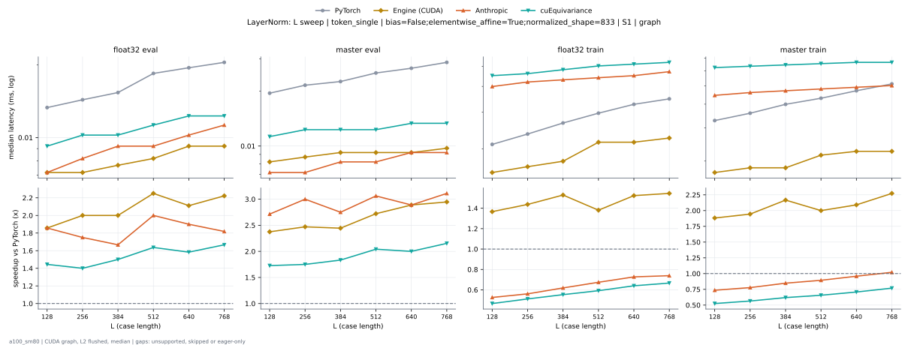

**float32 eval** (median ms; x = speedup vs PyTorch)

| L | PyTorch | Engine (Triton) | Engine (CUDA) | Anthropic | cuEquivariance |
|---|---|---|---|---|---|
| 128 | 0.01331 | 0.01229 (1.08x) | 0.007168 (1.86x) | 0.007168 (1.86x) | 0.009216 (1.44x) |
| 256 | 0.01434 | 0.01229 (1.17x) | 0.007168 (2.00x) | 0.008192 (1.75x) | 0.01024 (1.40x) |
| 384 | 0.01536 | 0.01331 (1.15x) | 0.00768 (2.00x) | 0.009216 (1.67x) | 0.01024 (1.50x) |
| 512 | 0.01843 | 0.01331 (1.38x) | 0.008192 (2.25x) | 0.009216 (2.00x) | 0.01126 (1.64x) |
| 640 | 0.01946 | 0.01331 (1.46x) | 0.009216 (2.11x) | 0.01024 (1.90x) | 0.01229 (1.58x) |
| 768 | 0.02048 | 0.01434 (1.43x) | 0.009216 (2.22x) | 0.01126 (1.82x) | 0.01229 (1.67x) |

**master eval** (median ms; x = speedup vs PyTorch)

| L | PyTorch | Engine (Triton) | Engine (CUDA) | Anthropic | cuEquivariance |
|---|---|---|---|---|---|
| 128 | 0.01946 | 0.01229 (1.58x) | 0.008192 (2.37x) | 0.007168 (2.71x) | 0.01126 (1.73x) |
| 256 | 0.0215 | 0.01229 (1.75x) | 0.008704 (2.47x) | 0.007168 (3.00x) | 0.01229 (1.75x) |
| 384 | 0.02253 | 0.01229 (1.83x) | 0.009216 (2.44x) | 0.008192 (2.75x) | 0.01229 (1.83x) |
| 512 | 0.02509 | 0.01229 (2.04x) | 0.009216 (2.72x) | 0.008192 (3.06x) | 0.01229 (2.04x) |
| 640 | 0.02662 | 0.01229 (2.17x) | 0.009216 (2.89x) | 0.009216 (2.89x) | 0.01331 (2.00x) |
| 768 | 0.02867 | 0.01229 (2.33x) | 0.009728 (2.95x) | 0.009216 (3.11x) | 0.01331 (2.15x) |

**float32 train** (median ms; x = speedup vs PyTorch)

| L | PyTorch | Engine (Triton) | Engine (CUDA) | Anthropic | cuEquivariance |
|---|---|---|---|---|---|
| 128 | 0.02099 | 0.02355 (0.89x) | 0.01536 (1.37x) | 0.03994 (0.53x) | 0.04506 (0.47x) |
| 256 | 0.02355 | 0.0256 (0.92x) | 0.01638 (1.44x) | 0.04198 (0.56x) | 0.04608 (0.51x) |
| 384 | 0.02662 | 0.02662 (1.00x) | 0.01741 (1.53x) | 0.04301 (0.62x) | 0.04813 (0.55x) |
| 512 | 0.0297 | 0.02867 (1.04x) | 0.0215 (1.38x) | 0.04403 (0.67x) | 0.05018 (0.59x) |
| 640 | 0.03277 | 0.03072 (1.07x) | 0.0215 (1.52x) | 0.04506 (0.73x) | 0.0512 (0.64x) |
| 768 | 0.03482 | 0.03379 (1.03x) | 0.02253 (1.55x) | 0.0471 (0.74x) | 0.05222 (0.67x) |

**master train** (median ms; x = speedup vs PyTorch)

| L | PyTorch | Engine (Triton) | Engine (CUDA) | Anthropic | cuEquivariance |
|---|---|---|---|---|---|
| 128 | 0.03277 | 0.02355 (1.39x) | 0.01741 (1.88x) | 0.04454 (0.74x) | 0.06246 (0.52x) |
| 256 | 0.03584 | 0.02458 (1.46x) | 0.01843 (1.94x) | 0.04608 (0.78x) | 0.06349 (0.56x) |
| 384 | 0.03994 | 0.0256 (1.56x) | 0.01843 (2.17x) | 0.0471 (0.85x) | 0.06451 (0.62x) |
| 512 | 0.04301 | 0.02765 (1.56x) | 0.0215 (2.00x) | 0.04813 (0.89x) | 0.06554 (0.66x) |
| 640 | 0.0471 | 0.0297 (1.59x) | 0.02253 (2.09x) | 0.04915 (0.96x) | 0.06656 (0.71x) |
| 768 | 0.0512 | 0.03174 (1.61x) | 0.02253 (2.27x) | 0.05018 (1.02x) | 0.06656 (0.77x) |

### L sweep: token_single | bias=True;elementwise_affine=True;normalized_shape=2560 | S1 | graph

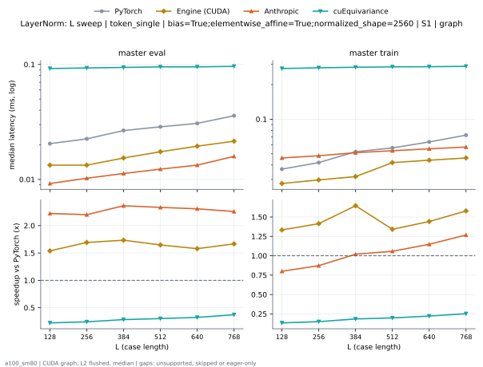

**master eval** (median ms; x = speedup vs PyTorch)

| L | PyTorch | Engine (Triton) | Engine (CUDA) | Anthropic | cuEquivariance |
|---|---|---|---|---|---|
| 128 | 0.02048 | 0.01638 (1.25x) | 0.01331 (1.54x) | 0.009216 (2.22x) | 0.09216 (0.22x) |
| 256 | 0.02253 | 0.01741 (1.29x) | 0.01331 (1.69x) | 0.01024 (2.20x) | 0.09318 (0.24x) |
| 384 | 0.02662 | 0.01741 (1.53x) | 0.01434 (1.86x) | 0.01126 (2.36x) | 0.09421 (0.28x) |
| 512 | 0.02867 | 0.01741 (1.65x) | 0.01741 (1.65x) | 0.01229 (2.33x) | 0.09523 (0.30x) |
| 640 | 0.03072 | 0.01741 (1.76x) | 0.01843 (1.67x) | 0.01331 (2.31x) | 0.09523 (0.32x) |
| 768 | 0.03482 | 0.01741 (2.00x) | 0.02099 (1.66x) | 0.01587 (2.19x) | 0.09626 (0.36x) |

**master train** (median ms; x = speedup vs PyTorch)

| L | PyTorch | Engine (Triton) | Engine (CUDA) | Anthropic | cuEquivariance |
|---|---|---|---|---|---|
| 128 | 0.03686 | 0.04096 (0.90x) | 0.02765 (1.33x) | 0.04608 (0.80x) | 0.2755 (0.13x) |
| 256 | 0.04096 | 0.04506 (0.91x) | 0.0297 (1.38x) | 0.04813 (0.85x) | 0.2796 (0.15x) |
| 384 | 0.0512 | 0.04608 (1.11x) | 0.03277 (1.56x) | 0.0512 (1.00x) | 0.2826 (0.18x) |
| 512 | 0.0553 | 0.04915 (1.12x) | 0.04198 (1.32x) | 0.05325 (1.04x) | 0.2847 (0.19x) |
| 640 | 0.06349 | 0.05325 (1.19x) | 0.04403 (1.44x) | 0.0553 (1.15x) | 0.2857 (0.22x) |
| 768 | 0.0727 | 0.05632 (1.29x) | 0.04608 (1.58x) | 0.05734 (1.27x) | 0.2877 (0.25x) |

### L sweep: token_single | bias=True;elementwise_affine=True;normalized_shape=384 | S1 | graph

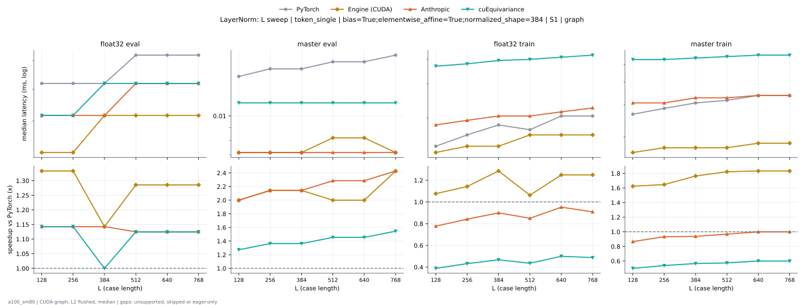

**float32 eval** (median ms; x = speedup vs PyTorch)

| L | PyTorch | Engine (Triton) | Engine (CUDA) | Anthropic | cuEquivariance |
|---|---|---|---|---|---|
| 128 | 0.008192 | 0.008192 (1.00x) | 0.006144 (1.33x) | 0.007168 (1.14x) | 0.007168 (1.14x) |
| 256 | 0.008192 | 0.007168 (1.14x) | 0.006144 (1.33x) | 0.007168 (1.14x) | 0.007168 (1.14x) |
| 384 | 0.008192 | 0.008192 (1.00x) | 0.006656 (1.23x) | 0.007168 (1.14x) | 0.008192 (1.00x) |
| 512 | 0.008704 | 0.008192 (1.06x) | 0.007168 (1.21x) | 0.008192 (1.06x) | 0.008192 (1.06x) |
| 640 | 0.009216 | 0.008192 (1.13x) | 0.007168 (1.29x) | 0.008192 (1.13x) | 0.008192 (1.13x) |
| 768 | 0.009216 | 0.009216 (1.00x) | 0.007168 (1.29x) | 0.008192 (1.13x) | 0.008192 (1.13x) |

**master eval** (median ms; x = speedup vs PyTorch)

| L | PyTorch | Engine (Triton) | Engine (CUDA) | Anthropic | cuEquivariance |
|---|---|---|---|---|---|
| 128 | 0.01434 | 0.007168 (2.00x) | 0.007168 (2.00x) | 0.007168 (2.00x) | 0.01126 (1.27x) |
| 256 | 0.01536 | 0.007168 (2.14x) | 0.007168 (2.14x) | 0.007168 (2.14x) | 0.01126 (1.36x) |
| 384 | 0.01536 | 0.007168 (2.14x) | 0.007168 (2.14x) | 0.007168 (2.14x) | 0.01126 (1.36x) |
| 512 | 0.01638 | 0.007168 (2.29x) | 0.007168 (2.29x) | 0.007168 (2.29x) | 0.01126 (1.45x) |
| 640 | 0.01638 | 0.007168 (2.29x) | 0.007168 (2.29x) | 0.007168 (2.29x) | 0.01126 (1.45x) |
| 768 | 0.01741 | 0.007168 (2.43x) | 0.008192 (2.13x) | 0.007168 (2.43x) | 0.01126 (1.55x) |

**float32 train** (median ms; x = speedup vs PyTorch)

| L | PyTorch | Engine (Triton) | Engine (CUDA) | Anthropic | cuEquivariance |
|---|---|---|---|---|---|
| 128 | 0.01434 | 0.01638 (0.88x) | 0.01331 (1.08x) | 0.01843 (0.78x) | 0.03686 (0.39x) |
| 256 | 0.01536 | 0.01638 (0.94x) | 0.01434 (1.07x) | 0.01946 (0.79x) | 0.03789 (0.41x) |
| 384 | 0.01843 | 0.01741 (1.06x) | 0.01434 (1.29x) | 0.02048 (0.90x) | 0.03942 (0.47x) |
| 512 | 0.01741 | 0.01843 (0.94x) | 0.01638 (1.06x) | 0.02048 (0.85x) | 0.03994 (0.44x) |
| 640 | 0.02048 | 0.01843 (1.11x) | 0.01638 (1.25x) | 0.0215 (0.95x) | 0.04096 (0.50x) |
| 768 | 0.02048 | 0.01946 (1.05x) | 0.01741 (1.18x) | 0.02253 (0.91x) | 0.04198 (0.49x) |

**master train** (median ms; x = speedup vs PyTorch)

| L | PyTorch | Engine (Triton) | Engine (CUDA) | Anthropic | cuEquivariance |
|---|---|---|---|---|---|
| 128 | 0.02662 | 0.01536 (1.73x) | 0.01638 (1.62x) | 0.03072 (0.87x) | 0.05325 (0.50x) |
| 256 | 0.02867 | 0.01638 (1.75x) | 0.01638 (1.75x) | 0.03072 (0.93x) | 0.05325 (0.54x) |
| 384 | 0.03072 | 0.01843 (1.67x) | 0.01741 (1.76x) | 0.03277 (0.94x) | 0.05427 (0.57x) |
| 512 | 0.03072 | 0.01946 (1.58x) | 0.01741 (1.76x) | 0.03277 (0.94x) | 0.0553 (0.56x) |
| 640 | 0.03379 | 0.01946 (1.74x) | 0.01792 (1.89x) | 0.03379 (1.00x) | 0.05632 (0.60x) |
| 768 | 0.03379 | 0.01946 (1.74x) | 0.01843 (1.83x) | 0.03379 (1.00x) | 0.05632 (0.60x) |

### L sweep: token_single | bias=True;elementwise_affine=True;normalized_shape=451 | S1 | graph

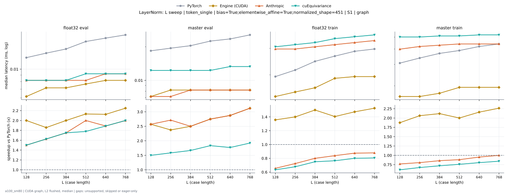

**float32 eval** (median ms; x = speedup vs PyTorch)

| L | PyTorch | Engine (Triton) | Engine (CUDA) | Anthropic | cuEquivariance |
|---|---|---|---|---|---|
| 128 | 0.01126 | 0.008192 (1.38x) | 0.006144 (1.83x) | 0.008192 (1.38x) | 0.008192 (1.38x) |
| 256 | 0.01331 | 0.008192 (1.62x) | 0.006144 (2.17x) | 0.008192 (1.62x) | 0.008192 (1.62x) |
| 384 | 0.01331 | 0.008192 (1.62x) | 0.007168 (1.86x) | 0.008192 (1.62x) | 0.008192 (1.62x) |
| 512 | 0.01638 | 0.009216 (1.78x) | 0.007168 (2.29x) | 0.008192 (2.00x) | 0.009216 (1.78x) |
| 640 | 0.01741 | 0.008192 (2.13x) | 0.007168 (2.43x) | 0.009216 (1.89x) | 0.009216 (1.89x) |
| 768 | 0.01843 | 0.009216 (2.00x) | 0.008192 (2.25x) | 0.009216 (2.00x) | 0.009216 (2.00x) |

**master eval** (median ms; x = speedup vs PyTorch)

| L | PyTorch | Engine (Triton) | Engine (CUDA) | Anthropic | cuEquivariance |
|---|---|---|---|---|---|
| 128 | 0.01741 | 0.008192 (2.13x) | 0.007168 (2.43x) | 0.007168 (2.43x) | 0.01229 (1.42x) |
| 256 | 0.01946 | 0.008192 (2.37x) | 0.007168 (2.71x) | 0.007168 (2.71x) | 0.01229 (1.58x) |
| 384 | 0.02048 | 0.008192 (2.50x) | 0.008192 (2.50x) | 0.008192 (2.50x) | 0.01229 (1.67x) |
| 512 | 0.02355 | 0.008192 (2.88x) | 0.008192 (2.88x) | 0.008192 (2.88x) | 0.01229 (1.92x) |
| 640 | 0.02458 | 0.008192 (3.00x) | 0.008192 (3.00x) | 0.008192 (3.00x) | 0.01331 (1.85x) |
| 768 | 0.0256 | 0.009216 (2.78x) | 0.008192 (3.12x) | 0.008192 (3.12x) | 0.01331 (1.92x) |

**float32 train** (median ms; x = speedup vs PyTorch)

| L | PyTorch | Engine (Triton) | Engine (CUDA) | Anthropic | cuEquivariance |
|---|---|---|---|---|---|
| 128 | 0.01843 | 0.01741 (1.06x) | 0.01434 (1.29x) | 0.0297 (0.62x) | 0.03072 (0.60x) |
| 256 | 0.0215 | 0.01843 (1.17x) | 0.01536 (1.40x) | 0.0297 (0.72x) | 0.03174 (0.68x) |
| 384 | 0.02355 | 0.02253 (1.05x) | 0.01536 (1.53x) | 0.03072 (0.77x) | 0.03277 (0.72x) |
| 512 | 0.02662 | 0.02253 (1.18x) | 0.01843 (1.44x) | 0.03174 (0.84x) | 0.03482 (0.76x) |
| 640 | 0.0297 | 0.02253 (1.32x) | 0.01946 (1.53x) | 0.03277 (0.91x) | 0.03584 (0.83x) |
| 768 | 0.03072 | 0.02458 (1.25x) | 0.01946 (1.58x) | 0.03379 (0.91x) | 0.03686 (0.83x) |

**master train** (median ms; x = speedup vs PyTorch)

| L | PyTorch | Engine (Triton) | Engine (CUDA) | Anthropic | cuEquivariance |
|---|---|---|---|---|---|
| 128 | 0.03072 | 0.01741 (1.76x) | 0.01536 (2.00x) | 0.03994 (0.77x) | 0.05018 (0.61x) |
| 256 | 0.03379 | 0.01946 (1.74x) | 0.01638 (2.06x) | 0.04198 (0.80x) | 0.05018 (0.67x) |
| 384 | 0.03686 | 0.01843 (2.00x) | 0.01638 (2.25x) | 0.04301 (0.86x) | 0.0512 (0.72x) |
| 512 | 0.03891 | 0.02355 (1.65x) | 0.01946 (2.00x) | 0.04403 (0.88x) | 0.0512 (0.76x) |
| 640 | 0.04198 | 0.02355 (1.78x) | 0.01946 (2.16x) | 0.04403 (0.95x) | 0.05222 (0.80x) |
| 768 | 0.04403 | 0.02458 (1.79x) | 0.01946 (2.26x) | 0.04403 (1.00x) | 0.05222 (0.84x) |

### L sweep: token_single | bias=True;elementwise_affine=True;normalized_shape=768 | S1 | graph

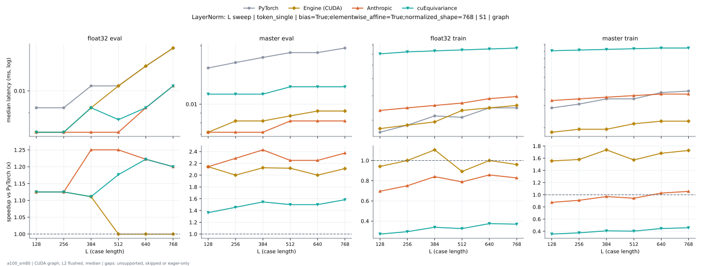

**float32 eval** (median ms; x = speedup vs PyTorch)

| L | PyTorch | Engine (Triton) | Engine (CUDA) | Anthropic | cuEquivariance |
|---|---|---|---|---|---|
| 128 | 0.009216 | 0.01024 (0.90x) | 0.008192 (1.13x) | 0.008192 (1.13x) | 0.008192 (1.13x) |
| 256 | 0.009216 | 0.01126 (0.82x) | 0.008192 (1.13x) | 0.008192 (1.13x) | 0.008192 (1.13x) |
| 384 | 0.01024 | 0.01024 (1.00x) | 0.008704 (1.18x) | 0.008192 (1.25x) | 0.009216 (1.11x) |
| 512 | 0.01024 | 0.01126 (0.91x) | 0.009216 (1.11x) | 0.008192 (1.25x) | 0.008704 (1.18x) |
| 640 | 0.01126 | 0.01126 (1.00x) | 0.01126 (1.00x) | 0.009216 (1.22x) | 0.009216 (1.22x) |
| 768 | 0.01126 | 0.01126 (1.00x) | 0.01229 (0.92x) | 0.01024 (1.10x) | 0.01024 (1.10x) |

**master eval** (median ms; x = speedup vs PyTorch)

| L | PyTorch | Engine (Triton) | Engine (CUDA) | Anthropic | cuEquivariance |
|---|---|---|---|---|---|
| 128 | 0.01536 | 0.009216 (1.67x) | 0.007168 (2.14x) | 0.007168 (2.14x) | 0.01126 (1.36x) |
| 256 | 0.01638 | 0.01024 (1.60x) | 0.007168 (2.29x) | 0.007168 (2.29x) | 0.01126 (1.45x) |
| 384 | 0.01741 | 0.01024 (1.70x) | 0.008192 (2.13x) | 0.007168 (2.43x) | 0.01126 (1.55x) |
| 512 | 0.01741 | 0.01024 (1.70x) | 0.008192 (2.13x) | 0.008192 (2.13x) | 0.01229 (1.42x) |
| 640 | 0.01843 | 0.01024 (1.80x) | 0.008192 (2.25x) | 0.008192 (2.25x) | 0.01229 (1.50x) |
| 768 | 0.01946 | 0.01024 (1.90x) | 0.009216 (2.11x) | 0.008192 (2.37x) | 0.01229 (1.58x) |

**float32 train** (median ms; x = speedup vs PyTorch)

| L | PyTorch | Engine (Triton) | Engine (CUDA) | Anthropic | cuEquivariance |
|---|---|---|---|---|---|
| 128 | 0.01638 | 0.02458 (0.67x) | 0.01741 (0.94x) | 0.02355 (0.70x) | 0.06042 (0.27x) |
| 256 | 0.01792 | 0.02458 (0.73x) | 0.01843 (0.97x) | 0.02458 (0.73x) | 0.06246 (0.29x) |
| 384 | 0.02099 | 0.02662 (0.79x) | 0.01946 (1.08x) | 0.0256 (0.82x) | 0.06349 (0.33x) |
| 512 | 0.0215 | 0.02765 (0.78x) | 0.02355 (0.91x) | 0.02662 (0.81x) | 0.06451 (0.33x) |
| 640 | 0.02458 | 0.02765 (0.89x) | 0.02355 (1.04x) | 0.02867 (0.86x) | 0.06554 (0.38x) |
| 768 | 0.02458 | 0.02867 (0.86x) | 0.02458 (1.00x) | 0.0297 (0.83x) | 0.06656 (0.37x) |

**master train** (median ms; x = speedup vs PyTorch)

| L | PyTorch | Engine (Triton) | Engine (CUDA) | Anthropic | cuEquivariance |
|---|---|---|---|---|---|
| 128 | 0.02867 | 0.02048 (1.40x) | 0.01843 (1.56x) | 0.03277 (0.88x) | 0.0809 (0.35x) |
| 256 | 0.03072 | 0.0297 (1.03x) | 0.01843 (1.67x) | 0.03379 (0.91x) | 0.08192 (0.38x) |
| 384 | 0.03379 | 0.0256 (1.32x) | 0.01946 (1.74x) | 0.03482 (0.97x) | 0.08294 (0.41x) |
| 512 | 0.03379 | 0.02816 (1.20x) | 0.02253 (1.50x) | 0.03584 (0.94x) | 0.08397 (0.40x) |
| 640 | 0.03789 | 0.02765 (1.37x) | 0.02253 (1.68x) | 0.03686 (1.03x) | 0.08499 (0.45x) |
| 768 | 0.03891 | 0.02867 (1.36x) | 0.02253 (1.73x) | 0.03686 (1.06x) | 0.08499 (0.46x) |

### L sweep: token_single | bias=True;elementwise_affine=True;normalized_shape=833 | S1 | graph

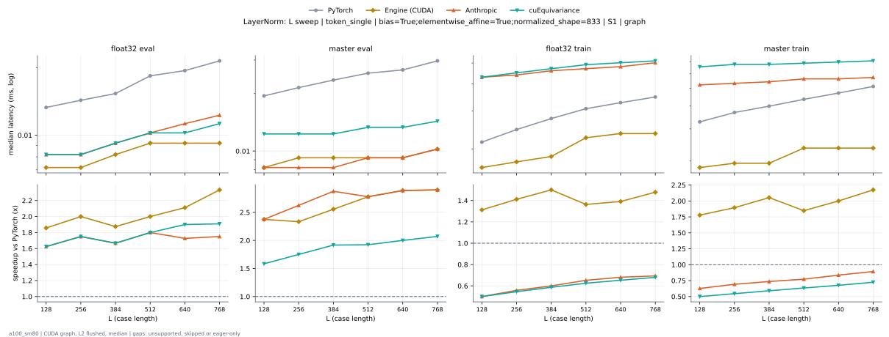

**float32 eval** (median ms; x = speedup vs PyTorch)

| L | PyTorch | Engine (Triton) | Engine (CUDA) | Anthropic | cuEquivariance |
|---|---|---|---|---|---|
| 128 | 0.01331 | 0.01126 (1.18x) | 0.007168 (1.86x) | 0.008192 (1.62x) | 0.008192 (1.62x) |
| 256 | 0.01434 | 0.01126 (1.27x) | 0.007168 (2.00x) | 0.008192 (1.75x) | 0.008192 (1.75x) |
| 384 | 0.01536 | 0.01126 (1.36x) | 0.008192 (1.87x) | 0.009216 (1.67x) | 0.009216 (1.67x) |
| 512 | 0.01843 | 0.01126 (1.64x) | 0.009216 (2.00x) | 0.01024 (1.80x) | 0.01024 (1.80x) |
| 640 | 0.01946 | 0.01229 (1.58x) | 0.009216 (2.11x) | 0.01126 (1.73x) | 0.01024 (1.90x) |
| 768 | 0.02048 | 0.01229 (1.67x) | 0.009216 (2.22x) | 0.01229 (1.67x) | 0.01126 (1.82x) |

**master eval** (median ms; x = speedup vs PyTorch)

| L | PyTorch | Engine (Triton) | Engine (CUDA) | Anthropic | cuEquivariance |
|---|---|---|---|---|---|
| 128 | 0.01946 | 0.01024 (1.90x) | 0.008192 (2.37x) | 0.008192 (2.37x) | 0.01229 (1.58x) |
| 256 | 0.0215 | 0.01024 (2.10x) | 0.008192 (2.62x) | 0.008192 (2.62x) | 0.01229 (1.75x) |
| 384 | 0.02355 | 0.01126 (2.09x) | 0.009216 (2.56x) | 0.008192 (2.88x) | 0.01229 (1.92x) |
| 512 | 0.0256 | 0.01126 (2.27x) | 0.009216 (2.78x) | 0.009216 (2.78x) | 0.01331 (1.92x) |
| 640 | 0.02662 | 0.01126 (2.36x) | 0.009216 (2.89x) | 0.009216 (2.89x) | 0.01331 (2.00x) |
| 768 | 0.0297 | 0.01126 (2.64x) | 0.009216 (3.22x) | 0.01024 (2.90x) | 0.01434 (2.07x) |

**float32 train** (median ms; x = speedup vs PyTorch)

| L | PyTorch | Engine (Triton) | Engine (CUDA) | Anthropic | cuEquivariance |
|---|---|---|---|---|---|
| 128 | 0.0215 | 0.02355 (0.91x) | 0.01638 (1.31x) | 0.04301 (0.50x) | 0.04301 (0.50x) |
| 256 | 0.02355 | 0.02355 (1.00x) | 0.01741 (1.35x) | 0.04403 (0.53x) | 0.04506 (0.52x) |
| 384 | 0.02662 | 0.02765 (0.96x) | 0.01843 (1.44x) | 0.04608 (0.58x) | 0.0471 (0.57x) |
| 512 | 0.03072 | 0.02662 (1.15x) | 0.02253 (1.36x) | 0.0471 (0.65x) | 0.04915 (0.62x) |
| 640 | 0.03277 | 0.0297 (1.10x) | 0.02355 (1.39x) | 0.04813 (0.68x) | 0.05018 (0.65x) |
| 768 | 0.03482 | 0.03174 (1.10x) | 0.02355 (1.48x) | 0.05018 (0.69x) | 0.0512 (0.68x) |

**master train** (median ms; x = speedup vs PyTorch)

| L | PyTorch | Engine (Triton) | Engine (CUDA) | Anthropic | cuEquivariance |
|---|---|---|---|---|---|
| 128 | 0.03277 | 0.02355 (1.39x) | 0.01843 (1.78x) | 0.05222 (0.63x) | 0.06554 (0.50x) |
| 256 | 0.03584 | 0.02458 (1.46x) | 0.01946 (1.84x) | 0.05325 (0.67x) | 0.06758 (0.53x) |
| 384 | 0.04096 | 0.0256 (1.60x) | 0.01946 (2.11x) | 0.05427 (0.75x) | 0.06758 (0.61x) |
| 512 | 0.04403 | 0.02662 (1.65x) | 0.02355 (1.87x) | 0.05632 (0.78x) | 0.06861 (0.64x) |
| 640 | 0.0471 | 0.02867 (1.64x) | 0.02355 (2.00x) | 0.05632 (0.84x) | 0.06963 (0.68x) |
| 768 | 0.0512 | 0.0297 (1.72x) | 0.02355 (2.17x) | 0.05734 (0.89x) | 0.07066 (0.72x) |

### normalized_shape sweep at L768: token_pair | bias=False;elementwise_affine=True | S1 | graph

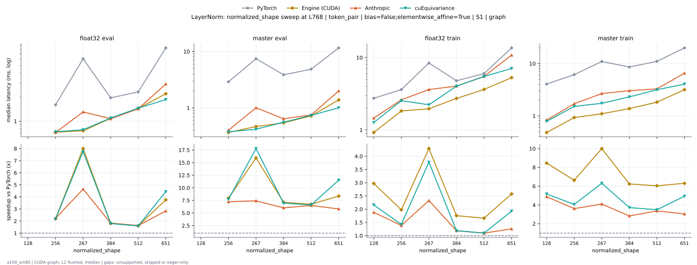

**float32 eval** (median ms; x = speedup vs PyTorch)

| normalized_shape | PyTorch | Engine (Triton) | Engine (CUDA) | Anthropic | cuEquivariance |
|---|---|---|---|---|---|
| 128 |  |  |  |  |  |
| 256 | 1.606 | 0.7363 (2.18x) | 0.7291 (2.20x) | 0.7219 (2.22x) | 0.7373 (2.18x) |
| 267 | 6.069 | 0.7654 (7.93x) | 0.7649 (7.93x) | 1.308 (4.64x) | 0.7823 (7.76x) |
| 384 | 1.949 | 1.095 (1.78x) | 1.09 (1.79x) | 1.074 (1.81x) | 1.097 (1.78x) |
| 512 | 2.29 | 1.456 (1.57x) | 1.45 (1.58x) | 1.433 (1.60x) | 1.46 (1.57x) |
| 651 | 8.313 | 2.148 (3.87x) | 1.83 (4.54x) | 2.93 (2.84x) | 1.872 (4.44x) |

**master eval** (median ms; x = speedup vs PyTorch)

| normalized_shape | PyTorch | Engine (Triton) | Engine (CUDA) | Anthropic | cuEquivariance |
|---|---|---|---|---|---|
| 128 |  |  |  |  |  |
| 256 | 2.885 | 0.3748 (7.70x) | 0.3656 (7.89x) | 0.4004 (7.20x) | 0.3758 (7.68x) |
| 267 | 7.424 | 0.4956 (14.98x) | 0.3881 (19.13x) | 1.002 (7.41x) | 0.4178 (17.77x) |
| 384 | 3.842 | 0.5519 (6.96x) | 0.5437 (7.06x) | 0.641 (5.99x) | 0.556 (6.91x) |
| 512 | 4.785 | 0.7352 (6.51x) | 0.727 (6.58x) | 0.7485 (6.39x) | 0.7363 (6.50x) |
| 651 | 11.49 | 1.16 (9.91x) | 0.9288 (12.37x) | 1.995 (5.76x) | 1.005 (11.44x) |

**float32 train** (median ms; x = speedup vs PyTorch)

| normalized_shape | PyTorch | Engine (Triton) | Engine (CUDA) | Anthropic | cuEquivariance |
|---|---|---|---|---|---|
| 128 | 2.717 | 0.9257 (2.93x) | 0.9052 (3.00x) | 1.459 (1.86x) | 1.269 (2.14x) |
| 256 | 3.614 | 1.845 (1.96x) | 1.836 (1.97x) | 2.613 (1.38x) | 2.539 (1.42x) |
| 267 | 8.361 | 2.419 (3.46x) | 1.968 (4.25x) | 3.623 (2.31x) | 2.23 (3.75x) |
| 384 | 4.762 | 2.757 (1.73x) | 2.729 (1.75x) | 4.036 (1.18x) | 4.03 (1.18x) |
| 512 | 5.955 | 3.681 (1.62x) | 3.635 (1.64x) | 5.505 (1.08x) | 5.498 (1.08x) |
| 651 | 13.62 | 6.743 (2.02x) | 4.942 (2.76x) | 10.84 (1.26x) | 7.072 (1.93x) |

**master train** (median ms; x = speedup vs PyTorch)

| normalized_shape | PyTorch | Engine (Triton) | Engine (CUDA) | Anthropic | cuEquivariance |
|---|---|---|---|---|---|
| 128 | 3.996 | 0.491 (8.14x) | 0.4803 (8.32x) | 0.8305 (4.81x) | 0.7828 (5.10x) |
| 256 | 6.115 | 0.9482 (6.45x) | 0.9257 (6.61x) | 1.7 (3.60x) | 1.514 (4.04x) |
| 267 | 10.94 | 1.585 (6.90x) | 1.013 (10.81x) | 2.671 (4.10x) | 1.735 (6.31x) |
| 384 | 8.527 | 1.771 (4.81x) | 1.378 (6.19x) | 3.031 (2.81x) | 2.305 (3.70x) |
| 512 | 10.98 | 2.459 (4.47x) | 1.827 (6.01x) | 3.274 (3.35x) | 3.156 (3.48x) |
| 651 | 19.93 | 4.952 (4.03x) | 2.767 (7.20x) | 6.555 (3.04x) | 4.044 (4.93x) |

### normalized_shape sweep at L768: token_pair | bias=True;elementwise_affine=True | S1 | graph

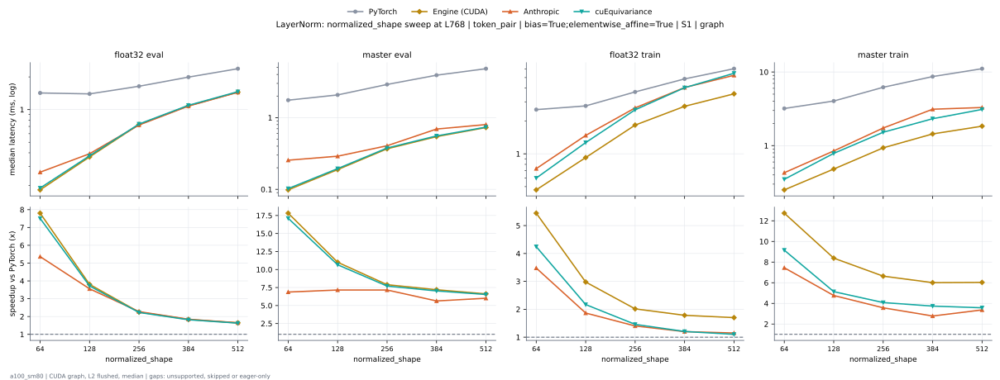

**float32 eval** (median ms; x = speedup vs PyTorch)

| normalized_shape | PyTorch | Engine (Triton) | Engine (CUDA) | Anthropic | cuEquivariance |
|---|---|---|---|---|---|
| 64 | 1.424 | 0.1853 (7.69x) | 0.1823 (7.81x) | 0.2652 (5.37x) | 0.1894 (7.52x) |
| 128 | 1.389 | 0.3686 (3.77x) | 0.3671 (3.78x) | 0.3922 (3.54x) | 0.3753 (3.70x) |
| 256 | 1.64 | 0.7342 (2.23x) | 0.7291 (2.25x) | 0.7209 (2.28x) | 0.7363 (2.23x) |
| 384 | 1.983 | 1.093 (1.82x) | 1.089 (1.82x) | 1.077 (1.84x) | 1.095 (1.81x) |
| 512 | 2.324 | 1.454 (1.60x) | 1.45 (1.60x) | 1.443 (1.61x) | 1.462 (1.59x) |

**master eval** (median ms; x = speedup vs PyTorch)

| normalized_shape | PyTorch | Engine (Triton) | Engine (CUDA) | Anthropic | cuEquivariance |
|---|---|---|---|---|---|
| 64 | 1.747 | 0.0983 (17.77x) | 0.09933 (17.59x) | 0.255 (6.85x) | 0.1024 (17.06x) |
| 128 | 2.061 | 0.1915 (10.76x) | 0.1884 (10.94x) | 0.2898 (7.11x) | 0.1946 (10.59x) |
| 256 | 2.907 | 0.3727 (7.80x) | 0.3676 (7.91x) | 0.4055 (7.17x) | 0.3768 (7.71x) |
| 384 | 3.877 | 0.5499 (7.05x) | 0.5448 (7.12x) | 0.6932 (5.59x) | 0.556 (6.97x) |
| 512 | 4.853 | 0.7332 (6.62x) | 0.7281 (6.67x) | 0.8008 (6.06x) | 0.7373 (6.58x) |

**float32 train** (median ms; x = speedup vs PyTorch)

| normalized_shape | PyTorch | Engine (Triton) | Engine (CUDA) | Anthropic | cuEquivariance |
|---|---|---|---|---|---|
| 64 | 2.534 | 0.468 (5.42x) | 0.4669 (5.43x) | 0.7311 (3.47x) | 0.599 (4.23x) |
| 128 | 2.745 | 0.9242 (2.97x) | 0.9042 (3.04x) | 1.474 (1.86x) | 1.268 (2.17x) |
| 256 | 3.666 | 1.844 (1.99x) | 1.835 (2.00x) | 2.637 (1.39x) | 2.533 (1.45x) |
| 384 | 4.847 | 2.759 (1.76x) | 2.729 (1.78x) | 4.054 (1.20x) | 4.038 (1.20x) |
| 512 | 6.026 | 3.683 (1.64x) | 3.633 (1.66x) | 5.249 (1.15x) | 5.478 (1.10x) |

**master train** (median ms; x = speedup vs PyTorch)

| normalized_shape | PyTorch | Engine (Triton) | Engine (CUDA) | Anthropic | cuEquivariance |
|---|---|---|---|---|---|
| 64 | 3.196 | 0.254 (12.58x) | 0.2519 (12.69x) | 0.4291 (7.45x) | 0.3492 (9.15x) |
| 128 | 4.031 | 0.4884 (8.25x) | 0.4813 (8.38x) | 0.8474 (4.76x) | 0.7854 (5.13x) |
| 256 | 6.166 | 0.9482 (6.50x) | 0.9349 (6.59x) | 1.736 (3.55x) | 1.52 (4.06x) |
| 384 | 8.597 | 1.774 (4.85x) | 1.443 (5.96x) | 3.121 (2.75x) | 2.319 (3.71x) |
| 512 | 11.04 | 2.461 (4.49x) | 1.835 (6.02x) | 3.293 (3.35x) | 3.103 (3.56x) |

### normalized_shape sweep at L768: token_single | bias=False;elementwise_affine=True | S1 | graph

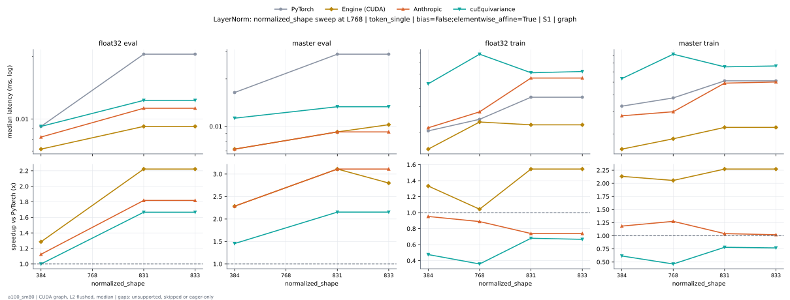

**float32 eval** (median ms; x = speedup vs PyTorch)

| normalized_shape | PyTorch | Engine (Triton) | Engine (CUDA) | Anthropic | cuEquivariance |
|---|---|---|---|---|---|
| 384 | 0.009216 | 0.01024 (0.90x) | 0.007168 (1.29x) | 0.008192 (1.13x) | 0.009216 (1.00x) |
| 768 |  |  |  |  |  |
| 831 | 0.02048 | 0.01331 (1.54x) | 0.009216 (2.22x) | 0.01126 (1.82x) | 0.01229 (1.67x) |
| 833 | 0.02048 | 0.01434 (1.43x) | 0.009216 (2.22x) | 0.01126 (1.82x) | 0.01229 (1.67x) |

**master eval** (median ms; x = speedup vs PyTorch)

| normalized_shape | PyTorch | Engine (Triton) | Engine (CUDA) | Anthropic | cuEquivariance |
|---|---|---|---|---|---|
| 384 | 0.01638 | 0.008192 (2.00x) | 0.007168 (2.29x) | 0.007168 (2.29x) | 0.01126 (1.45x) |
| 768 |  |  |  |  |  |
| 831 | 0.02918 | 0.01331 (2.19x) | 0.01024 (2.85x) | 0.009216 (3.17x) | 0.01331 (2.19x) |
| 833 | 0.02867 | 0.01229 (2.33x) | 0.009728 (2.95x) | 0.009216 (3.11x) | 0.01331 (2.15x) |

**float32 train** (median ms; x = speedup vs PyTorch)

| normalized_shape | PyTorch | Engine (Triton) | Engine (CUDA) | Anthropic | cuEquivariance |
|---|---|---|---|---|---|
| 384 | 0.02048 | 0.02048 (1.00x) | 0.01536 (1.33x) | 0.0215 (0.95x) | 0.04301 (0.48x) |
| 768 | 0.02458 | 0.02867 (0.86x) | 0.02355 (1.04x) | 0.02765 (0.89x) | 0.06861 (0.36x) |
| 831 | 0.03482 | 0.03584 (0.97x) | 0.02253 (1.55x) | 0.0471 (0.74x) | 0.0512 (0.68x) |
| 833 | 0.03482 | 0.03379 (1.03x) | 0.02253 (1.55x) | 0.0471 (0.74x) | 0.05222 (0.67x) |

**master train** (median ms; x = speedup vs PyTorch)

| normalized_shape | PyTorch | Engine (Triton) | Engine (CUDA) | Anthropic | cuEquivariance |
|---|---|---|---|---|---|
| 384 | 0.03277 | 0.02048 (1.60x) | 0.01536 (2.13x) | 0.02765 (1.19x) | 0.05325 (0.62x) |
| 768 | 0.03789 | 0.0297 (1.28x) | 0.01843 (2.06x) | 0.0297 (1.28x) | 0.08192 (0.46x) |
| 831 | 0.0512 | 0.03174 (1.61x) | 0.02253 (2.27x) | 0.04915 (1.04x) | 0.06554 (0.78x) |
| 833 | 0.0512 | 0.03174 (1.61x) | 0.02253 (2.27x) | 0.05018 (1.02x) | 0.06656 (0.77x) |

### normalized_shape sweep at L768: token_single | bias=True;elementwise_affine=True | S1 | graph

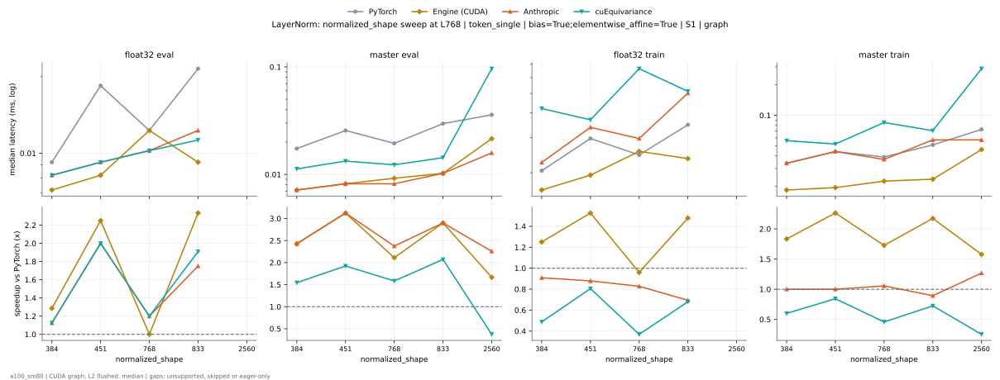

**float32 eval** (median ms; x = speedup vs PyTorch)

| normalized_shape | PyTorch | Engine (Triton) | Engine (CUDA) | Anthropic | cuEquivariance |
|---|---|---|---|---|---|
| 384 | 0.009216 | 0.009216 (1.00x) | 0.007168 (1.29x) | 0.008192 (1.13x) | 0.008192 (1.13x) |
| 451 | 0.01843 | 0.009216 (2.00x) | 0.008192 (2.25x) | 0.009216 (2.00x) | 0.009216 (2.00x) |
| 768 | 0.01126 | 0.01126 (1.00x) | 0.01229 (0.92x) | 0.01024 (1.10x) | 0.01024 (1.10x) |
| 833 | 0.02048 | 0.01229 (1.67x) | 0.009216 (2.22x) | 0.01229 (1.67x) | 0.01126 (1.82x) |
| 2560 |  |  |  |  |  |

**master eval** (median ms; x = speedup vs PyTorch)

| normalized_shape | PyTorch | Engine (Triton) | Engine (CUDA) | Anthropic | cuEquivariance |
|---|---|---|---|---|---|
| 384 | 0.01741 | 0.007168 (2.43x) | 0.008192 (2.13x) | 0.007168 (2.43x) | 0.01126 (1.55x) |
| 451 | 0.0256 | 0.009216 (2.78x) | 0.008192 (3.12x) | 0.008192 (3.12x) | 0.01331 (1.92x) |
| 768 | 0.01946 | 0.01024 (1.90x) | 0.009216 (2.11x) | 0.008192 (2.37x) | 0.01229 (1.58x) |
| 833 | 0.0297 | 0.01126 (2.64x) | 0.009216 (3.22x) | 0.01024 (2.90x) | 0.01434 (2.07x) |
| 2560 | 0.03482 | 0.01741 (2.00x) | 0.02099 (1.66x) | 0.01587 (2.19x) | 0.09626 (0.36x) |

**float32 train** (median ms; x = speedup vs PyTorch)

| normalized_shape | PyTorch | Engine (Triton) | Engine (CUDA) | Anthropic | cuEquivariance |
|---|---|---|---|---|---|
| 384 | 0.02048 | 0.01946 (1.05x) | 0.01741 (1.18x) | 0.02253 (0.91x) | 0.04198 (0.49x) |
| 451 | 0.03072 | 0.02458 (1.25x) | 0.01946 (1.58x) | 0.03379 (0.91x) | 0.03686 (0.83x) |
| 768 | 0.02458 | 0.02867 (0.86x) | 0.02458 (1.00x) | 0.0297 (0.83x) | 0.06656 (0.37x) |
| 833 | 0.03482 | 0.03174 (1.10x) | 0.02355 (1.48x) | 0.05018 (0.69x) | 0.0512 (0.68x) |
| 2560 |  |  |  |  |  |

**master train** (median ms; x = speedup vs PyTorch)

| normalized_shape | PyTorch | Engine (Triton) | Engine (CUDA) | Anthropic | cuEquivariance |
|---|---|---|---|---|---|
| 384 | 0.03379 | 0.01946 (1.74x) | 0.01843 (1.83x) | 0.03379 (1.00x) | 0.05632 (0.60x) |
| 451 | 0.04403 | 0.02458 (1.79x) | 0.01946 (2.26x) | 0.04403 (1.00x) | 0.05222 (0.84x) |
| 768 | 0.03891 | 0.02867 (1.36x) | 0.02253 (1.73x) | 0.03686 (1.06x) | 0.08499 (0.46x) |
| 833 | 0.0512 | 0.0297 (1.72x) | 0.02355 (2.17x) | 0.05734 (0.89x) | 0.07066 (0.72x) |
| 2560 | 0.0727 | 0.05632 (1.29x) | 0.04608 (1.58x) | 0.05734 (1.27x) | 0.2877 (0.25x) |

### Single-length cases (no sweep)

- noise | bias=False;elementwise_affine=True;normalized_shape=256 | S1 | graph L1 float32 train anthropic: 0.01536 ms
- noise | bias=False;elementwise_affine=True;normalized_shape=256 | S1 | graph L1 float32 train cuda: 0.01126 ms
- noise | bias=False;elementwise_affine=True;normalized_shape=256 | S1 | graph L1 float32 train cueq: 0.02765 ms
- noise | bias=False;elementwise_affine=True;normalized_shape=256 | S1 | graph L1 float32 train pytorch: 0.01229 ms
- noise | bias=False;elementwise_affine=True;normalized_shape=256 | S1 | graph L1 float32 train triton: 0.01229 ms
- noise | bias=False;elementwise_affine=True;normalized_shape=256 | S1 | graph L1 master train anthropic: 0.01946 ms
- noise | bias=False;elementwise_affine=True;normalized_shape=256 | S1 | graph L1 master train cuda: 0.01229 ms
- noise | bias=False;elementwise_affine=True;normalized_shape=256 | S1 | graph L1 master train cueq: 0.03738 ms
- noise | bias=False;elementwise_affine=True;normalized_shape=256 | S1 | graph L1 master train pytorch: 0.02048 ms
- noise | bias=False;elementwise_affine=True;normalized_shape=256 | S1 | graph L1 master train triton: 0.01229 ms
- noise | bias=False;elementwise_affine=True;normalized_shape=256 | S5 | graph L1 float32 eval anthropic: 0.006144 ms
- noise | bias=False;elementwise_affine=True;normalized_shape=256 | S5 | graph L1 float32 eval cuda: 0.005632 ms
- noise | bias=False;elementwise_affine=True;normalized_shape=256 | S5 | graph L1 float32 eval cueq: 0.008192 ms
- noise | bias=False;elementwise_affine=True;normalized_shape=256 | S5 | graph L1 float32 eval pytorch: 0.007168 ms
- noise | bias=False;elementwise_affine=True;normalized_shape=256 | S5 | graph L1 float32 eval triton: 0.007168 ms
- noise | bias=False;elementwise_affine=True;normalized_shape=256 | S5 | graph L1 master eval anthropic: 0.01024 ms
- noise | bias=False;elementwise_affine=True;normalized_shape=256 | S5 | graph L1 master eval cuda: 0.006144 ms
- noise | bias=False;elementwise_affine=True;normalized_shape=256 | S5 | graph L1 master eval cueq: 0.009216 ms
- noise | bias=False;elementwise_affine=True;normalized_shape=256 | S5 | graph L1 master eval pytorch: 0.01331 ms
- noise | bias=False;elementwise_affine=True;normalized_shape=256 | S5 | graph L1 master eval triton: 0.008192 ms
- noise | bias=True;elementwise_affine=True;normalized_shape=256 | S1 | graph L1 float32 train anthropic: 0.01536 ms
- noise | bias=True;elementwise_affine=True;normalized_shape=256 | S1 | graph L1 float32 train cuda: 0.01229 ms
- noise | bias=True;elementwise_affine=True;normalized_shape=256 | S1 | graph L1 float32 train cueq: 0.02662 ms
- noise | bias=True;elementwise_affine=True;normalized_shape=256 | S1 | graph L1 float32 train pytorch: 0.01229 ms
- noise | bias=True;elementwise_affine=True;normalized_shape=256 | S1 | graph L1 float32 train triton: 0.01126 ms
- noise | bias=True;elementwise_affine=True;normalized_shape=256 | S1 | graph L1 master train anthropic: 0.02458 ms
- noise | bias=True;elementwise_affine=True;normalized_shape=256 | S1 | graph L1 master train cuda: 0.01331 ms
- noise | bias=True;elementwise_affine=True;normalized_shape=256 | S1 | graph L1 master train cueq: 0.03994 ms
- noise | bias=True;elementwise_affine=True;normalized_shape=256 | S1 | graph L1 master train pytorch: 0.02048 ms
- noise | bias=True;elementwise_affine=True;normalized_shape=256 | S1 | graph L1 master train triton: 0.01126 ms
- noise | bias=True;elementwise_affine=True;normalized_shape=256 | S5 | graph L1 float32 eval anthropic: 0.006144 ms
- noise | bias=True;elementwise_affine=True;normalized_shape=256 | S5 | graph L1 float32 eval cuda: 0.00512 ms
- noise | bias=True;elementwise_affine=True;normalized_shape=256 | S5 | graph L1 float32 eval cueq: 0.007168 ms
- noise | bias=True;elementwise_affine=True;normalized_shape=256 | S5 | graph L1 float32 eval pytorch: 0.007168 ms
- noise | bias=True;elementwise_affine=True;normalized_shape=256 | S5 | graph L1 float32 eval triton: 0.006144 ms
- noise | bias=True;elementwise_affine=True;normalized_shape=256 | S5 | graph L1 master eval anthropic: 0.01024 ms
- noise | bias=True;elementwise_affine=True;normalized_shape=256 | S5 | graph L1 master eval cuda: 0.006144 ms
- noise | bias=True;elementwise_affine=True;normalized_shape=256 | S5 | graph L1 master eval cueq: 0.01024 ms
- noise | bias=True;elementwise_affine=True;normalized_shape=256 | S5 | graph L1 master eval pytorch: 0.01331 ms
- noise | bias=True;elementwise_affine=True;normalized_shape=256 | S5 | graph L1 master eval triton: 0.006144 ms
