# LayerNorm on a100_sm80

Generated by `python -m foldjet_engine.measure.plot` from speed tokens `judge/tokens/a100_sm80/`; do not edit.

### L sweep: atom_single | bias=False;elementwise_affine=True;normalized_shape=128 | S1 | graph

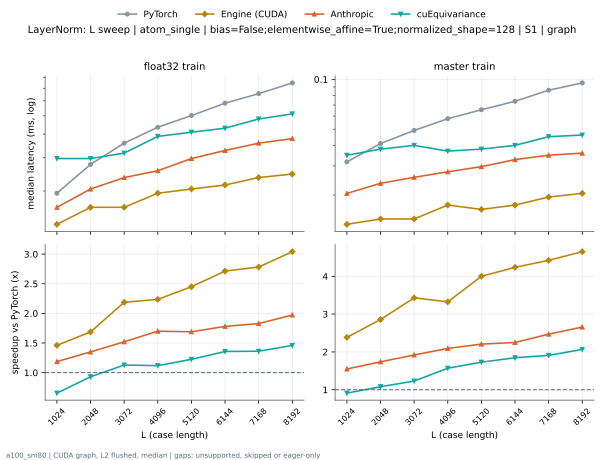

**float32 train** (median ms; x = speedup vs PyTorch)

| L | PyTorch | Engine (Triton) | Engine (CUDA) | Anthropic | cuEquivariance |
|---|---|---|---|---|---|
| 1024 | 0.01946 | 0.01638 (1.19x) | 0.01331 (1.46x) | 0.01638 (1.19x) | 0.0297 (0.66x) |
| 2048 | 0.02765 | 0.01638 (1.69x) | 0.01638 (1.69x) | 0.02048 (1.35x) | 0.0297 (0.93x) |
| 3072 | 0.03584 | 0.01843 (1.94x) | 0.01638 (2.19x) | 0.02355 (1.52x) | 0.03174 (1.13x) |
| 4096 | 0.04352 | 0.02048 (2.13x) | 0.01946 (2.24x) | 0.0256 (1.70x) | 0.03891 (1.12x) |
| 5120 | 0.05018 | 0.0215 (2.33x) | 0.02048 (2.45x) | 0.0297 (1.69x) | 0.04096 (1.22x) |
| 6144 | 0.05837 | 0.02253 (2.59x) | 0.0215 (2.71x) | 0.03277 (1.78x) | 0.04301 (1.36x) |
| 7168 | 0.06554 | 0.02355 (2.78x) | 0.02355 (2.78x) | 0.03584 (1.83x) | 0.04813 (1.36x) |
| 8192 | 0.07475 | 0.02458 (3.04x) | 0.02458 (3.04x) | 0.03789 (1.97x) | 0.0512 (1.46x) |

**master train** (median ms; x = speedup vs PyTorch)

| L | PyTorch | Engine (Triton) | Engine (CUDA) | Anthropic | cuEquivariance |
|---|---|---|---|---|---|
| 1024 | 0.03174 | 0.01434 (2.21x) | 0.01331 (2.38x) | 0.02048 (1.55x) | 0.03482 (0.91x) |
| 2048 | 0.04096 | 0.01741 (2.35x) | 0.01434 (2.86x) | 0.02355 (1.74x) | 0.03789 (1.08x) |
| 3072 | 0.04915 | 0.01843 (2.67x) | 0.01434 (3.43x) | 0.0256 (1.92x) | 0.03994 (1.23x) |
| 4096 | 0.05786 | 0.01843 (3.14x) | 0.01741 (3.32x) | 0.02765 (2.09x) | 0.03686 (1.57x) |
| 5120 | 0.06554 | 0.01843 (3.56x) | 0.01638 (4.00x) | 0.0297 (2.21x) | 0.03789 (1.73x) |
| 6144 | 0.07373 | 0.01946 (3.79x) | 0.01741 (4.24x) | 0.03277 (2.25x) | 0.03994 (1.85x) |
| 7168 | 0.08602 | 0.02253 (3.82x) | 0.01946 (4.42x) | 0.03482 (2.47x) | 0.04506 (1.91x) |
| 8192 | 0.09523 | 0.02355 (4.04x) | 0.02048 (4.65x) | 0.03584 (2.66x) | 0.04608 (2.07x) |

### L sweep: atom_single | bias=False;elementwise_affine=True;normalized_shape=128 | S5 | graph

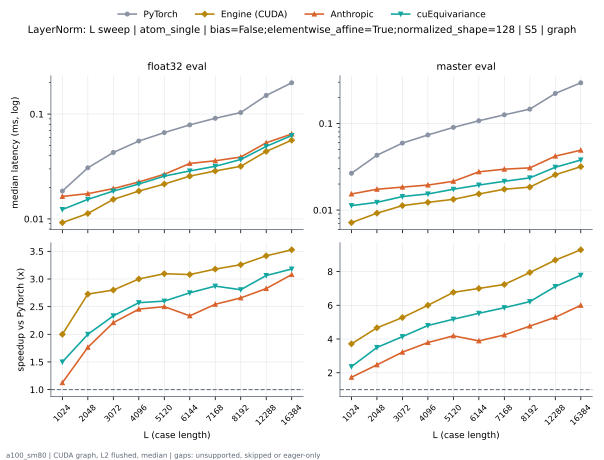

**float32 eval** (median ms; x = speedup vs PyTorch)

| L | PyTorch | Engine (Triton) | Engine (CUDA) | Anthropic | cuEquivariance |
|---|---|---|---|---|---|
| 1024 | 0.01843 | 0.01126 (1.64x) | 0.009216 (2.00x) | 0.01638 (1.13x) | 0.01229 (1.50x) |
| 2048 | 0.03072 | 0.01434 (2.14x) | 0.01126 (2.73x) | 0.01741 (1.76x) | 0.01536 (2.00x) |
| 3072 | 0.04301 | 0.01741 (2.47x) | 0.01536 (2.80x) | 0.01946 (2.21x) | 0.01843 (2.33x) |
| 4096 | 0.0553 | 0.02048 (2.70x) | 0.01843 (3.00x) | 0.02253 (2.45x) | 0.0215 (2.57x) |
| 5120 | 0.06656 | 0.02458 (2.71x) | 0.0215 (3.10x) | 0.02662 (2.50x) | 0.0256 (2.60x) |
| 6144 | 0.07885 | 0.02867 (2.75x) | 0.0256 (3.08x) | 0.03379 (2.33x) | 0.02867 (2.75x) |
| 7168 | 0.09114 | 0.03174 (2.87x) | 0.02867 (3.18x) | 0.03584 (2.54x) | 0.03174 (2.87x) |
| 8192 | 0.1034 | 0.03482 (2.97x) | 0.03174 (3.26x) | 0.03891 (2.66x) | 0.03686 (2.81x) |
| 12288 | 0.1505 | 0.04813 (3.13x) | 0.04403 (3.42x) | 0.05325 (2.83x) | 0.04915 (3.06x) |
| 16384 | 0.1987 | 0.06042 (3.29x) | 0.05632 (3.53x) | 0.06451 (3.08x) | 0.06246 (3.18x) |

**master eval** (median ms; x = speedup vs PyTorch)

| L | PyTorch | Engine (Triton) | Engine (CUDA) | Anthropic | cuEquivariance |
|---|---|---|---|---|---|
| 1024 | 0.02662 | 0.009216 (2.89x) | 0.007168 (3.71x) | 0.01536 (1.73x) | 0.01126 (2.36x) |
| 2048 | 0.04301 | 0.01126 (3.82x) | 0.009216 (4.67x) | 0.01741 (2.47x) | 0.01229 (3.50x) |
| 3072 | 0.05939 | 0.01229 (4.83x) | 0.01126 (5.27x) | 0.01843 (3.22x) | 0.01434 (4.14x) |
| 4096 | 0.07373 | 0.01331 (5.54x) | 0.01229 (6.00x) | 0.01946 (3.79x) | 0.01536 (4.80x) |
| 5120 | 0.09011 | 0.01536 (5.87x) | 0.01331 (6.77x) | 0.0215 (4.19x) | 0.01741 (5.18x) |
| 6144 | 0.1075 | 0.01843 (5.83x) | 0.01536 (7.00x) | 0.02765 (3.89x) | 0.01946 (5.53x) |
| 7168 | 0.126 | 0.02048 (6.15x) | 0.01741 (7.24x) | 0.0297 (4.24x) | 0.0215 (5.86x) |
| 8192 | 0.1464 | 0.0215 (6.81x) | 0.01843 (7.94x) | 0.03072 (4.77x) | 0.02355 (6.22x) |
| 12288 | 0.2222 | 0.02867 (7.75x) | 0.0256 (8.68x) | 0.04198 (5.29x) | 0.03123 (7.11x) |
| 16384 | 0.2949 | 0.03482 (8.47x) | 0.03174 (9.29x) | 0.04915 (6.00x) | 0.03789 (7.78x) |

### L sweep: atom_single | bias=True;elementwise_affine=True;normalized_shape=128 | S1 | graph

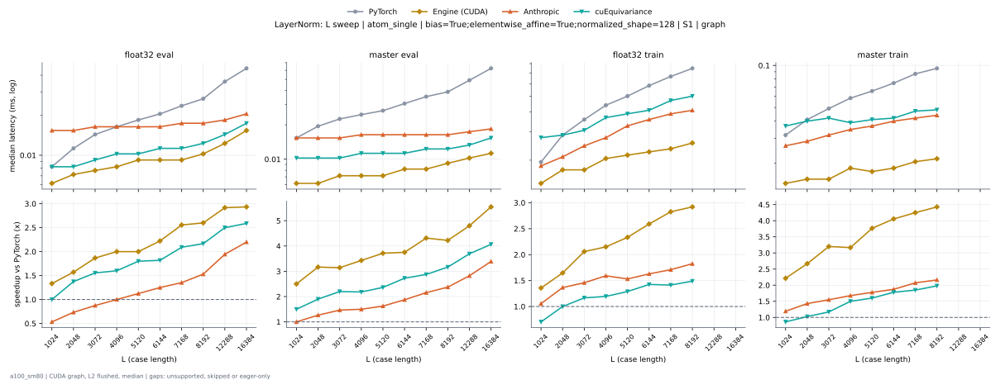

**float32 eval** (median ms; x = speedup vs PyTorch)

| L | PyTorch | Engine (Triton) | Engine (CUDA) | Anthropic | cuEquivariance |
|---|---|---|---|---|---|
| 1024 | 0.008192 | 0.007168 (1.14x) | 0.006144 (1.33x) | 0.01536 (0.53x) | 0.008192 (1.00x) |
| 2048 | 0.01126 | 0.007168 (1.57x) | 0.007168 (1.57x) | 0.01536 (0.73x) | 0.008192 (1.38x) |
| 3072 | 0.01434 | 0.008192 (1.75x) | 0.00768 (1.87x) | 0.01638 (0.88x) | 0.009216 (1.56x) |
| 4096 | 0.01638 | 0.008192 (2.00x) | 0.008192 (2.00x) | 0.01638 (1.00x) | 0.01024 (1.60x) |
| 5120 | 0.01843 | 0.009216 (2.00x) | 0.009216 (2.00x) | 0.01638 (1.13x) | 0.01024 (1.80x) |
| 6144 | 0.02048 | 0.01024 (2.00x) | 0.009216 (2.22x) | 0.01638 (1.25x) | 0.01126 (1.82x) |
| 7168 | 0.02355 | 0.01024 (2.30x) | 0.009216 (2.56x) | 0.01741 (1.35x) | 0.01126 (2.09x) |
| 8192 | 0.02662 | 0.01024 (2.60x) | 0.01024 (2.60x) | 0.01741 (1.53x) | 0.01229 (2.17x) |
| 12288 | 0.03584 | 0.01331 (2.69x) | 0.01229 (2.92x) | 0.01843 (1.94x) | 0.01434 (2.50x) |
| 16384 | 0.04506 | 0.01638 (2.75x) | 0.01536 (2.93x) | 0.02048 (2.20x) | 0.01741 (2.59x) |

**master eval** (median ms; x = speedup vs PyTorch)

| L | PyTorch | Engine (Triton) | Engine (CUDA) | Anthropic | cuEquivariance |
|---|---|---|---|---|---|
| 1024 | 0.01536 | 0.006144 (2.50x) | 0.006144 (2.50x) | 0.01536 (1.00x) | 0.01024 (1.50x) |
| 2048 | 0.01946 | 0.006144 (3.17x) | 0.006144 (3.17x) | 0.01536 (1.27x) | 0.01024 (1.90x) |
| 3072 | 0.02253 | 0.007168 (3.14x) | 0.007168 (3.14x) | 0.01536 (1.47x) | 0.01024 (2.20x) |
| 4096 | 0.02458 | 0.007168 (3.43x) | 0.007168 (3.43x) | 0.01638 (1.50x) | 0.01126 (2.18x) |
| 5120 | 0.02662 | 0.007168 (3.71x) | 0.007168 (3.71x) | 0.01638 (1.62x) | 0.01126 (2.36x) |
| 6144 | 0.03072 | 0.008192 (3.75x) | 0.008192 (3.75x) | 0.01638 (1.87x) | 0.01126 (2.73x) |
| 7168 | 0.03533 | 0.008192 (4.31x) | 0.008192 (4.31x) | 0.01638 (2.16x) | 0.01229 (2.87x) |
| 8192 | 0.03891 | 0.009216 (4.22x) | 0.009216 (4.22x) | 0.01638 (2.37x) | 0.01229 (3.17x) |
| 12288 | 0.04915 | 0.01024 (4.80x) | 0.01024 (4.80x) | 0.01741 (2.82x) | 0.01331 (3.69x) |
| 16384 | 0.06246 | 0.01024 (6.10x) | 0.01126 (5.55x) | 0.01843 (3.39x) | 0.01536 (4.07x) |

**float32 train** (median ms; x = speedup vs PyTorch)

| L | PyTorch | Engine (Triton) | Engine (CUDA) | Anthropic | cuEquivariance |
|---|---|---|---|---|---|
| 1024 | 0.01946 | 0.01536 (1.27x) | 0.01434 (1.36x) | 0.01843 (1.06x) | 0.02765 (0.70x) |
| 2048 | 0.02867 | 0.01741 (1.65x) | 0.01741 (1.65x) | 0.02099 (1.37x) | 0.02867 (1.00x) |
| 3072 | 0.03584 | 0.01946 (1.84x) | 0.01741 (2.06x) | 0.02458 (1.46x) | 0.03072 (1.17x) |
| 4096 | 0.04403 | 0.01946 (2.26x) | 0.02048 (2.15x) | 0.02765 (1.59x) | 0.03686 (1.19x) |
| 5120 | 0.05018 | 0.02048 (2.45x) | 0.0215 (2.33x) | 0.03277 (1.53x) | 0.03891 (1.29x) |
| 6144 | 0.05837 | 0.0215 (2.71x) | 0.02253 (2.59x) | 0.03584 (1.63x) | 0.04096 (1.43x) |
| 7168 | 0.06656 | 0.02355 (2.83x) | 0.02355 (2.83x) | 0.03891 (1.71x) | 0.0471 (1.41x) |
| 8192 | 0.07475 | 0.02458 (3.04x) | 0.0256 (2.92x) | 0.04096 (1.83x) | 0.05018 (1.49x) |
| 12288 |  |  |  |  |  |
| 16384 |  |  |  |  |  |

**master train** (median ms; x = speedup vs PyTorch)

| L | PyTorch | Engine (Triton) | Engine (CUDA) | Anthropic | cuEquivariance |
|---|---|---|---|---|---|
| 1024 | 0.03174 | 0.01536 (2.07x) | 0.01434 (2.21x) | 0.02662 (1.19x) | 0.03686 (0.86x) |
| 2048 | 0.04096 | 0.01741 (2.35x) | 0.01536 (2.67x) | 0.02867 (1.43x) | 0.03994 (1.03x) |
| 3072 | 0.04915 | 0.01741 (2.82x) | 0.01536 (3.20x) | 0.03174 (1.55x) | 0.04198 (1.17x) |
| 4096 | 0.05837 | 0.01741 (3.35x) | 0.01843 (3.17x) | 0.03482 (1.68x) | 0.03891 (1.50x) |
| 5120 | 0.06554 | 0.01741 (3.76x) | 0.01741 (3.76x) | 0.03686 (1.78x) | 0.04096 (1.60x) |
| 6144 | 0.07475 | 0.01946 (3.84x) | 0.01843 (4.06x) | 0.03994 (1.87x) | 0.04198 (1.78x) |
| 7168 | 0.08704 | 0.0215 (4.05x) | 0.02048 (4.25x) | 0.04198 (2.07x) | 0.0471 (1.85x) |
| 8192 | 0.09523 | 0.02253 (4.23x) | 0.0215 (4.43x) | 0.04403 (2.16x) | 0.04813 (1.98x) |
| 12288 |  |  |  |  |  |
| 16384 |  |  |  |  |  |

### L sweep: token_pair | bias=False;elementwise_affine=True;normalized_shape=128 | S1 | graph

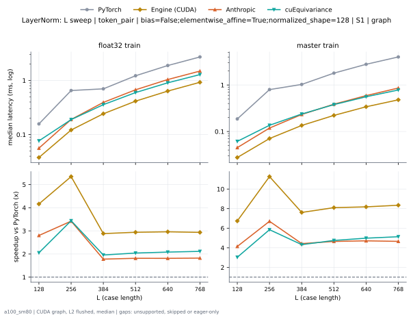

**float32 train** (median ms; x = speedup vs PyTorch)

| L | PyTorch | Engine (Triton) | Engine (CUDA) | Anthropic | cuEquivariance |
|---|---|---|---|---|---|
| 128 | 0.1577 | 0.04096 (3.85x) | 0.03789 (4.16x) | 0.05632 (2.80x) | 0.0768 (2.05x) |
| 256 | 0.6513 | 0.1239 (5.26x) | 0.1219 (5.34x) | 0.1905 (3.42x) | 0.1894 (3.44x) |
| 384 | 0.6994 | 0.2499 (2.80x) | 0.2427 (2.88x) | 0.3932 (1.78x) | 0.3574 (1.96x) |
| 512 | 1.219 | 0.426 (2.86x) | 0.4147 (2.94x) | 0.6717 (1.81x) | 0.597 (2.04x) |
| 640 | 1.882 | 0.6554 (2.87x) | 0.6359 (2.96x) | 1.038 (1.81x) | 0.9037 (2.08x) |
| 768 | 2.71 | 0.9385 (2.89x) | 0.9236 (2.93x) | 1.487 (1.82x) | 1.282 (2.11x) |

**master train** (median ms; x = speedup vs PyTorch)

| L | PyTorch | Engine (Triton) | Engine (CUDA) | Anthropic | cuEquivariance |
|---|---|---|---|---|---|
| 128 | 0.1864 | 0.02816 (6.62x) | 0.02765 (6.74x) | 0.04506 (4.14x) | 0.06144 (3.03x) |
| 256 | 0.7967 | 0.07782 (10.24x) | 0.07066 (11.28x) | 0.1188 (6.71x) | 0.1362 (5.85x) |
| 384 | 1.029 | 0.1464 (7.03x) | 0.1352 (7.61x) | 0.2324 (4.43x) | 0.2381 (4.32x) |
| 512 | 1.8 | 0.2381 (7.56x) | 0.2222 (8.10x) | 0.3871 (4.65x) | 0.3789 (4.75x) |
| 640 | 2.786 | 0.3558 (7.83x) | 0.3405 (8.18x) | 0.5914 (4.71x) | 0.5591 (4.98x) |
| 768 | 4.01 | 0.4925 (8.14x) | 0.4803 (8.35x) | 0.8612 (4.66x) | 0.7813 (5.13x) |

### L sweep: token_pair | bias=False;elementwise_affine=True;normalized_shape=128 | S5 | graph

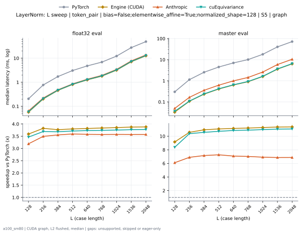

**float32 eval** (median ms; x = speedup vs PyTorch)

| L | PyTorch | Engine (Triton) | Engine (CUDA) | Anthropic | cuEquivariance |
|---|---|---|---|---|---|
| 128 | 0.2058 | 0.05837 (3.53x) | 0.05734 (3.59x) | 0.06451 (3.19x) | 0.05939 (3.47x) |
| 256 | 0.7711 | 0.2048 (3.76x) | 0.2017 (3.82x) | 0.2207 (3.49x) | 0.2089 (3.69x) |
| 384 | 1.724 | 0.4603 (3.75x) | 0.4577 (3.77x) | 0.4854 (3.55x) | 0.4685 (3.68x) |
| 512 | 3.068 | 0.811 (3.78x) | 0.8079 (3.80x) | 0.854 (3.59x) | 0.8264 (3.71x) |
| 640 | 4.787 | 1.254 (3.82x) | 1.254 (3.82x) | 1.338 (3.58x) | 1.283 (3.73x) |
| 768 | 6.888 | 1.798 (3.83x) | 1.796 (3.84x) | 1.929 (3.57x) | 1.843 (3.74x) |
| 1024 | 12.24 | 3.195 (3.83x) | 3.178 (3.85x) | 3.425 (3.57x) | 3.263 (3.75x) |
| 1536 | 27.55 | 7.208 (3.82x) | 7.114 (3.87x) | 7.715 (3.57x) | 7.314 (3.77x) |
| 2048 | 48.97 | 12.79 (3.83x) | 12.62 (3.88x) | 13.7 (3.57x) | 12.97 (3.77x) |

**master eval** (median ms; x = speedup vs PyTorch)

| L | PyTorch | Engine (Triton) | Engine (CUDA) | Anthropic | cuEquivariance |
|---|---|---|---|---|---|
| 128 | 0.3 | 0.03277 (9.16x) | 0.03277 (9.16x) | 0.04915 (6.10x) | 0.03584 (8.37x) |
| 256 | 1.137 | 0.1085 (10.47x) | 0.1075 (10.57x) | 0.1649 (6.89x) | 0.1096 (10.37x) |
| 384 | 2.543 | 0.2386 (10.66x) | 0.2324 (10.94x) | 0.3553 (7.16x) | 0.2406 (10.57x) |
| 512 | 4.511 | 0.4168 (10.82x) | 0.4076 (11.07x) | 0.6205 (7.27x) | 0.4209 (10.72x) |
| 640 | 7.039 | 0.6441 (10.93x) | 0.6318 (11.14x) | 0.9943 (7.08x) | 0.6492 (10.84x) |
| 768 | 10.14 | 0.9216 (11.00x) | 0.9052 (11.20x) | 1.443 (7.03x) | 0.9308 (10.89x) |
| 1024 | 18.02 | 1.627 (11.08x) | 1.598 (11.27x) | 2.605 (6.92x) | 1.642 (10.97x) |
| 1536 | 40.53 | 3.601 (11.25x) | 3.572 (11.35x) | 5.901 (6.87x) | 3.672 (11.04x) |
| 2048 | 72.07 | 6.389 (11.28x) | 6.34 (11.37x) | 10.48 (6.88x) | 6.512 (11.07x) |

### L sweep: token_pair | bias=False;elementwise_affine=True;normalized_shape=256 | S1 | graph

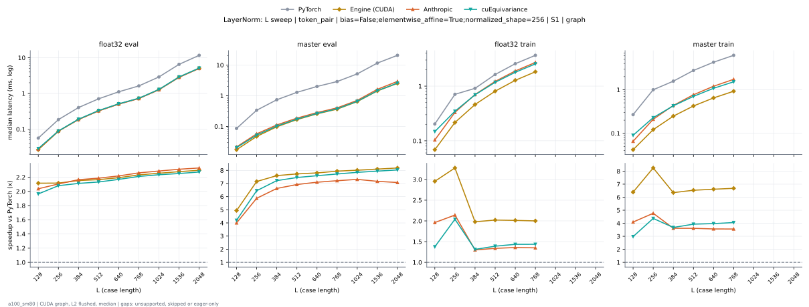

**float32 eval** (median ms; x = speedup vs PyTorch)

| L | PyTorch | Engine (Triton) | Engine (CUDA) | Anthropic | cuEquivariance |
|---|---|---|---|---|---|
| 128 | 0.05632 | 0.02867 (1.96x) | 0.02662 (2.12x) | 0.02765 (2.04x) | 0.02867 (1.96x) |
| 256 | 0.1853 | 0.08858 (2.09x) | 0.08755 (2.12x) | 0.08806 (2.10x) | 0.08909 (2.08x) |
| 384 | 0.4035 | 0.1905 (2.12x) | 0.1874 (2.15x) | 0.1864 (2.16x) | 0.191 (2.11x) |
| 512 | 0.7096 | 0.3308 (2.15x) | 0.3277 (2.17x) | 0.3246 (2.19x) | 0.3328 (2.13x) |
| 640 | 1.115 | 0.512 (2.18x) | 0.5084 (2.19x) | 0.5028 (2.22x) | 0.514 (2.17x) |
| 768 | 1.628 | 0.7357 (2.21x) | 0.7291 (2.23x) | 0.7199 (2.26x) | 0.7363 (2.21x) |
| 1024 | 2.906 | 1.296 (2.24x) | 1.288 (2.26x) | 1.271 (2.29x) | 1.3 (2.23x) |
| 1536 | 6.546 | 2.896 (2.26x) | 2.874 (2.28x) | 2.831 (2.31x) | 2.907 (2.25x) |
| 2048 | 11.71 | 5.118 (2.29x) | 5.095 (2.30x) | 5.024 (2.33x) | 5.15 (2.27x) |

**master eval** (median ms; x = speedup vs PyTorch)

| L | PyTorch | Engine (Triton) | Engine (CUDA) | Anthropic | cuEquivariance |
|---|---|---|---|---|---|
| 128 | 0.08602 | 0.01843 (4.67x) | 0.01741 (4.94x) | 0.0215 (4.00x) | 0.02048 (4.20x) |
| 256 | 0.3369 | 0.05018 (6.71x) | 0.0471 (7.15x) | 0.05734 (5.87x) | 0.05222 (6.45x) |
| 384 | 0.7393 | 0.1004 (7.37x) | 0.09728 (7.60x) | 0.1116 (6.62x) | 0.1024 (7.22x) |
| 512 | 1.29 | 0.171 (7.54x) | 0.1669 (7.73x) | 0.1864 (6.92x) | 0.1731 (7.46x) |
| 640 | 2.006 | 0.2632 (7.62x) | 0.257 (7.80x) | 0.2826 (7.10x) | 0.2642 (7.59x) |
| 768 | 2.903 | 0.3738 (7.77x) | 0.3656 (7.94x) | 0.4024 (7.21x) | 0.3758 (7.72x) |
| 1024 | 5.161 | 0.6554 (7.88x) | 0.6441 (8.01x) | 0.7055 (7.31x) | 0.6574 (7.85x) |
| 1536 | 11.6 | 1.459 (7.95x) | 1.433 (8.10x) | 1.619 (7.17x) | 1.461 (7.94x) |
| 2048 | 20.77 | 2.577 (8.06x) | 2.538 (8.18x) | 2.935 (7.08x) | 2.586 (8.03x) |

**float32 train** (median ms; x = speedup vs PyTorch)

| L | PyTorch | Engine (Triton) | Engine (CUDA) | Anthropic | cuEquivariance |
|---|---|---|---|---|---|
| 128 | 0.2028 | 0.07782 (2.61x) | 0.06861 (2.96x) | 0.1034 (1.96x) | 0.1475 (1.37x) |
| 256 | 0.7081 | 0.2335 (3.03x) | 0.2161 (3.28x) | 0.3308 (2.14x) | 0.3471 (2.04x) |
| 384 | 0.9114 | 0.4844 (1.88x) | 0.4608 (1.98x) | 0.7014 (1.30x) | 0.6943 (1.31x) |
| 512 | 1.633 | 0.831 (1.96x) | 0.8079 (2.02x) | 1.221 (1.34x) | 1.175 (1.39x) |
| 640 | 2.571 | 1.311 (1.96x) | 1.278 (2.01x) | 1.893 (1.36x) | 1.792 (1.43x) |
| 768 | 3.662 | 1.875 (1.95x) | 1.831 (2.00x) | 2.712 (1.35x) | 2.55 (1.44x) |
| 1024 |  |  |  |  |  |
| 1536 |  |  |  |  |  |
| 2048 |  |  |  |  |  |

**master train** (median ms; x = speedup vs PyTorch)

| L | PyTorch | Engine (Triton) | Engine (CUDA) | Anthropic | cuEquivariance |
|---|---|---|---|---|---|
| 128 | 0.2683 | 0.04915 (5.46x) | 0.04198 (6.39x) | 0.06554 (4.09x) | 0.09011 (2.98x) |
| 256 | 1 | 0.1464 (6.83x) | 0.1213 (8.24x) | 0.2099 (4.77x) | 0.2289 (4.37x) |
| 384 | 1.574 | 0.2806 (5.61x) | 0.2478 (6.35x) | 0.4352 (3.62x) | 0.428 (3.68x) |
| 512 | 2.77 | 0.4495 (6.16x) | 0.4239 (6.53x) | 0.767 (3.61x) | 0.7045 (3.93x) |
| 640 | 4.293 | 0.683 (6.28x) | 0.6492 (6.61x) | 1.204 (3.56x) | 1.08 (3.97x) |
| 768 | 6.178 | 0.9697 (6.37x) | 0.9247 (6.68x) | 1.736 (3.56x) | 1.523 (4.06x) |
| 1024 |  |  |  |  |  |
| 1536 |  |  |  |  |  |
| 2048 |  |  |  |  |  |

### L sweep: token_pair | bias=False;elementwise_affine=True;normalized_shape=267 | S1 | graph

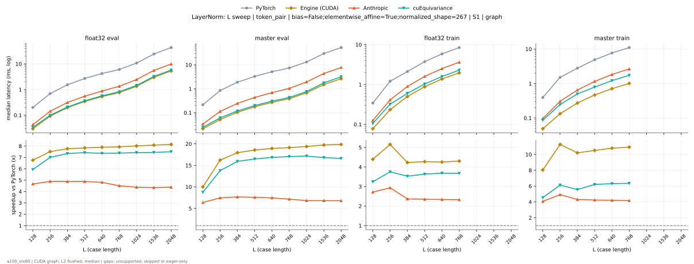

**float32 eval** (median ms; x = speedup vs PyTorch)

| L | PyTorch | Engine (Triton) | Engine (CUDA) | Anthropic | cuEquivariance |
|---|---|---|---|---|---|
| 128 | 0.2007 | 0.03379 (5.94x) | 0.0297 (6.76x) | 0.04301 (4.67x) | 0.03379 (5.94x) |
| 256 | 0.6963 | 0.09779 (7.12x) | 0.09267 (7.51x) | 0.1423 (4.89x) | 0.09933 (7.01x) |
| 384 | 1.535 | 0.2038 (7.53x) | 0.1976 (7.77x) | 0.3144 (4.88x) | 0.2089 (7.35x) |
| 512 | 2.702 | 0.3523 (7.67x) | 0.3446 (7.84x) | 0.553 (4.89x) | 0.364 (7.42x) |
| 640 | 4.215 | 0.556 (7.58x) | 0.5335 (7.90x) | 0.8765 (4.81x) | 0.5724 (7.36x) |
| 768 | 6.063 | 0.7936 (7.64x) | 0.7644 (7.93x) | 1.346 (4.51x) | 0.8212 (7.38x) |
| 1024 | 10.77 | 1.399 (7.70x) | 1.344 (8.01x) | 2.458 (4.38x) | 1.45 (7.43x) |
| 1536 | 24.23 | 3.125 (7.75x) | 2.997 (8.09x) | 5.575 (4.35x) | 3.256 (7.44x) |
| 2048 | 43.32 | 5.561 (7.79x) | 5.318 (8.15x) | 9.877 (4.39x) | 5.773 (7.50x) |

**master eval** (median ms; x = speedup vs PyTorch)

| L | PyTorch | Engine (Triton) | Engine (CUDA) | Anthropic | cuEquivariance |
|---|---|---|---|---|---|
| 128 | 0.215 | 0.02458 (8.75x) | 0.0215 (10.00x) | 0.03379 (6.36x) | 0.02458 (8.75x) |
| 256 | 0.8468 | 0.06963 (12.16x) | 0.05222 (16.22x) | 0.1137 (7.45x) | 0.06144 (13.78x) |
| 384 | 1.884 | 0.1362 (13.83x) | 0.105 (17.95x) | 0.2458 (7.67x) | 0.1183 (15.93x) |
| 512 | 3.309 | 0.2304 (14.36x) | 0.1782 (18.57x) | 0.4367 (7.58x) | 0.2007 (16.48x) |
| 640 | 5.159 | 0.3564 (14.48x) | 0.2724 (18.94x) | 0.6922 (7.45x) | 0.3062 (16.85x) |
| 768 | 7.422 | 0.5064 (14.66x) | 0.3881 (19.13x) | 1.037 (7.16x) | 0.4352 (17.06x) |
| 1024 | 13.18 | 0.9308 (14.16x) | 0.6799 (19.38x) | 1.934 (6.81x) | 0.7675 (17.17x) |
| 1536 | 29.65 | 2.175 (13.63x) | 1.502 (19.74x) | 4.35 (6.82x) | 1.764 (16.81x) |
| 2048 | 52.72 | 3.877 (13.60x) | 2.653 (19.87x) | 7.766 (6.79x) | 3.174 (16.61x) |

**float32 train** (median ms; x = speedup vs PyTorch)

| L | PyTorch | Engine (Triton) | Engine (CUDA) | Anthropic | cuEquivariance |
|---|---|---|---|---|---|
| 128 | 0.342 | 0.08909 (3.84x) | 0.07782 (4.39x) | 0.126 (2.72x) | 0.1055 (3.24x) |
| 256 | 1.208 | 0.2826 (4.28x) | 0.2345 (5.15x) | 0.4116 (2.94x) | 0.322 (3.75x) |
| 384 | 2.117 | 0.6164 (3.43x) | 0.5007 (4.23x) | 0.8945 (2.37x) | 0.6001 (3.53x) |
| 512 | 3.752 | 1.075 (3.49x) | 0.8781 (4.27x) | 1.597 (2.35x) | 1.033 (3.63x) |
| 640 | 5.862 | 1.675 (3.50x) | 1.379 (4.25x) | 2.51 (2.34x) | 1.591 (3.68x) |
| 768 | 8.445 | 2.421 (3.49x) | 1.962 (4.30x) | 3.632 (2.33x) | 2.299 (3.67x) |
| 1024 |  |  |  |  |  |
| 1536 |  |  |  |  |  |
| 2048 |  |  |  |  |  |

**master train** (median ms; x = speedup vs PyTorch)

| L | PyTorch | Engine (Triton) | Engine (CUDA) | Anthropic | cuEquivariance |
|---|---|---|---|---|---|
| 128 | 0.3953 | 0.07168 (5.51x) | 0.04915 (8.04x) | 0.09728 (4.06x) | 0.08704 (4.54x) |
| 256 | 1.511 | 0.2161 (7.00x) | 0.1341 (11.27x) | 0.3072 (4.92x) | 0.2468 (6.12x) |
| 384 | 2.789 | 0.4178 (6.68x) | 0.2734 (10.20x) | 0.6482 (4.30x) | 0.5018 (5.56x) |
| 512 | 4.906 | 0.6994 (7.01x) | 0.4669 (10.51x) | 1.157 (4.24x) | 0.7905 (6.21x) |
| 640 | 7.681 | 1.083 (7.09x) | 0.7117 (10.79x) | 1.83 (4.20x) | 1.218 (6.31x) |
| 768 | 11.04 | 1.544 (7.15x) | 1.011 (10.93x) | 2.655 (4.16x) | 1.74 (6.35x) |
| 1024 |  |  |  |  |  |
| 1536 |  |  |  |  |  |
| 2048 |  |  |  |  |  |

### L sweep: token_pair | bias=False;elementwise_affine=True;normalized_shape=384 | S1 | graph

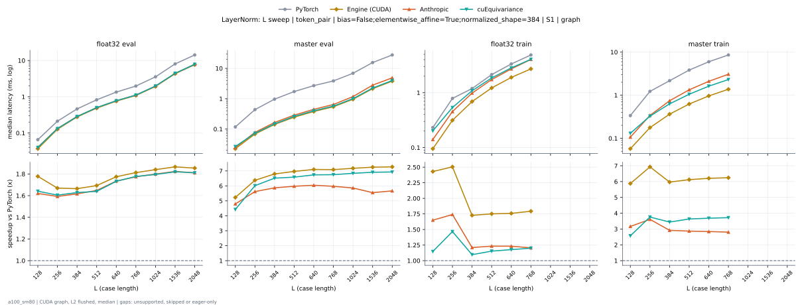

**float32 eval** (median ms; x = speedup vs PyTorch)

| L | PyTorch | Engine (Triton) | Engine (CUDA) | Anthropic | cuEquivariance |
|---|---|---|---|---|---|
| 128 | 0.06554 | 0.03994 (1.64x) | 0.03686 (1.78x) | 0.04045 (1.62x) | 0.03994 (1.64x) |
| 256 | 0.212 | 0.1311 (1.62x) | 0.127 (1.67x) | 0.1331 (1.59x) | 0.1321 (1.60x) |
| 384 | 0.4618 | 0.2836 (1.63x) | 0.2775 (1.66x) | 0.2857 (1.62x) | 0.2836 (1.63x) |
| 512 | 0.8233 | 0.5018 (1.64x) | 0.4864 (1.69x) | 0.4997 (1.65x) | 0.5023 (1.64x) |
| 640 | 1.345 | 0.7772 (1.73x) | 0.7578 (1.77x) | 0.7752 (1.73x) | 0.7762 (1.73x) |
| 768 | 1.973 | 1.111 (1.78x) | 1.089 (1.81x) | 1.112 (1.77x) | 1.11 (1.78x) |
| 1024 | 3.542 | 1.974 (1.79x) | 1.925 (1.84x) | 1.969 (1.80x) | 1.973 (1.80x) |
| 1536 | 8.053 | 4.422 (1.82x) | 4.317 (1.87x) | 4.418 (1.82x) | 4.425 (1.82x) |
| 2048 | 14.2 | 7.843 (1.81x) | 7.662 (1.85x) | 7.846 (1.81x) | 7.847 (1.81x) |

**master eval** (median ms; x = speedup vs PyTorch)

| L | PyTorch | Engine (Triton) | Engine (CUDA) | Anthropic | cuEquivariance |
|---|---|---|---|---|---|
| 128 | 0.1178 | 0.0256 (4.60x) | 0.02253 (5.23x) | 0.02458 (4.79x) | 0.02662 (4.42x) |
| 256 | 0.4372 | 0.0727 (6.01x) | 0.06861 (6.37x) | 0.07782 (5.62x) | 0.0727 (6.01x) |
| 384 | 0.9677 | 0.1464 (6.61x) | 0.1423 (6.80x) | 0.1649 (5.87x) | 0.1485 (6.52x) |
| 512 | 1.719 | 0.257 (6.69x) | 0.2468 (6.97x) | 0.2877 (5.98x) | 0.2611 (6.58x) |
| 640 | 2.697 | 0.3953 (6.82x) | 0.3799 (7.10x) | 0.4465 (6.04x) | 0.4004 (6.74x) |
| 768 | 3.853 | 0.5632 (6.84x) | 0.5437 (7.09x) | 0.6451 (5.97x) | 0.5709 (6.75x) |
| 1024 | 6.884 | 0.9882 (6.97x) | 0.9595 (7.18x) | 1.175 (5.86x) | 1.007 (6.84x) |
| 1536 | 15.52 | 2.211 (7.02x) | 2.141 (7.25x) | 2.799 (5.55x) | 2.247 (6.91x) |
| 2048 | 27.6 | 3.908 (7.06x) | 3.795 (7.27x) | 4.872 (5.66x) | 3.983 (6.93x) |

**float32 train** (median ms; x = speedup vs PyTorch)

| L | PyTorch | Engine (Triton) | Engine (CUDA) | Anthropic | cuEquivariance |
|---|---|---|---|---|---|
| 128 | 0.2314 | 0.1147 (2.02x) | 0.09523 (2.43x) | 0.1403 (1.65x) | 0.2017 (1.15x) |
| 256 | 0.7875 | 0.3256 (2.42x) | 0.3144 (2.50x) | 0.4526 (1.74x) | 0.5371 (1.47x) |
| 384 | 1.191 | 0.7096 (1.68x) | 0.6897 (1.73x) | 0.9841 (1.21x) | 1.086 (1.10x) |
| 512 | 2.139 | 1.258 (1.70x) | 1.222 (1.75x) | 1.735 (1.23x) | 1.856 (1.15x) |
| 640 | 3.34 | 1.96 (1.70x) | 1.9 (1.76x) | 2.712 (1.23x) | 2.838 (1.18x) |
| 768 | 4.877 | 2.814 (1.73x) | 2.72 (1.79x) | 4.046 (1.21x) | 4.063 (1.20x) |
| 1024 |  |  |  |  |  |
| 1536 |  |  |  |  |  |
| 2048 |  |  |  |  |  |

**master train** (median ms; x = speedup vs PyTorch)

| L | PyTorch | Engine (Triton) | Engine (CUDA) | Anthropic | cuEquivariance |
|---|---|---|---|---|---|
| 128 | 0.3369 | 0.07168 (4.70x) | 0.05734 (5.87x) | 0.1065 (3.16x) | 0.1311 (2.57x) |
| 256 | 1.228 | 0.2181 (5.63x) | 0.1772 (6.93x) | 0.34 (3.61x) | 0.3267 (3.76x) |
| 384 | 2.17 | 0.4577 (4.74x) | 0.3635 (5.97x) | 0.7439 (2.92x) | 0.6308 (3.44x) |
| 512 | 3.83 | 0.7962 (4.81x) | 0.6257 (6.12x) | 1.335 (2.87x) | 1.054 (3.63x) |
| 640 | 5.98 | 1.262 (4.74x) | 0.9636 (6.21x) | 2.105 (2.84x) | 1.624 (3.68x) |
| 768 | 8.591 | 1.816 (4.73x) | 1.376 (6.24x) | 3.065 (2.80x) | 2.311 (3.72x) |
| 1024 |  |  |  |  |  |
| 1536 |  |  |  |  |  |
| 2048 |  |  |  |  |  |

### L sweep: token_pair | bias=False;elementwise_affine=True;normalized_shape=512 | S1 | graph

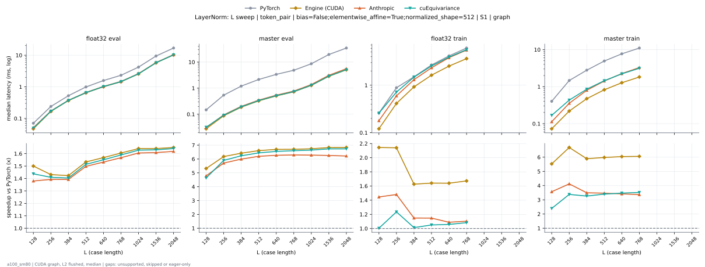

**float32 eval** (median ms; x = speedup vs PyTorch)

| L | PyTorch | Engine (Triton) | Engine (CUDA) | Anthropic | cuEquivariance |
|---|---|---|---|---|---|
| 128 | 0.07066 | 0.04813 (1.47x) | 0.0471 (1.50x) | 0.0512 (1.38x) | 0.04915 (1.44x) |
| 256 | 0.2396 | 0.17 (1.41x) | 0.1674 (1.43x) | 0.172 (1.39x) | 0.17 (1.41x) |
| 384 | 0.5233 | 0.3717 (1.41x) | 0.3676 (1.42x) | 0.3758 (1.39x) | 0.3727 (1.40x) |
| 512 | 0.9923 | 0.6543 (1.52x) | 0.6472 (1.53x) | 0.6625 (1.50x) | 0.6554 (1.51x) |
| 640 | 1.58 | 1.015 (1.56x) | 1.008 (1.57x) | 1.031 (1.53x) | 1.019 (1.55x) |
| 768 | 2.322 | 1.457 (1.59x) | 1.447 (1.61x) | 1.482 (1.57x) | 1.461 (1.59x) |
| 1024 | 4.21 | 2.57 (1.64x) | 2.566 (1.64x) | 2.622 (1.61x) | 2.586 (1.63x) |
| 1536 | 9.452 | 5.755 (1.64x) | 5.761 (1.64x) | 5.877 (1.61x) | 5.797 (1.63x) |
| 2048 | 16.87 | 10.22 (1.65x) | 10.22 (1.65x) | 10.42 (1.62x) | 10.28 (1.64x) |

**master eval** (median ms; x = speedup vs PyTorch)

| L | PyTorch | Engine (Triton) | Engine (CUDA) | Anthropic | cuEquivariance |
|---|---|---|---|---|---|
| 128 | 0.1469 | 0.0297 (4.95x) | 0.02765 (5.31x) | 0.03072 (4.78x) | 0.03174 (4.63x) |
| 256 | 0.5376 | 0.09114 (5.90x) | 0.08704 (6.18x) | 0.09421 (5.71x) | 0.09114 (5.90x) |
| 384 | 1.197 | 0.1915 (6.25x) | 0.1864 (6.42x) | 0.1997 (5.99x) | 0.192 (6.23x) |
| 512 | 2.15 | 0.3328 (6.46x) | 0.3256 (6.60x) | 0.3471 (6.19x) | 0.3338 (6.44x) |
| 640 | 3.373 | 0.513 (6.57x) | 0.5038 (6.70x) | 0.5381 (6.27x) | 0.5151 (6.55x) |
| 768 | 4.852 | 0.7352 (6.60x) | 0.724 (6.70x) | 0.7711 (6.29x) | 0.7352 (6.60x) |
| 1024 | 8.612 | 1.294 (6.65x) | 1.278 (6.74x) | 1.371 (6.28x) | 1.296 (6.64x) |
| 1536 | 19.47 | 2.873 (6.78x) | 2.851 (6.83x) | 3.112 (6.26x) | 2.892 (6.73x) |
| 2048 | 34.51 | 5.091 (6.78x) | 5.051 (6.83x) | 5.551 (6.22x) | 5.126 (6.73x) |

**float32 train** (median ms; x = speedup vs PyTorch)

| L | PyTorch | Engine (Triton) | Engine (CUDA) | Anthropic | cuEquivariance |
|---|---|---|---|---|---|
| 128 | 0.2591 | 0.1352 (1.92x) | 0.1208 (2.14x) | 0.1792 (1.45x) | 0.258 (1.00x) |
| 256 | 0.8852 | 0.427 (2.07x) | 0.4137 (2.14x) | 0.598 (1.48x) | 0.7168 (1.24x) |
| 384 | 1.502 | 0.9457 (1.59x) | 0.9236 (1.63x) | 1.309 (1.15x) | 1.483 (1.01x) |
| 512 | 2.674 | 1.676 (1.59x) | 1.629 (1.64x) | 2.331 (1.15x) | 2.546 (1.05x) |
| 640 | 4.151 | 2.628 (1.58x) | 2.531 (1.64x) | 3.813 (1.09x) | 3.923 (1.06x) |
| 768 | 6.074 | 3.765 (1.61x) | 3.633 (1.67x) | 5.507 (1.10x) | 5.612 (1.08x) |
| 1024 |  |  |  |  |  |
| 1536 |  |  |  |  |  |
| 2048 |  |  |  |  |  |

**master train** (median ms; x = speedup vs PyTorch)

| L | PyTorch | Engine (Triton) | Engine (CUDA) | Anthropic | cuEquivariance |
|---|---|---|---|---|---|
| 128 | 0.4019 | 0.09728 (4.13x) | 0.0727 (5.53x) | 0.1126 (3.57x) | 0.1679 (2.39x) |
| 256 | 1.464 | 0.297 (4.93x) | 0.2191 (6.68x) | 0.3553 (4.12x) | 0.4332 (3.38x) |
| 384 | 2.787 | 0.6298 (4.43x) | 0.4731 (5.89x) | 0.7977 (3.49x) | 0.854 (3.26x) |
| 512 | 4.923 | 1.097 (4.49x) | 0.8233 (5.98x) | 1.42 (3.47x) | 1.447 (3.40x) |
| 640 | 7.707 | 1.709 (4.51x) | 1.276 (6.04x) | 2.255 (3.42x) | 2.22 (3.47x) |
| 768 | 11.04 | 2.451 (4.50x) | 1.822 (6.06x) | 3.28 (3.37x) | 3.138 (3.52x) |
| 1024 |  |  |  |  |  |
| 1536 |  |  |  |  |  |
| 2048 |  |  |  |  |  |

### L sweep: token_pair | bias=False;elementwise_affine=True;normalized_shape=651 | S1 | graph

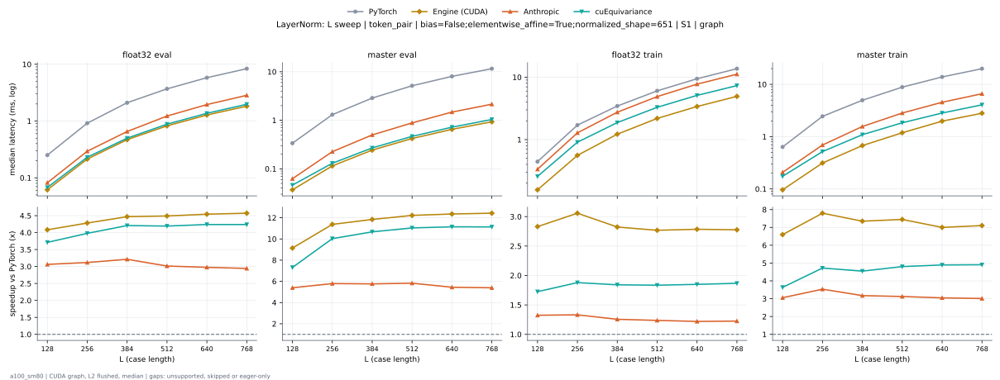

**float32 eval** (median ms; x = speedup vs PyTorch)

| L | PyTorch | Engine (Triton) | Engine (CUDA) | Anthropic | cuEquivariance |
|---|---|---|---|---|---|
| 128 | 0.2509 | 0.07475 (3.36x) | 0.06144 (4.08x) | 0.08192 (3.06x) | 0.06758 (3.71x) |
| 256 | 0.9165 | 0.2478 (3.70x) | 0.214 (4.28x) | 0.2939 (3.12x) | 0.2304 (3.98x) |
| 384 | 2.101 | 0.534 (3.93x) | 0.47 (4.47x) | 0.6538 (3.21x) | 0.4992 (4.21x) |
| 512 | 3.692 | 0.9431 (3.91x) | 0.8223 (4.49x) | 1.225 (3.01x) | 0.8806 (4.19x) |
| 640 | 5.803 | 1.484 (3.91x) | 1.277 (4.54x) | 1.95 (2.98x) | 1.369 (4.24x) |
| 768 | 8.361 | 2.142 (3.90x) | 1.829 (4.57x) | 2.841 (2.94x) | 1.973 (4.24x) |

**master eval** (median ms; x = speedup vs PyTorch)

| L | PyTorch | Engine (Triton) | Engine (CUDA) | Anthropic | cuEquivariance |
|---|---|---|---|---|---|
| 128 | 0.3369 | 0.04813 (7.00x) | 0.03686 (9.14x) | 0.06246 (5.39x) | 0.04608 (7.31x) |
| 256 | 1.305 | 0.1464 (8.91x) | 0.1147 (11.38x) | 0.2253 (5.79x) | 0.13 (10.03x) |
| 384 | 2.873 | 0.3072 (9.35x) | 0.2427 (11.84x) | 0.4987 (5.76x) | 0.2693 (10.67x) |
| 512 | 5.144 | 0.5396 (9.53x) | 0.4209 (12.22x) | 0.8827 (5.83x) | 0.4659 (11.04x) |
| 640 | 8.033 | 0.8346 (9.63x) | 0.6502 (12.35x) | 1.476 (5.44x) | 0.7209 (11.14x) |
| 768 | 11.57 | 1.2 (9.64x) | 0.9308 (12.43x) | 2.145 (5.39x) | 1.039 (11.14x) |

**float32 train** (median ms; x = speedup vs PyTorch)

| L | PyTorch | Engine (Triton) | Engine (CUDA) | Anthropic | cuEquivariance |
|---|---|---|---|---|---|
| 128 | 0.4434 | 0.2176 (2.04x) | 0.1567 (2.83x) | 0.3348 (1.32x) | 0.257 (1.73x) |
| 256 | 1.706 | 0.7916 (2.16x) | 0.5581 (3.06x) | 1.282 (1.33x) | 0.9083 (1.88x) |
| 384 | 3.449 | 1.737 (1.99x) | 1.222 (2.82x) | 2.746 (1.26x) | 1.873 (1.84x) |
| 512 | 6.044 | 3.082 (1.96x) | 2.184 (2.77x) | 4.886 (1.24x) | 3.294 (1.83x) |
| 640 | 9.452 | 4.834 (1.96x) | 3.394 (2.79x) | 7.75 (1.22x) | 5.112 (1.85x) |
| 768 | 13.7 | 6.924 (1.98x) | 4.935 (2.78x) | 11.18 (1.22x) | 7.336 (1.87x) |

**master train** (median ms; x = speedup vs PyTorch)

| L | PyTorch | Engine (Triton) | Engine (CUDA) | Anthropic | cuEquivariance |
|---|---|---|---|---|---|
| 128 | 0.6349 | 0.1469 (4.32x) | 0.09626 (6.60x) | 0.2079 (3.05x) | 0.1746 (3.64x) |
| 256 | 2.443 | 0.5048 (4.84x) | 0.3133 (7.80x) | 0.6912 (3.53x) | 0.5176 (4.72x) |
| 384 | 4.96 | 1.092 (4.54x) | 0.6748 (7.35x) | 1.563 (3.17x) | 1.091 (4.55x) |
| 512 | 8.835 | 1.995 (4.43x) | 1.186 (7.45x) | 2.828 (3.12x) | 1.84 (4.80x) |
| 640 | 13.84 | 3.305 (4.19x) | 1.977 (7.00x) | 4.543 (3.05x) | 2.829 (4.89x) |
| 768 | 19.91 | 4.791 (4.16x) | 2.803 (7.10x) | 6.611 (3.01x) | 4.059 (4.91x) |

### L sweep: token_pair | bias=True;elementwise_affine=True;normalized_shape=128 | S1 | graph

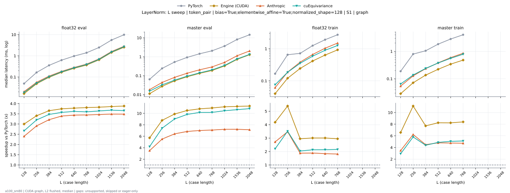

**float32 eval** (median ms; x = speedup vs PyTorch)

| L | PyTorch | Engine (Triton) | Engine (CUDA) | Anthropic | cuEquivariance |
|---|---|---|---|---|---|
| 128 | 0.04915 | 0.01638 (3.00x) | 0.01638 (3.00x) | 0.02048 (2.40x) | 0.01843 (2.67x) |
| 256 | 0.1638 | 0.04915 (3.33x) | 0.04813 (3.40x) | 0.05632 (2.91x) | 0.0512 (3.20x) |
| 384 | 0.3553 | 0.09933 (3.58x) | 0.09728 (3.65x) | 0.1106 (3.21x) | 0.1024 (3.47x) |
| 512 | 0.6246 | 0.171 (3.65x) | 0.1669 (3.74x) | 0.1843 (3.39x) | 0.1751 (3.57x) |
| 640 | 0.9708 | 0.2601 (3.73x) | 0.257 (3.78x) | 0.2826 (3.43x) | 0.2683 (3.62x) |
| 768 | 1.395 | 0.3789 (3.68x) | 0.3666 (3.80x) | 0.405 (3.44x) | 0.3881 (3.59x) |
| 1024 | 2.474 | 0.6656 (3.72x) | 0.6472 (3.82x) | 0.7142 (3.46x) | 0.6799 (3.64x) |
| 1536 | 5.557 | 1.484 (3.75x) | 1.442 (3.85x) | 1.594 (3.49x) | 1.51 (3.68x) |
| 2048 | 9.849 | 2.629 (3.75x) | 2.538 (3.88x) | 2.827 (3.48x) | 2.695 (3.65x) |

**master eval** (median ms; x = speedup vs PyTorch)

| L | PyTorch | Engine (Triton) | Engine (CUDA) | Anthropic | cuEquivariance |
|---|---|---|---|---|---|
| 128 | 0.06451 | 0.01024 (6.30x) | 0.01126 (5.73x) | 0.01843 (3.50x) | 0.01536 (4.20x) |
| 256 | 0.2427 | 0.02816 (8.62x) | 0.02765 (8.78x) | 0.04403 (5.51x) | 0.03277 (7.41x) |
| 384 | 0.5263 | 0.05427 (9.70x) | 0.05325 (9.88x) | 0.08192 (6.43x) | 0.05837 (9.02x) |
| 512 | 0.9247 | 0.09114 (10.15x) | 0.08806 (10.50x) | 0.1352 (6.84x) | 0.09421 (9.82x) |
| 640 | 1.436 | 0.1372 (10.46x) | 0.1331 (10.78x) | 0.2048 (7.01x) | 0.1413 (10.16x) |
| 768 | 2.061 | 0.1925 (10.71x) | 0.1884 (10.94x) | 0.2908 (7.09x) | 0.2028 (10.17x) |
| 1024 | 3.652 | 0.343 (10.64x) | 0.3277 (11.14x) | 0.5059 (7.22x) | 0.3492 (10.46x) |
| 1536 | 8.14 | 0.7557 (10.77x) | 0.726 (11.21x) | 1.127 (7.22x) | 0.7649 (10.64x) |
| 2048 | 14.46 | 1.336 (10.82x) | 1.282 (11.28x) | 2.024 (7.14x) | 1.336 (10.82x) |

**float32 train** (median ms; x = speedup vs PyTorch)

| L | PyTorch | Engine (Triton) | Engine (CUDA) | Anthropic | cuEquivariance |
|---|---|---|---|---|---|
| 128 | 0.1669 | 0.03891 (4.29x) | 0.03994 (4.18x) | 0.06144 (2.72x) | 0.07578 (2.20x) |
| 256 | 0.6513 | 0.1229 (5.30x) | 0.1208 (5.39x) | 0.1874 (3.48x) | 0.1853 (3.51x) |
| 384 | 0.7178 | 0.2437 (2.95x) | 0.2432 (2.95x) | 0.382 (1.88x) | 0.3523 (2.04x) |
| 512 | 1.247 | 0.4219 (2.96x) | 0.4147 (3.01x) | 0.6605 (1.89x) | 0.5857 (2.13x) |
| 640 | 1.913 | 0.642 (2.98x) | 0.6359 (3.01x) | 1.038 (1.84x) | 0.896 (2.13x) |
| 768 | 2.724 | 0.9272 (2.94x) | 0.9236 (2.95x) | 1.502 (1.81x) | 1.264 (2.16x) |
| 1024 |  |  |  |  |  |
| 1536 |  |  |  |  |  |
| 2048 |  |  |  |  |  |

**master train** (median ms; x = speedup vs PyTorch)

| L | PyTorch | Engine (Triton) | Engine (CUDA) | Anthropic | cuEquivariance |
|---|---|---|---|---|---|
| 128 | 0.1884 | 0.02816 (6.69x) | 0.02867 (6.57x) | 0.05427 (3.47x) | 0.06451 (2.92x) |
| 256 | 0.7967 | 0.07373 (10.81x) | 0.07168 (11.11x) | 0.128 (6.22x) | 0.1372 (5.81x) |
| 384 | 1.05 | 0.1413 (7.43x) | 0.1362 (7.71x) | 0.234 (4.49x) | 0.2396 (4.38x) |
| 512 | 1.832 | 0.2509 (7.30x) | 0.2222 (8.24x) | 0.382 (4.80x) | 0.3758 (4.87x) |
| 640 | 2.815 | 0.3471 (8.11x) | 0.342 (8.23x) | 0.5908 (4.76x) | 0.5571 (5.05x) |
| 768 | 4.029 | 0.4884 (8.25x) | 0.4803 (8.39x) | 0.853 (4.72x) | 0.7885 (5.11x) |
| 1024 |  |  |  |  |  |
| 1536 |  |  |  |  |  |
| 2048 |  |  |  |  |  |

### L sweep: token_pair | bias=True;elementwise_affine=True;normalized_shape=256 | S1 | graph

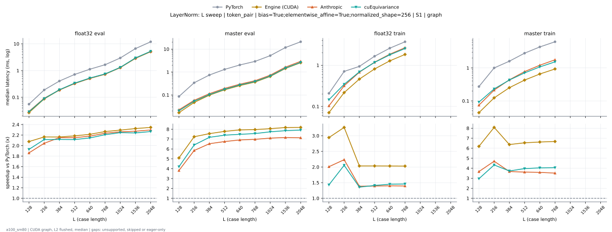

**float32 eval** (median ms; x = speedup vs PyTorch)

| L | PyTorch | Engine (Triton) | Engine (CUDA) | Anthropic | cuEquivariance |
|---|---|---|---|---|---|
| 128 | 0.0553 | 0.02765 (2.00x) | 0.02662 (2.08x) | 0.0297 (1.86x) | 0.02867 (1.93x) |
| 256 | 0.1884 | 0.08909 (2.11x) | 0.08704 (2.16x) | 0.09216 (2.04x) | 0.08909 (2.11x) |
| 384 | 0.4055 | 0.1915 (2.12x) | 0.1874 (2.16x) | 0.1884 (2.15x) | 0.1915 (2.12x) |
| 512 | 0.7158 | 0.3308 (2.16x) | 0.3277 (2.18x) | 0.3328 (2.15x) | 0.3384 (2.11x) |
| 640 | 1.125 | 0.5233 (2.15x) | 0.5079 (2.21x) | 0.5161 (2.18x) | 0.5243 (2.15x) |
| 768 | 1.653 | 0.748 (2.21x) | 0.7291 (2.27x) | 0.7393 (2.24x) | 0.7485 (2.21x) |
| 1024 | 2.958 | 1.317 (2.25x) | 1.289 (2.29x) | 1.308 (2.26x) | 1.317 (2.25x) |
| 1536 | 6.649 | 2.969 (2.24x) | 2.861 (2.32x) | 2.925 (2.27x) | 2.968 (2.24x) |
| 2048 | 11.94 | 5.255 (2.27x) | 5.091 (2.35x) | 5.199 (2.30x) | 5.267 (2.27x) |

**master eval** (median ms; x = speedup vs PyTorch)

| L | PyTorch | Engine (Triton) | Engine (CUDA) | Anthropic | cuEquivariance |
|---|---|---|---|---|---|
| 128 | 0.08602 | 0.01741 (4.94x) | 0.0169 (5.09x) | 0.02253 (3.82x) | 0.02048 (4.20x) |
| 256 | 0.341 | 0.04915 (6.94x) | 0.0471 (7.24x) | 0.05837 (5.84x) | 0.05325 (6.40x) |
| 384 | 0.7424 | 0.1004 (7.40x) | 0.0983 (7.55x) | 0.1137 (6.53x) | 0.1034 (7.18x) |
| 512 | 1.307 | 0.172 (7.60x) | 0.1679 (7.78x) | 0.1935 (6.75x) | 0.1766 (7.40x) |
| 640 | 2.038 | 0.2693 (7.57x) | 0.257 (7.93x) | 0.2949 (6.91x) | 0.2724 (7.48x) |
| 768 | 2.918 | 0.383 (7.62x) | 0.3666 (7.96x) | 0.4183 (6.98x) | 0.386 (7.56x) |
| 1024 | 5.19 | 0.6743 (7.70x) | 0.6441 (8.06x) | 0.7311 (7.10x) | 0.6707 (7.74x) |
| 1536 | 11.75 | 1.494 (7.86x) | 1.438 (8.17x) | 1.641 (7.16x) | 1.496 (7.85x) |
| 2048 | 20.91 | 2.665 (7.84x) | 2.554 (8.18x) | 2.931 (7.13x) | 2.643 (7.91x) |

**float32 train** (median ms; x = speedup vs PyTorch)

| L | PyTorch | Engine (Triton) | Engine (CUDA) | Anthropic | cuEquivariance |
|---|---|---|---|---|---|
| 128 | 0.2079 | 0.0768 (2.71x) | 0.07066 (2.94x) | 0.1034 (2.01x) | 0.1454 (1.43x) |
| 256 | 0.7091 | 0.2335 (3.04x) | 0.2171 (3.27x) | 0.3174 (2.23x) | 0.3451 (2.05x) |
| 384 | 0.939 | 0.4823 (1.95x) | 0.4618 (2.03x) | 0.6779 (1.39x) | 0.6922 (1.36x) |
| 512 | 1.655 | 0.8294 (2.00x) | 0.8136 (2.03x) | 1.188 (1.39x) | 1.174 (1.41x) |
| 640 | 2.598 | 1.31 (1.98x) | 1.279 (2.03x) | 1.857 (1.40x) | 1.791 (1.45x) |
| 768 | 3.714 | 1.875 (1.98x) | 1.831 (2.03x) | 2.664 (1.39x) | 2.548 (1.46x) |
| 1024 |  |  |  |  |  |
| 1536 |  |  |  |  |  |
| 2048 |  |  |  |  |  |

**master train** (median ms; x = speedup vs PyTorch)

| L | PyTorch | Engine (Triton) | Engine (CUDA) | Anthropic | cuEquivariance |
|---|---|---|---|---|---|
| 128 | 0.2724 | 0.04813 (5.66x) | 0.04403 (6.19x) | 0.07424 (3.67x) | 0.09216 (2.96x) |
| 256 | 1.001 | 0.1464 (6.84x) | 0.1239 (8.08x) | 0.213 (4.70x) | 0.2314 (4.33x) |
| 384 | 1.605 | 0.2785 (5.76x) | 0.2519 (6.37x) | 0.4367 (3.67x) | 0.4301 (3.73x) |
| 512 | 2.804 | 0.4475 (6.27x) | 0.4285 (6.54x) | 0.7752 (3.62x) | 0.7076 (3.96x) |
| 640 | 4.34 | 0.681 (6.37x) | 0.6554 (6.62x) | 1.209 (3.59x) | 1.075 (4.04x) |
| 768 | 6.221 | 0.9667 (6.44x) | 0.9318 (6.68x) | 1.769 (3.52x) | 1.532 (4.06x) |
| 1024 |  |  |  |  |  |
| 1536 |  |  |  |  |  |
| 2048 |  |  |  |  |  |

### L sweep: token_pair | bias=True;elementwise_affine=True;normalized_shape=384 | S1 | graph

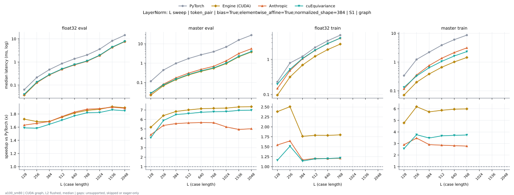

**float32 eval** (median ms; x = speedup vs PyTorch)

| L | PyTorch | Engine (Triton) | Engine (CUDA) | Anthropic | cuEquivariance |
|---|---|---|---|---|---|
| 128 | 0.06349 | 0.03994 (1.59x) | 0.03686 (1.72x) | 0.03891 (1.63x) | 0.03994 (1.59x) |
| 256 | 0.214 | 0.1341 (1.60x) | 0.127 (1.69x) | 0.129 (1.66x) | 0.1352 (1.58x) |
| 384 | 0.468 | 0.2826 (1.66x) | 0.2775 (1.69x) | 0.2775 (1.69x) | 0.2847 (1.64x) |
| 512 | 0.8545 | 0.5012 (1.70x) | 0.4874 (1.75x) | 0.4854 (1.76x) | 0.5007 (1.71x) |
| 640 | 1.375 | 0.7752 (1.77x) | 0.7572 (1.82x) | 0.7516 (1.83x) | 0.7762 (1.77x) |
| 768 | 2.018 | 1.108 (1.82x) | 1.087 (1.86x) | 1.077 (1.87x) | 1.109 (1.82x) |
| 1024 | 3.598 | 1.972 (1.82x) | 1.922 (1.87x) | 1.912 (1.88x) | 1.973 (1.82x) |
| 1536 | 8.244 | 4.421 (1.86x) | 4.313 (1.91x) | 4.329 (1.90x) | 4.424 (1.86x) |
| 2048 | 14.51 | 7.839 (1.85x) | 7.654 (1.90x) | 7.686 (1.89x) | 7.846 (1.85x) |

**master eval** (median ms; x = speedup vs PyTorch)

| L | PyTorch | Engine (Triton) | Engine (CUDA) | Anthropic | cuEquivariance |
|---|---|---|---|---|---|
| 128 | 0.1167 | 0.0256 (4.56x) | 0.02253 (5.18x) | 0.02662 (4.38x) | 0.02867 (4.07x) |
| 256 | 0.4398 | 0.07117 (6.18x) | 0.06861 (6.41x) | 0.08192 (5.37x) | 0.07475 (5.88x) |
| 384 | 0.9748 | 0.1454 (6.70x) | 0.1423 (6.85x) | 0.1751 (5.57x) | 0.1495 (6.52x) |
| 512 | 1.732 | 0.257 (6.74x) | 0.2468 (7.02x) | 0.3072 (5.64x) | 0.2611 (6.63x) |
| 640 | 2.715 | 0.3953 (6.87x) | 0.3799 (7.15x) | 0.4782 (5.68x) | 0.4014 (6.76x) |
| 768 | 3.906 | 0.5632 (6.93x) | 0.5437 (7.18x) | 0.6902 (5.66x) | 0.5724 (6.82x) |
| 1024 | 6.898 | 0.9923 (6.95x) | 0.9574 (7.20x) | 1.324 (5.21x) | 1.009 (6.84x) |
| 1536 | 15.65 | 2.215 (7.06x) | 2.135 (7.33x) | 3.167 (4.94x) | 2.248 (6.96x) |
| 2048 | 27.86 | 3.914 (7.12x) | 3.787 (7.36x) | 5.552 (5.02x) | 3.988 (6.98x) |

**float32 train** (median ms; x = speedup vs PyTorch)

| L | PyTorch | Engine (Triton) | Engine (CUDA) | Anthropic | cuEquivariance |
|---|---|---|---|---|---|
| 128 | 0.2294 | 0.1075 (2.13x) | 0.09626 (2.38x) | 0.1485 (1.54x) | 0.1976 (1.16x) |
| 256 | 0.7905 | 0.3174 (2.49x) | 0.3154 (2.51x) | 0.4803 (1.65x) | 0.5222 (1.51x) |
| 384 | 1.216 | 0.6927 (1.76x) | 0.6902 (1.76x) | 1.039 (1.17x) | 1.066 (1.14x) |
| 512 | 2.189 | 1.231 (1.78x) | 1.225 (1.79x) | 1.817 (1.20x) | 1.83 (1.20x) |
| 640 | 3.39 | 1.923 (1.76x) | 1.899 (1.79x) | 2.821 (1.20x) | 2.818 (1.20x) |
| 768 | 4.901 | 2.755 (1.78x) | 2.725 (1.80x) | 4.046 (1.21x) | 4.019 (1.22x) |
| 1024 |  |  |  |  |  |
| 1536 |  |  |  |  |  |
| 2048 |  |  |  |  |  |

**master train** (median ms; x = speedup vs PyTorch)

| L | PyTorch | Engine (Triton) | Engine (CUDA) | Anthropic | cuEquivariance |
|---|---|---|---|---|---|
| 128 | 0.3379 | 0.06963 (4.85x) | 0.07066 (4.78x) | 0.1167 (2.89x) | 0.1321 (2.56x) |
| 256 | 1.229 | 0.2099 (5.85x) | 0.1987 (6.19x) | 0.3543 (3.47x) | 0.3267 (3.76x) |
| 384 | 2.203 | 0.4434 (4.97x) | 0.384 (5.74x) | 0.7578 (2.91x) | 0.6339 (3.47x) |
| 512 | 3.869 | 0.7793 (4.97x) | 0.6584 (5.88x) | 1.356 (2.85x) | 1.056 (3.66x) |
| 640 | 6.031 | 1.22 (4.94x) | 1.011 (5.97x) | 2.143 (2.81x) | 1.627 (3.71x) |
| 768 | 8.65 | 1.771 (4.88x) | 1.443 (6.00x) | 3.115 (2.78x) | 2.314 (3.74x) |
| 1024 |  |  |  |  |  |
| 1536 |  |  |  |  |  |
| 2048 |  |  |  |  |  |

### L sweep: token_pair | bias=True;elementwise_affine=True;normalized_shape=512 | S1 | graph

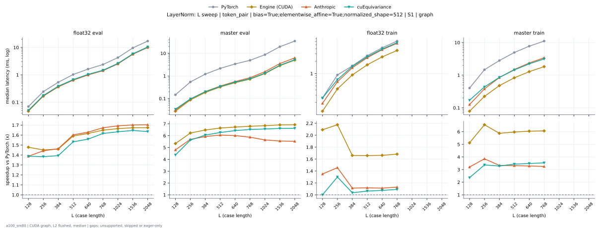

**float32 eval** (median ms; x = speedup vs PyTorch)

| L | PyTorch | Engine (Triton) | Engine (CUDA) | Anthropic | cuEquivariance |
|---|---|---|---|---|---|
| 128 | 0.06963 | 0.05018 (1.39x) | 0.0471 (1.48x) | 0.05018 (1.39x) | 0.05018 (1.39x) |
| 256 | 0.2437 | 0.1761 (1.38x) | 0.1679 (1.45x) | 0.169 (1.44x) | 0.1761 (1.38x) |
| 384 | 0.5366 | 0.384 (1.40x) | 0.3676 (1.46x) | 0.3666 (1.46x) | 0.385 (1.39x) |
| 512 | 1.028 | 0.6697 (1.54x) | 0.6461 (1.59x) | 0.6415 (1.60x) | 0.6707 (1.53x) |
| 640 | 1.624 | 1.037 (1.57x) | 1.005 (1.62x) | 0.9964 (1.63x) | 1.041 (1.56x) |
| 768 | 2.385 | 1.471 (1.62x) | 1.445 (1.65x) | 1.424 (1.67x) | 1.475 (1.62x) |
| 1024 | 4.272 | 2.628 (1.63x) | 2.565 (1.67x) | 2.523 (1.69x) | 2.615 (1.63x) |
| 1536 | 9.636 | 5.893 (1.64x) | 5.755 (1.67x) | 5.66 (1.70x) | 5.851 (1.65x) |
| 2048 | 17.12 | 10.45 (1.64x) | 10.22 (1.67x) | 10.05 (1.70x) | 10.47 (1.64x) |

**master eval** (median ms; x = speedup vs PyTorch)

| L | PyTorch | Engine (Triton) | Engine (CUDA) | Anthropic | cuEquivariance |
|---|---|---|---|---|---|
| 128 | 0.1475 | 0.03072 (4.80x) | 0.02765 (5.33x) | 0.03072 (4.80x) | 0.03379 (4.36x) |
| 256 | 0.5417 | 0.09318 (5.81x) | 0.08704 (6.22x) | 0.09523 (5.69x) | 0.09626 (5.63x) |
| 384 | 1.207 | 0.1956 (6.17x) | 0.1864 (6.48x) | 0.2038 (5.92x) | 0.1997 (6.05x) |
| 512 | 2.157 | 0.3405 (6.33x) | 0.3246 (6.64x) | 0.3564 (6.05x) | 0.3441 (6.27x) |
| 640 | 3.396 | 0.5258 (6.46x) | 0.5048 (6.73x) | 0.5652 (6.01x) | 0.5284 (6.43x) |
| 768 | 4.91 | 0.7547 (6.51x) | 0.7229 (6.79x) | 0.8366 (5.87x) | 0.7526 (6.52x) |
| 1024 | 8.724 | 1.328 (6.57x) | 1.275 (6.84x) | 1.547 (5.64x) | 1.329 (6.56x) |
| 1536 | 19.61 | 2.98 (6.58x) | 2.839 (6.91x) | 3.535 (5.55x) | 2.968 (6.61x) |
| 2048 | 34.86 | 5.297 (6.58x) | 5.036 (6.92x) | 6.311 (5.52x) | 5.263 (6.62x) |

**float32 train** (median ms; x = speedup vs PyTorch)

| L | PyTorch | Engine (Triton) | Engine (CUDA) | Anthropic | cuEquivariance |
|---|---|---|---|---|---|
| 128 | 0.257 | 0.1341 (1.92x) | 0.1229 (2.09x) | 0.1905 (1.35x) | 0.257 (1.00x) |
| 256 | 0.9247 | 0.4255 (2.17x) | 0.425 (2.18x) | 0.6349 (1.46x) | 0.7117 (1.30x) |
| 384 | 1.538 | 0.9544 (1.61x) | 0.9257 (1.66x) | 1.381 (1.11x) | 1.486 (1.03x) |
| 512 | 2.705 | 1.674 (1.62x) | 1.63 (1.66x) | 2.421 (1.12x) | 2.545 (1.06x) |
| 640 | 4.209 | 2.612 (1.61x) | 2.531 (1.66x) | 3.784 (1.11x) | 3.917 (1.07x) |
| 768 | 6.114 | 3.779 (1.62x) | 3.633 (1.68x) | 5.413 (1.13x) | 5.607 (1.09x) |
| 1024 |  |  |  |  |  |
| 1536 |  |  |  |  |  |
| 2048 |  |  |  |  |  |

**master train** (median ms; x = speedup vs PyTorch)

| L | PyTorch | Engine (Triton) | Engine (CUDA) | Anthropic | cuEquivariance |
|---|---|---|---|---|---|
| 128 | 0.4035 | 0.09626 (4.19x) | 0.07885 (5.12x) | 0.126 (3.20x) | 0.171 (2.36x) |
| 256 | 1.469 | 0.2959 (4.97x) | 0.2243 (6.55x) | 0.3809 (3.86x) | 0.4362 (3.37x) |
| 384 | 2.814 | 0.6298 (4.47x) | 0.4792 (5.87x) | 0.8458 (3.33x) | 0.8571 (3.28x) |
| 512 | 4.962 | 1.098 (4.52x) | 0.8305 (5.97x) | 1.497 (3.32x) | 1.445 (3.43x) |
| 640 | 7.754 | 1.708 (4.54x) | 1.283 (6.04x) | 2.36 (3.29x) | 2.227 (3.48x) |
| 768 | 11.11 | 2.45 (4.53x) | 1.832 (6.06x) | 3.422 (3.25x) | 3.144 (3.53x) |
| 1024 |  |  |  |  |  |
| 1536 |  |  |  |  |  |
| 2048 |  |  |  |  |  |

### L sweep: token_pair | bias=True;elementwise_affine=True;normalized_shape=64 | S1 | graph

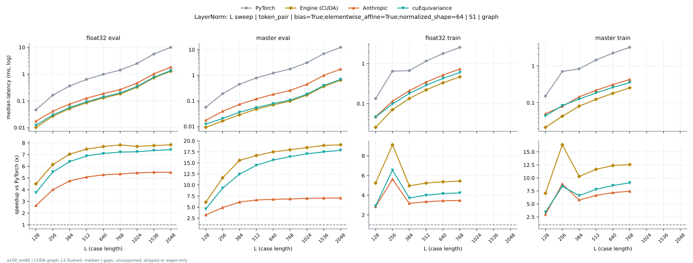

**float32 eval** (median ms; x = speedup vs PyTorch)

| L | PyTorch | Engine (Triton) | Engine (CUDA) | Anthropic | cuEquivariance |
|---|---|---|---|---|---|
| 128 | 0.04608 | 0.01126 (4.09x) | 0.01024 (4.50x) | 0.01741 (2.65x) | 0.01229 (3.75x) |
| 256 | 0.1638 | 0.02867 (5.71x) | 0.02662 (6.15x) | 0.04096 (4.00x) | 0.0297 (5.52x) |
| 384 | 0.3604 | 0.05427 (6.64x) | 0.0512 (7.04x) | 0.07578 (4.76x) | 0.05632 (6.40x) |
| 512 | 0.6349 | 0.09011 (7.05x) | 0.08499 (7.47x) | 0.1249 (5.08x) | 0.09216 (6.89x) |
| 640 | 0.9882 | 0.1362 (7.26x) | 0.1285 (7.69x) | 0.1874 (5.27x) | 0.1393 (7.10x) |
| 768 | 1.419 | 0.1915 (7.41x) | 0.1812 (7.83x) | 0.2652 (5.35x) | 0.1966 (7.22x) |
| 1024 | 2.515 | 0.342 (7.35x) | 0.3267 (7.70x) | 0.4623 (5.44x) | 0.3471 (7.24x) |
| 1536 | 5.65 | 0.7608 (7.43x) | 0.7265 (7.78x) | 1.029 (5.49x) | 0.768 (7.36x) |
| 2048 | 10.04 | 1.348 (7.45x) | 1.281 (7.84x) | 1.831 (5.48x) | 1.354 (7.42x) |

**master eval** (median ms; x = speedup vs PyTorch)

| L | PyTorch | Engine (Triton) | Engine (CUDA) | Anthropic | cuEquivariance |
|---|---|---|---|---|---|
| 128 | 0.05632 | 0.009216 (6.11x) | 0.009216 (6.11x) | 0.01741 (3.24x) | 0.01229 (4.58x) |
| 256 | 0.1905 | 0.01741 (10.94x) | 0.01638 (11.63x) | 0.03891 (4.89x) | 0.02048 (9.30x) |
| 384 | 0.4465 | 0.03174 (14.06x) | 0.02867 (15.57x) | 0.0727 (6.14x) | 0.03584 (12.46x) |
| 512 | 0.7854 | 0.05018 (15.65x) | 0.0471 (16.67x) | 0.1188 (6.61x) | 0.05427 (14.47x) |
| 640 | 1.219 | 0.07373 (16.53x) | 0.06963 (17.50x) | 0.1802 (6.76x) | 0.07782 (15.66x) |
| 768 | 1.748 | 0.1024 (17.07x) | 0.09728 (17.97x) | 0.255 (6.86x) | 0.1065 (16.41x) |
| 1024 | 3.101 | 0.1761 (17.60x) | 0.1679 (18.46x) | 0.4444 (6.98x) | 0.1818 (17.06x) |
| 1536 | 6.951 | 0.3922 (17.72x) | 0.3666 (18.96x) | 0.9871 (7.04x) | 0.3973 (17.49x) |
| 2048 | 12.34 | 0.6871 (17.96x) | 0.6461 (19.10x) | 1.746 (7.07x) | 0.6902 (17.88x) |

**float32 train** (median ms; x = speedup vs PyTorch)

| L | PyTorch | Engine (Triton) | Engine (CUDA) | Anthropic | cuEquivariance |
|---|---|---|---|---|---|
| 128 | 0.1341 | 0.02406 (5.57x) | 0.0256 (5.24x) | 0.0471 (2.85x) | 0.04608 (2.91x) |
| 256 | 0.6441 | 0.07066 (9.12x) | 0.07066 (9.12x) | 0.1147 (5.62x) | 0.0983 (6.55x) |
| 384 | 0.6656 | 0.1352 (4.92x) | 0.1341 (4.96x) | 0.2099 (3.17x) | 0.1792 (3.71x) |
| 512 | 1.152 | 0.2232 (5.16x) | 0.2202 (5.23x) | 0.3446 (3.34x) | 0.2877 (4.00x) |
| 640 | 1.777 | 0.3379 (5.26x) | 0.3313 (5.36x) | 0.5171 (3.44x) | 0.427 (4.16x) |
| 768 | 2.538 | 0.4762 (5.33x) | 0.4669 (5.44x) | 0.7322 (3.47x) | 0.599 (4.24x) |
| 1024 |  |  |  |  |  |
| 1536 |  |  |  |  |  |
| 2048 |  |  |  |  |  |

**master train** (median ms; x = speedup vs PyTorch)

| L | PyTorch | Engine (Triton) | Engine (CUDA) | Anthropic | cuEquivariance |
|---|---|---|---|---|---|
| 128 | 0.1516 | 0.02048 (7.40x) | 0.0215 (7.05x) | 0.05018 (3.02x) | 0.04403 (3.44x) |
| 256 | 0.7035 | 0.04403 (15.98x) | 0.04301 (16.36x) | 0.07987 (8.81x) | 0.08397 (8.38x) |
| 384 | 0.8325 | 0.08192 (10.16x) | 0.0809 (10.29x) | 0.1444 (5.77x) | 0.126 (6.61x) |
| 512 | 1.443 | 0.129 (11.18x) | 0.1239 (11.64x) | 0.2171 (6.65x) | 0.1848 (7.81x) |
| 640 | 2.231 | 0.1864 (11.97x) | 0.1802 (12.38x) | 0.3113 (7.17x) | 0.2611 (8.55x) |
| 768 | 3.189 | 0.2601 (12.26x) | 0.254 (12.56x) | 0.428 (7.45x) | 0.3523 (9.05x) |
| 1024 |  |  |  |  |  |
| 1536 |  |  |  |  |  |
| 2048 |  |  |  |  |  |

### L sweep: token_single | bias=False;elementwise_affine=True;normalized_shape=384 | S1 | graph

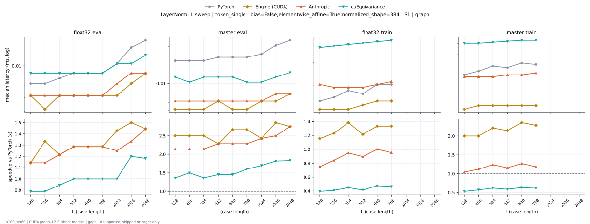

**float32 eval** (median ms; x = speedup vs PyTorch)

| L | PyTorch | Engine (Triton) | Engine (CUDA) | Anthropic | cuEquivariance |
|---|---|---|---|---|---|
| 128 | 0.008192 | 0.01024 (0.80x) | 0.007168 (1.14x) | 0.007168 (1.14x) | 0.009216 (0.89x) |
| 256 | 0.008192 | 0.009216 (0.89x) | 0.006144 (1.33x) | 0.007168 (1.14x) | 0.009216 (0.89x) |
| 384 | 0.008704 | 0.009216 (0.94x) | 0.007168 (1.21x) | 0.007168 (1.21x) | 0.009216 (0.94x) |
| 512 | 0.009216 | 0.009216 (1.00x) | 0.007168 (1.29x) | 0.007168 (1.29x) | 0.009216 (1.00x) |
| 640 | 0.009216 | 0.009216 (1.00x) | 0.007168 (1.29x) | 0.007168 (1.29x) | 0.009216 (1.00x) |
| 768 | 0.009216 | 0.01024 (0.90x) | 0.007168 (1.29x) | 0.007168 (1.29x) | 0.009216 (1.00x) |
| 1024 | 0.01024 | 0.01843 (0.56x) | 0.007168 (1.43x) | 0.008192 (1.25x) | 0.01024 (1.00x) |
| 1536 | 0.01229 | 0.01843 (0.67x) | 0.008192 (1.50x) | 0.009216 (1.33x) | 0.01024 (1.20x) |
| 2048 | 0.01331 | 0.01843 (0.72x) | 0.009216 (1.44x) | 0.009216 (1.44x) | 0.01126 (1.18x) |

**master eval** (median ms; x = speedup vs PyTorch)

| L | PyTorch | Engine (Triton) | Engine (CUDA) | Anthropic | cuEquivariance |
|---|---|---|---|---|---|
| 128 | 0.01536 | 0.008192 (1.87x) | 0.006144 (2.50x) | 0.007168 (2.14x) | 0.01126 (1.36x) |
| 256 | 0.01536 | 0.008192 (1.87x) | 0.006144 (2.50x) | 0.007168 (2.14x) | 0.01024 (1.50x) |
| 384 | 0.01536 | 0.008192 (1.87x) | 0.006144 (2.50x) | 0.007168 (2.14x) | 0.01126 (1.36x) |
| 512 | 0.01638 | 0.008192 (2.00x) | 0.007168 (2.29x) | 0.007168 (2.29x) | 0.01126 (1.45x) |
| 640 | 0.01638 | 0.008192 (2.00x) | 0.006144 (2.67x) | 0.007168 (2.29x) | 0.01126 (1.45x) |
| 768 | 0.01638 | 0.008192 (2.00x) | 0.006144 (2.67x) | 0.007168 (2.29x) | 0.01024 (1.60x) |
| 1024 | 0.01741 | 0.01741 (1.00x) | 0.007168 (2.43x) | 0.007168 (2.43x) | 0.01024 (1.70x) |
| 1536 | 0.02048 | 0.01741 (1.18x) | 0.007168 (2.86x) | 0.008192 (2.50x) | 0.01126 (1.82x) |
| 2048 | 0.02253 | 0.01741 (1.29x) | 0.008192 (2.75x) | 0.008192 (2.75x) | 0.01229 (1.83x) |

**float32 train** (median ms; x = speedup vs PyTorch)

| L | PyTorch | Engine (Triton) | Engine (CUDA) | Anthropic | cuEquivariance |
|---|---|---|---|---|---|
| 128 | 0.01536 | 0.01638 (0.94x) | 0.01331 (1.15x) | 0.02048 (0.75x) | 0.03891 (0.39x) |
| 256 | 0.01638 | 0.01741 (0.94x) | 0.01331 (1.23x) | 0.01946 (0.84x) | 0.03994 (0.41x) |
| 384 | 0.01843 | 0.01843 (1.00x) | 0.01331 (1.38x) | 0.01946 (0.95x) | 0.04096 (0.45x) |
| 512 | 0.01741 | 0.01946 (0.89x) | 0.01434 (1.21x) | 0.01946 (0.89x) | 0.04198 (0.41x) |
| 640 | 0.02048 | 0.01946 (1.05x) | 0.01536 (1.33x) | 0.02048 (1.00x) | 0.04301 (0.48x) |
| 768 | 0.02048 | 0.02048 (1.00x) | 0.01536 (1.33x) | 0.0215 (0.95x) | 0.04403 (0.47x) |
| 1024 |  |  |  |  |  |
| 1536 |  |  |  |  |  |
| 2048 |  |  |  |  |  |

**master train** (median ms; x = speedup vs PyTorch)

| L | PyTorch | Engine (Triton) | Engine (CUDA) | Anthropic | cuEquivariance |
|---|---|---|---|---|---|
| 128 | 0.02662 | 0.01638 (1.62x) | 0.01331 (2.00x) | 0.0256 (1.04x) | 0.05018 (0.53x) |
| 256 | 0.02867 | 0.01843 (1.56x) | 0.01434 (2.00x) | 0.0256 (1.12x) | 0.05018 (0.57x) |
| 384 | 0.03174 | 0.01946 (1.63x) | 0.01434 (2.21x) | 0.0256 (1.24x) | 0.0512 (0.62x) |
| 512 | 0.03072 | 0.02048 (1.50x) | 0.01434 (2.14x) | 0.02662 (1.15x) | 0.05222 (0.59x) |
| 640 | 0.03379 | 0.01946 (1.74x) | 0.01434 (2.36x) | 0.02662 (1.27x) | 0.05325 (0.63x) |
| 768 | 0.03277 | 0.02048 (1.60x) | 0.01434 (2.29x) | 0.02765 (1.19x) | 0.05325 (0.62x) |
| 1024 |  |  |  |  |  |
| 1536 |  |  |  |  |  |
| 2048 |  |  |  |  |  |

### L sweep: token_single | bias=False;elementwise_affine=True;normalized_shape=768 | S1 | graph

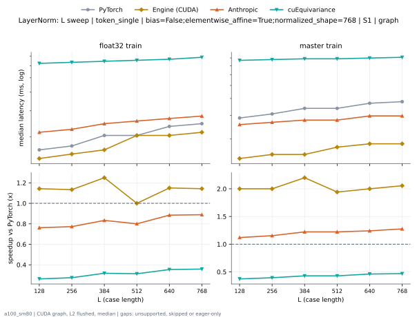

**float32 train** (median ms; x = speedup vs PyTorch)

| L | PyTorch | Engine (Triton) | Engine (CUDA) | Anthropic | cuEquivariance |
|---|---|---|---|---|---|
| 128 | 0.01638 | 0.02458 (0.67x) | 0.01434 (1.14x) | 0.0215 (0.76x) | 0.06246 (0.26x) |
| 256 | 0.01741 | 0.02458 (0.71x) | 0.01536 (1.13x) | 0.02253 (0.77x) | 0.06349 (0.27x) |
| 384 | 0.02048 | 0.02765 (0.74x) | 0.01638 (1.25x) | 0.02458 (0.83x) | 0.06451 (0.32x) |
| 512 | 0.02048 | 0.02867 (0.71x) | 0.02048 (1.00x) | 0.0256 (0.80x) | 0.06554 (0.31x) |
| 640 | 0.02355 | 0.02867 (0.82x) | 0.02048 (1.15x) | 0.02662 (0.88x) | 0.06656 (0.35x) |
| 768 | 0.02458 | 0.02867 (0.86x) | 0.0215 (1.14x) | 0.02765 (0.89x) | 0.06861 (0.36x) |

**master train** (median ms; x = speedup vs PyTorch)

| L | PyTorch | Engine (Triton) | Engine (CUDA) | Anthropic | cuEquivariance |
|---|---|---|---|---|---|
| 128 | 0.02867 | 0.0215 (1.33x) | 0.01434 (2.00x) | 0.0256 (1.12x) | 0.0768 (0.37x) |
| 256 | 0.03072 | 0.02662 (1.15x) | 0.01536 (2.00x) | 0.02662 (1.15x) | 0.07782 (0.39x) |
| 384 | 0.03379 | 0.0256 (1.32x) | 0.01536 (2.20x) | 0.02765 (1.22x) | 0.07885 (0.43x) |
| 512 | 0.03379 | 0.02867 (1.18x) | 0.01741 (1.94x) | 0.02765 (1.22x) | 0.07885 (0.43x) |
| 640 | 0.03686 | 0.03072 (1.20x) | 0.01843 (2.00x) | 0.0297 (1.24x) | 0.07987 (0.46x) |
| 768 | 0.03789 | 0.0297 (1.28x) | 0.01843 (2.06x) | 0.0297 (1.28x) | 0.0809 (0.47x) |

### L sweep: token_single | bias=False;elementwise_affine=True;normalized_shape=768 | S5 | graph

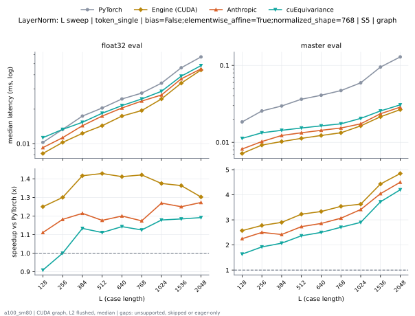

**float32 eval** (median ms; x = speedup vs PyTorch)

| L | PyTorch | Engine (Triton) | Engine (CUDA) | Anthropic | cuEquivariance |
|---|---|---|---|---|---|
| 128 | 0.01024 | 0.01331 (0.77x) | 0.008192 (1.25x) | 0.009216 (1.11x) | 0.01126 (0.91x) |
| 256 | 0.01331 | 0.01434 (0.93x) | 0.01024 (1.30x) | 0.01126 (1.18x) | 0.01331 (1.00x) |
| 384 | 0.01741 | 0.01536 (1.13x) | 0.01229 (1.42x) | 0.01434 (1.21x) | 0.01536 (1.13x) |
| 512 | 0.02048 | 0.01843 (1.11x) | 0.01434 (1.43x) | 0.01741 (1.18x) | 0.01843 (1.11x) |
| 640 | 0.02458 | 0.0215 (1.14x) | 0.01741 (1.41x) | 0.02048 (1.20x) | 0.0215 (1.14x) |
| 768 | 0.02765 | 0.02458 (1.12x) | 0.01946 (1.42x) | 0.02355 (1.17x) | 0.02458 (1.12x) |
| 1024 | 0.03379 | 0.04096 (0.83x) | 0.02458 (1.37x) | 0.02662 (1.27x) | 0.02867 (1.18x) |
| 1536 | 0.04608 | 0.05734 (0.80x) | 0.03379 (1.36x) | 0.03686 (1.25x) | 0.03891 (1.18x) |
| 2048 | 0.05734 | 0.07168 (0.80x) | 0.04403 (1.30x) | 0.04506 (1.27x) | 0.04813 (1.19x) |

**master eval** (median ms; x = speedup vs PyTorch)

| L | PyTorch | Engine (Triton) | Engine (CUDA) | Anthropic | cuEquivariance |
|---|---|---|---|---|---|
| 128 | 0.01843 | 0.01126 (1.64x) | 0.007168 (2.57x) | 0.008192 (2.25x) | 0.01126 (1.64x) |
| 256 | 0.0256 | 0.01229 (2.08x) | 0.009216 (2.78x) | 0.01024 (2.50x) | 0.01331 (1.92x) |
| 384 | 0.0297 | 0.01229 (2.42x) | 0.01024 (2.90x) | 0.01229 (2.42x) | 0.01434 (2.07x) |
| 512 | 0.03635 | 0.01434 (2.54x) | 0.01126 (3.23x) | 0.01331 (2.73x) | 0.01536 (2.37x) |
| 640 | 0.04096 | 0.01536 (2.67x) | 0.01229 (3.33x) | 0.01434 (2.86x) | 0.01638 (2.50x) |
| 768 | 0.0471 | 0.01638 (2.88x) | 0.01331 (3.54x) | 0.01536 (3.07x) | 0.01741 (2.71x) |
| 1024 | 0.05939 | 0.03277 (1.81x) | 0.01638 (3.63x) | 0.01741 (3.41x) | 0.02048 (2.90x) |
| 1536 | 0.09523 | 0.03584 (2.66x) | 0.0215 (4.43x) | 0.02355 (4.04x) | 0.0256 (3.72x) |
| 2048 | 0.129 | 0.03994 (3.23x) | 0.02662 (4.85x) | 0.02867 (4.50x) | 0.03072 (4.20x) |

### L sweep: token_single | bias=False;elementwise_affine=True;normalized_shape=831 | S1 | graph

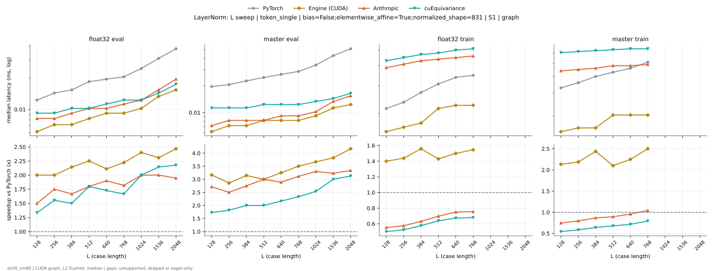

**float32 eval** (median ms; x = speedup vs PyTorch)

| L | PyTorch | Engine (Triton) | Engine (CUDA) | Anthropic | cuEquivariance |
|---|---|---|---|---|---|
| 128 | 0.01229 | 0.01126 (1.09x) | 0.006144 (2.00x) | 0.008192 (1.50x) | 0.009216 (1.33x) |
| 256 | 0.01434 | 0.01229 (1.17x) | 0.007168 (2.00x) | 0.008192 (1.75x) | 0.009216 (1.56x) |
| 384 | 0.01536 | 0.01229 (1.25x) | 0.007168 (2.14x) | 0.009216 (1.67x) | 0.01024 (1.50x) |
| 512 | 0.01843 | 0.01229 (1.50x) | 0.008192 (2.25x) | 0.01024 (1.80x) | 0.01024 (1.80x) |
| 640 | 0.01946 | 0.01331 (1.46x) | 0.009216 (2.11x) | 0.01024 (1.90x) | 0.01126 (1.73x) |
| 768 | 0.02048 | 0.01331 (1.54x) | 0.009216 (2.22x) | 0.01126 (1.82x) | 0.01229 (1.67x) |
| 1024 | 0.02458 | 0.06144 (0.40x) | 0.01024 (2.40x) | 0.01229 (2.00x) | 0.01229 (2.00x) |
| 1536 | 0.03072 | 0.06246 (0.49x) | 0.01331 (2.31x) | 0.01536 (2.00x) | 0.01434 (2.14x) |
| 2048 | 0.03789 | 0.06349 (0.60x) | 0.01536 (2.47x) | 0.01946 (1.95x) | 0.01741 (2.18x) |

**master eval** (median ms; x = speedup vs PyTorch)

| L | PyTorch | Engine (Triton) | Engine (CUDA) | Anthropic | cuEquivariance |
|---|---|---|---|---|---|
| 128 | 0.01946 | 0.01126 (1.73x) | 0.006144 (3.17x) | 0.007168 (2.71x) | 0.01126 (1.73x) |
| 256 | 0.02048 | 0.01229 (1.67x) | 0.007168 (2.86x) | 0.008192 (2.50x) | 0.01126 (1.82x) |
| 384 | 0.02253 | 0.01229 (1.83x) | 0.007168 (3.14x) | 0.008192 (2.75x) | 0.01126 (2.00x) |
| 512 | 0.02458 | 0.01229 (2.00x) | 0.008192 (3.00x) | 0.008192 (3.00x) | 0.01229 (2.00x) |
| 640 | 0.02662 | 0.01229 (2.17x) | 0.008192 (3.25x) | 0.009216 (2.89x) | 0.01229 (2.17x) |
| 768 | 0.02867 | 0.01229 (2.33x) | 0.008192 (3.50x) | 0.009216 (3.11x) | 0.01229 (2.33x) |
| 1024 | 0.03379 | 0.06246 (0.54x) | 0.009216 (3.67x) | 0.01024 (3.30x) | 0.01331 (2.54x) |
| 1536 | 0.04301 | 0.06349 (0.68x) | 0.01126 (3.82x) | 0.01331 (3.23x) | 0.01434 (3.00x) |
| 2048 | 0.0512 | 0.06349 (0.81x) | 0.01229 (4.17x) | 0.01536 (3.33x) | 0.01638 (3.12x) |

**float32 train** (median ms; x = speedup vs PyTorch)

| L | PyTorch | Engine (Triton) | Engine (CUDA) | Anthropic | cuEquivariance |
|---|---|---|---|---|---|
| 128 | 0.0215 | 0.02355 (0.91x) | 0.01536 (1.40x) | 0.03891 (0.55x) | 0.04301 (0.50x) |
| 256 | 0.02355 | 0.02662 (0.88x) | 0.01638 (1.44x) | 0.04096 (0.58x) | 0.04506 (0.52x) |
| 384 | 0.02714 | 0.02662 (1.02x) | 0.01741 (1.56x) | 0.04301 (0.63x) | 0.0471 (0.58x) |
| 512 | 0.03072 | 0.02765 (1.11x) | 0.0215 (1.43x) | 0.04403 (0.70x) | 0.04813 (0.64x) |
| 640 | 0.03379 | 0.03072 (1.10x) | 0.02253 (1.50x) | 0.04506 (0.75x) | 0.05018 (0.67x) |
| 768 | 0.03482 | 0.03584 (0.97x) | 0.02253 (1.55x) | 0.04608 (0.76x) | 0.0512 (0.68x) |
| 1024 |  |  |  |  |  |
| 1536 |  |  |  |  |  |
| 2048 |  |  |  |  |  |

**master train** (median ms; x = speedup vs PyTorch)

| L | PyTorch | Engine (Triton) | Engine (CUDA) | Anthropic | cuEquivariance |
|---|---|---|---|---|---|
| 128 | 0.03277 | 0.02355 (1.39x) | 0.01536 (2.13x) | 0.04403 (0.74x) | 0.06042 (0.54x) |
| 256 | 0.03584 | 0.02458 (1.46x) | 0.01638 (2.19x) | 0.04506 (0.80x) | 0.06144 (0.58x) |
| 384 | 0.03994 | 0.0256 (1.56x) | 0.01638 (2.44x) | 0.04608 (0.87x) | 0.06246 (0.64x) |
| 512 | 0.04301 | 0.02867 (1.50x) | 0.02048 (2.10x) | 0.04813 (0.89x) | 0.06349 (0.68x) |
| 640 | 0.04608 | 0.02867 (1.61x) | 0.02048 (2.25x) | 0.04813 (0.96x) | 0.06451 (0.71x) |
| 768 | 0.0512 | 0.03174 (1.61x) | 0.02048 (2.50x) | 0.04915 (1.04x) | 0.06451 (0.79x) |
| 1024 |  |  |  |  |  |
| 1536 |  |  |  |  |  |
| 2048 |  |  |  |  |  |

### L sweep: token_single | bias=False;elementwise_affine=True;normalized_shape=833 | S1 | graph

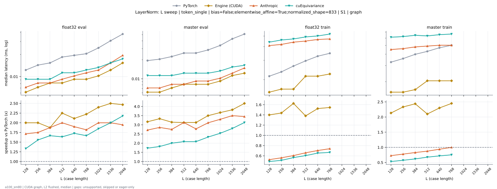

**float32 eval** (median ms; x = speedup vs PyTorch)

| L | PyTorch | Engine (Triton) | Engine (CUDA) | Anthropic | cuEquivariance |
|---|---|---|---|---|---|
| 128 | 0.01229 | 0.01229 (1.00x) | 0.006144 (2.00x) | 0.007168 (1.71x) | 0.009216 (1.33x) |
| 256 | 0.01434 | 0.01229 (1.17x) | 0.007168 (2.00x) | 0.008192 (1.75x) | 0.009216 (1.56x) |
| 384 | 0.01536 | 0.01229 (1.25x) | 0.008192 (1.87x) | 0.008192 (1.87x) | 0.009216 (1.67x) |
| 512 | 0.01843 | 0.01331 (1.38x) | 0.008192 (2.25x) | 0.009216 (2.00x) | 0.01126 (1.64x) |
| 640 | 0.01946 | 0.01331 (1.46x) | 0.009216 (2.11x) | 0.01024 (1.90x) | 0.01126 (1.73x) |
| 768 | 0.02048 | 0.01331 (1.54x) | 0.009216 (2.22x) | 0.01126 (1.82x) | 0.01229 (1.67x) |
| 1024 | 0.02458 | 0.06502 (0.38x) | 0.01024 (2.40x) | 0.01229 (2.00x) | 0.01331 (1.85x) |
| 1536 | 0.03072 | 0.06656 (0.46x) | 0.01229 (2.50x) | 0.01536 (2.00x) | 0.01536 (2.00x) |
| 2048 | 0.03789 | 0.06656 (0.57x) | 0.01536 (2.47x) | 0.01946 (1.95x) | 0.01741 (2.18x) |

**master eval** (median ms; x = speedup vs PyTorch)

| L | PyTorch | Engine (Triton) | Engine (CUDA) | Anthropic | cuEquivariance |
|---|---|---|---|---|---|
| 128 | 0.01946 | 0.01126 (1.73x) | 0.006144 (3.17x) | 0.007168 (2.71x) | 0.01126 (1.73x) |
| 256 | 0.02048 | 0.01229 (1.67x) | 0.006144 (3.33x) | 0.007168 (2.86x) | 0.01126 (1.82x) |
| 384 | 0.02253 | 0.01229 (1.83x) | 0.007168 (3.14x) | 0.008192 (2.75x) | 0.01126 (2.00x) |
| 512 | 0.0256 | 0.01229 (2.08x) | 0.008192 (3.12x) | 0.008192 (3.12x) | 0.01229 (2.08x) |
| 640 | 0.0256 | 0.01229 (2.08x) | 0.008192 (3.12x) | 0.009216 (2.78x) | 0.01229 (2.08x) |
| 768 | 0.02867 | 0.01229 (2.33x) | 0.008192 (3.50x) | 0.009216 (3.11x) | 0.01229 (2.33x) |
| 1024 | 0.03379 | 0.06554 (0.52x) | 0.009216 (3.67x) | 0.01024 (3.30x) | 0.01331 (2.54x) |
| 1536 | 0.04301 | 0.06605 (0.65x) | 0.01126 (3.82x) | 0.01229 (3.50x) | 0.01536 (2.80x) |
| 2048 | 0.0512 | 0.06656 (0.77x) | 0.01229 (4.17x) | 0.01485 (3.45x) | 0.01638 (3.12x) |

**float32 train** (median ms; x = speedup vs PyTorch)

| L | PyTorch | Engine (Triton) | Engine (CUDA) | Anthropic | cuEquivariance |
|---|---|---|---|---|---|
| 128 | 0.0215 | 0.02355 (0.91x) | 0.01536 (1.40x) | 0.04096 (0.53x) | 0.04403 (0.49x) |
| 256 | 0.02355 | 0.02458 (0.96x) | 0.01638 (1.44x) | 0.04198 (0.56x) | 0.04608 (0.51x) |
| 384 | 0.02662 | 0.0256 (1.04x) | 0.01638 (1.62x) | 0.04403 (0.60x) | 0.0471 (0.57x) |
| 512 | 0.0297 | 0.02765 (1.07x) | 0.0215 (1.38x) | 0.04506 (0.66x) | 0.04915 (0.60x) |
| 640 | 0.03277 | 0.0297 (1.10x) | 0.0215 (1.52x) | 0.04659 (0.70x) | 0.05018 (0.65x) |
| 768 | 0.03482 | 0.03379 (1.03x) | 0.02253 (1.55x) | 0.0471 (0.74x) | 0.05222 (0.67x) |
| 1024 |  |  |  |  |  |
| 1536 |  |  |  |  |  |
| 2048 |  |  |  |  |  |

**master train** (median ms; x = speedup vs PyTorch)

| L | PyTorch | Engine (Triton) | Engine (CUDA) | Anthropic | cuEquivariance |
|---|---|---|---|---|---|
| 128 | 0.03277 | 0.02355 (1.39x) | 0.01536 (2.13x) | 0.04506 (0.73x) | 0.06144 (0.53x) |
| 256 | 0.03584 | 0.02458 (1.46x) | 0.01536 (2.33x) | 0.04608 (0.78x) | 0.06246 (0.57x) |
| 384 | 0.03994 | 0.0256 (1.56x) | 0.01638 (2.44x) | 0.04813 (0.83x) | 0.06451 (0.62x) |
| 512 | 0.04301 | 0.02765 (1.56x) | 0.02048 (2.10x) | 0.04915 (0.87x) | 0.06349 (0.68x) |
| 640 | 0.0471 | 0.02867 (1.64x) | 0.02048 (2.30x) | 0.05018 (0.94x) | 0.06554 (0.72x) |
| 768 | 0.05018 | 0.03174 (1.58x) | 0.02048 (2.45x) | 0.05018 (1.00x) | 0.06656 (0.75x) |
| 1024 |  |  |  |  |  |
| 1536 |  |  |  |  |  |
| 2048 |  |  |  |  |  |

### L sweep: token_single | bias=True;elementwise_affine=True;normalized_shape=2560 | S1 | graph

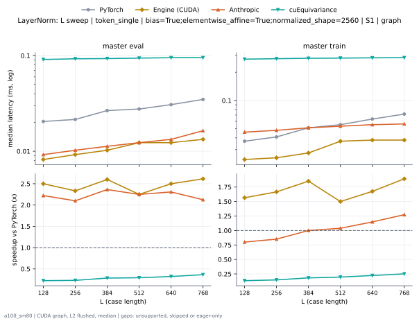

**master eval** (median ms; x = speedup vs PyTorch)

| L | PyTorch | Engine (Triton) | Engine (CUDA) | Anthropic | cuEquivariance |
|---|---|---|---|---|---|
| 128 | 0.02048 | 0.01638 (1.25x) | 0.008192 (2.50x) | 0.009216 (2.22x) | 0.09114 (0.22x) |
| 256 | 0.0215 | 0.01638 (1.31x) | 0.009216 (2.33x) | 0.01024 (2.10x) | 0.09267 (0.23x) |
| 384 | 0.02662 | 0.01638 (1.62x) | 0.01024 (2.60x) | 0.01126 (2.36x) | 0.09318 (0.29x) |
| 512 | 0.02765 | 0.0169 (1.64x) | 0.01229 (2.25x) | 0.01229 (2.25x) | 0.09421 (0.29x) |
| 640 | 0.03072 | 0.01741 (1.76x) | 0.01229 (2.50x) | 0.01331 (2.31x) | 0.09523 (0.32x) |
| 768 | 0.03482 | 0.01741 (2.00x) | 0.01331 (2.62x) | 0.01638 (2.13x) | 0.09523 (0.37x) |

**master train** (median ms; x = speedup vs PyTorch)

| L | PyTorch | Engine (Triton) | Engine (CUDA) | Anthropic | cuEquivariance |
|---|---|---|---|---|---|
| 128 | 0.03686 | 0.04096 (0.90x) | 0.02355 (1.57x) | 0.04608 (0.80x) | 0.2755 (0.13x) |
| 256 | 0.04096 | 0.04506 (0.91x) | 0.02458 (1.67x) | 0.04813 (0.85x) | 0.2785 (0.15x) |
| 384 | 0.0512 | 0.04608 (1.11x) | 0.02765 (1.85x) | 0.0512 (1.00x) | 0.2816 (0.18x) |
| 512 | 0.0553 | 0.0512 (1.08x) | 0.03686 (1.50x) | 0.05325 (1.04x) | 0.2826 (0.20x) |
| 640 | 0.06349 | 0.05222 (1.22x) | 0.03789 (1.68x) | 0.0553 (1.15x) | 0.2847 (0.22x) |
| 768 | 0.07168 | 0.05888 (1.22x) | 0.03789 (1.89x) | 0.05632 (1.27x) | 0.2857 (0.25x) |

### L sweep: token_single | bias=True;elementwise_affine=True;normalized_shape=384 | S1 | graph

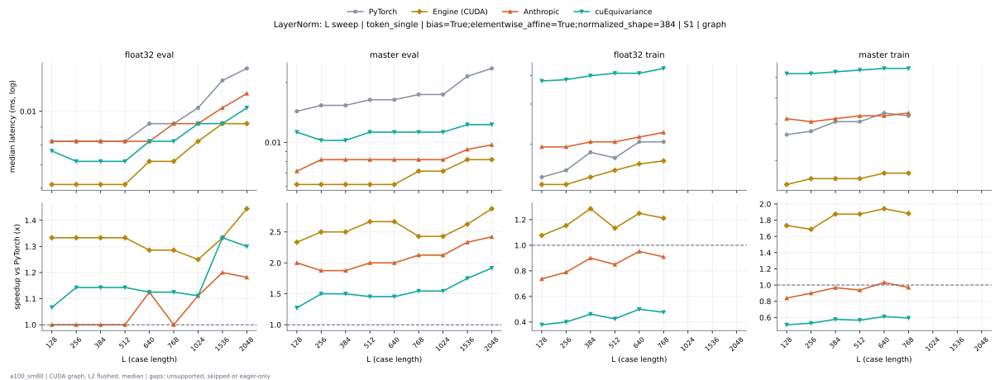

**float32 eval** (median ms; x = speedup vs PyTorch)

| L | PyTorch | Engine (Triton) | Engine (CUDA) | Anthropic | cuEquivariance |
|---|---|---|---|---|---|
| 128 | 0.008192 | 0.008192 (1.00x) | 0.006144 (1.33x) | 0.008192 (1.00x) | 0.00768 (1.07x) |
| 256 | 0.008192 | 0.007168 (1.14x) | 0.006144 (1.33x) | 0.008192 (1.00x) | 0.007168 (1.14x) |
| 384 | 0.008192 | 0.008192 (1.00x) | 0.006144 (1.33x) | 0.008192 (1.00x) | 0.007168 (1.14x) |
| 512 | 0.008192 | 0.00768 (1.07x) | 0.006144 (1.33x) | 0.008192 (1.00x) | 0.007168 (1.14x) |
| 640 | 0.009216 | 0.008192 (1.13x) | 0.007168 (1.29x) | 0.008192 (1.13x) | 0.008192 (1.13x) |
| 768 | 0.009216 | 0.008704 (1.06x) | 0.007168 (1.29x) | 0.009216 (1.00x) | 0.008192 (1.13x) |
| 1024 | 0.01024 | 0.01741 (0.59x) | 0.008192 (1.25x) | 0.009216 (1.11x) | 0.009216 (1.11x) |
| 1536 | 0.01229 | 0.01741 (0.71x) | 0.009216 (1.33x) | 0.01024 (1.20x) | 0.009216 (1.33x) |
| 2048 | 0.01331 | 0.01741 (0.76x) | 0.009216 (1.44x) | 0.01126 (1.18x) | 0.01024 (1.30x) |

**master eval** (median ms; x = speedup vs PyTorch)

| L | PyTorch | Engine (Triton) | Engine (CUDA) | Anthropic | cuEquivariance |
|---|---|---|---|---|---|
| 128 | 0.01434 | 0.007168 (2.00x) | 0.006144 (2.33x) | 0.007168 (2.00x) | 0.01126 (1.27x) |
| 256 | 0.01536 | 0.007168 (2.14x) | 0.006144 (2.50x) | 0.008192 (1.87x) | 0.01024 (1.50x) |
| 384 | 0.01536 | 0.007168 (2.14x) | 0.006144 (2.50x) | 0.008192 (1.87x) | 0.01024 (1.50x) |
| 512 | 0.01638 | 0.007168 (2.29x) | 0.006144 (2.67x) | 0.008192 (2.00x) | 0.01126 (1.45x) |
| 640 | 0.01638 | 0.007168 (2.29x) | 0.006144 (2.67x) | 0.008192 (2.00x) | 0.01126 (1.45x) |
| 768 | 0.01741 | 0.007168 (2.43x) | 0.007168 (2.43x) | 0.008192 (2.13x) | 0.01126 (1.55x) |
| 1024 | 0.01741 | 0.01638 (1.06x) | 0.007168 (2.43x) | 0.008192 (2.13x) | 0.01126 (1.55x) |
| 1536 | 0.0215 | 0.01638 (1.31x) | 0.008192 (2.62x) | 0.009216 (2.33x) | 0.01229 (1.75x) |
| 2048 | 0.02355 | 0.01638 (1.44x) | 0.008192 (2.88x) | 0.009728 (2.42x) | 0.01229 (1.92x) |

**float32 train** (median ms; x = speedup vs PyTorch)

| L | PyTorch | Engine (Triton) | Engine (CUDA) | Anthropic | cuEquivariance |
|---|---|---|---|---|---|
| 128 | 0.01434 | 0.01638 (0.88x) | 0.01331 (1.08x) | 0.01946 (0.74x) | 0.03789 (0.38x) |
| 256 | 0.01536 | 0.01536 (1.00x) | 0.01331 (1.15x) | 0.01946 (0.79x) | 0.0384 (0.40x) |
| 384 | 0.01843 | 0.01741 (1.06x) | 0.01434 (1.29x) | 0.02048 (0.90x) | 0.03994 (0.46x) |
| 512 | 0.01741 | 0.01741 (1.00x) | 0.01536 (1.13x) | 0.02048 (0.85x) | 0.04096 (0.43x) |
| 640 | 0.02048 | 0.01843 (1.11x) | 0.01638 (1.25x) | 0.0215 (0.95x) | 0.04096 (0.50x) |
| 768 | 0.02048 | 0.01946 (1.05x) | 0.0169 (1.21x) | 0.02253 (0.91x) | 0.04301 (0.48x) |
| 1024 |  |  |  |  |  |
| 1536 |  |  |  |  |  |
| 2048 |  |  |  |  |  |

**master train** (median ms; x = speedup vs PyTorch)

| L | PyTorch | Engine (Triton) | Engine (CUDA) | Anthropic | cuEquivariance |
|---|---|---|---|---|---|
| 128 | 0.02662 | 0.01536 (1.73x) | 0.01536 (1.73x) | 0.03174 (0.84x) | 0.05222 (0.51x) |
| 256 | 0.02765 | 0.01741 (1.59x) | 0.01638 (1.69x) | 0.03072 (0.90x) | 0.05222 (0.53x) |
| 384 | 0.03072 | 0.01843 (1.67x) | 0.01638 (1.87x) | 0.03174 (0.97x) | 0.05325 (0.58x) |
| 512 | 0.03072 | 0.01946 (1.58x) | 0.01638 (1.87x) | 0.03277 (0.94x) | 0.05427 (0.57x) |
| 640 | 0.03379 | 0.01843 (1.83x) | 0.01741 (1.94x) | 0.03277 (1.03x) | 0.0553 (0.61x) |
| 768 | 0.03277 | 0.01946 (1.68x) | 0.01741 (1.88x) | 0.03379 (0.97x) | 0.0553 (0.59x) |
| 1024 |  |  |  |  |  |
| 1536 |  |  |  |  |  |
| 2048 |  |  |  |  |  |

### L sweep: token_single | bias=True;elementwise_affine=True;normalized_shape=451 | S1 | graph

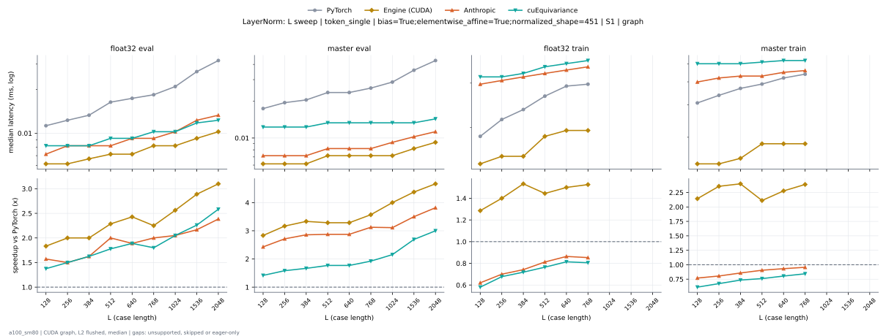

**float32 eval** (median ms; x = speedup vs PyTorch)

| L | PyTorch | Engine (Triton) | Engine (CUDA) | Anthropic | cuEquivariance |
|---|---|---|---|---|---|
| 128 | 0.01126 | 0.008192 (1.38x) | 0.006144 (1.83x) | 0.007168 (1.57x) | 0.008192 (1.38x) |
| 256 | 0.01229 | 0.008192 (1.50x) | 0.006144 (2.00x) | 0.008192 (1.50x) | 0.008192 (1.50x) |
| 384 | 0.01331 | 0.008192 (1.62x) | 0.006656 (2.00x) | 0.008192 (1.62x) | 0.008192 (1.62x) |
| 512 | 0.01638 | 0.01024 (1.60x) | 0.007168 (2.29x) | 0.008192 (2.00x) | 0.009216 (1.78x) |
| 640 | 0.01741 | 0.009216 (1.89x) | 0.007168 (2.43x) | 0.009216 (1.89x) | 0.009216 (1.89x) |
| 768 | 0.01843 | 0.009216 (2.00x) | 0.008192 (2.25x) | 0.009216 (2.00x) | 0.01024 (1.80x) |
| 1024 | 0.02099 | 0.03891 (0.54x) | 0.008192 (2.56x) | 0.01024 (2.05x) | 0.01024 (2.05x) |
| 1536 | 0.02662 | 0.03891 (0.68x) | 0.009216 (2.89x) | 0.01229 (2.17x) | 0.01178 (2.26x) |
| 2048 | 0.03174 | 0.03891 (0.82x) | 0.01024 (3.10x) | 0.01331 (2.38x) | 0.01229 (2.58x) |

**master eval** (median ms; x = speedup vs PyTorch)

| L | PyTorch | Engine (Triton) | Engine (CUDA) | Anthropic | cuEquivariance |
|---|---|---|---|---|---|
| 128 | 0.01741 | 0.008192 (2.13x) | 0.006144 (2.83x) | 0.007168 (2.43x) | 0.01229 (1.42x) |
| 256 | 0.01946 | 0.008192 (2.37x) | 0.006144 (3.17x) | 0.007168 (2.71x) | 0.01229 (1.58x) |
| 384 | 0.02048 | 0.008192 (2.50x) | 0.006144 (3.33x) | 0.007168 (2.86x) | 0.01229 (1.67x) |
| 512 | 0.02355 | 0.008192 (2.88x) | 0.007168 (3.29x) | 0.008192 (2.88x) | 0.01331 (1.77x) |
| 640 | 0.02355 | 0.008192 (2.88x) | 0.007168 (3.29x) | 0.008192 (2.88x) | 0.01331 (1.77x) |
| 768 | 0.0256 | 0.009216 (2.78x) | 0.007168 (3.57x) | 0.008192 (3.12x) | 0.01331 (1.92x) |
| 1024 | 0.02867 | 0.03891 (0.74x) | 0.007168 (4.00x) | 0.009216 (3.11x) | 0.01331 (2.15x) |
| 1536 | 0.03584 | 0.03891 (0.92x) | 0.008192 (4.38x) | 0.01024 (3.50x) | 0.01331 (2.69x) |
| 2048 | 0.04301 | 0.03891 (1.11x) | 0.009216 (4.67x) | 0.01126 (3.82x) | 0.01434 (3.00x) |

**float32 train** (median ms; x = speedup vs PyTorch)

| L | PyTorch | Engine (Triton) | Engine (CUDA) | Anthropic | cuEquivariance |
|---|---|---|---|---|---|
| 128 | 0.01843 | 0.01741 (1.06x) | 0.01434 (1.29x) | 0.0297 (0.62x) | 0.03174 (0.58x) |
| 256 | 0.0215 | 0.01843 (1.17x) | 0.01536 (1.40x) | 0.03072 (0.70x) | 0.03174 (0.68x) |
| 384 | 0.02355 | 0.02253 (1.05x) | 0.01536 (1.53x) | 0.03174 (0.74x) | 0.03277 (0.72x) |
| 512 | 0.02662 | 0.0215 (1.24x) | 0.01843 (1.44x) | 0.03277 (0.81x) | 0.03482 (0.76x) |
| 640 | 0.02918 | 0.02253 (1.30x) | 0.01946 (1.50x) | 0.03379 (0.86x) | 0.03584 (0.81x) |
| 768 | 0.0297 | 0.02355 (1.26x) | 0.01946 (1.53x) | 0.03482 (0.85x) | 0.03686 (0.81x) |
| 1024 |  |  |  |  |  |
| 1536 |  |  |  |  |  |
| 2048 |  |  |  |  |  |

**master train** (median ms; x = speedup vs PyTorch)

| L | PyTorch | Engine (Triton) | Engine (CUDA) | Anthropic | cuEquivariance |
|---|---|---|---|---|---|
| 128 | 0.03072 | 0.01741 (1.76x) | 0.01434 (2.14x) | 0.03994 (0.77x) | 0.05018 (0.61x) |
| 256 | 0.03379 | 0.01946 (1.74x) | 0.01434 (2.36x) | 0.04198 (0.80x) | 0.05018 (0.67x) |
| 384 | 0.03686 | 0.01843 (2.00x) | 0.01536 (2.40x) | 0.04301 (0.86x) | 0.05018 (0.73x) |
| 512 | 0.03891 | 0.02355 (1.65x) | 0.01843 (2.11x) | 0.04301 (0.90x) | 0.0512 (0.76x) |
| 640 | 0.04198 | 0.02253 (1.86x) | 0.01843 (2.28x) | 0.04506 (0.93x) | 0.05222 (0.80x) |
| 768 | 0.04403 | 0.02458 (1.79x) | 0.01843 (2.39x) | 0.04608 (0.96x) | 0.05222 (0.84x) |
| 1024 |  |  |  |  |  |
| 1536 |  |  |  |  |  |
| 2048 |  |  |  |  |  |

### L sweep: token_single | bias=True;elementwise_affine=True;normalized_shape=768 | S1 | graph

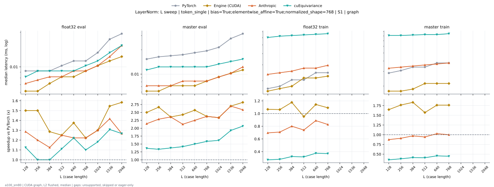

**float32 eval** (median ms; x = speedup vs PyTorch)

| L | PyTorch | Engine (Triton) | Engine (CUDA) | Anthropic | cuEquivariance |
|---|---|---|---|---|---|
| 128 | 0.009216 | 0.01024 (0.90x) | 0.006144 (1.50x) | 0.007168 (1.29x) | 0.008192 (1.13x) |
| 256 | 0.009216 | 0.01126 (0.82x) | 0.006144 (1.50x) | 0.00768 (1.20x) | 0.009216 (1.00x) |
| 384 | 0.009216 | 0.01126 (0.82x) | 0.007168 (1.29x) | 0.008192 (1.13x) | 0.009216 (1.00x) |
| 512 | 0.01024 | 0.01126 (0.91x) | 0.008192 (1.25x) | 0.008192 (1.25x) | 0.009216 (1.11x) |
| 640 | 0.01126 | 0.01229 (0.92x) | 0.008192 (1.38x) | 0.009216 (1.22x) | 0.009216 (1.22x) |
| 768 | 0.01126 | 0.01229 (0.92x) | 0.009216 (1.22x) | 0.009216 (1.22x) | 0.01024 (1.10x) |
| 1024 | 0.01331 | 0.01229 (1.08x) | 0.01024 (1.30x) | 0.01024 (1.30x) | 0.01126 (1.18x) |
| 1536 | 0.01741 | 0.01434 (1.21x) | 0.01126 (1.55x) | 0.01229 (1.42x) | 0.01331 (1.31x) |
| 2048 | 0.01946 | 0.01536 (1.27x) | 0.01229 (1.58x) | 0.01536 (1.27x) | 0.01536 (1.27x) |

**master eval** (median ms; x = speedup vs PyTorch)

| L | PyTorch | Engine (Triton) | Engine (CUDA) | Anthropic | cuEquivariance |
|---|---|---|---|---|---|
| 128 | 0.01536 | 0.009216 (1.67x) | 0.006144 (2.50x) | 0.007168 (2.14x) | 0.01126 (1.36x) |
| 256 | 0.01638 | 0.01024 (1.60x) | 0.006144 (2.67x) | 0.007168 (2.29x) | 0.01229 (1.33x) |
| 384 | 0.0169 | 0.01024 (1.65x) | 0.007168 (2.36x) | 0.007168 (2.36x) | 0.01229 (1.37x) |
| 512 | 0.01741 | 0.01024 (1.70x) | 0.007168 (2.43x) | 0.008192 (2.13x) | 0.01229 (1.42x) |
| 640 | 0.01843 | 0.01024 (1.80x) | 0.007168 (2.57x) | 0.008192 (2.25x) | 0.01229 (1.50x) |
| 768 | 0.01946 | 0.01024 (1.90x) | 0.008192 (2.37x) | 0.008192 (2.37x) | 0.01229 (1.58x) |
| 1024 | 0.0215 | 0.01024 (2.10x) | 0.009216 (2.33x) | 0.009216 (2.33x) | 0.01331 (1.62x) |
| 1536 | 0.02765 | 0.01126 (2.45x) | 0.01024 (2.70x) | 0.01024 (2.70x) | 0.01434 (1.93x) |
| 2048 | 0.03174 | 0.01229 (2.58x) | 0.01126 (2.82x) | 0.01229 (2.58x) | 0.01536 (2.07x) |

**float32 train** (median ms; x = speedup vs PyTorch)

| L | PyTorch | Engine (Triton) | Engine (CUDA) | Anthropic | cuEquivariance |
|---|---|---|---|---|---|
| 128 | 0.01638 | 0.02355 (0.70x) | 0.01536 (1.07x) | 0.02355 (0.70x) | 0.06042 (0.27x) |
| 256 | 0.01741 | 0.02509 (0.69x) | 0.01638 (1.06x) | 0.02458 (0.71x) | 0.06246 (0.28x) |
| 384 | 0.02048 | 0.02662 (0.77x) | 0.01741 (1.18x) | 0.0256 (0.80x) | 0.06349 (0.32x) |
| 512 | 0.02048 | 0.02765 (0.74x) | 0.0215 (0.95x) | 0.02765 (0.74x) | 0.06451 (0.32x) |
| 640 | 0.02458 | 0.02765 (0.89x) | 0.0215 (1.14x) | 0.02765 (0.89x) | 0.06554 (0.38x) |
| 768 | 0.02458 | 0.02765 (0.89x) | 0.02253 (1.09x) | 0.0297 (0.83x) | 0.06656 (0.37x) |
| 1024 |  |  |  |  |  |
| 1536 |  |  |  |  |  |
| 2048 |  |  |  |  |  |

**master train** (median ms; x = speedup vs PyTorch)

| L | PyTorch | Engine (Triton) | Engine (CUDA) | Anthropic | cuEquivariance |
|---|---|---|---|---|---|
| 128 | 0.02867 | 0.01946 (1.47x) | 0.01741 (1.65x) | 0.03277 (0.88x) | 0.0809 (0.35x) |
| 256 | 0.03072 | 0.02662 (1.15x) | 0.01741 (1.76x) | 0.03379 (0.91x) | 0.0809 (0.38x) |
| 384 | 0.03379 | 0.02662 (1.27x) | 0.01843 (1.83x) | 0.03482 (0.97x) | 0.08192 (0.41x) |
| 512 | 0.03379 | 0.02867 (1.18x) | 0.0215 (1.57x) | 0.03584 (0.94x) | 0.08294 (0.41x) |
| 640 | 0.03789 | 0.02765 (1.37x) | 0.0215 (1.76x) | 0.03686 (1.03x) | 0.08294 (0.46x) |
| 768 | 0.03789 | 0.02867 (1.32x) | 0.0215 (1.76x) | 0.03789 (1.00x) | 0.08499 (0.45x) |
| 1024 |  |  |  |  |  |
| 1536 |  |  |  |  |  |
| 2048 |  |  |  |  |  |

### L sweep: token_single | bias=True;elementwise_affine=True;normalized_shape=833 | S1 | graph

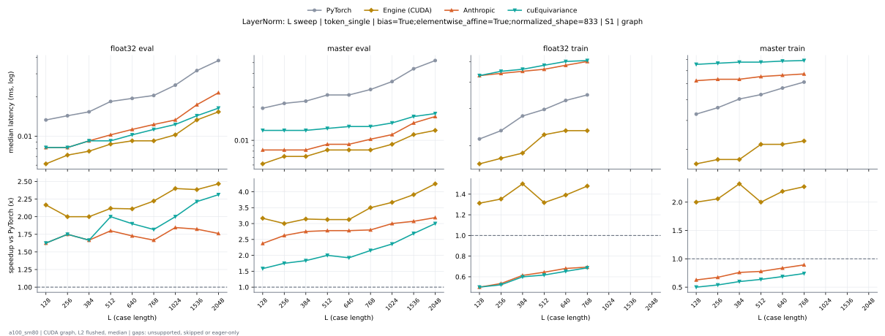

**float32 eval** (median ms; x = speedup vs PyTorch)

| L | PyTorch | Engine (Triton) | Engine (CUDA) | Anthropic | cuEquivariance |
|---|---|---|---|---|---|
| 128 | 0.01331 | 0.01126 (1.18x) | 0.006144 (2.17x) | 0.008192 (1.62x) | 0.008192 (1.62x) |
| 256 | 0.01434 | 0.01126 (1.27x) | 0.007168 (2.00x) | 0.008192 (1.75x) | 0.008192 (1.75x) |
| 384 | 0.01536 | 0.01126 (1.36x) | 0.00768 (2.00x) | 0.009216 (1.67x) | 0.009216 (1.67x) |
| 512 | 0.01843 | 0.01126 (1.64x) | 0.008704 (2.12x) | 0.01024 (1.80x) | 0.009216 (2.00x) |
| 640 | 0.01946 | 0.01229 (1.58x) | 0.009216 (2.11x) | 0.01126 (1.73x) | 0.01024 (1.90x) |
| 768 | 0.02048 | 0.01229 (1.67x) | 0.009216 (2.22x) | 0.01229 (1.67x) | 0.01126 (1.82x) |
| 1024 | 0.02458 | 0.06554 (0.38x) | 0.01024 (2.40x) | 0.01331 (1.85x) | 0.01229 (2.00x) |
| 1536 | 0.03174 | 0.06554 (0.48x) | 0.01331 (2.38x) | 0.01741 (1.82x) | 0.01434 (2.21x) |
| 2048 | 0.03789 | 0.06656 (0.57x) | 0.01536 (2.47x) | 0.0215 (1.76x) | 0.01638 (2.31x) |

**master eval** (median ms; x = speedup vs PyTorch)

| L | PyTorch | Engine (Triton) | Engine (CUDA) | Anthropic | cuEquivariance |
|---|---|---|---|---|---|
| 128 | 0.01946 | 0.01024 (1.90x) | 0.006144 (3.17x) | 0.008192 (2.37x) | 0.01229 (1.58x) |
| 256 | 0.0215 | 0.01024 (2.10x) | 0.007168 (3.00x) | 0.008192 (2.62x) | 0.01229 (1.75x) |
| 384 | 0.02253 | 0.01126 (2.00x) | 0.007168 (3.14x) | 0.008192 (2.75x) | 0.01229 (1.83x) |
| 512 | 0.0256 | 0.01126 (2.27x) | 0.008192 (3.12x) | 0.009216 (2.78x) | 0.0128 (2.00x) |
| 640 | 0.0256 | 0.01126 (2.27x) | 0.008192 (3.12x) | 0.009216 (2.78x) | 0.01331 (1.92x) |
| 768 | 0.02867 | 0.01126 (2.55x) | 0.008192 (3.50x) | 0.01024 (2.80x) | 0.01331 (2.15x) |
| 1024 | 0.03379 | 0.06554 (0.52x) | 0.009216 (3.67x) | 0.01126 (3.00x) | 0.01434 (2.36x) |
| 1536 | 0.04403 | 0.06656 (0.66x) | 0.01126 (3.91x) | 0.01434 (3.07x) | 0.01638 (2.69x) |
| 2048 | 0.05222 | 0.06656 (0.78x) | 0.01229 (4.25x) | 0.01638 (3.19x) | 0.01741 (3.00x) |

**float32 train** (median ms; x = speedup vs PyTorch)

| L | PyTorch | Engine (Triton) | Engine (CUDA) | Anthropic | cuEquivariance |
|---|---|---|---|---|---|
| 128 | 0.0215 | 0.02253 (0.95x) | 0.01638 (1.31x) | 0.04301 (0.50x) | 0.04301 (0.50x) |
| 256 | 0.02355 | 0.02355 (1.00x) | 0.01741 (1.35x) | 0.04403 (0.53x) | 0.04506 (0.52x) |
| 384 | 0.02765 | 0.02458 (1.12x) | 0.01843 (1.50x) | 0.04506 (0.61x) | 0.04608 (0.60x) |
| 512 | 0.0297 | 0.02662 (1.12x) | 0.02253 (1.32x) | 0.04608 (0.64x) | 0.04813 (0.62x) |
| 640 | 0.03277 | 0.0297 (1.10x) | 0.02355 (1.39x) | 0.04813 (0.68x) | 0.05018 (0.65x) |
| 768 | 0.03482 | 0.03482 (1.00x) | 0.02355 (1.48x) | 0.05018 (0.69x) | 0.05069 (0.69x) |
| 1024 |  |  |  |  |  |
| 1536 |  |  |  |  |  |
| 2048 |  |  |  |  |  |

**master train** (median ms; x = speedup vs PyTorch)

| L | PyTorch | Engine (Triton) | Engine (CUDA) | Anthropic | cuEquivariance |
|---|---|---|---|---|---|
| 128 | 0.03277 | 0.02253 (1.45x) | 0.01638 (2.00x) | 0.05222 (0.63x) | 0.06554 (0.50x) |
| 256 | 0.03584 | 0.02458 (1.46x) | 0.01741 (2.06x) | 0.05325 (0.67x) | 0.06656 (0.54x) |
| 384 | 0.04045 | 0.02458 (1.65x) | 0.01741 (2.32x) | 0.05325 (0.76x) | 0.06758 (0.60x) |
| 512 | 0.04301 | 0.02662 (1.62x) | 0.0215 (2.00x) | 0.0553 (0.78x) | 0.06758 (0.64x) |
| 640 | 0.0471 | 0.02765 (1.70x) | 0.0215 (2.19x) | 0.05632 (0.84x) | 0.06861 (0.69x) |
| 768 | 0.0512 | 0.03277 (1.56x) | 0.02253 (2.27x) | 0.05734 (0.89x) | 0.06912 (0.74x) |
| 1024 |  |  |  |  |  |
| 1536 |  |  |  |  |  |
| 2048 |  |  |  |  |  |

### normalized_shape sweep at L768: token_pair | bias=False;elementwise_affine=True | S1 | graph

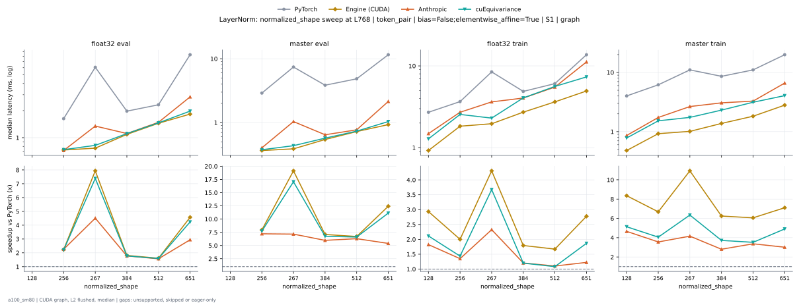

**float32 eval** (median ms; x = speedup vs PyTorch)

| normalized_shape | PyTorch | Engine (Triton) | Engine (CUDA) | Anthropic | cuEquivariance |
|---|---|---|---|---|---|
| 128 |  |  |  |  |  |
| 256 | 1.628 | 0.7357 (2.21x) | 0.7291 (2.23x) | 0.7199 (2.26x) | 0.7363 (2.21x) |
| 267 | 6.063 | 0.7936 (7.64x) | 0.7644 (7.93x) | 1.346 (4.51x) | 0.8212 (7.38x) |
| 384 | 1.973 | 1.111 (1.78x) | 1.089 (1.81x) | 1.112 (1.77x) | 1.11 (1.78x) |
| 512 | 2.322 | 1.457 (1.59x) | 1.447 (1.61x) | 1.482 (1.57x) | 1.461 (1.59x) |
| 651 | 8.361 | 2.142 (3.90x) | 1.829 (4.57x) | 2.841 (2.94x) | 1.973 (4.24x) |

**master eval** (median ms; x = speedup vs PyTorch)

| normalized_shape | PyTorch | Engine (Triton) | Engine (CUDA) | Anthropic | cuEquivariance |
|---|---|---|---|---|---|
| 128 |  |  |  |  |  |
| 256 | 2.903 | 0.3738 (7.77x) | 0.3656 (7.94x) | 0.4024 (7.21x) | 0.3758 (7.72x) |
| 267 | 7.422 | 0.5064 (14.66x) | 0.3881 (19.13x) | 1.037 (7.16x) | 0.4352 (17.06x) |
| 384 | 3.853 | 0.5632 (6.84x) | 0.5437 (7.09x) | 0.6451 (5.97x) | 0.5709 (6.75x) |
| 512 | 4.852 | 0.7352 (6.60x) | 0.724 (6.70x) | 0.7711 (6.29x) | 0.7352 (6.60x) |
| 651 | 11.57 | 1.2 (9.64x) | 0.9308 (12.43x) | 2.145 (5.39x) | 1.039 (11.14x) |

**float32 train** (median ms; x = speedup vs PyTorch)

| normalized_shape | PyTorch | Engine (Triton) | Engine (CUDA) | Anthropic | cuEquivariance |
|---|---|---|---|---|---|
| 128 | 2.71 | 0.9385 (2.89x) | 0.9236 (2.93x) | 1.487 (1.82x) | 1.282 (2.11x) |
| 256 | 3.662 | 1.875 (1.95x) | 1.831 (2.00x) | 2.712 (1.35x) | 2.55 (1.44x) |
| 267 | 8.445 | 2.421 (3.49x) | 1.962 (4.30x) | 3.632 (2.33x) | 2.299 (3.67x) |
| 384 | 4.877 | 2.814 (1.73x) | 2.72 (1.79x) | 4.046 (1.21x) | 4.063 (1.20x) |
| 512 | 6.074 | 3.765 (1.61x) | 3.633 (1.67x) | 5.507 (1.10x) | 5.612 (1.08x) |
| 651 | 13.7 | 6.924 (1.98x) | 4.935 (2.78x) | 11.18 (1.22x) | 7.336 (1.87x) |

**master train** (median ms; x = speedup vs PyTorch)

| normalized_shape | PyTorch | Engine (Triton) | Engine (CUDA) | Anthropic | cuEquivariance |
|---|---|---|---|---|---|
| 128 | 4.01 | 0.4925 (8.14x) | 0.4803 (8.35x) | 0.8612 (4.66x) | 0.7813 (5.13x) |
| 256 | 6.178 | 0.9697 (6.37x) | 0.9247 (6.68x) | 1.736 (3.56x) | 1.523 (4.06x) |
| 267 | 11.04 | 1.544 (7.15x) | 1.011 (10.93x) | 2.655 (4.16x) | 1.74 (6.35x) |
| 384 | 8.591 | 1.816 (4.73x) | 1.376 (6.24x) | 3.065 (2.80x) | 2.311 (3.72x) |
| 512 | 11.04 | 2.451 (4.50x) | 1.822 (6.06x) | 3.28 (3.37x) | 3.138 (3.52x) |
| 651 | 19.91 | 4.791 (4.16x) | 2.803 (7.10x) | 6.611 (3.01x) | 4.059 (4.91x) |

### normalized_shape sweep at L2048: token_pair | bias=True;elementwise_affine=True | S1 | graph

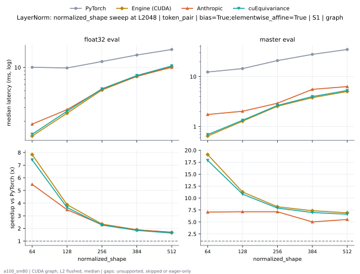

**float32 eval** (median ms; x = speedup vs PyTorch)

| normalized_shape | PyTorch | Engine (Triton) | Engine (CUDA) | Anthropic | cuEquivariance |
|---|---|---|---|---|---|
| 64 | 10.04 | 1.348 (7.45x) | 1.281 (7.84x) | 1.831 (5.48x) | 1.354 (7.42x) |
| 128 | 9.849 | 2.629 (3.75x) | 2.538 (3.88x) | 2.827 (3.48x) | 2.695 (3.65x) |
| 256 | 11.94 | 5.255 (2.27x) | 5.091 (2.35x) | 5.199 (2.30x) | 5.267 (2.27x) |
| 384 | 14.51 | 7.839 (1.85x) | 7.654 (1.90x) | 7.686 (1.89x) | 7.846 (1.85x) |
| 512 | 17.12 | 10.45 (1.64x) | 10.22 (1.67x) | 10.05 (1.70x) | 10.47 (1.64x) |

**master eval** (median ms; x = speedup vs PyTorch)

| normalized_shape | PyTorch | Engine (Triton) | Engine (CUDA) | Anthropic | cuEquivariance |
|---|---|---|---|---|---|
| 64 | 12.34 | 0.6871 (17.96x) | 0.6461 (19.10x) | 1.746 (7.07x) | 0.6902 (17.88x) |
| 128 | 14.46 | 1.336 (10.82x) | 1.282 (11.28x) | 2.024 (7.14x) | 1.336 (10.82x) |
| 256 | 20.91 | 2.665 (7.84x) | 2.554 (8.18x) | 2.931 (7.13x) | 2.643 (7.91x) |
| 384 | 27.86 | 3.914 (7.12x) | 3.787 (7.36x) | 5.552 (5.02x) | 3.988 (6.98x) |
| 512 | 34.86 | 5.297 (6.58x) | 5.036 (6.92x) | 6.311 (5.52x) | 5.263 (6.62x) |

### normalized_shape sweep at L768: token_single | bias=False;elementwise_affine=True | S1 | graph

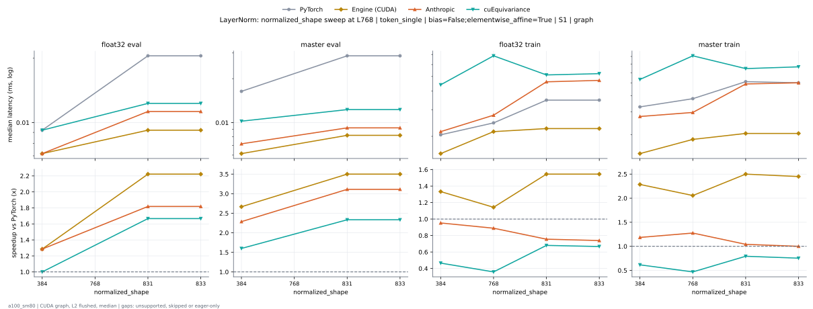

**float32 eval** (median ms; x = speedup vs PyTorch)

| normalized_shape | PyTorch | Engine (Triton) | Engine (CUDA) | Anthropic | cuEquivariance |
|---|---|---|---|---|---|
| 384 | 0.009216 | 0.01024 (0.90x) | 0.007168 (1.29x) | 0.007168 (1.29x) | 0.009216 (1.00x) |
| 768 |  |  |  |  |  |
| 831 | 0.02048 | 0.01331 (1.54x) | 0.009216 (2.22x) | 0.01126 (1.82x) | 0.01229 (1.67x) |
| 833 | 0.02048 | 0.01331 (1.54x) | 0.009216 (2.22x) | 0.01126 (1.82x) | 0.01229 (1.67x) |

**master eval** (median ms; x = speedup vs PyTorch)

| normalized_shape | PyTorch | Engine (Triton) | Engine (CUDA) | Anthropic | cuEquivariance |
|---|---|---|---|---|---|
| 384 | 0.01638 | 0.008192 (2.00x) | 0.006144 (2.67x) | 0.007168 (2.29x) | 0.01024 (1.60x) |
| 768 |  |  |  |  |  |
| 831 | 0.02867 | 0.01229 (2.33x) | 0.008192 (3.50x) | 0.009216 (3.11x) | 0.01229 (2.33x) |
| 833 | 0.02867 | 0.01229 (2.33x) | 0.008192 (3.50x) | 0.009216 (3.11x) | 0.01229 (2.33x) |

**float32 train** (median ms; x = speedup vs PyTorch)

| normalized_shape | PyTorch | Engine (Triton) | Engine (CUDA) | Anthropic | cuEquivariance |
|---|---|---|---|---|---|
| 384 | 0.02048 | 0.02048 (1.00x) | 0.01536 (1.33x) | 0.0215 (0.95x) | 0.04403 (0.47x) |
| 768 | 0.02458 | 0.02867 (0.86x) | 0.0215 (1.14x) | 0.02765 (0.89x) | 0.06861 (0.36x) |
| 831 | 0.03482 | 0.03584 (0.97x) | 0.02253 (1.55x) | 0.04608 (0.76x) | 0.0512 (0.68x) |
| 833 | 0.03482 | 0.03379 (1.03x) | 0.02253 (1.55x) | 0.0471 (0.74x) | 0.05222 (0.67x) |

**master train** (median ms; x = speedup vs PyTorch)

| normalized_shape | PyTorch | Engine (Triton) | Engine (CUDA) | Anthropic | cuEquivariance |
|---|---|---|---|---|---|
| 384 | 0.03277 | 0.02048 (1.60x) | 0.01434 (2.29x) | 0.02765 (1.19x) | 0.05325 (0.62x) |
| 768 | 0.03789 | 0.0297 (1.28x) | 0.01843 (2.06x) | 0.0297 (1.28x) | 0.0809 (0.47x) |
| 831 | 0.0512 | 0.03174 (1.61x) | 0.02048 (2.50x) | 0.04915 (1.04x) | 0.06451 (0.79x) |
| 833 | 0.05018 | 0.03174 (1.58x) | 0.02048 (2.45x) | 0.05018 (1.00x) | 0.06656 (0.75x) |

### normalized_shape sweep at L768: token_single | bias=True;elementwise_affine=True | S1 | graph

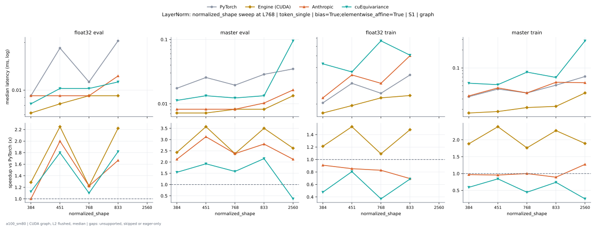

**float32 eval** (median ms; x = speedup vs PyTorch)

| normalized_shape | PyTorch | Engine (Triton) | Engine (CUDA) | Anthropic | cuEquivariance |
|---|---|---|---|---|---|
| 384 | 0.009216 | 0.008704 (1.06x) | 0.007168 (1.29x) | 0.009216 (1.00x) | 0.008192 (1.13x) |
| 451 | 0.01843 | 0.009216 (2.00x) | 0.008192 (2.25x) | 0.009216 (2.00x) | 0.01024 (1.80x) |
| 768 | 0.01126 | 0.01229 (0.92x) | 0.009216 (1.22x) | 0.009216 (1.22x) | 0.01024 (1.10x) |
| 833 | 0.02048 | 0.01229 (1.67x) | 0.009216 (2.22x) | 0.01229 (1.67x) | 0.01126 (1.82x) |
| 2560 |  |  |  |  |  |

**master eval** (median ms; x = speedup vs PyTorch)

| normalized_shape | PyTorch | Engine (Triton) | Engine (CUDA) | Anthropic | cuEquivariance |
|---|---|---|---|---|---|
| 384 | 0.01741 | 0.007168 (2.43x) | 0.007168 (2.43x) | 0.008192 (2.13x) | 0.01126 (1.55x) |
| 451 | 0.0256 | 0.009216 (2.78x) | 0.007168 (3.57x) | 0.008192 (3.12x) | 0.01331 (1.92x) |
| 768 | 0.01946 | 0.01024 (1.90x) | 0.008192 (2.37x) | 0.008192 (2.37x) | 0.01229 (1.58x) |
| 833 | 0.02867 | 0.01126 (2.55x) | 0.008192 (3.50x) | 0.01024 (2.80x) | 0.01331 (2.15x) |
| 2560 | 0.03482 | 0.01741 (2.00x) | 0.01331 (2.62x) | 0.01638 (2.13x) | 0.09523 (0.37x) |

**float32 train** (median ms; x = speedup vs PyTorch)

| normalized_shape | PyTorch | Engine (Triton) | Engine (CUDA) | Anthropic | cuEquivariance |
|---|---|---|---|---|---|
| 384 | 0.02048 | 0.01946 (1.05x) | 0.0169 (1.21x) | 0.02253 (0.91x) | 0.04301 (0.48x) |
| 451 | 0.0297 | 0.02355 (1.26x) | 0.01946 (1.53x) | 0.03482 (0.85x) | 0.03686 (0.81x) |
| 768 | 0.02458 | 0.02765 (0.89x) | 0.02253 (1.09x) | 0.0297 (0.83x) | 0.06656 (0.37x) |
| 833 | 0.03482 | 0.03482 (1.00x) | 0.02355 (1.48x) | 0.05018 (0.69x) | 0.05069 (0.69x) |
| 2560 |  |  |  |  |  |

**master train** (median ms; x = speedup vs PyTorch)

| normalized_shape | PyTorch | Engine (Triton) | Engine (CUDA) | Anthropic | cuEquivariance |
|---|---|---|---|---|---|
| 384 | 0.03277 | 0.01946 (1.68x) | 0.01741 (1.88x) | 0.03379 (0.97x) | 0.0553 (0.59x) |
| 451 | 0.04403 | 0.02458 (1.79x) | 0.01843 (2.39x) | 0.04608 (0.96x) | 0.05222 (0.84x) |
| 768 | 0.03789 | 0.02867 (1.32x) | 0.0215 (1.76x) | 0.03789 (1.00x) | 0.08499 (0.45x) |
| 833 | 0.0512 | 0.03277 (1.56x) | 0.02253 (2.27x) | 0.05734 (0.89x) | 0.06912 (0.74x) |
| 2560 | 0.07168 | 0.05888 (1.22x) | 0.03789 (1.89x) | 0.05632 (1.27x) | 0.2857 (0.25x) |

### Single-length cases (no sweep)

- noise | bias=False;elementwise_affine=True;normalized_shape=256 | S1 | graph L1 float32 train anthropic: 0.01536 ms
- noise | bias=False;elementwise_affine=True;normalized_shape=256 | S1 | graph L1 float32 train cuda: 0.01126 ms
- noise | bias=False;elementwise_affine=True;normalized_shape=256 | S1 | graph L1 float32 train cueq: 0.02867 ms
- noise | bias=False;elementwise_affine=True;normalized_shape=256 | S1 | graph L1 float32 train pytorch: 0.01229 ms
- noise | bias=False;elementwise_affine=True;normalized_shape=256 | S1 | graph L1 float32 train triton: 0.01229 ms
- noise | bias=False;elementwise_affine=True;normalized_shape=256 | S1 | graph L1 master train anthropic: 0.01946 ms
- noise | bias=False;elementwise_affine=True;normalized_shape=256 | S1 | graph L1 master train cuda: 0.01229 ms
- noise | bias=False;elementwise_affine=True;normalized_shape=256 | S1 | graph L1 master train cueq: 0.03686 ms
- noise | bias=False;elementwise_affine=True;normalized_shape=256 | S1 | graph L1 master train pytorch: 0.02048 ms
- noise | bias=False;elementwise_affine=True;normalized_shape=256 | S1 | graph L1 master train triton: 0.01229 ms
- noise | bias=False;elementwise_affine=True;normalized_shape=256 | S5 | graph L1 float32 eval anthropic: 0.006144 ms
- noise | bias=False;elementwise_affine=True;normalized_shape=256 | S5 | graph L1 float32 eval cuda: 0.00512 ms
- noise | bias=False;elementwise_affine=True;normalized_shape=256 | S5 | graph L1 float32 eval cueq: 0.008192 ms
- noise | bias=False;elementwise_affine=True;normalized_shape=256 | S5 | graph L1 float32 eval pytorch: 0.007168 ms
- noise | bias=False;elementwise_affine=True;normalized_shape=256 | S5 | graph L1 float32 eval triton: 0.007168 ms
- noise | bias=False;elementwise_affine=True;normalized_shape=256 | S5 | graph L1 master eval anthropic: 0.01024 ms
- noise | bias=False;elementwise_affine=True;normalized_shape=256 | S5 | graph L1 master eval cuda: 0.00512 ms
- noise | bias=False;elementwise_affine=True;normalized_shape=256 | S5 | graph L1 master eval cueq: 0.009216 ms
- noise | bias=False;elementwise_affine=True;normalized_shape=256 | S5 | graph L1 master eval pytorch: 0.01331 ms
- noise | bias=False;elementwise_affine=True;normalized_shape=256 | S5 | graph L1 master eval triton: 0.007168 ms
- noise | bias=True;elementwise_affine=True;normalized_shape=256 | S1 | graph L1 float32 train anthropic: 0.01536 ms
- noise | bias=True;elementwise_affine=True;normalized_shape=256 | S1 | graph L1 float32 train cuda: 0.01229 ms
- noise | bias=True;elementwise_affine=True;normalized_shape=256 | S1 | graph L1 float32 train cueq: 0.02662 ms
- noise | bias=True;elementwise_affine=True;normalized_shape=256 | S1 | graph L1 float32 train pytorch: 0.01229 ms
- noise | bias=True;elementwise_affine=True;normalized_shape=256 | S1 | graph L1 float32 train triton: 0.01024 ms
- noise | bias=True;elementwise_affine=True;normalized_shape=256 | S1 | graph L1 master train anthropic: 0.02458 ms
- noise | bias=True;elementwise_affine=True;normalized_shape=256 | S1 | graph L1 master train cuda: 0.01331 ms
- noise | bias=True;elementwise_affine=True;normalized_shape=256 | S1 | graph L1 master train cueq: 0.03994 ms
- noise | bias=True;elementwise_affine=True;normalized_shape=256 | S1 | graph L1 master train pytorch: 0.02048 ms
- noise | bias=True;elementwise_affine=True;normalized_shape=256 | S1 | graph L1 master train triton: 0.01024 ms
- noise | bias=True;elementwise_affine=True;normalized_shape=256 | S5 | graph L1 float32 eval anthropic: 0.006144 ms
- noise | bias=True;elementwise_affine=True;normalized_shape=256 | S5 | graph L1 float32 eval cuda: 0.00512 ms
- noise | bias=True;elementwise_affine=True;normalized_shape=256 | S5 | graph L1 float32 eval cueq: 0.006144 ms
- noise | bias=True;elementwise_affine=True;normalized_shape=256 | S5 | graph L1 float32 eval pytorch: 0.007168 ms
- noise | bias=True;elementwise_affine=True;normalized_shape=256 | S5 | graph L1 float32 eval triton: 0.006144 ms
- noise | bias=True;elementwise_affine=True;normalized_shape=256 | S5 | graph L1 master eval anthropic: 0.01024 ms
- noise | bias=True;elementwise_affine=True;normalized_shape=256 | S5 | graph L1 master eval cuda: 0.00512 ms
- noise | bias=True;elementwise_affine=True;normalized_shape=256 | S5 | graph L1 master eval cueq: 0.009216 ms
- noise | bias=True;elementwise_affine=True;normalized_shape=256 | S5 | graph L1 master eval pytorch: 0.01331 ms
- noise | bias=True;elementwise_affine=True;normalized_shape=256 | S5 | graph L1 master eval triton: 0.006144 ms
