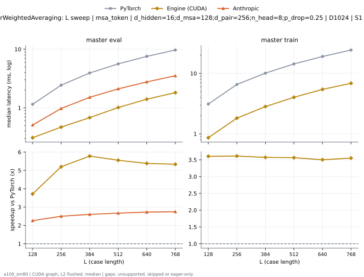
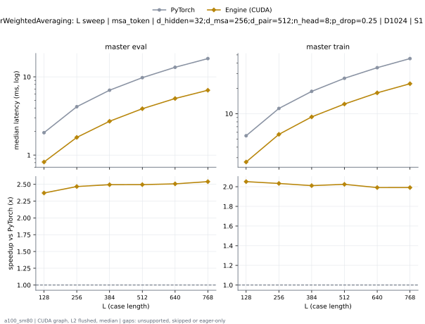
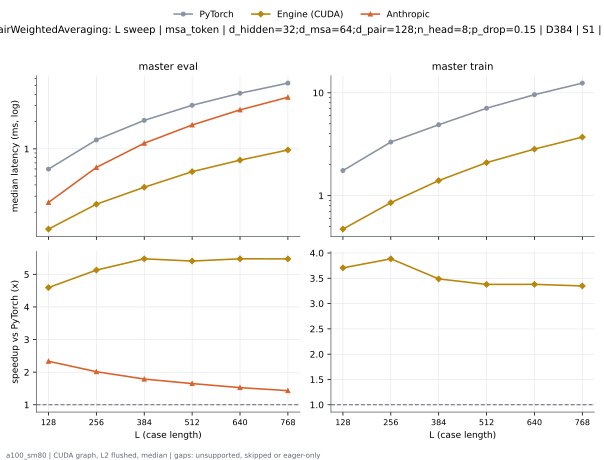
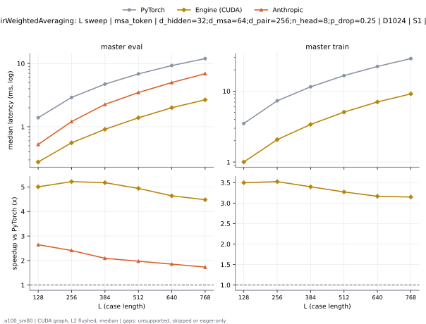
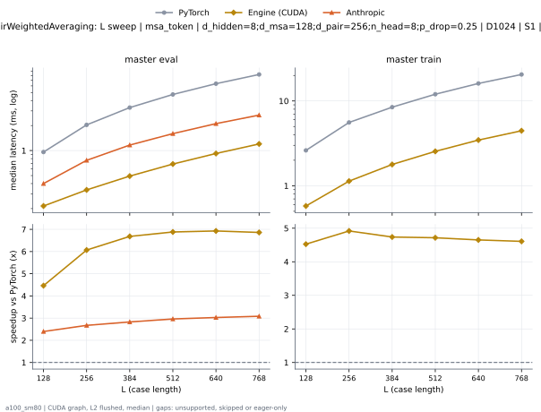
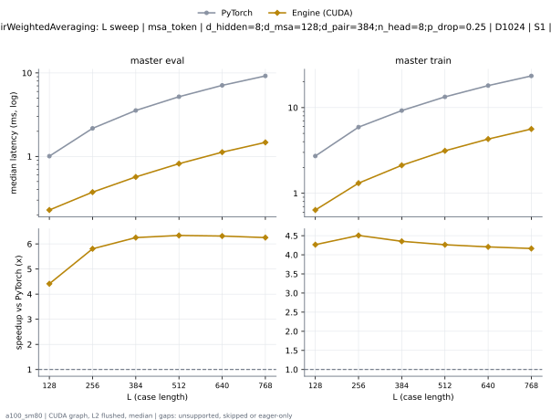
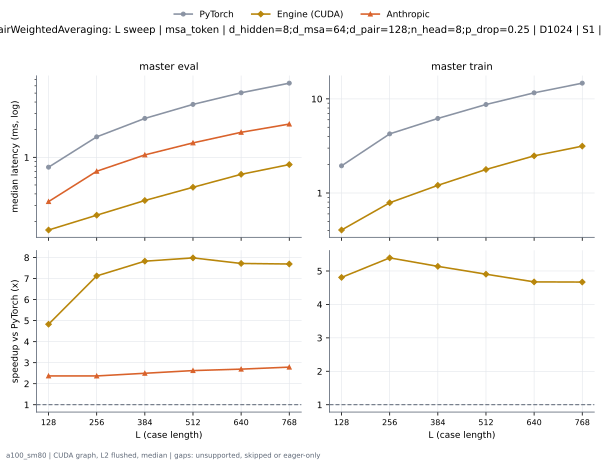
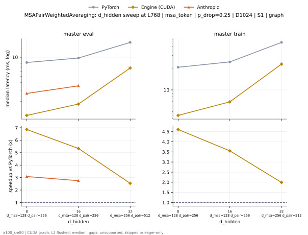
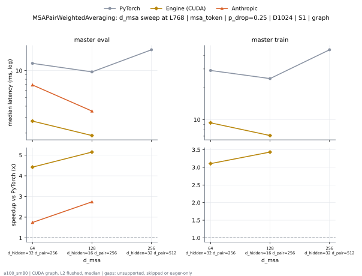
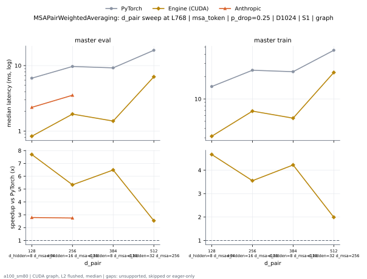

# MSAPairWeightedAveraging on a100_sm80

Generated by `python -m miniworld_engine.measure.plot` from speed tokens `judge/tokens/a100_sm80/`; do not edit.

### L sweep: msa_token | d_hidden=16;d_msa=128;d_pair=256;n_head=8;p_drop=0.25 | D1024 | S1 | graph

**master eval** (median ms; x = speedup vs PyTorch)

| L | PyTorch | Engine (Triton) | Engine (CUDA) | Anthropic |
|---|---|---|---|---|
| 128 | 1.15 | 0.3154 (3.65x) | 0.3092 (3.72x) | 0.5089 (2.26x) |
| 256 | 2.439 | 0.6236 (3.91x) | 0.469 (5.20x) | 0.9754 (2.50x) |
| 384 | 3.937 | 1.012 (3.89x) | 0.681 (5.78x) | 1.513 (2.60x) |
| 512 | 5.627 | 1.481 (3.80x) | 1.013 (5.55x) | 2.109 (2.67x) |
| 640 | 7.559 | 2.037 (3.71x) | 1.404 (5.38x) | 2.771 (2.73x) |
| 768 | 9.692 | 2.649 (3.66x) | 1.817 (5.34x) | 3.526 (2.75x) |

**master train** (median ms; x = speedup vs PyTorch)

| L | PyTorch | Engine (Triton) | Engine (CUDA) | Anthropic |
|---|---|---|---|---|
| 128 | 3.11 | 1.484 (2.10x) | 0.8632 (3.60x) | unsupported |
| 256 | 6.557 | 3.06 (2.14x) | 1.816 (3.61x) | unsupported |
| 384 | 10.09 | 4.891 (2.06x) | 2.824 (3.57x) | unsupported |
| 512 | 14.35 | 6.793 (2.11x) | 4.025 (3.56x) | unsupported |
| 640 | 19.03 | 9.045 (2.10x) | 5.436 (3.50x) | unsupported |
| 768 | 24.35 | 11.64 (2.09x) | 6.856 (3.55x) | unsupported |

### L sweep: msa_token | d_hidden=32;d_msa=256;d_pair=512;n_head=8;p_drop=0.25 | D1024 | S1 | graph

**master eval** (median ms; x = speedup vs PyTorch)

| L | PyTorch | Engine (Triton) | Engine (CUDA) | Anthropic |
|---|---|---|---|---|
| 128 | 1.933 | 0.8561 (2.26x) | 0.8151 (2.37x) | unsupported |
| 256 | 4.151 | 1.853 (2.24x) | 1.682 (2.47x) | unsupported |
| 384 | 6.747 | 2.939 (2.30x) | 2.704 (2.49x) | unsupported |
| 512 | 9.765 | 4.297 (2.27x) | 3.913 (2.50x) | unsupported |
| 640 | 13.25 | 5.758 (2.30x) | 5.285 (2.51x) | unsupported |
| 768 | 17.13 | 7.472 (2.29x) | 6.743 (2.54x) | unsupported |

**master train** (median ms; x = speedup vs PyTorch)

| L | PyTorch | Engine (Triton) | Engine (CUDA) | Anthropic |
|---|---|---|---|---|
| 128 | 5.462 | 4.182 (1.31x) | 2.662 (2.05x) | unsupported |
| 256 | 11.54 | 8.054 (1.43x) | 5.677 (2.03x) | unsupported |
| 384 | 18.41 | 12.45 (1.48x) | 9.156 (2.01x) | unsupported |
| 512 | 26.35 | 17.57 (1.50x) | 13.02 (2.02x) | unsupported |
| 640 | 35.23 | 22.97 (1.53x) | 17.69 (1.99x) | unsupported |
| 768 | 45.21 | 29.27 (1.54x) | 22.7 (1.99x) | unsupported |

### L sweep: msa_token | d_hidden=32;d_msa=64;d_pair=128;n_head=8;p_drop=0.15 | D384 | S1 | graph

**master eval** (median ms; x = speedup vs PyTorch)

| L | PyTorch | Engine (Triton) | Engine (CUDA) | Anthropic |
|---|---|---|---|---|
| 128 | 0.5975 | 0.1403 (4.26x) | 0.13 (4.59x) | 0.256 (2.33x) |
| 256 | 1.255 | 0.2714 (4.63x) | 0.2447 (5.13x) | 0.6236 (2.01x) |
| 384 | 2.063 | 0.4372 (4.72x) | 0.3768 (5.48x) | 1.154 (1.79x) |
| 512 | 3.028 | 0.639 (4.74x) | 0.5601 (5.41x) | 1.836 (1.65x) |
| 640 | 4.11 | 0.8945 (4.60x) | 0.7506 (5.48x) | 2.694 (1.53x) |
| 768 | 5.32 | 1.206 (4.41x) | 0.9718 (5.47x) | 3.714 (1.43x) |

**master train** (median ms; x = speedup vs PyTorch)

| L | PyTorch | Engine (Triton) | Engine (CUDA) | Anthropic |
|---|---|---|---|---|
| 128 | 1.753 | 0.598 (2.93x) | 0.4731 (3.71x) | unsupported |
| 256 | 3.32 | 1.098 (3.02x) | 0.8545 (3.88x) | unsupported |
| 384 | 4.889 | 1.809 (2.70x) | 1.402 (3.49x) | unsupported |
| 512 | 7.078 | 2.668 (2.65x) | 2.095 (3.38x) | unsupported |
| 640 | 9.587 | 3.592 (2.67x) | 2.836 (3.38x) | unsupported |
| 768 | 12.42 | 4.729 (2.63x) | 3.71 (3.35x) | unsupported |

### L sweep: msa_token | d_hidden=32;d_msa=64;d_pair=256;n_head=8;p_drop=0.25 | D1024 | S1 | graph

**master eval** (median ms; x = speedup vs PyTorch)

| L | PyTorch | Engine (Triton) | Engine (CUDA) | Anthropic |
|---|---|---|---|---|
| 128 | 1.39 | 0.3164 (4.39x) | 0.2775 (5.01x) | 0.5253 (2.65x) |
| 256 | 2.912 | 0.6666 (4.37x) | 0.5581 (5.22x) | 1.209 (2.41x) |
| 384 | 4.722 | 1.167 (4.05x) | 0.9124 (5.18x) | 2.258 (2.09x) |
| 512 | 6.853 | 1.854 (3.70x) | 1.386 (4.94x) | 3.475 (1.97x) |
| 640 | 9.282 | 2.653 (3.50x) | 2.001 (4.64x) | 5.004 (1.85x) |
| 768 | 11.96 | 3.551 (3.37x) | 2.67 (4.48x) | 6.905 (1.73x) |

**master train** (median ms; x = speedup vs PyTorch)

| L | PyTorch | Engine (Triton) | Engine (CUDA) | Anthropic |
|---|---|---|---|---|
| 128 | 3.503 | 1.311 (2.67x) | 1.001 (3.50x) | unsupported |
| 256 | 7.307 | 2.755 (2.65x) | 2.074 (3.52x) | unsupported |
| 384 | 11.52 | 4.648 (2.48x) | 3.39 (3.40x) | unsupported |
| 512 | 16.57 | 7.008 (2.36x) | 5.063 (3.27x) | unsupported |
| 640 | 22.31 | 9.53 (2.34x) | 7.045 (3.17x) | unsupported |
| 768 | 28.81 | 12.7 (2.27x) | 9.15 (3.15x) | unsupported |

### L sweep: msa_token | d_hidden=8;d_msa=128;d_pair=256;n_head=8;p_drop=0.25 | D1024 | S1 | graph

**master eval** (median ms; x = speedup vs PyTorch)

| L | PyTorch | Engine (Triton) | Engine (CUDA) | Anthropic |
|---|---|---|---|---|
| 128 | 0.9595 | 0.2703 (3.55x) | 0.215 (4.46x) | 0.4004 (2.40x) |
| 256 | 2.038 | 0.5151 (3.96x) | 0.3359 (6.07x) | 0.7624 (2.67x) |
| 384 | 3.291 | 0.8233 (4.00x) | 0.4925 (6.68x) | 1.164 (2.83x) |
| 512 | 4.735 | 1.176 (4.03x) | 0.6881 (6.88x) | 1.599 (2.96x) |
| 640 | 6.384 | 1.599 (3.99x) | 0.9216 (6.93x) | 2.109 (3.03x) |
| 768 | 8.24 | 2.073 (3.97x) | 1.201 (6.86x) | 2.673 (3.08x) |

**master train** (median ms; x = speedup vs PyTorch)

| L | PyTorch | Engine (Triton) | Engine (CUDA) | Anthropic |
|---|---|---|---|---|
| 128 | 2.613 | 1.348 (1.94x) | 0.5775 (4.52x) | unsupported |
| 256 | 5.58 | 2.739 (2.04x) | 1.135 (4.92x) | unsupported |
| 384 | 8.449 | 4.247 (1.99x) | 1.783 (4.74x) | unsupported |
| 512 | 12 | 5.963 (2.01x) | 2.546 (4.72x) | unsupported |
| 640 | 16.08 | 7.755 (2.07x) | 3.458 (4.65x) | unsupported |
| 768 | 20.52 | 9.768 (2.10x) | 4.453 (4.61x) | unsupported |

### L sweep: msa_token | d_hidden=8;d_msa=128;d_pair=384;n_head=8;p_drop=0.25 | D1024 | S1 | graph

**master eval** (median ms; x = speedup vs PyTorch)

| L | PyTorch | Engine (Triton) | Engine (CUDA) | Anthropic |
|---|---|---|---|---|
| 128 | 1.006 | 0.2913 (3.45x) | 0.2253 (4.46x) | unsupported |
| 256 | 2.148 | 0.6042 (3.56x) | 0.3697 (5.81x) | unsupported |
| 384 | 3.545 | 0.9523 (3.72x) | 0.5642 (6.28x) | unsupported |
| 512 | 5.203 | 1.461 (3.56x) | 0.7941 (6.55x) | unsupported |
| 640 | 7.095 | 1.991 (3.56x) | 1.082 (6.56x) | unsupported |
| 768 | 9.228 | 2.678 (3.45x) | 1.422 (6.49x) | unsupported |

**master train** (median ms; x = speedup vs PyTorch)

| L | PyTorch | Engine (Triton) | Engine (CUDA) | Anthropic |
|---|---|---|---|---|
| 128 | 2.683 | 1.45 (1.85x) | 0.6359 (4.22x) | unsupported |
| 256 | 5.835 | 3.129 (1.86x) | 1.297 (4.50x) | unsupported |
| 384 | 9.149 | 4.906 (1.86x) | 2.07 (4.42x) | unsupported |
| 512 | 13.24 | 7.21 (1.84x) | 3.042 (4.35x) | unsupported |
| 640 | 17.95 | 9.596 (1.87x) | 4.216 (4.26x) | unsupported |
| 768 | 23.27 | 12.45 (1.87x) | 5.511 (4.22x) | unsupported |

### L sweep: msa_token | d_hidden=8;d_msa=64;d_pair=128;n_head=8;p_drop=0.25 | D1024 | S1 | graph

**master eval** (median ms; x = speedup vs PyTorch)

| L | PyTorch | Engine (Triton) | Engine (CUDA) | Anthropic |
|---|---|---|---|---|
| 128 | 0.7813 | 0.1608 (4.86x) | 0.1618 (4.83x) | 0.3297 (2.37x) |
| 256 | 1.671 | 0.3052 (5.48x) | 0.2345 (7.13x) | 0.7055 (2.37x) |
| 384 | 2.653 | 0.469 (5.66x) | 0.3389 (7.83x) | 1.063 (2.50x) |
| 512 | 3.769 | 0.6605 (5.71x) | 0.4721 (7.98x) | 1.437 (2.62x) |
| 640 | 5.043 | 0.9114 (5.53x) | 0.6533 (7.72x) | 1.873 (2.69x) |
| 768 | 6.42 | 1.192 (5.39x) | 0.8346 (7.69x) | 2.303 (2.79x) |

**master train** (median ms; x = speedup vs PyTorch)

| L | PyTorch | Engine (Triton) | Engine (CUDA) | Anthropic |
|---|---|---|---|---|
| 128 | 1.945 | 0.8151 (2.39x) | 0.4045 (4.81x) | unsupported |
| 256 | 4.249 | 1.568 (2.71x) | 0.788 (5.39x) | unsupported |
| 384 | 6.198 | 2.476 (2.50x) | 1.206 (5.14x) | unsupported |
| 512 | 8.717 | 3.458 (2.52x) | 1.778 (4.90x) | unsupported |
| 640 | 11.6 | 4.585 (2.53x) | 2.482 (4.67x) | unsupported |
| 768 | 14.7 | 5.837 (2.52x) | 3.148 (4.67x) | unsupported |

### d_hidden sweep at L768: msa_token | p_drop=0.25 | D1024 | S1 | graph

**master eval** (median ms; x = speedup vs PyTorch)

| d_hidden | PyTorch | Engine (Triton) | Engine (CUDA) | Anthropic |
|---|---|---|---|---|
| 8 d_msa=128 d_pair=256 | 8.24 | 2.073 (3.97x) | 1.201 (6.86x) | 2.673 (3.08x) |
| 16 d_msa=128 d_pair=256 | 9.692 | 2.649 (3.66x) | 1.817 (5.34x) | 3.526 (2.75x) |
| 32 d_msa=256 d_pair=512 | 17.13 | 7.472 (2.29x) | 6.743 (2.54x) | unsupported |

**master train** (median ms; x = speedup vs PyTorch)

| d_hidden | PyTorch | Engine (Triton) | Engine (CUDA) | Anthropic |
|---|---|---|---|---|
| 8 d_msa=128 d_pair=256 | 20.52 | 9.768 (2.10x) | 4.453 (4.61x) | unsupported |
| 16 d_msa=128 d_pair=256 | 24.35 | 11.64 (2.09x) | 6.856 (3.55x) | unsupported |
| 32 d_msa=256 d_pair=512 | 45.21 | 29.27 (1.54x) | 22.7 (1.99x) | unsupported |

### d_msa sweep at L768: msa_token | p_drop=0.25 | D1024 | S1 | graph

**master eval** (median ms; x = speedup vs PyTorch)

| d_msa | PyTorch | Engine (Triton) | Engine (CUDA) | Anthropic |
|---|---|---|---|---|
| 64 d_hidden=32 d_pair=256 | 11.96 | 3.551 (3.37x) | 2.67 (4.48x) | 6.905 (1.73x) |
| 128 d_hidden=16 d_pair=256 | 9.692 | 2.649 (3.66x) | 1.817 (5.34x) | 3.526 (2.75x) |
| 256 d_hidden=32 d_pair=512 | 17.13 | 7.472 (2.29x) | 6.743 (2.54x) | unsupported |

**master train** (median ms; x = speedup vs PyTorch)

| d_msa | PyTorch | Engine (Triton) | Engine (CUDA) | Anthropic |
|---|---|---|---|---|
| 64 d_hidden=32 d_pair=256 | 28.81 | 12.7 (2.27x) | 9.15 (3.15x) | unsupported |
| 128 d_hidden=16 d_pair=256 | 24.35 | 11.64 (2.09x) | 6.856 (3.55x) | unsupported |
| 256 d_hidden=32 d_pair=512 | 45.21 | 29.27 (1.54x) | 22.7 (1.99x) | unsupported |

### d_pair sweep at L768: msa_token | p_drop=0.25 | D1024 | S1 | graph

**master eval** (median ms; x = speedup vs PyTorch)

| d_pair | PyTorch | Engine (Triton) | Engine (CUDA) | Anthropic |
|---|---|---|---|---|
| 128 d_hidden=8 d_msa=64 | 6.42 | 1.192 (5.39x) | 0.8346 (7.69x) | 2.303 (2.79x) |
| 256 d_hidden=16 d_msa=128 | 9.692 | 2.649 (3.66x) | 1.817 (5.34x) | 3.526 (2.75x) |
| 384 d_hidden=8 d_msa=128 | 9.228 | 2.678 (3.45x) | 1.422 (6.49x) | unsupported |
| 512 d_hidden=32 d_msa=256 | 17.13 | 7.472 (2.29x) | 6.743 (2.54x) | unsupported |

**master train** (median ms; x = speedup vs PyTorch)

| d_pair | PyTorch | Engine (Triton) | Engine (CUDA) | Anthropic |
|---|---|---|---|---|
| 128 d_hidden=8 d_msa=64 | 14.7 | 5.837 (2.52x) | 3.148 (4.67x) | unsupported |
| 256 d_hidden=16 d_msa=128 | 24.35 | 11.64 (2.09x) | 6.856 (3.55x) | unsupported |
| 384 d_hidden=8 d_msa=128 | 23.27 | 12.45 (1.87x) | 5.511 (4.22x) | unsupported |
| 512 d_hidden=32 d_msa=256 | 45.21 | 29.27 (1.54x) | 22.7 (1.99x) | unsupported |

