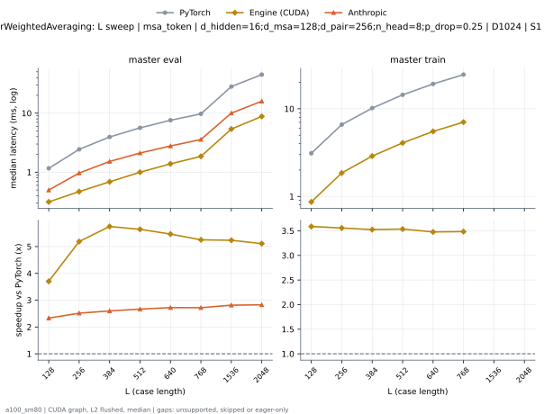
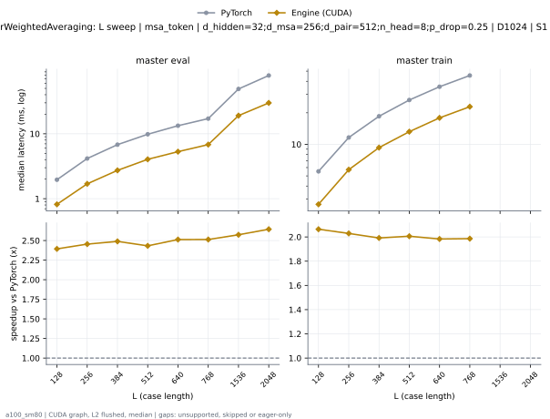
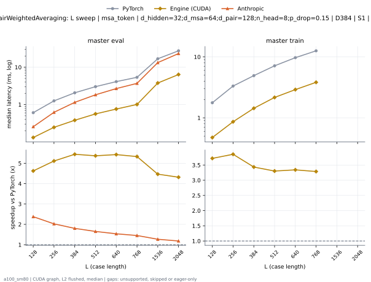
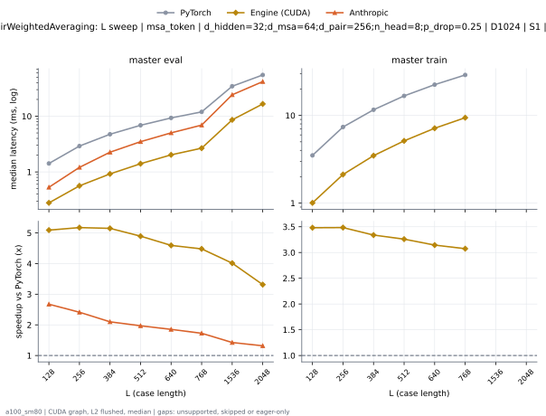
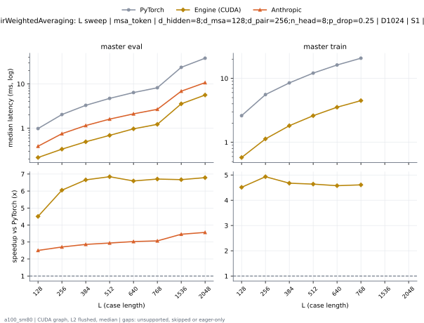
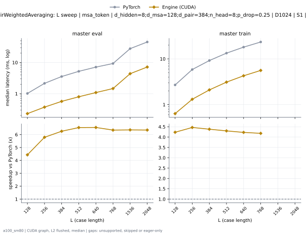
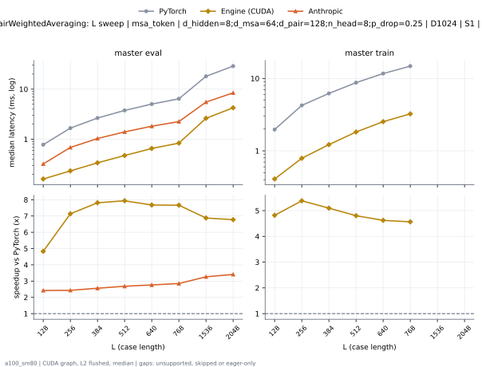
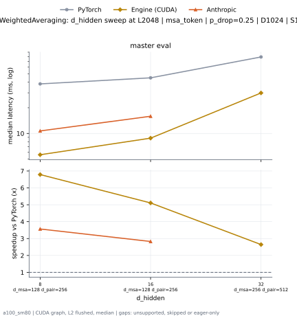
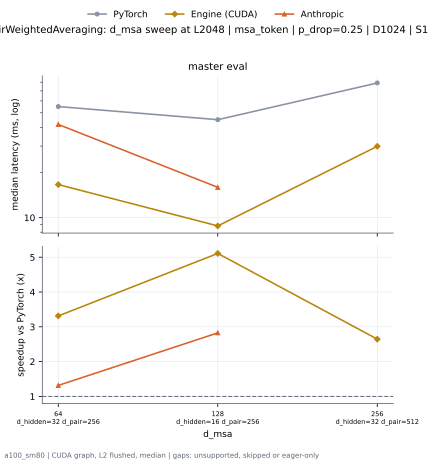
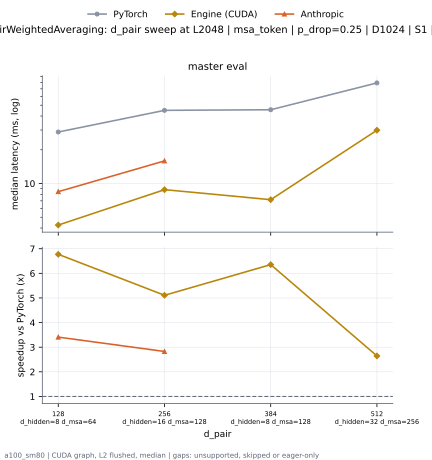

# MSAPairWeightedAveraging on a100_sm80

Generated by `python -m foldjet_engine.measure.plot` from speed tokens `judge/tokens/a100_sm80/`; do not edit.

### L sweep: msa_token | d_hidden=16;d_msa=128;d_pair=256;n_head=8;p_drop=0.25 | D1024 | S1 | graph

**master eval** (median ms; x = speedup vs PyTorch)

| L | PyTorch | Engine (Triton) | Engine (CUDA) | Anthropic |
|---|---|---|---|---|
| 128 | 1.164 | 0.318 (3.66x) | 0.3144 (3.70x) | 0.4987 (2.33x) |
| 256 | 2.438 | 0.6216 (3.92x) | 0.47 (5.19x) | 0.9697 (2.51x) |
| 384 | 3.953 | 1.007 (3.93x) | 0.6876 (5.75x) | 1.521 (2.60x) |
| 512 | 5.642 | 1.463 (3.86x) | 0.9999 (5.64x) | 2.116 (2.67x) |
| 640 | 7.577 | 2.003 (3.78x) | 1.386 (5.46x) | 2.783 (2.72x) |
| 768 | 9.741 | 2.595 (3.75x) | 1.855 (5.25x) | 3.581 (2.72x) |
| 1536 | 28.2 | 8.247 (3.42x) | 5.386 (5.24x) | 10.02 (2.81x) |
| 2048 | 44.98 | 13.23 (3.40x) | 8.804 (5.11x) | 15.92 (2.83x) |

**master train** (median ms; x = speedup vs PyTorch)

| L | PyTorch | Engine (Triton) | Engine (CUDA) | Anthropic |
|---|---|---|---|---|
| 128 | 3.108 | 1.481 (2.10x) | 0.8663 (3.59x) | unsupported |
| 256 | 6.591 | 3.058 (2.16x) | 1.853 (3.56x) | unsupported |
| 384 | 10.17 | 4.829 (2.11x) | 2.886 (3.52x) | unsupported |
| 512 | 14.42 | 6.789 (2.12x) | 4.08 (3.54x) | unsupported |
| 640 | 19.18 | 8.906 (2.15x) | 5.515 (3.48x) | unsupported |
| 768 | 24.54 | 11.41 (2.15x) | 7.043 (3.48x) | unsupported |
| 1536 |  |  |  |  |
| 2048 |  |  |  |  |

### L sweep: msa_token | d_hidden=32;d_msa=256;d_pair=512;n_head=8;p_drop=0.25 | D1024 | S1 | graph

**master eval** (median ms; x = speedup vs PyTorch)

| L | PyTorch | Engine (Triton) | Engine (CUDA) | Anthropic |
|---|---|---|---|---|
| 128 | 1.96 | 0.8596 (2.28x) | 0.8187 (2.39x) | unsupported |
| 256 | 4.158 | 1.82 (2.29x) | 1.694 (2.45x) | unsupported |
| 384 | 6.798 | 2.889 (2.35x) | 2.731 (2.49x) | unsupported |
| 512 | 9.834 | 4.178 (2.35x) | 4.043 (2.43x) | unsupported |
| 640 | 13.32 | 5.65 (2.36x) | 5.301 (2.51x) | unsupported |
| 768 | 17.13 | 7.351 (2.33x) | 6.815 (2.51x) | unsupported |
| 1536 | 49.04 | 20.23 (2.42x) | 19.05 (2.57x) | unsupported |
| 2048 | 79.06 | 32.15 (2.46x) | 29.89 (2.64x) | unsupported |

**master train** (median ms; x = speedup vs PyTorch)

| L | PyTorch | Engine (Triton) | Engine (CUDA) | Anthropic |
|---|---|---|---|---|
| 128 | 5.52 | 4.11 (1.34x) | 2.675 (2.06x) | unsupported |
| 256 | 11.63 | 7.973 (1.46x) | 5.731 (2.03x) | unsupported |
| 384 | 18.54 | 12.2 (1.52x) | 9.308 (1.99x) | unsupported |
| 512 | 26.5 | 17.32 (1.53x) | 13.21 (2.01x) | unsupported |
| 640 | 35.49 | 22.61 (1.57x) | 17.9 (1.98x) | unsupported |
| 768 | 45.43 | 28.81 (1.58x) | 22.88 (1.99x) | unsupported |
| 1536 |  |  |  |  |
| 2048 |  |  |  |  |

### L sweep: msa_token | d_hidden=32;d_msa=64;d_pair=128;n_head=8;p_drop=0.15 | D384 | S1 | graph

**master eval** (median ms; x = speedup vs PyTorch)

| L | PyTorch | Engine (Triton) | Engine (CUDA) | Anthropic |
|---|---|---|---|---|
| 128 | 0.6062 | 0.1403 (4.32x) | 0.1311 (4.63x) | 0.255 (2.38x) |
| 256 | 1.256 | 0.2703 (4.65x) | 0.2458 (5.11x) | 0.6205 (2.02x) |
| 384 | 2.067 | 0.4311 (4.80x) | 0.3799 (5.44x) | 1.147 (1.80x) |
| 512 | 3.018 | 0.6339 (4.76x) | 0.5622 (5.37x) | 1.827 (1.65x) |
| 640 | 4.118 | 0.8888 (4.63x) | 0.7588 (5.43x) | 2.68 (1.54x) |
| 768 | 5.37 | 1.229 (4.37x) | 1.008 (5.33x) | 3.698 (1.45x) |
| 1536 | 16.85 | 4.451 (3.79x) | 3.773 (4.47x) | 13.28 (1.27x) |
| 2048 | 27.51 | 7.66 (3.59x) | 6.376 (4.32x) | 23.25 (1.18x) |

**master train** (median ms; x = speedup vs PyTorch)

| L | PyTorch | Engine (Triton) | Engine (CUDA) | Anthropic |
|---|---|---|---|---|
| 128 | 1.767 | 0.6052 (2.92x) | 0.4751 (3.72x) | unsupported |
| 256 | 3.323 | 1.093 (3.04x) | 0.8622 (3.85x) | unsupported |
| 384 | 4.925 | 1.82 (2.71x) | 1.434 (3.43x) | unsupported |
| 512 | 7.139 | 2.674 (2.67x) | 2.162 (3.30x) | unsupported |
| 640 | 9.71 | 3.626 (2.68x) | 2.906 (3.34x) | unsupported |
| 768 | 12.58 | 4.716 (2.67x) | 3.828 (3.29x) | unsupported |
| 1536 |  |  |  |  |
| 2048 |  |  |  |  |

### L sweep: msa_token | d_hidden=32;d_msa=64;d_pair=256;n_head=8;p_drop=0.25 | D1024 | S1 | graph

**master eval** (median ms; x = speedup vs PyTorch)

| L | PyTorch | Engine (Triton) | Engine (CUDA) | Anthropic |
|---|---|---|---|---|
| 128 | 1.418 | 0.3164 (4.48x) | 0.2785 (5.09x) | 0.5304 (2.67x) |
| 256 | 2.914 | 0.6564 (4.44x) | 0.5632 (5.17x) | 1.208 (2.41x) |
| 384 | 4.746 | 1.154 (4.11x) | 0.9216 (5.15x) | 2.26 (2.10x) |
| 512 | 6.876 | 1.836 (3.75x) | 1.405 (4.89x) | 3.491 (1.97x) |
| 640 | 9.313 | 2.639 (3.53x) | 2.028 (4.59x) | 5.027 (1.85x) |
| 768 | 11.96 | 3.558 (3.36x) | 2.67 (4.48x) | 6.929 (1.73x) |
| 1536 | 34.54 | 11.37 (3.04x) | 8.607 (4.01x) | 24.26 (1.42x) |
| 2048 | 55.01 | 19.88 (2.77x) | 16.61 (3.31x) | 41.8 (1.32x) |

**master train** (median ms; x = speedup vs PyTorch)

| L | PyTorch | Engine (Triton) | Engine (CUDA) | Anthropic |
|---|---|---|---|---|
| 128 | 3.501 | 1.3 (2.69x) | 1.006 (3.48x) | unsupported |
| 256 | 7.382 | 2.755 (2.68x) | 2.119 (3.48x) | unsupported |
| 384 | 11.61 | 4.629 (2.51x) | 3.478 (3.34x) | unsupported |
| 512 | 16.72 | 6.965 (2.40x) | 5.129 (3.26x) | unsupported |
| 640 | 22.46 | 9.603 (2.34x) | 7.144 (3.14x) | unsupported |
| 768 | 28.99 | 12.68 (2.29x) | 9.43 (3.07x) | unsupported |
| 1536 |  |  |  |  |
| 2048 |  |  |  |  |

### L sweep: msa_token | d_hidden=8;d_msa=128;d_pair=256;n_head=8;p_drop=0.25 | D1024 | S1 | graph

**master eval** (median ms; x = speedup vs PyTorch)

| L | PyTorch | Engine (Triton) | Engine (CUDA) | Anthropic |
|---|---|---|---|---|
| 128 | 0.983 | 0.2703 (3.64x) | 0.2181 (4.51x) | 0.3922 (2.51x) |
| 256 | 2.039 | 0.5161 (3.95x) | 0.3369 (6.05x) | 0.7526 (2.71x) |
| 384 | 3.293 | 0.8212 (4.01x) | 0.4946 (6.66x) | 1.151 (2.86x) |
| 512 | 4.724 | 1.162 (4.06x) | 0.6902 (6.84x) | 1.606 (2.94x) |
| 640 | 6.395 | 1.589 (4.03x) | 0.9697 (6.59x) | 2.112 (3.03x) |
| 768 | 8.21 | 2.03 (4.05x) | 1.224 (6.71x) | 2.676 (3.07x) |
| 1536 | 23.74 | 5.752 (4.13x) | 3.558 (6.67x) | 6.864 (3.46x) |
| 2048 | 38.17 | 9.263 (4.12x) | 5.623 (6.79x) | 10.7 (3.57x) |

**master train** (median ms; x = speedup vs PyTorch)

| L | PyTorch | Engine (Triton) | Engine (CUDA) | Anthropic |
|---|---|---|---|---|
| 128 | 2.611 | 1.348 (1.94x) | 0.5786 (4.51x) | unsupported |
| 256 | 5.578 | 2.726 (2.05x) | 1.131 (4.93x) | unsupported |
| 384 | 8.502 | 4.248 (2.00x) | 1.819 (4.68x) | unsupported |
| 512 | 12.1 | 5.927 (2.04x) | 2.609 (4.64x) | unsupported |
| 640 | 16.2 | 7.733 (2.09x) | 3.54 (4.58x) | unsupported |
| 768 | 20.69 | 9.694 (2.13x) | 4.489 (4.61x) | unsupported |
| 1536 |  |  |  |  |
| 2048 |  |  |  |  |

### L sweep: msa_token | d_hidden=8;d_msa=128;d_pair=384;n_head=8;p_drop=0.25 | D1024 | S1 | graph

**master eval** (median ms; x = speedup vs PyTorch)

| L | PyTorch | Engine (Triton) | Engine (CUDA) | Anthropic |
|---|---|---|---|---|
| 128 | 1.017 | 0.2939 (3.46x) | 0.2294 (4.43x) | unsupported |
| 256 | 2.147 | 0.599 (3.58x) | 0.3707 (5.79x) | unsupported |
| 384 | 3.551 | 0.9523 (3.73x) | 0.5673 (6.26x) | unsupported |
| 512 | 5.211 | 1.43 (3.64x) | 0.7962 (6.54x) | unsupported |
| 640 | 7.122 | 1.96 (3.63x) | 1.087 (6.55x) | unsupported |
| 768 | 9.291 | 2.633 (3.53x) | 1.463 (6.35x) | unsupported |
| 1536 | 27.87 | 8.06 (3.46x) | 4.379 (6.36x) | unsupported |
| 2048 | 45.54 | 13.29 (3.43x) | 7.167 (6.35x) | unsupported |

**master train** (median ms; x = speedup vs PyTorch)

| L | PyTorch | Engine (Triton) | Engine (CUDA) | Anthropic |
|---|---|---|---|---|
| 128 | 2.693 | 1.445 (1.86x) | 0.6359 (4.24x) | unsupported |
| 256 | 5.848 | 3.086 (1.89x) | 1.309 (4.47x) | unsupported |
| 384 | 9.197 | 4.876 (1.89x) | 2.098 (4.38x) | unsupported |
| 512 | 13.34 | 7.129 (1.87x) | 3.101 (4.30x) | unsupported |
| 640 | 18.06 | 9.51 (1.90x) | 4.27 (4.23x) | unsupported |
| 768 | 23.4 | 12.38 (1.89x) | 5.594 (4.18x) | unsupported |
| 1536 |  |  |  |  |
| 2048 |  |  |  |  |

### L sweep: msa_token | d_hidden=8;d_msa=64;d_pair=128;n_head=8;p_drop=0.25 | D1024 | S1 | graph

**master eval** (median ms; x = speedup vs PyTorch)

| L | PyTorch | Engine (Triton) | Engine (CUDA) | Anthropic |
|---|---|---|---|---|
| 128 | 0.7813 | 0.1608 (4.86x) | 0.1618 (4.83x) | 0.3226 (2.42x) |
| 256 | 1.673 | 0.3062 (5.46x) | 0.2345 (7.14x) | 0.6881 (2.43x) |
| 384 | 2.656 | 0.47 (5.65x) | 0.34 (7.81x) | 1.037 (2.56x) |
| 512 | 3.77 | 0.6579 (5.73x) | 0.4751 (7.94x) | 1.406 (2.68x) |
| 640 | 5.042 | 0.8899 (5.67x) | 0.6569 (7.68x) | 1.825 (2.76x) |
| 768 | 6.434 | 1.179 (5.46x) | 0.8397 (7.66x) | 2.257 (2.85x) |
| 1536 | 18.04 | 3.599 (5.01x) | 2.624 (6.88x) | 5.528 (3.26x) |
| 2048 | 28.82 | 5.977 (4.82x) | 4.256 (6.77x) | 8.454 (3.41x) |

**master train** (median ms; x = speedup vs PyTorch)

| L | PyTorch | Engine (Triton) | Engine (CUDA) | Anthropic |
|---|---|---|---|---|
| 128 | 1.968 | 0.809 (2.43x) | 0.4086 (4.82x) | unsupported |
| 256 | 4.243 | 1.553 (2.73x) | 0.7885 (5.38x) | unsupported |
| 384 | 6.21 | 2.5 (2.48x) | 1.219 (5.10x) | unsupported |
| 512 | 8.744 | 3.481 (2.51x) | 1.821 (4.80x) | unsupported |
| 640 | 11.69 | 4.612 (2.53x) | 2.529 (4.62x) | unsupported |
| 768 | 14.8 | 5.814 (2.55x) | 3.242 (4.56x) | unsupported |
| 1536 |  |  |  |  |
| 2048 |  |  |  |  |

### d_hidden sweep at L2048: msa_token | p_drop=0.25 | D1024 | S1 | graph

**master eval** (median ms; x = speedup vs PyTorch)

| d_hidden | PyTorch | Engine (Triton) | Engine (CUDA) | Anthropic |
|---|---|---|---|---|
| 8 d_msa=128 d_pair=256 | 38.17 | 9.263 (4.12x) | 5.623 (6.79x) | 10.7 (3.57x) |
| 16 d_msa=128 d_pair=256 | 44.98 | 13.23 (3.40x) | 8.804 (5.11x) | 15.92 (2.83x) |
| 32 d_msa=256 d_pair=512 | 79.06 | 32.15 (2.46x) | 29.89 (2.64x) | unsupported |

### d_msa sweep at L2048: msa_token | p_drop=0.25 | D1024 | S1 | graph

**master eval** (median ms; x = speedup vs PyTorch)

| d_msa | PyTorch | Engine (Triton) | Engine (CUDA) | Anthropic |
|---|---|---|---|---|
| 64 d_hidden=32 d_pair=256 | 55.01 | 19.88 (2.77x) | 16.61 (3.31x) | 41.8 (1.32x) |
| 128 d_hidden=16 d_pair=256 | 44.98 | 13.23 (3.40x) | 8.804 (5.11x) | 15.92 (2.83x) |
| 256 d_hidden=32 d_pair=512 | 79.06 | 32.15 (2.46x) | 29.89 (2.64x) | unsupported |

### d_pair sweep at L2048: msa_token | p_drop=0.25 | D1024 | S1 | graph

**master eval** (median ms; x = speedup vs PyTorch)

| d_pair | PyTorch | Engine (Triton) | Engine (CUDA) | Anthropic |
|---|---|---|---|---|
| 128 d_hidden=8 d_msa=64 | 28.82 | 5.977 (4.82x) | 4.256 (6.77x) | 8.454 (3.41x) |
| 256 d_hidden=16 d_msa=128 | 44.98 | 13.23 (3.40x) | 8.804 (5.11x) | 15.92 (2.83x) |
| 384 d_hidden=8 d_msa=128 | 45.54 | 13.29 (3.43x) | 7.167 (6.35x) | unsupported |
| 512 d_hidden=32 d_msa=256 | 79.06 | 32.15 (2.46x) | 29.89 (2.64x) | unsupported |

