# OuterProductMean on a100_sm80

Generated by `python -m miniworld_engine.measure.plot` from speed tokens `judge/tokens/a100_sm80/`; do not edit.

### L sweep: msa_token | d_hidden=32;d_msa=128;d_pair=256;normalize_before_proj=False | D1024 | S1 | graph

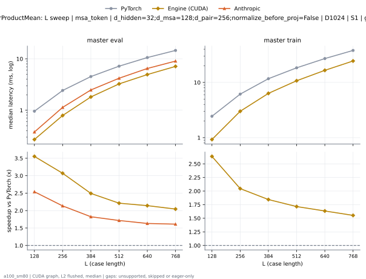

**master eval** (median ms; x = speedup vs PyTorch)

| L | PyTorch | Engine (Triton) | Engine (CUDA) | Anthropic |
|---|---|---|---|---|
| 128 | 0.9569 | 0.2867 (3.34x) | 0.2693 (3.55x) | 0.3768 (2.54x) |
| 256 | 2.423 | 0.9487 (2.55x) | 0.7895 (3.07x) | 1.136 (2.13x) |
| 384 | 4.518 | 2.169 (2.08x) | 1.813 (2.49x) | 2.478 (1.82x) |
| 512 | 7.194 | 3.723 (1.93x) | 3.252 (2.21x) | 4.193 (1.72x) |
| 640 | 10.59 | 5.839 (1.81x) | 4.942 (2.14x) | 6.49 (1.63x) |
| 768 | 14.56 | 8.339 (1.75x) | 7.127 (2.04x) | 9.038 (1.61x) |

**master train** (median ms; x = speedup vs PyTorch)

| L | PyTorch | Engine (Triton) | Engine (CUDA) | Anthropic |
|---|---|---|---|---|
| 128 | 2.441 | 1.312 (1.86x) | 0.9257 (2.64x) | unsupported |
| 256 | 6.142 | 3.837 (1.60x) | 3.003 (2.05x) | unsupported |
| 384 | 11.69 | 7.978 (1.46x) | 6.339 (1.84x) | unsupported |
| 512 | 18.41 | 13.24 (1.39x) | 10.73 (1.71x) | unsupported |
| 640 | 27.08 | 19.92 (1.36x) | 16.58 (1.63x) | unsupported |
| 768 | 38.01 | 28.96 (1.31x) | 24.48 (1.55x) | unsupported |

### L sweep: msa_token | d_hidden=32;d_msa=128;d_pair=256;normalize_before_proj=True | D1024 | S1 | graph

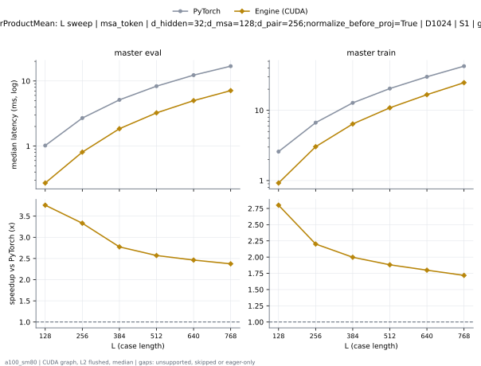

**master eval** (median ms; x = speedup vs PyTorch)

| L | PyTorch | Engine (Triton) | Engine (CUDA) | Anthropic |
|---|---|---|---|---|
| 128 | 1.02 | 0.2888 (3.53x) | 0.2714 (3.76x) | unsupported |
| 256 | 2.696 | 0.9713 (2.78x) | 0.809 (3.33x) | unsupported |
| 384 | 5.131 | 2.156 (2.38x) | 1.85 (2.77x) | unsupported |
| 512 | 8.324 | 3.742 (2.22x) | 3.239 (2.57x) | unsupported |
| 640 | 12.29 | 5.858 (2.10x) | 4.99 (2.46x) | unsupported |
| 768 | 16.88 | 8.539 (1.98x) | 7.113 (2.37x) | unsupported |

**master train** (median ms; x = speedup vs PyTorch)

| L | PyTorch | Engine (Triton) | Engine (CUDA) | Anthropic |
|---|---|---|---|---|
| 128 | 2.584 | 1.31 (1.97x) | 0.9226 (2.80x) | unsupported |
| 256 | 6.679 | 3.874 (1.72x) | 3.034 (2.20x) | unsupported |
| 384 | 12.79 | 8.071 (1.58x) | 6.401 (2.00x) | unsupported |
| 512 | 20.45 | 13.39 (1.53x) | 10.87 (1.88x) | unsupported |
| 640 | 30.08 | 20.02 (1.50x) | 16.72 (1.80x) | unsupported |
| 768 | 42.6 | 29.14 (1.46x) | 24.79 (1.72x) | unsupported |

### L sweep: msa_token | d_hidden=32;d_msa=128;d_pair=384;normalize_before_proj=False | D1024 | S1 | graph

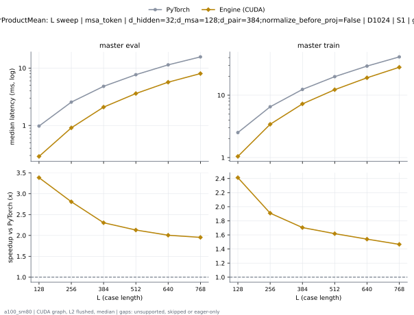

**master eval** (median ms; x = speedup vs PyTorch)

| L | PyTorch | Engine (Triton) | Engine (CUDA) | Anthropic |
|---|---|---|---|---|
| 128 | 0.9769 | 0.3185 (3.07x) | 0.2888 (3.38x) | unsupported |
| 256 | 2.552 | 1.128 (2.26x) | 0.9093 (2.81x) | unsupported |
| 384 | 4.81 | 2.482 (1.94x) | 2.088 (2.30x) | unsupported |
| 512 | 7.674 | 4.335 (1.77x) | 3.604 (2.13x) | unsupported |
| 640 | 11.38 | 6.586 (1.73x) | 5.677 (2.01x) | unsupported |
| 768 | 15.67 | 9.528 (1.64x) | 8.023 (1.95x) | unsupported |

**master train** (median ms; x = speedup vs PyTorch)

| L | PyTorch | Engine (Triton) | Engine (CUDA) | Anthropic |
|---|---|---|---|---|
| 128 | 2.515 | 1.437 (1.75x) | 1.042 (2.41x) | unsupported |
| 256 | 6.514 | 4.433 (1.47x) | 3.413 (1.91x) | unsupported |
| 384 | 12.36 | 9.192 (1.34x) | 7.252 (1.70x) | unsupported |
| 512 | 19.81 | 15.39 (1.29x) | 12.24 (1.62x) | unsupported |
| 640 | 29.26 | 23.19 (1.26x) | 19 (1.54x) | unsupported |
| 768 | 41.08 | 33.45 (1.23x) | 28.02 (1.47x) | unsupported |

### L sweep: msa_token | d_hidden=32;d_msa=128;d_pair=384;normalize_before_proj=True | D1024 | S1 | graph

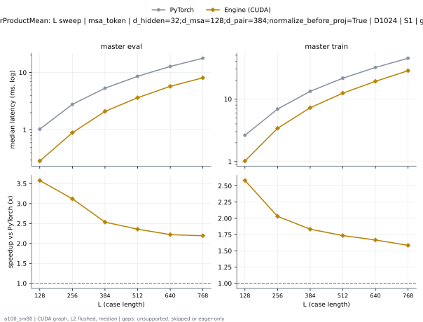

**master eval** (median ms; x = speedup vs PyTorch)

| L | PyTorch | Engine (Triton) | Engine (CUDA) | Anthropic |
|---|---|---|---|---|
| 128 | 1.03 | 0.3164 (3.26x) | 0.2877 (3.58x) | unsupported |
| 256 | 2.79 | 1.115 (2.50x) | 0.894 (3.12x) | unsupported |
| 384 | 5.329 | 2.448 (2.18x) | 2.101 (2.54x) | unsupported |
| 512 | 8.583 | 4.339 (1.98x) | 3.639 (2.36x) | unsupported |
| 640 | 12.75 | 6.631 (1.92x) | 5.737 (2.22x) | unsupported |
| 768 | 17.72 | 9.593 (1.85x) | 8.08 (2.19x) | unsupported |

**master train** (median ms; x = speedup vs PyTorch)

| L | PyTorch | Engine (Triton) | Engine (CUDA) | Anthropic |
|---|---|---|---|---|
| 128 | 2.635 | 1.439 (1.83x) | 1.02 (2.58x) | unsupported |
| 256 | 6.911 | 4.48 (1.54x) | 3.403 (2.03x) | unsupported |
| 384 | 13.28 | 9.281 (1.43x) | 7.249 (1.83x) | unsupported |
| 512 | 21.52 | 15.53 (1.39x) | 12.4 (1.73x) | unsupported |
| 640 | 31.95 | 23.19 (1.38x) | 19.17 (1.67x) | unsupported |
| 768 | 44.88 | 33.47 (1.34x) | 28.33 (1.58x) | unsupported |

### L sweep: msa_token | d_hidden=32;d_msa=256;d_pair=512;normalize_before_proj=False | D1024 | S1 | graph

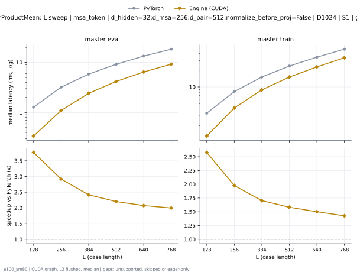

**master eval** (median ms; x = speedup vs PyTorch)

| L | PyTorch | Engine (Triton) | Engine (CUDA) | Anthropic |
|---|---|---|---|---|
| 128 | 1.28 | 0.3932 (3.26x) | 0.34 (3.77x) | unsupported |
| 256 | 3.203 | 1.337 (2.40x) | 1.098 (2.92x) | unsupported |
| 384 | 5.842 | 2.915 (2.00x) | 2.416 (2.42x) | unsupported |
| 512 | 9.188 | 4.961 (1.85x) | 4.173 (2.20x) | unsupported |
| 640 | 13.38 | 7.686 (1.74x) | 6.449 (2.07x) | unsupported |
| 768 | 18.4 | 11.03 (1.67x) | 9.217 (2.00x) | unsupported |

**master train** (median ms; x = speedup vs PyTorch)

| L | PyTorch | Engine (Triton) | Engine (CUDA) | Anthropic |
|---|---|---|---|---|
| 128 | 3.361 | 2.238 (1.50x) | 1.304 (2.58x) | unsupported |
| 256 | 8.246 | 5.851 (1.41x) | 4.171 (1.98x) | unsupported |
| 384 | 15.09 | 11.61 (1.30x) | 8.861 (1.70x) | unsupported |
| 512 | 23.81 | 19.04 (1.25x) | 15.05 (1.58x) | unsupported |
| 640 | 34.45 | 28.02 (1.23x) | 22.95 (1.50x) | unsupported |
| 768 | 48 | 40.3 (1.19x) | 33.64 (1.43x) | unsupported |

### L sweep: msa_token | d_hidden=32;d_msa=256;d_pair=512;normalize_before_proj=True | D1024 | S1 | graph

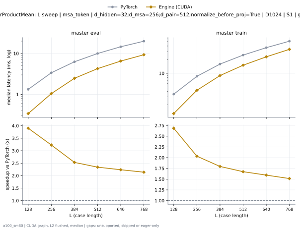

**master eval** (median ms; x = speedup vs PyTorch)

| L | PyTorch | Engine (Triton) | Engine (CUDA) | Anthropic |
|---|---|---|---|---|
| 128 | 1.328 | 0.3881 (3.42x) | 0.3405 (3.90x) | unsupported |
| 256 | 3.381 | 1.321 (2.56x) | 1.048 (3.23x) | unsupported |
| 384 | 6.266 | 2.939 (2.13x) | 2.476 (2.53x) | unsupported |
| 512 | 9.981 | 5.031 (1.98x) | 4.264 (2.34x) | unsupported |
| 640 | 14.59 | 7.797 (1.87x) | 6.52 (2.24x) | unsupported |
| 768 | 19.92 | 11.11 (1.79x) | 9.311 (2.14x) | unsupported |

**master train** (median ms; x = speedup vs PyTorch)

| L | PyTorch | Engine (Triton) | Engine (CUDA) | Anthropic |
|---|---|---|---|---|
| 128 | 3.461 | 2.228 (1.55x) | 1.289 (2.68x) | unsupported |
| 256 | 8.566 | 5.861 (1.46x) | 4.211 (2.03x) | unsupported |
| 384 | 15.99 | 11.63 (1.37x) | 8.906 (1.80x) | unsupported |
| 512 | 25.25 | 19.11 (1.32x) | 15.09 (1.67x) | unsupported |
| 640 | 36.87 | 28.34 (1.30x) | 23.13 (1.59x) | unsupported |
| 768 | 51.19 | 40.24 (1.27x) | 33.83 (1.51x) | unsupported |

### L sweep: msa_token | d_hidden=32;d_msa=64;d_pair=128;normalize_before_proj=False | D1024 | S1 | graph

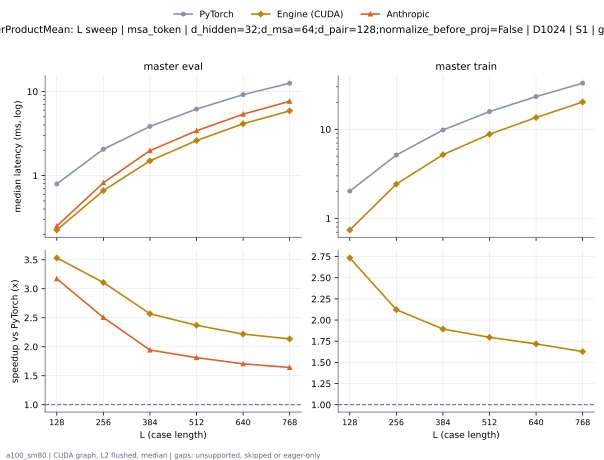

**master eval** (median ms; x = speedup vs PyTorch)

| L | PyTorch | Engine (Triton) | Engine (CUDA) | Anthropic |
|---|---|---|---|---|
| 128 | 0.7956 | 0.2396 (3.32x) | 0.2253 (3.53x) | 0.2509 (3.17x) |
| 256 | 2.059 | 0.769 (2.68x) | 0.6625 (3.11x) | 0.8223 (2.50x) |
| 384 | 3.847 | 1.749 (2.20x) | 1.498 (2.57x) | 1.98 (1.94x) |
| 512 | 6.184 | 3.1 (1.99x) | 2.61 (2.37x) | 3.414 (1.81x) |
| 640 | 9.169 | 4.839 (1.89x) | 4.135 (2.22x) | 5.379 (1.70x) |
| 768 | 12.58 | 6.917 (1.82x) | 5.892 (2.13x) | 7.658 (1.64x) |

**master train** (median ms; x = speedup vs PyTorch)

| L | PyTorch | Engine (Triton) | Engine (CUDA) | Anthropic |
|---|---|---|---|---|
| 128 | 2.024 | 0.9964 (2.03x) | 0.7404 (2.73x) | unsupported |
| 256 | 5.149 | 2.85 (1.81x) | 2.426 (2.12x) | unsupported |
| 384 | 9.827 | 6.073 (1.62x) | 5.189 (1.89x) | unsupported |
| 512 | 15.83 | 10.3 (1.54x) | 8.813 (1.80x) | unsupported |
| 640 | 23.31 | 15.67 (1.49x) | 13.57 (1.72x) | unsupported |
| 768 | 32.99 | 23.1 (1.43x) | 20.27 (1.63x) | unsupported |

### L sweep: msa_token | d_hidden=32;d_msa=64;d_pair=128;normalize_before_proj=False;projection_bias=True | D1024 | S1 | graph

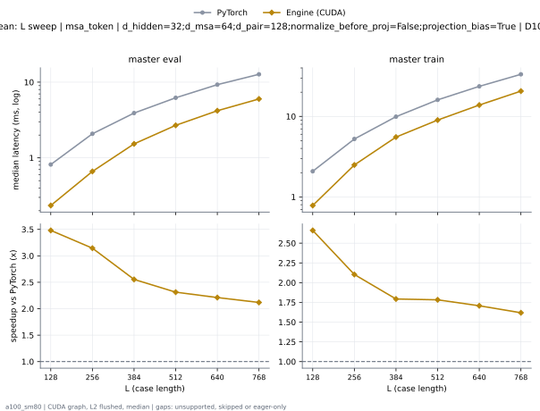

**master eval** (median ms; x = speedup vs PyTorch)

| L | PyTorch | Engine (Triton) | Engine (CUDA) | Anthropic |
|---|---|---|---|---|
| 128 | 0.8161 | 0.2427 (3.36x) | 0.2345 (3.48x) | unsupported |
| 256 | 2.08 | 0.7946 (2.62x) | 0.6615 (3.14x) | unsupported |
| 384 | 3.906 | 1.777 (2.20x) | 1.529 (2.55x) | unsupported |
| 512 | 6.219 | 3.154 (1.97x) | 2.689 (2.31x) | unsupported |
| 640 | 9.271 | 4.836 (1.92x) | 4.193 (2.21x) | unsupported |
| 768 | 12.71 | 6.936 (1.83x) | 5.998 (2.12x) | unsupported |

**master train** (median ms; x = speedup vs PyTorch)

| L | PyTorch | Engine (Triton) | Engine (CUDA) | Anthropic |
|---|---|---|---|---|
| 128 | 2.081 | 1.024 (2.03x) | 0.7818 (2.66x) | unsupported |
| 256 | 5.24 | 2.918 (1.80x) | 2.491 (2.10x) | unsupported |
| 384 | 9.924 | 6.169 (1.61x) | 5.535 (1.79x) | unsupported |
| 512 | 16.05 | 10.49 (1.53x) | 9.006 (1.78x) | unsupported |
| 640 | 23.63 | 15.96 (1.48x) | 13.84 (1.71x) | unsupported |
| 768 | 33.35 | 23.43 (1.42x) | 20.61 (1.62x) | unsupported |

### L sweep: msa_token | d_hidden=32;d_msa=64;d_pair=128;normalize_before_proj=True | D384 | S1 | graph

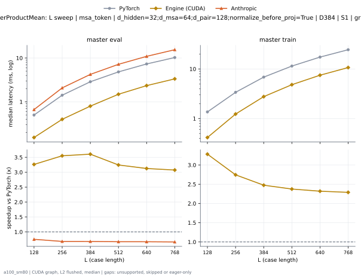

**master eval** (median ms; x = speedup vs PyTorch)

| L | PyTorch | Engine (Triton) | Engine (CUDA) | Anthropic |
|---|---|---|---|---|
| 128 | 0.4977 | 0.1464 (3.40x) | 0.1526 (3.26x) | 0.6625 (0.75x) |
| 256 | 1.411 | 0.427 (3.30x) | 0.3973 (3.55x) | 2.074 (0.68x) |
| 384 | 2.865 | 0.9011 (3.18x) | 0.7946 (3.61x) | 4.219 (0.68x) |
| 512 | 4.816 | 1.577 (3.05x) | 1.485 (3.24x) | 7.175 (0.67x) |
| 640 | 7.309 | 2.527 (2.89x) | 2.339 (3.13x) | 10.91 (0.67x) |
| 768 | 10.25 | 3.648 (2.81x) | 3.335 (3.07x) | 15.46 (0.66x) |

**master train** (median ms; x = speedup vs PyTorch)

| L | PyTorch | Engine (Triton) | Engine (CUDA) | Anthropic |
|---|---|---|---|---|
| 128 | 1.361 | 0.5222 (2.61x) | 0.4147 (3.28x) | unsupported |
| 256 | 3.38 | 1.582 (2.14x) | 1.232 (2.74x) | unsupported |
| 384 | 6.845 | 3.34 (2.05x) | 2.766 (2.47x) | unsupported |
| 512 | 11.44 | 5.771 (1.98x) | 4.818 (2.38x) | unsupported |
| 640 | 17.35 | 8.839 (1.96x) | 7.481 (2.32x) | unsupported |
| 768 | 24.44 | 12.64 (1.93x) | 10.67 (2.29x) | unsupported |

### L sweep: msa_token | d_hidden=32;d_msa=64;d_pair=128;normalize_before_proj=True;projection_bias=True | D1024 | S1 | graph

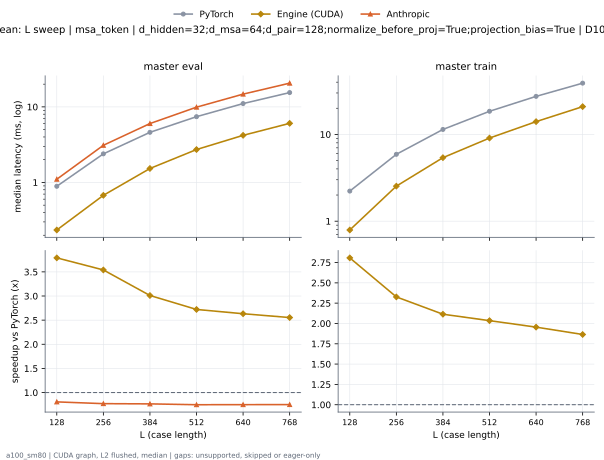

**master eval** (median ms; x = speedup vs PyTorch)

| L | PyTorch | Engine (Triton) | Engine (CUDA) | Anthropic |
|---|---|---|---|---|
| 128 | 0.8888 | 0.2417 (3.68x) | 0.2345 (3.79x) | 1.102 (0.81x) |
| 256 | 2.389 | 0.7977 (2.99x) | 0.6748 (3.54x) | 3.102 (0.77x) |
| 384 | 4.604 | 1.797 (2.56x) | 1.529 (3.01x) | 6.015 (0.77x) |
| 512 | 7.416 | 3.159 (2.35x) | 2.725 (2.72x) | 9.915 (0.75x) |
| 640 | 11.06 | 4.914 (2.25x) | 4.2 (2.63x) | 14.75 (0.75x) |
| 768 | 15.47 | 7.089 (2.18x) | 6.057 (2.55x) | 20.61 (0.75x) |

**master train** (median ms; x = speedup vs PyTorch)

| L | PyTorch | Engine (Triton) | Engine (CUDA) | Anthropic |
|---|---|---|---|---|
| 128 | 2.222 | 1.035 (2.15x) | 0.7916 (2.81x) | unsupported |
| 256 | 5.897 | 2.976 (1.98x) | 2.534 (2.33x) | unsupported |
| 384 | 11.4 | 6.241 (1.83x) | 5.395 (2.11x) | unsupported |
| 512 | 18.47 | 10.56 (1.75x) | 9.076 (2.03x) | unsupported |
| 640 | 27.43 | 16.12 (1.70x) | 14.03 (1.95x) | unsupported |
| 768 | 38.94 | 23.71 (1.64x) | 20.89 (1.86x) | unsupported |

### L sweep: msa_token | d_hidden=64;d_msa=64;d_pair=256;groups=8;normalize_before_proj=False | D1024 | S1 | graph

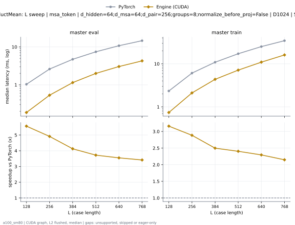

**master eval** (median ms; x = speedup vs PyTorch)

| L | PyTorch | Engine (Triton) | Engine (CUDA) | Anthropic |
|---|---|---|---|---|
| 128 | 1.031 | 0.1946 (5.30x) | 0.1853 (5.56x) | unsupported |
| 256 | 2.605 | 0.5499 (4.74x) | 0.5304 (4.91x) | unsupported |
| 384 | 4.715 | 1.198 (3.94x) | 1.143 (4.12x) | unsupported |
| 512 | 7.425 | 2.158 (3.44x) | 1.996 (3.72x) | unsupported |
| 640 | 10.76 | 3.355 (3.21x) | 3.034 (3.55x) | unsupported |
| 768 | 14.62 | 4.709 (3.10x) | 4.284 (3.41x) | unsupported |

**master train** (median ms; x = speedup vs PyTorch)

| L | PyTorch | Engine (Triton) | Engine (CUDA) | Anthropic |
|---|---|---|---|---|
| 128 | 2.337 | 0.81 (2.88x) | 0.7393 (3.16x) | unsupported |
| 256 | 6.081 | 2.213 (2.75x) | 2.107 (2.89x) | unsupported |
| 384 | 10.9 | 4.484 (2.43x) | 4.363 (2.50x) | unsupported |
| 512 | 17.15 | 7.369 (2.33x) | 7.134 (2.40x) | unsupported |
| 640 | 25.12 | 11.38 (2.21x) | 10.95 (2.30x) | unsupported |
| 768 | 34.5 | 16.67 (2.07x) | 16.07 (2.15x) | unsupported |

### L sweep: msa_token | d_hidden=64;d_msa=64;d_pair=256;groups=8;normalize_before_proj=True | D1024 | S1 | graph

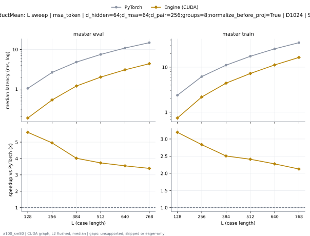

**master eval** (median ms; x = speedup vs PyTorch)

| L | PyTorch | Engine (Triton) | Engine (CUDA) | Anthropic |
|---|---|---|---|---|
| 128 | 1.043 | 0.1966 (5.31x) | 0.1864 (5.60x) | unsupported |
| 256 | 2.635 | 0.5591 (4.71x) | 0.532 (4.95x) | unsupported |
| 384 | 4.805 | 1.265 (3.80x) | 1.197 (4.01x) | unsupported |
| 512 | 7.495 | 2.232 (3.36x) | 2.009 (3.73x) | unsupported |
| 640 | 10.89 | 3.395 (3.21x) | 3.066 (3.55x) | unsupported |
| 768 | 14.87 | 4.769 (3.12x) | 4.379 (3.40x) | unsupported |

**master train** (median ms; x = speedup vs PyTorch)

| L | PyTorch | Engine (Triton) | Engine (CUDA) | Anthropic |
|---|---|---|---|---|
| 128 | 2.38 | 0.8192 (2.91x) | 0.745 (3.20x) | unsupported |
| 256 | 6.175 | 2.262 (2.73x) | 2.178 (2.84x) | unsupported |
| 384 | 11.07 | 4.525 (2.45x) | 4.418 (2.50x) | unsupported |
| 512 | 17.44 | 7.515 (2.32x) | 7.238 (2.41x) | unsupported |
| 640 | 25.49 | 11.57 (2.20x) | 11.21 (2.28x) | unsupported |
| 768 | 34.95 | 16.95 (2.06x) | 16.45 (2.12x) | unsupported |

### d_msa sweep at L768: msa_token | normalize_before_proj=False | D1024 | S1 | graph

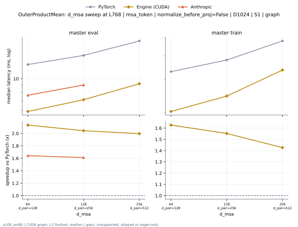

**master eval** (median ms; x = speedup vs PyTorch)

| d_msa | PyTorch | Engine (Triton) | Engine (CUDA) | Anthropic |
|---|---|---|---|---|
| 64 d_pair=128 | 12.58 | 6.917 (1.82x) | 5.892 (2.13x) | 7.658 (1.64x) |
| 128 d_pair=256 | 14.56 | 8.339 (1.75x) | 7.127 (2.04x) | 9.038 (1.61x) |
| 256 d_pair=512 | 18.4 | 11.03 (1.67x) | 9.217 (2.00x) | unsupported |

**master train** (median ms; x = speedup vs PyTorch)

| d_msa | PyTorch | Engine (Triton) | Engine (CUDA) | Anthropic |
|---|---|---|---|---|
| 64 d_pair=128 | 32.99 | 23.1 (1.43x) | 20.27 (1.63x) | unsupported |
| 128 d_pair=256 | 38.01 | 28.96 (1.31x) | 24.48 (1.55x) | unsupported |
| 256 d_pair=512 | 48 | 40.3 (1.19x) | 33.64 (1.43x) | unsupported |

### d_pair sweep at L768: msa_token | normalize_before_proj=False | D1024 | S1 | graph

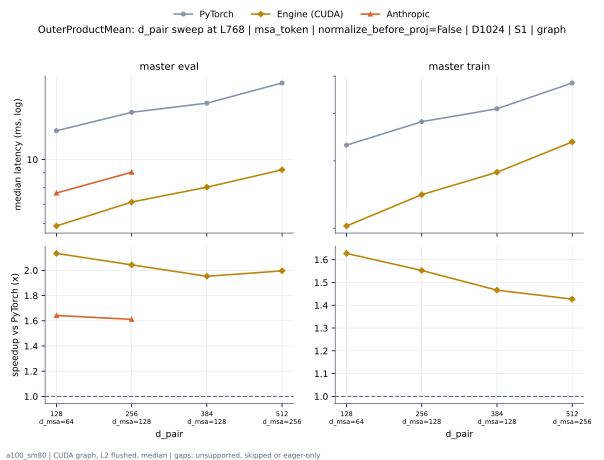

**master eval** (median ms; x = speedup vs PyTorch)

| d_pair | PyTorch | Engine (Triton) | Engine (CUDA) | Anthropic |
|---|---|---|---|---|
| 128 d_msa=64 | 12.58 | 6.917 (1.82x) | 5.892 (2.13x) | 7.658 (1.64x) |
| 256 d_msa=128 | 14.56 | 8.339 (1.75x) | 7.127 (2.04x) | 9.038 (1.61x) |
| 384 d_msa=128 | 15.67 | 9.528 (1.64x) | 8.023 (1.95x) | unsupported |
| 512 d_msa=256 | 18.4 | 11.03 (1.67x) | 9.217 (2.00x) | unsupported |

**master train** (median ms; x = speedup vs PyTorch)

| d_pair | PyTorch | Engine (Triton) | Engine (CUDA) | Anthropic |
|---|---|---|---|---|
| 128 d_msa=64 | 32.99 | 23.1 (1.43x) | 20.27 (1.63x) | unsupported |
| 256 d_msa=128 | 38.01 | 28.96 (1.31x) | 24.48 (1.55x) | unsupported |
| 384 d_msa=128 | 41.08 | 33.45 (1.23x) | 28.02 (1.47x) | unsupported |
| 512 d_msa=256 | 48 | 40.3 (1.19x) | 33.64 (1.43x) | unsupported |

### d_pair sweep at L768: msa_token | normalize_before_proj=True | D1024 | S1 | graph

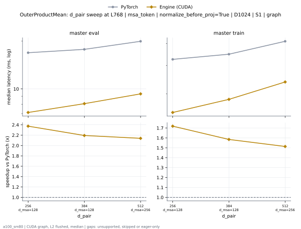

**master eval** (median ms; x = speedup vs PyTorch)

| d_pair | PyTorch | Engine (Triton) | Engine (CUDA) | Anthropic |
|---|---|---|---|---|
| 256 d_msa=128 | 16.88 | 8.539 (1.98x) | 7.113 (2.37x) | unsupported |
| 384 d_msa=128 | 17.72 | 9.593 (1.85x) | 8.08 (2.19x) | unsupported |
| 512 d_msa=256 | 19.92 | 11.11 (1.79x) | 9.311 (2.14x) | unsupported |

**master train** (median ms; x = speedup vs PyTorch)

| d_pair | PyTorch | Engine (Triton) | Engine (CUDA) | Anthropic |
|---|---|---|---|---|
| 256 d_msa=128 | 42.6 | 29.14 (1.46x) | 24.79 (1.72x) | unsupported |
| 384 d_msa=128 | 44.88 | 33.47 (1.34x) | 28.33 (1.58x) | unsupported |
| 512 d_msa=256 | 51.19 | 40.24 (1.27x) | 33.83 (1.51x) | unsupported |

