# OuterProductMean on a100_sm80

Generated by `python -m foldjet_engine.measure.plot` from speed tokens `judge/tokens/a100_sm80/`; do not edit.

### L sweep: msa_token | count_offset=0.001;d_hidden=32;d_msa=128;d_pair=256;normalize_before_proj=False | D1024 | S1 | graph

**master eval** (median ms; x = speedup vs PyTorch)

| L | PyTorch | Engine (Triton) | Engine (CUDA) | Anthropic |
|---|---|---|---|---|
| 128 | 0.9549 | 0.2918 (3.27x) | 0.2929 (3.26x) | unsupported |
| 256 | 2.406 | 0.94 (2.56x) | 0.8914 (2.70x) | unsupported |
| 384 | 4.483 | 2.167 (2.07x) | 2.148 (2.09x) | unsupported |
| 512 | 7.118 | 3.851 (1.85x) | 3.777 (1.88x) | unsupported |
| 640 | 10.49 | 5.855 (1.79x) | 5.871 (1.79x) | unsupported |
| 768 | 14.42 | 8.433 (1.71x) | 8.307 (1.74x) | unsupported |
| 1024 | 24.12 | 14.7 (1.64x) | 14.57 (1.66x) | unsupported |
| 1536 | 51.57 | 33.29 (1.55x) | 32.54 (1.58x) | unsupported |
| 2048 | 88.33 | 58.77 (1.50x) | 57.31 (1.54x) | unsupported |

**master train** (median ms; x = speedup vs PyTorch)

| L | PyTorch | Engine (Triton) | Engine (CUDA) | Anthropic |
|---|---|---|---|---|
| 128 | 2.43 | 1.3 (1.87x) | 0.9513 (2.55x) | unsupported |
| 256 | 6.081 | 3.836 (1.59x) | 3.106 (1.96x) | unsupported |
| 384 | 11.54 | 7.99 (1.44x) | 6.568 (1.76x) | unsupported |
| 512 | 18.35 | 13.29 (1.38x) | 11.17 (1.64x) | unsupported |
| 640 | 26.88 | 19.85 (1.35x) | 17.33 (1.55x) | unsupported |
| 768 | 37.62 | 28.73 (1.31x) | 25.44 (1.48x) | unsupported |
| 1024 |  |  |  |  |
| 1536 |  |  |  |  |
| 2048 |  |  |  |  |

### L sweep: msa_token | count_offset=0.001;d_hidden=32;d_msa=128;d_pair=384;normalize_before_proj=False | D1024 | S1 | graph

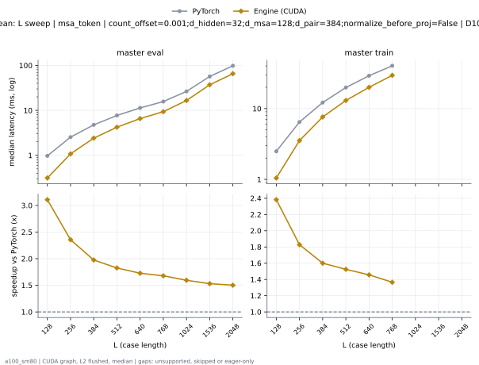

**master eval** (median ms; x = speedup vs PyTorch)

| L | PyTorch | Engine (Triton) | Engine (CUDA) | Anthropic |
|---|---|---|---|---|
| 128 | 0.9738 | 0.3205 (3.04x) | 0.3133 (3.11x) | unsupported |
| 256 | 2.541 | 1.068 (2.38x) | 1.079 (2.36x) | unsupported |
| 384 | 4.764 | 2.519 (1.89x) | 2.412 (1.97x) | unsupported |
| 512 | 7.713 | 4.38 (1.76x) | 4.226 (1.83x) | unsupported |
| 640 | 11.34 | 6.749 (1.68x) | 6.568 (1.73x) | unsupported |
| 768 | 15.7 | 9.773 (1.61x) | 9.355 (1.68x) | unsupported |
| 1024 | 26.46 | 17.09 (1.55x) | 16.59 (1.59x) | unsupported |
| 1536 | 56.72 | 38.71 (1.47x) | 37.06 (1.53x) | unsupported |
| 2048 | 98.19 | 68.3 (1.44x) | 65.38 (1.50x) | unsupported |

**master train** (median ms; x = speedup vs PyTorch)

| L | PyTorch | Engine (Triton) | Engine (CUDA) | Anthropic |
|---|---|---|---|---|
| 128 | 2.492 | 1.449 (1.72x) | 1.046 (2.38x) | unsupported |
| 256 | 6.454 | 4.448 (1.45x) | 3.531 (1.83x) | unsupported |
| 384 | 12.18 | 9.137 (1.33x) | 7.611 (1.60x) | unsupported |
| 512 | 19.85 | 15.45 (1.28x) | 13.02 (1.52x) | unsupported |
| 640 | 29.11 | 23.24 (1.25x) | 19.98 (1.46x) | unsupported |
| 768 | 40.26 | 33.46 (1.20x) | 29.49 (1.37x) | unsupported |
| 1024 |  |  |  |  |
| 1536 |  |  |  |  |
| 2048 |  |  |  |  |

### L sweep: msa_token | count_offset=0.001;d_hidden=32;d_msa=256;d_pair=512;normalize_before_proj=False | D1024 | S1 | graph

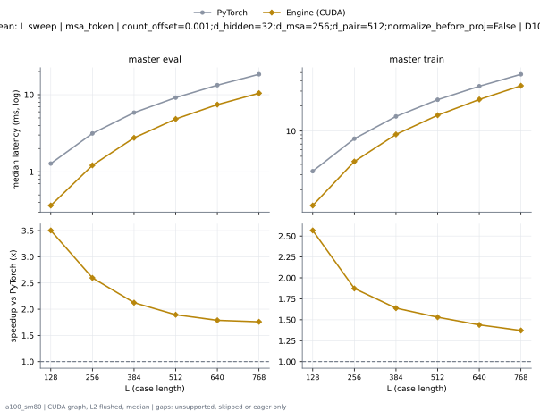

**master eval** (median ms; x = speedup vs PyTorch)

| L | PyTorch | Engine (Triton) | Engine (CUDA) | Anthropic |
|---|---|---|---|---|
| 128 | 1.277 | 0.3963 (3.22x) | 0.3645 (3.50x) | unsupported |
| 256 | 3.145 | 1.363 (2.31x) | 1.211 (2.60x) | unsupported |
| 384 | 5.854 | 2.967 (1.97x) | 2.756 (2.12x) | unsupported |
| 512 | 9.166 | 5.015 (1.83x) | 4.838 (1.89x) | unsupported |
| 640 | 13.3 | 7.871 (1.69x) | 7.436 (1.79x) | unsupported |
| 768 | 18.41 | 11.23 (1.64x) | 10.46 (1.76x) | unsupported |

**master train** (median ms; x = speedup vs PyTorch)

| L | PyTorch | Engine (Triton) | Engine (CUDA) | Anthropic |
|---|---|---|---|---|
| 128 | 3.316 | 2.189 (1.51x) | 1.292 (2.57x) | unsupported |
| 256 | 8.11 | 5.756 (1.41x) | 4.328 (1.87x) | unsupported |
| 384 | 14.95 | 11.56 (1.29x) | 9.122 (1.64x) | unsupported |
| 512 | 23.65 | 18.93 (1.25x) | 15.45 (1.53x) | unsupported |
| 640 | 34.27 | 27.99 (1.22x) | 23.82 (1.44x) | unsupported |
| 768 | 47.61 | 40.02 (1.19x) | 34.72 (1.37x) | unsupported |

### L sweep: msa_token | count_offset=0.001;d_hidden=32;d_msa=64;d_pair=128;normalize_before_proj=False | D1024 | S1 | graph

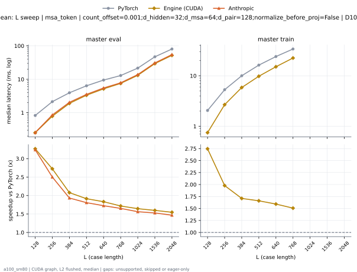

**master eval** (median ms; x = speedup vs PyTorch)

| L | PyTorch | Engine (Triton) | Engine (CUDA) | Anthropic |
|---|---|---|---|---|
| 128 | 0.8264 | 0.2458 (3.36x) | 0.2529 (3.27x) | 0.255 (3.24x) |
| 256 | 2.14 | 0.8115 (2.64x) | 0.7854 (2.72x) | 0.8556 (2.50x) |
| 384 | 3.949 | 1.871 (2.11x) | 1.9 (2.08x) | 2.043 (1.93x) |
| 512 | 6.386 | 3.266 (1.96x) | 3.336 (1.91x) | 3.534 (1.81x) |
| 640 | 9.476 | 5.1 (1.86x) | 5.17 (1.83x) | 5.494 (1.72x) |
| 768 | 12.95 | 7.323 (1.77x) | 7.542 (1.72x) | 7.84 (1.65x) |
| 1024 | 21.6 | 12.79 (1.69x) | 13.14 (1.64x) | 13.83 (1.56x) |
| 1536 | 47.11 | 29.03 (1.62x) | 29.49 (1.60x) | 30.82 (1.53x) |
| 2048 | 80.55 | 51.06 (1.58x) | 52.08 (1.55x) | 54.91 (1.47x) |

**master train** (median ms; x = speedup vs PyTorch)

| L | PyTorch | Engine (Triton) | Engine (CUDA) | Anthropic |
|---|---|---|---|---|
| 128 | 2.058 | 1.024 (2.01x) | 0.7496 (2.75x) | unsupported |
| 256 | 5.299 | 2.99 (1.77x) | 2.679 (1.98x) | unsupported |
| 384 | 10.01 | 6.322 (1.58x) | 5.855 (1.71x) | unsupported |
| 512 | 16.25 | 10.71 (1.52x) | 9.786 (1.66x) | unsupported |
| 640 | 24.01 | 16.35 (1.47x) | 15.08 (1.59x) | unsupported |
| 768 | 33.84 | 23.85 (1.42x) | 22.45 (1.51x) | unsupported |
| 1024 |  |  |  |  |
| 1536 |  |  |  |  |
| 2048 |  |  |  |  |

### L sweep: msa_token | d_hidden=32;d_msa=128;d_pair=256;normalize_before_proj=False | D1024 | S1 | graph

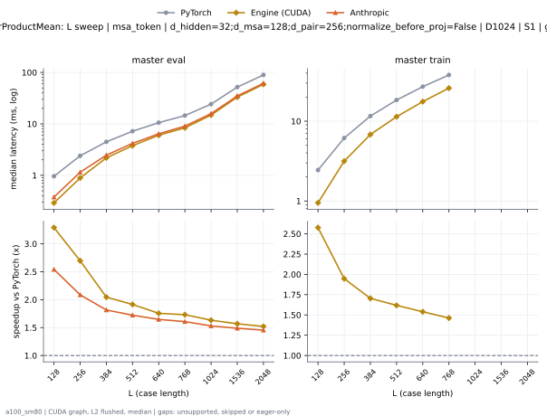

**master eval** (median ms; x = speedup vs PyTorch)

| L | PyTorch | Engine (Triton) | Engine (CUDA) | Anthropic |
|---|---|---|---|---|
| 128 | 0.9605 | 0.2918 (3.29x) | 0.2918 (3.29x) | 0.3779 (2.54x) |
| 256 | 2.398 | 0.9252 (2.59x) | 0.8893 (2.70x) | 1.149 (2.09x) |
| 384 | 4.478 | 2.218 (2.02x) | 2.189 (2.05x) | 2.467 (1.82x) |
| 512 | 7.21 | 3.857 (1.87x) | 3.766 (1.91x) | 4.187 (1.72x) |
| 640 | 10.57 | 5.918 (1.79x) | 6.019 (1.76x) | 6.417 (1.65x) |
| 768 | 14.53 | 8.498 (1.71x) | 8.396 (1.73x) | 9.043 (1.61x) |
| 1024 | 24.23 | 15 (1.62x) | 14.85 (1.63x) | 15.84 (1.53x) |
| 1536 | 51.96 | 33.79 (1.54x) | 33.13 (1.57x) | 34.92 (1.49x) |
| 2048 | 89.36 | 59.58 (1.50x) | 58.76 (1.52x) | 61.44 (1.45x) |

**master train** (median ms; x = speedup vs PyTorch)

| L | PyTorch | Engine (Triton) | Engine (CUDA) | Anthropic |
|---|---|---|---|---|
| 128 | 2.441 | 1.306 (1.87x) | 0.9472 (2.58x) | unsupported |
| 256 | 6.144 | 3.85 (1.60x) | 3.156 (1.95x) | unsupported |
| 384 | 11.6 | 7.936 (1.46x) | 6.804 (1.70x) | unsupported |
| 512 | 18.41 | 13.34 (1.38x) | 11.38 (1.62x) | unsupported |
| 640 | 27.07 | 20.1 (1.35x) | 17.59 (1.54x) | unsupported |
| 768 | 37.97 | 28.98 (1.31x) | 25.97 (1.46x) | unsupported |
| 1024 |  |  |  |  |
| 1536 |  |  |  |  |
| 2048 |  |  |  |  |

### L sweep: msa_token | d_hidden=32;d_msa=128;d_pair=256;normalize_before_proj=True | D1024 | S1 | graph

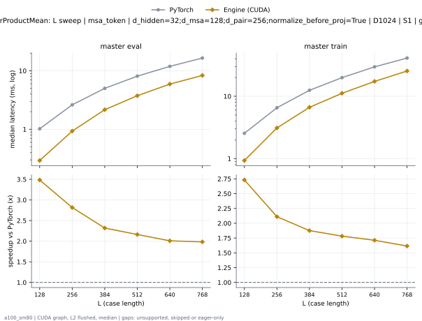

**master eval** (median ms; x = speedup vs PyTorch)

| L | PyTorch | Engine (Triton) | Engine (CUDA) | Anthropic |
|---|---|---|---|---|
| 128 | 1.02 | 0.2913 (3.50x) | 0.2929 (3.48x) | unsupported |
| 256 | 2.623 | 0.9216 (2.85x) | 0.9318 (2.82x) | unsupported |
| 384 | 5.012 | 2.184 (2.30x) | 2.162 (2.32x) | unsupported |
| 512 | 8.099 | 3.866 (2.09x) | 3.747 (2.16x) | unsupported |
| 640 | 11.9 | 5.858 (2.03x) | 5.926 (2.01x) | unsupported |
| 768 | 16.53 | 8.388 (1.97x) | 8.332 (1.98x) | unsupported |

**master train** (median ms; x = speedup vs PyTorch)

| L | PyTorch | Engine (Triton) | Engine (CUDA) | Anthropic |
|---|---|---|---|---|
| 128 | 2.545 | 1.289 (1.97x) | 0.9318 (2.73x) | unsupported |
| 256 | 6.543 | 3.834 (1.71x) | 3.101 (2.11x) | unsupported |
| 384 | 12.48 | 7.911 (1.58x) | 6.653 (1.88x) | unsupported |
| 512 | 19.9 | 13.27 (1.50x) | 11.17 (1.78x) | unsupported |
| 640 | 29.65 | 19.84 (1.49x) | 17.31 (1.71x) | unsupported |
| 768 | 41.07 | 28.76 (1.43x) | 25.44 (1.61x) | unsupported |

### L sweep: msa_token | d_hidden=32;d_msa=128;d_pair=384;normalize_before_proj=False | D1024 | S1 | graph

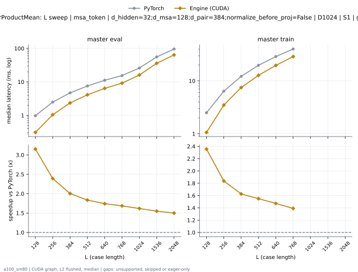

**master eval** (median ms; x = speedup vs PyTorch)

| L | PyTorch | Engine (Triton) | Engine (CUDA) | Anthropic |
|---|---|---|---|---|
| 128 | 0.981 | 0.3195 (3.07x) | 0.3113 (3.15x) | unsupported |
| 256 | 2.502 | 1.056 (2.37x) | 1.047 (2.39x) | unsupported |
| 384 | 4.714 | 2.456 (1.92x) | 2.353 (2.00x) | unsupported |
| 512 | 7.56 | 4.289 (1.76x) | 4.12 (1.84x) | unsupported |
| 640 | 11.2 | 6.589 (1.70x) | 6.43 (1.74x) | unsupported |
| 768 | 15.49 | 9.521 (1.63x) | 9.192 (1.69x) | unsupported |
| 1024 | 26.02 | 16.79 (1.55x) | 16.09 (1.62x) | unsupported |
| 1536 | 55.77 | 37.91 (1.47x) | 36 (1.55x) | unsupported |
| 2048 | 96.14 | 66.8 (1.44x) | 64.1 (1.50x) | unsupported |

**master train** (median ms; x = speedup vs PyTorch)

| L | PyTorch | Engine (Triton) | Engine (CUDA) | Anthropic |
|---|---|---|---|---|
| 128 | 2.49 | 1.419 (1.75x) | 1.057 (2.36x) | unsupported |
| 256 | 6.393 | 4.381 (1.46x) | 3.482 (1.84x) | unsupported |
| 384 | 12.18 | 9.103 (1.34x) | 7.491 (1.63x) | unsupported |
| 512 | 19.78 | 15.28 (1.29x) | 12.77 (1.55x) | unsupported |
| 640 | 28.9 | 22.95 (1.26x) | 19.64 (1.47x) | unsupported |
| 768 | 40.23 | 33.12 (1.21x) | 28.92 (1.39x) | unsupported |
| 1024 |  |  |  |  |
| 1536 |  |  |  |  |
| 2048 |  |  |  |  |

### L sweep: msa_token | d_hidden=32;d_msa=128;d_pair=384;normalize_before_proj=True | D1024 | S1 | graph

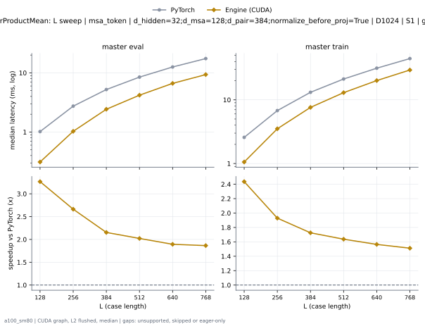

**master eval** (median ms; x = speedup vs PyTorch)

| L | PyTorch | Engine (Triton) | Engine (CUDA) | Anthropic |
|---|---|---|---|---|
| 128 | 1.017 | 0.3174 (3.20x) | 0.3113 (3.27x) | unsupported |
| 256 | 2.737 | 1.127 (2.43x) | 1.028 (2.66x) | unsupported |
| 384 | 5.223 | 2.49 (2.10x) | 2.426 (2.15x) | unsupported |
| 512 | 8.479 | 4.392 (1.93x) | 4.194 (2.02x) | unsupported |
| 640 | 12.58 | 6.747 (1.86x) | 6.642 (1.89x) | unsupported |
| 768 | 17.45 | 9.767 (1.79x) | 9.355 (1.86x) | unsupported |

**master train** (median ms; x = speedup vs PyTorch)

| L | PyTorch | Engine (Triton) | Engine (CUDA) | Anthropic |
|---|---|---|---|---|
| 128 | 2.574 | 1.413 (1.82x) | 1.057 (2.44x) | unsupported |
| 256 | 6.776 | 4.391 (1.54x) | 3.512 (1.93x) | unsupported |
| 384 | 13.13 | 9.128 (1.44x) | 7.607 (1.73x) | unsupported |
| 512 | 21.23 | 15.42 (1.38x) | 12.97 (1.64x) | unsupported |
| 640 | 31.39 | 23.07 (1.36x) | 20.07 (1.56x) | unsupported |
| 768 | 44.44 | 33.47 (1.33x) | 29.39 (1.51x) | unsupported |

### L sweep: msa_token | d_hidden=32;d_msa=256;d_pair=512;normalize_before_proj=False | D1024 | S1 | graph

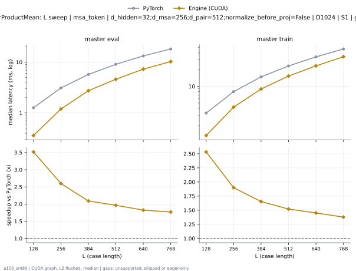

**master eval** (median ms; x = speedup vs PyTorch)

| L | PyTorch | Engine (Triton) | Engine (CUDA) | Anthropic |
|---|---|---|---|---|
| 128 | 1.268 | 0.3932 (3.22x) | 0.3604 (3.52x) | unsupported |
| 256 | 3.114 | 1.338 (2.33x) | 1.199 (2.60x) | unsupported |
| 384 | 5.735 | 2.907 (1.97x) | 2.745 (2.09x) | unsupported |
| 512 | 9.08 | 4.974 (1.83x) | 4.623 (1.96x) | unsupported |
| 640 | 13.31 | 7.686 (1.73x) | 7.3 (1.82x) | unsupported |
| 768 | 18.21 | 11.03 (1.65x) | 10.29 (1.77x) | unsupported |

**master train** (median ms; x = speedup vs PyTorch)

| L | PyTorch | Engine (Triton) | Engine (CUDA) | Anthropic |
|---|---|---|---|---|
| 128 | 3.295 | 2.169 (1.52x) | 1.301 (2.53x) | unsupported |
| 256 | 8.022 | 5.694 (1.41x) | 4.225 (1.90x) | unsupported |
| 384 | 14.79 | 11.37 (1.30x) | 8.947 (1.65x) | unsupported |
| 512 | 23.28 | 18.68 (1.25x) | 15.31 (1.52x) | unsupported |
| 640 | 33.97 | 27.7 (1.23x) | 23.4 (1.45x) | unsupported |
| 768 | 47.08 | 39.67 (1.19x) | 34.18 (1.38x) | unsupported |

### L sweep: msa_token | d_hidden=32;d_msa=256;d_pair=512;normalize_before_proj=True | D1024 | S1 | graph

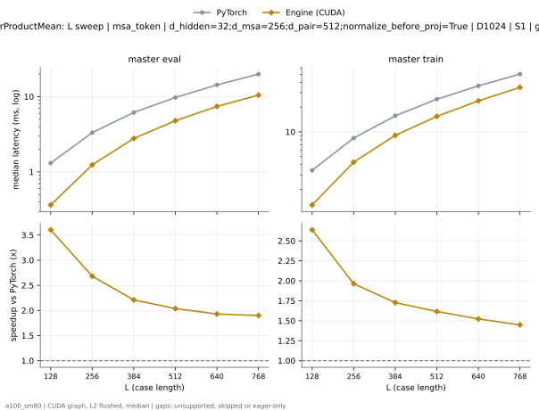

**master eval** (median ms; x = speedup vs PyTorch)

| L | PyTorch | Engine (Triton) | Engine (CUDA) | Anthropic |
|---|---|---|---|---|
| 128 | 1.31 | 0.3922 (3.34x) | 0.3635 (3.60x) | unsupported |
| 256 | 3.326 | 1.35 (2.46x) | 1.241 (2.68x) | unsupported |
| 384 | 6.158 | 2.968 (2.08x) | 2.787 (2.21x) | unsupported |
| 512 | 9.748 | 5.091 (1.91x) | 4.784 (2.04x) | unsupported |
| 640 | 14.32 | 7.822 (1.83x) | 7.42 (1.93x) | unsupported |
| 768 | 19.92 | 11.25 (1.77x) | 10.49 (1.90x) | unsupported |

**master train** (median ms; x = speedup vs PyTorch)

| L | PyTorch | Engine (Triton) | Engine (CUDA) | Anthropic |
|---|---|---|---|---|
| 128 | 3.409 | 2.183 (1.56x) | 1.292 (2.64x) | unsupported |
| 256 | 8.42 | 5.793 (1.45x) | 4.289 (1.96x) | unsupported |
| 384 | 15.67 | 11.56 (1.36x) | 9.075 (1.73x) | unsupported |
| 512 | 24.97 | 19.06 (1.31x) | 15.45 (1.62x) | unsupported |
| 640 | 36.28 | 28.06 (1.29x) | 23.82 (1.52x) | unsupported |
| 768 | 50.39 | 40.26 (1.25x) | 34.78 (1.45x) | unsupported |

### L sweep: msa_token | d_hidden=32;d_msa=64;d_pair=128;normalize_before_proj=False | D1024 | S1 | graph

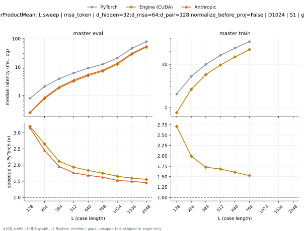

**master eval** (median ms; x = speedup vs PyTorch)

| L | PyTorch | Engine (Triton) | Engine (CUDA) | Anthropic |
|---|---|---|---|---|
| 128 | 0.7987 | 0.2422 (3.30x) | 0.2499 (3.20x) | 0.254 (3.15x) |
| 256 | 2.074 | 0.7772 (2.67x) | 0.7813 (2.65x) | 0.8443 (2.46x) |
| 384 | 3.896 | 1.798 (2.17x) | 1.842 (2.12x) | 1.992 (1.96x) |
| 512 | 6.157 | 3.149 (1.96x) | 3.182 (1.94x) | 3.501 (1.76x) |
| 640 | 9.145 | 4.902 (1.87x) | 4.988 (1.83x) | 5.441 (1.68x) |
| 768 | 12.58 | 7.015 (1.79x) | 7.194 (1.75x) | 7.749 (1.62x) |
| 1024 | 20.81 | 12.31 (1.69x) | 12.59 (1.65x) | 13.64 (1.53x) |
| 1536 | 45.46 | 28.1 (1.62x) | 28.48 (1.60x) | 30.37 (1.50x) |
| 2048 | 78.62 | 49.6 (1.59x) | 50.52 (1.56x) | 54.04 (1.45x) |

**master train** (median ms; x = speedup vs PyTorch)

| L | PyTorch | Engine (Triton) | Engine (CUDA) | Anthropic |
|---|---|---|---|---|
| 128 | 2.045 | 1.002 (2.04x) | 0.7547 (2.71x) | unsupported |
| 256 | 5.236 | 2.939 (1.78x) | 2.63 (1.99x) | unsupported |
| 384 | 9.975 | 6.22 (1.60x) | 5.775 (1.73x) | unsupported |
| 512 | 16.19 | 10.49 (1.54x) | 9.619 (1.68x) | unsupported |
| 640 | 23.76 | 15.93 (1.49x) | 14.81 (1.60x) | unsupported |
| 768 | 33.68 | 23.46 (1.44x) | 22.09 (1.52x) | unsupported |
| 1024 |  |  |  |  |
| 1536 |  |  |  |  |
| 2048 |  |  |  |  |

### L sweep: msa_token | d_hidden=32;d_msa=64;d_pair=128;normalize_before_proj=False;projection_bias=True | D1024 | S1 | graph

**master eval** (median ms; x = speedup vs PyTorch)

| L | PyTorch | Engine (Triton) | Engine (CUDA) | Anthropic |
|---|---|---|---|---|
| 128 | 0.8069 | 0.2447 (3.30x) | 0.257 (3.14x) | unsupported |
| 256 | 2.085 | 0.7803 (2.67x) | 0.7793 (2.68x) | unsupported |
| 384 | 3.917 | 1.826 (2.15x) | 1.882 (2.08x) | unsupported |
| 512 | 6.266 | 3.198 (1.96x) | 3.26 (1.92x) | unsupported |
| 640 | 9.329 | 4.991 (1.87x) | 5.159 (1.81x) | unsupported |
| 768 | 12.81 | 7.15 (1.79x) | 7.358 (1.74x) | unsupported |
| 1024 | 21.31 | 12.57 (1.70x) | 12.9 (1.65x) | unsupported |
| 1536 | 46.45 | 28.73 (1.62x) | 29.07 (1.60x) | unsupported |
| 2048 | 80.11 | 50.55 (1.58x) | 51.52 (1.55x) | unsupported |

**master train** (median ms; x = speedup vs PyTorch)

| L | PyTorch | Engine (Triton) | Engine (CUDA) | Anthropic |
|---|---|---|---|---|
| 128 | 2.12 | 1.037 (2.04x) | 0.8279 (2.56x) | unsupported |
| 256 | 5.348 | 3.036 (1.76x) | 2.71 (1.97x) | unsupported |
| 384 | 10.14 | 6.383 (1.59x) | 5.821 (1.74x) | unsupported |
| 512 | 16.39 | 10.71 (1.53x) | 9.884 (1.66x) | unsupported |
| 640 | 24.3 | 16.35 (1.49x) | 15.06 (1.61x) | unsupported |
| 768 | 33.86 | 23.95 (1.41x) | 22.51 (1.50x) | unsupported |
| 1024 |  |  |  |  |
| 1536 |  |  |  |  |
| 2048 |  |  |  |  |

### L sweep: msa_token | d_hidden=32;d_msa=64;d_pair=128;normalize_before_proj=True | D384 | S1 | graph

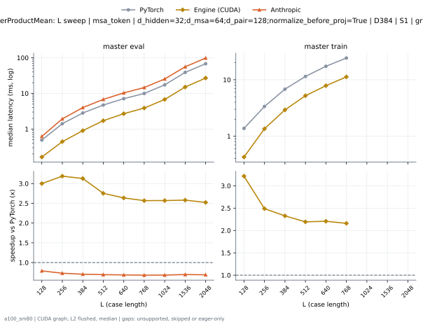

**master eval** (median ms; x = speedup vs PyTorch)

| L | PyTorch | Engine (Triton) | Engine (CUDA) | Anthropic |
|---|---|---|---|---|
| 128 | 0.4915 | 0.1485 (3.31x) | 0.1638 (3.00x) | 0.6226 (0.79x) |
| 256 | 1.41 | 0.4321 (3.26x) | 0.4424 (3.19x) | 1.929 (0.73x) |
| 384 | 2.824 | 0.898 (3.14x) | 0.9027 (3.13x) | 4.003 (0.71x) |
| 512 | 4.717 | 1.633 (2.89x) | 1.713 (2.75x) | 6.786 (0.70x) |
| 640 | 7.115 | 2.556 (2.78x) | 2.698 (2.64x) | 10.35 (0.69x) |
| 768 | 9.967 | 3.759 (2.65x) | 3.881 (2.57x) | 14.63 (0.68x) |
| 1024 | 17.39 | 6.508 (2.67x) | 6.766 (2.57x) | 25.44 (0.68x) |
| 1536 | 38.99 | 14.7 (2.65x) | 15.11 (2.58x) | 55.91 (0.70x) |
| 2048 | 68.07 | 26.22 (2.60x) | 26.98 (2.52x) | 98.53 (0.69x) |

**master train** (median ms; x = speedup vs PyTorch)

| L | PyTorch | Engine (Triton) | Engine (CUDA) | Anthropic |
|---|---|---|---|---|
| 128 | 1.373 | 0.5212 (2.63x) | 0.427 (3.22x) | unsupported |
| 256 | 3.363 | 1.536 (2.19x) | 1.352 (2.49x) | unsupported |
| 384 | 6.806 | 3.374 (2.02x) | 2.925 (2.33x) | unsupported |
| 512 | 11.44 | 5.848 (1.96x) | 5.217 (2.19x) | unsupported |
| 640 | 17.32 | 8.941 (1.94x) | 7.849 (2.21x) | unsupported |
| 768 | 24.28 | 12.65 (1.92x) | 11.24 (2.16x) | unsupported |
| 1024 |  |  |  |  |
| 1536 |  |  |  |  |
| 2048 |  |  |  |  |

### L sweep: msa_token | d_hidden=32;d_msa=64;d_pair=128;normalize_before_proj=True;projection_bias=True | D1024 | S1 | graph

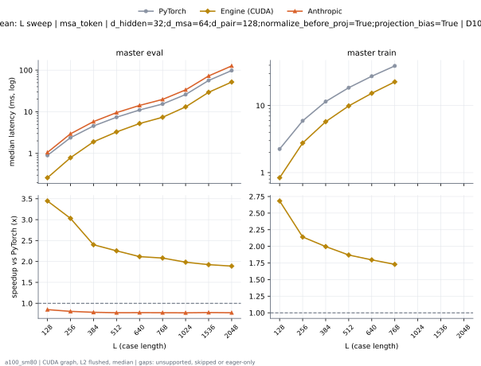

**master eval** (median ms; x = speedup vs PyTorch)

| L | PyTorch | Engine (Triton) | Engine (CUDA) | Anthropic |
|---|---|---|---|---|
| 128 | 0.8965 | 0.2478 (3.62x) | 0.2601 (3.45x) | 1.056 (0.85x) |
| 256 | 2.386 | 0.811 (2.94x) | 0.7875 (3.03x) | 2.956 (0.81x) |
| 384 | 4.561 | 1.848 (2.47x) | 1.901 (2.40x) | 5.807 (0.79x) |
| 512 | 7.397 | 3.266 (2.27x) | 3.281 (2.25x) | 9.545 (0.78x) |
| 640 | 11.04 | 5.061 (2.18x) | 5.218 (2.12x) | 14.21 (0.78x) |
| 768 | 15.36 | 7.244 (2.12x) | 7.376 (2.08x) | 19.81 (0.78x) |
| 1024 | 25.97 | 12.67 (2.05x) | 13.09 (1.98x) | 33.59 (0.77x) |
| 1536 | 56.53 | 28.75 (1.97x) | 29.37 (1.92x) | 72.5 (0.78x) |
| 2048 | 97.87 | 50.86 (1.92x) | 51.8 (1.89x) | 126.3 (0.77x) |

**master train** (median ms; x = speedup vs PyTorch)

| L | PyTorch | Engine (Triton) | Engine (CUDA) | Anthropic |
|---|---|---|---|---|
| 128 | 2.249 | 1.046 (2.15x) | 0.8381 (2.68x) | unsupported |
| 256 | 5.92 | 3.049 (1.94x) | 2.765 (2.14x) | unsupported |
| 384 | 11.48 | 6.356 (1.81x) | 5.748 (2.00x) | unsupported |
| 512 | 18.48 | 10.77 (1.72x) | 9.882 (1.87x) | unsupported |
| 640 | 27.4 | 16.49 (1.66x) | 15.25 (1.80x) | unsupported |
| 768 | 39.05 | 23.95 (1.63x) | 22.58 (1.73x) | unsupported |
| 1024 |  |  |  |  |
| 1536 |  |  |  |  |
| 2048 |  |  |  |  |

### L sweep: msa_token | d_hidden=64;d_msa=64;d_pair=256;groups=8;normalize_before_proj=False | D1024 | S1 | graph

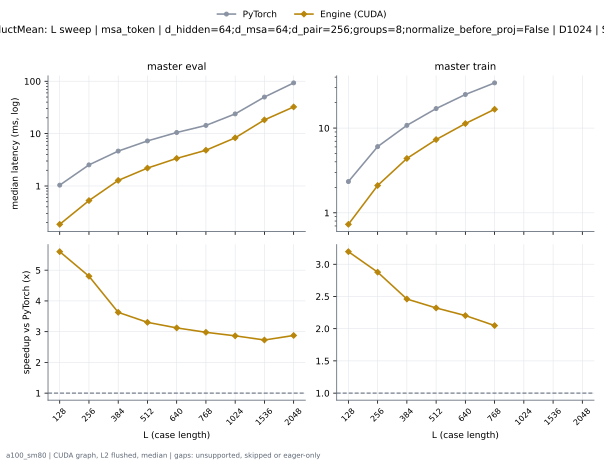

**master eval** (median ms; x = speedup vs PyTorch)

| L | PyTorch | Engine (Triton) | Engine (CUDA) | Anthropic |
|---|---|---|---|---|
| 128 | 1.038 | 0.1956 (5.31x) | 0.1853 (5.60x) | unsupported |
| 256 | 2.53 | 0.5519 (4.58x) | 0.5268 (4.80x) | unsupported |
| 384 | 4.64 | 1.202 (3.86x) | 1.279 (3.63x) | unsupported |
| 512 | 7.257 | 2.126 (3.41x) | 2.198 (3.30x) | unsupported |
| 640 | 10.51 | 3.396 (3.09x) | 3.366 (3.12x) | unsupported |
| 768 | 14.35 | 4.712 (3.05x) | 4.818 (2.98x) | unsupported |
| 1024 | 23.81 | 8.287 (2.87x) | 8.316 (2.86x) | unsupported |
| 1536 | 49.92 | 19.4 (2.57x) | 18.3 (2.73x) | unsupported |
| 2048 | 93.1 | 40.15 (2.32x) | 32.38 (2.88x) | unsupported |

**master train** (median ms; x = speedup vs PyTorch)

| L | PyTorch | Engine (Triton) | Engine (CUDA) | Anthropic |
|---|---|---|---|---|
| 128 | 2.338 | 0.8059 (2.90x) | 0.7316 (3.20x) | unsupported |
| 256 | 6.044 | 2.2 (2.75x) | 2.101 (2.88x) | unsupported |
| 384 | 10.77 | 4.47 (2.41x) | 4.38 (2.46x) | unsupported |
| 512 | 16.99 | 7.335 (2.32x) | 7.321 (2.32x) | unsupported |
| 640 | 24.91 | 11.37 (2.19x) | 11.31 (2.20x) | unsupported |
| 768 | 34.16 | 16.51 (2.07x) | 16.68 (2.05x) | unsupported |
| 1024 |  |  |  |  |
| 1536 |  |  |  |  |
| 2048 |  |  |  |  |

### L sweep: msa_token | d_hidden=64;d_msa=64;d_pair=256;groups=8;normalize_before_proj=True | D1024 | S1 | graph

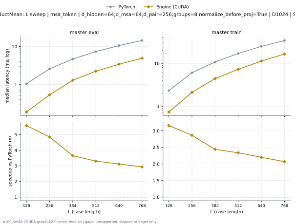

**master eval** (median ms; x = speedup vs PyTorch)

| L | PyTorch | Engine (Triton) | Engine (CUDA) | Anthropic |
|---|---|---|---|---|
| 128 | 1.039 | 0.1956 (5.31x) | 0.1864 (5.58x) | unsupported |
| 256 | 2.571 | 0.5632 (4.57x) | 0.5304 (4.85x) | unsupported |
| 384 | 4.682 | 1.228 (3.81x) | 1.283 (3.65x) | unsupported |
| 512 | 7.362 | 2.145 (3.43x) | 2.23 (3.30x) | unsupported |
| 640 | 10.62 | 3.4 (3.12x) | 3.407 (3.12x) | unsupported |
| 768 | 14.46 | 4.731 (3.06x) | 4.934 (2.93x) | unsupported |

**master train** (median ms; x = speedup vs PyTorch)

| L | PyTorch | Engine (Triton) | Engine (CUDA) | Anthropic |
|---|---|---|---|---|
| 128 | 2.321 | 0.8044 (2.89x) | 0.7352 (3.16x) | unsupported |
| 256 | 6.046 | 2.208 (2.74x) | 2.111 (2.86x) | unsupported |
| 384 | 10.78 | 4.465 (2.42x) | 4.421 (2.44x) | unsupported |
| 512 | 16.99 | 7.31 (2.32x) | 7.272 (2.34x) | unsupported |
| 640 | 24.9 | 11.27 (2.21x) | 11.32 (2.20x) | unsupported |
| 768 | 34.16 | 16.46 (2.07x) | 16.51 (2.07x) | unsupported |

### d_msa sweep at L768: msa_token | count_offset=0.001;normalize_before_proj=False | D1024 | S1 | graph

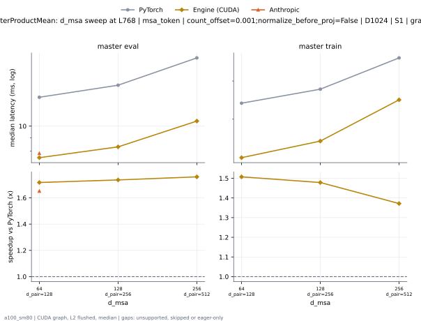

**master eval** (median ms; x = speedup vs PyTorch)

| d_msa | PyTorch | Engine (Triton) | Engine (CUDA) | Anthropic |
|---|---|---|---|---|
| 64 d_pair=128 | 12.95 | 7.323 (1.77x) | 7.542 (1.72x) | 7.84 (1.65x) |
| 128 d_pair=256 | 14.42 | 8.433 (1.71x) | 8.307 (1.74x) | unsupported |
| 256 d_pair=512 | 18.41 | 11.23 (1.64x) | 10.46 (1.76x) | unsupported |

**master train** (median ms; x = speedup vs PyTorch)

| d_msa | PyTorch | Engine (Triton) | Engine (CUDA) | Anthropic |
|---|---|---|---|---|
| 64 d_pair=128 | 33.84 | 23.85 (1.42x) | 22.45 (1.51x) | unsupported |
| 128 d_pair=256 | 37.62 | 28.73 (1.31x) | 25.44 (1.48x) | unsupported |
| 256 d_pair=512 | 47.61 | 40.02 (1.19x) | 34.72 (1.37x) | unsupported |

### d_msa sweep at L768: msa_token | normalize_before_proj=False | D1024 | S1 | graph

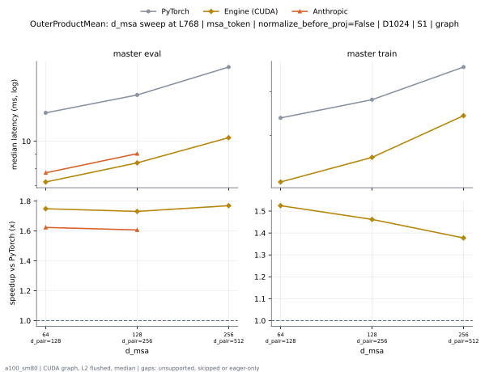

**master eval** (median ms; x = speedup vs PyTorch)

| d_msa | PyTorch | Engine (Triton) | Engine (CUDA) | Anthropic |
|---|---|---|---|---|
| 64 d_pair=128 | 12.58 | 7.015 (1.79x) | 7.194 (1.75x) | 7.749 (1.62x) |
| 128 d_pair=256 | 14.53 | 8.498 (1.71x) | 8.396 (1.73x) | 9.043 (1.61x) |
| 256 d_pair=512 | 18.21 | 11.03 (1.65x) | 10.29 (1.77x) | unsupported |

**master train** (median ms; x = speedup vs PyTorch)

| d_msa | PyTorch | Engine (Triton) | Engine (CUDA) | Anthropic |
|---|---|---|---|---|
| 64 d_pair=128 | 33.68 | 23.46 (1.44x) | 22.09 (1.52x) | unsupported |
| 128 d_pair=256 | 37.97 | 28.98 (1.31x) | 25.97 (1.46x) | unsupported |
| 256 d_pair=512 | 47.08 | 39.67 (1.19x) | 34.18 (1.38x) | unsupported |

### d_pair sweep at L768: msa_token | count_offset=0.001;normalize_before_proj=False | D1024 | S1 | graph

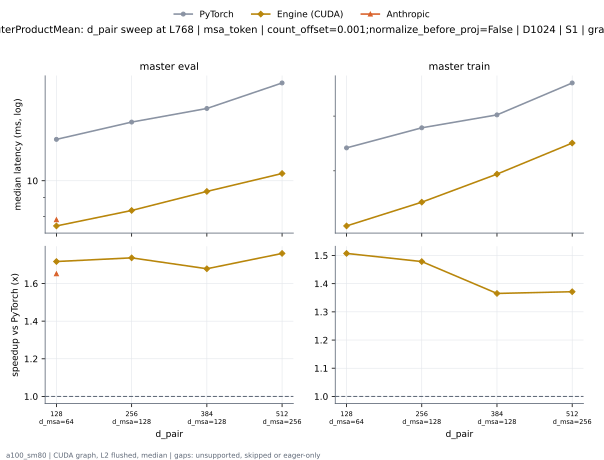

**master eval** (median ms; x = speedup vs PyTorch)

| d_pair | PyTorch | Engine (Triton) | Engine (CUDA) | Anthropic |
|---|---|---|---|---|
| 128 d_msa=64 | 12.95 | 7.323 (1.77x) | 7.542 (1.72x) | 7.84 (1.65x) |
| 256 d_msa=128 | 14.42 | 8.433 (1.71x) | 8.307 (1.74x) | unsupported |
| 384 d_msa=128 | 15.7 | 9.773 (1.61x) | 9.355 (1.68x) | unsupported |
| 512 d_msa=256 | 18.41 | 11.23 (1.64x) | 10.46 (1.76x) | unsupported |

**master train** (median ms; x = speedup vs PyTorch)

| d_pair | PyTorch | Engine (Triton) | Engine (CUDA) | Anthropic |
|---|---|---|---|---|
| 128 d_msa=64 | 33.84 | 23.85 (1.42x) | 22.45 (1.51x) | unsupported |
| 256 d_msa=128 | 37.62 | 28.73 (1.31x) | 25.44 (1.48x) | unsupported |
| 384 d_msa=128 | 40.26 | 33.46 (1.20x) | 29.49 (1.37x) | unsupported |
| 512 d_msa=256 | 47.61 | 40.02 (1.19x) | 34.72 (1.37x) | unsupported |

### d_pair sweep at L768: msa_token | normalize_before_proj=False | D1024 | S1 | graph

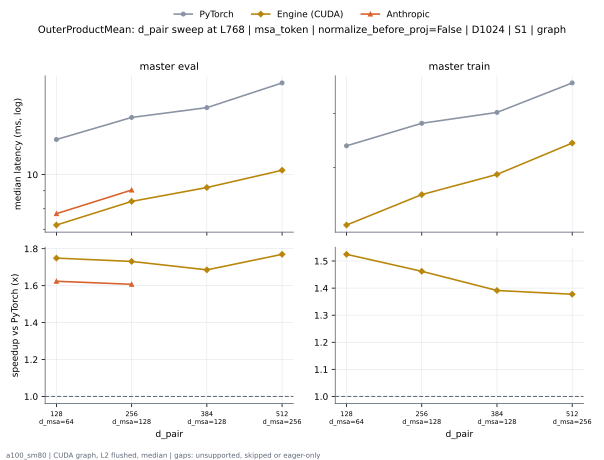

**master eval** (median ms; x = speedup vs PyTorch)

| d_pair | PyTorch | Engine (Triton) | Engine (CUDA) | Anthropic |
|---|---|---|---|---|
| 128 d_msa=64 | 12.58 | 7.015 (1.79x) | 7.194 (1.75x) | 7.749 (1.62x) |
| 256 d_msa=128 | 14.53 | 8.498 (1.71x) | 8.396 (1.73x) | 9.043 (1.61x) |
| 384 d_msa=128 | 15.49 | 9.521 (1.63x) | 9.192 (1.69x) | unsupported |
| 512 d_msa=256 | 18.21 | 11.03 (1.65x) | 10.29 (1.77x) | unsupported |

**master train** (median ms; x = speedup vs PyTorch)

| d_pair | PyTorch | Engine (Triton) | Engine (CUDA) | Anthropic |
|---|---|---|---|---|
| 128 d_msa=64 | 33.68 | 23.46 (1.44x) | 22.09 (1.52x) | unsupported |
| 256 d_msa=128 | 37.97 | 28.98 (1.31x) | 25.97 (1.46x) | unsupported |
| 384 d_msa=128 | 40.23 | 33.12 (1.21x) | 28.92 (1.39x) | unsupported |
| 512 d_msa=256 | 47.08 | 39.67 (1.19x) | 34.18 (1.38x) | unsupported |

### d_pair sweep at L768: msa_token | normalize_before_proj=True | D1024 | S1 | graph

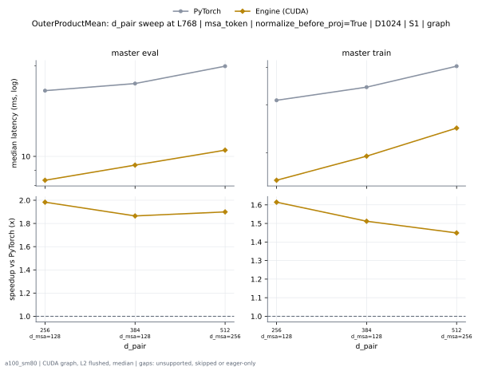

**master eval** (median ms; x = speedup vs PyTorch)

| d_pair | PyTorch | Engine (Triton) | Engine (CUDA) | Anthropic |
|---|---|---|---|---|
| 256 d_msa=128 | 16.53 | 8.388 (1.97x) | 8.332 (1.98x) | unsupported |
| 384 d_msa=128 | 17.45 | 9.767 (1.79x) | 9.355 (1.86x) | unsupported |
| 512 d_msa=256 | 19.92 | 11.25 (1.77x) | 10.49 (1.90x) | unsupported |

**master train** (median ms; x = speedup vs PyTorch)

| d_pair | PyTorch | Engine (Triton) | Engine (CUDA) | Anthropic |
|---|---|---|---|---|
| 256 d_msa=128 | 41.07 | 28.76 (1.43x) | 25.44 (1.61x) | unsupported |
| 384 d_msa=128 | 44.44 | 33.47 (1.33x) | 29.39 (1.51x) | unsupported |
| 512 d_msa=256 | 50.39 | 40.26 (1.25x) | 34.78 (1.45x) | unsupported |

