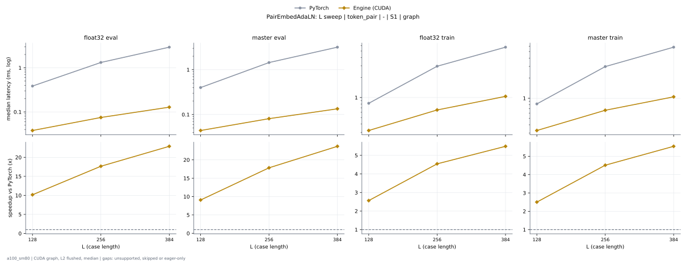

# PairEmbedAdaLN on a100_sm80

Generated by `python -m foldjet_engine.measure.plot` from speed tokens `judge/tokens/a100_sm80/`; do not edit.

### L sweep: token_pair | - | S1 | graph

**float32 eval** (median ms; x = speedup vs PyTorch)

| L | PyTorch | Engine (Triton) | Engine (CUDA) |
|---|---|---|---|
| 128 | 0.385 | 0.03994 (9.64x) | 0.03789 (10.16x) |
| 256 | 1.32 | 0.1044 (12.64x) | 0.07475 (17.66x) |
| 384 | 2.931 | 0.2058 (14.24x) | 0.128 (22.90x) |

**master eval** (median ms; x = speedup vs PyTorch)

| L | PyTorch | Engine (Triton) | Engine (CUDA) |
|---|---|---|---|
| 128 | 0.3994 | 0.04506 (8.86x) | 0.04403 (9.07x) |
| 256 | 1.443 | 0.1096 (13.17x) | 0.0809 (17.84x) |
| 384 | 3.177 | 0.213 (14.92x) | 0.1341 (23.69x) |

**float32 train** (median ms; x = speedup vs PyTorch)

| L | PyTorch | Engine (Triton) | Engine (CUDA) |
|---|---|---|---|
| 128 | 0.8192 | 0.6902 (1.19x) | 0.3195 (2.56x) |
| 256 | 2.954 | 1.376 (2.15x) | 0.6502 (4.54x) |
| 384 | 5.714 | 2.116 (2.70x) | 1.041 (5.49x) |

**master train** (median ms; x = speedup vs PyTorch)

| L | PyTorch | Engine (Triton) | Engine (CUDA) |
|---|---|---|---|
| 128 | 0.8223 | 0.6984 (1.18x) | 0.3287 (2.50x) |
| 256 | 2.98 | 1.389 (2.15x) | 0.6605 (4.51x) |
| 384 | 5.819 | 2.124 (2.74x) | 1.05 (5.54x) |

