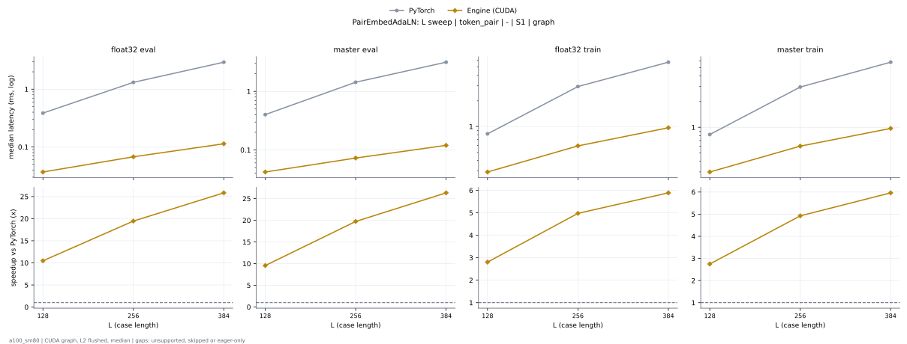

# PairEmbedAdaLN on a100_sm80

Generated by `python -m miniworld_engine.measure.plot` from speed tokens `judge/tokens/a100_sm80/`; do not edit.

### L sweep: token_pair | - | S1 | graph

**float32 eval** (median ms; x = speedup vs PyTorch)

| L | PyTorch | Engine (Triton) | Engine (CUDA) |
|---|---|---|---|
| 128 | 0.386 | 0.03994 (9.67x) | 0.03686 (10.47x) |
| 256 | 1.315 | 0.1024 (12.84x) | 0.06758 (19.45x) |
| 384 | 2.937 | 0.2068 (14.20x) | 0.1137 (25.84x) |

**master eval** (median ms; x = speedup vs PyTorch)

| L | PyTorch | Engine (Triton) | Engine (CUDA) |
|---|---|---|---|
| 128 | 0.4014 | 0.04506 (8.91x) | 0.04198 (9.56x) |
| 256 | 1.435 | 0.1096 (13.09x) | 0.0727 (19.73x) |
| 384 | 3.155 | 0.213 (14.81x) | 0.1198 (26.33x) |

**float32 train** (median ms; x = speedup vs PyTorch)

| L | PyTorch | Engine (Triton) | Engine (CUDA) |
|---|---|---|---|
| 128 | 0.8187 | 0.6789 (1.21x) | 0.2918 (2.81x) |
| 256 | 2.943 | 1.372 (2.14x) | 0.5914 (4.98x) |
| 384 | 5.686 | 2.11 (2.69x) | 0.9656 (5.89x) |

**master train** (median ms; x = speedup vs PyTorch)

| L | PyTorch | Engine (Triton) | Engine (CUDA) |
|---|---|---|---|
| 128 | 0.8233 | 0.6922 (1.19x) | 0.2995 (2.75x) |
| 256 | 2.962 | 1.391 (2.13x) | 0.6016 (4.92x) |
| 384 | 5.786 | 2.125 (2.72x) | 0.9702 (5.96x) |

