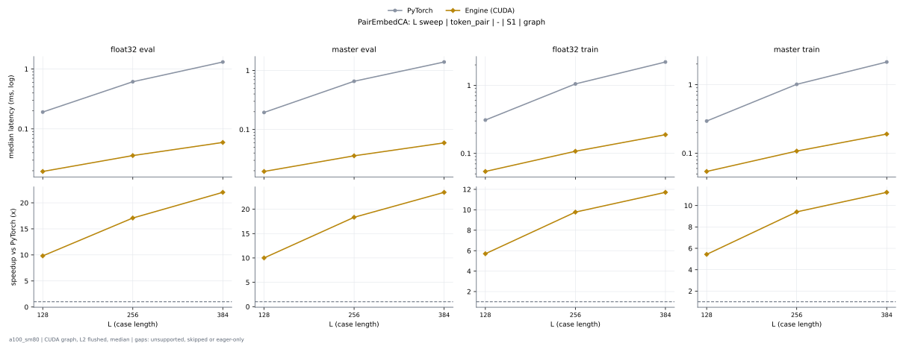
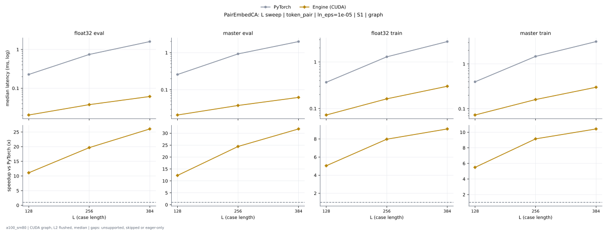

# PairEmbedCA on a100_sm80

Generated by `python -m foldjet_engine.measure.plot` from speed tokens `judge/tokens/a100_sm80/`; do not edit.

### L sweep: token_pair | - | S1 | graph

**float32 eval** (median ms; x = speedup vs PyTorch)

| L | PyTorch | Engine (Triton) | Engine (CUDA) |
|---|---|---|---|
| 128 | 0.191 | 0.01946 (9.82x) | 0.01946 (9.82x) |
| 256 | 0.6124 | 0.03482 (17.59x) | 0.03584 (17.09x) |
| 384 | 1.308 | 0.06246 (20.93x) | 0.05939 (22.02x) |

**master eval** (median ms; x = speedup vs PyTorch)

| L | PyTorch | Engine (Triton) | Engine (CUDA) |
|---|---|---|---|
| 128 | 0.1946 | 0.01946 (10.00x) | 0.01946 (10.00x) |
| 256 | 0.6574 | 0.03482 (18.88x) | 0.03584 (18.34x) |
| 384 | 1.394 | 0.06246 (22.31x) | 0.05939 (23.47x) |

**float32 train** (median ms; x = speedup vs PyTorch)

| L | PyTorch | Engine (Triton) | Engine (CUDA) |
|---|---|---|---|
| 128 | 0.3092 | 0.09011 (3.43x) | 0.05427 (5.70x) |
| 256 | 1.051 | 0.1434 (7.33x) | 0.1075 (9.77x) |
| 384 | 2.206 | 0.2222 (9.93x) | 0.1884 (11.71x) |

**master train** (median ms; x = speedup vs PyTorch)

| L | PyTorch | Engine (Triton) | Engine (CUDA) |
|---|---|---|---|
| 128 | 0.2949 | 0.09011 (3.27x) | 0.05427 (5.43x) |
| 256 | 1.012 | 0.1434 (7.06x) | 0.1075 (9.41x) |
| 384 | 2.14 | 0.2212 (9.68x) | 0.1905 (11.24x) |

### L sweep: token_pair | ln_eps=1e-05 | S1 | graph

**float32 eval** (median ms; x = speedup vs PyTorch)

| L | PyTorch | Engine (Triton) | Engine (CUDA) |
|---|---|---|---|
| 128 | 0.2273 | 0.01946 (11.68x) | 0.02048 (11.10x) |
| 256 | 0.7455 | 0.03482 (21.41x) | 0.03789 (19.68x) |
| 384 | 1.601 | 0.06144 (26.05x) | 0.06144 (26.05x) |

**master eval** (median ms; x = speedup vs PyTorch)

| L | PyTorch | Engine (Triton) | Engine (CUDA) |
|---|---|---|---|
| 128 | 0.258 | 0.01946 (13.26x) | 0.02099 (12.29x) |
| 256 | 0.9257 | 0.03482 (26.59x) | 0.03789 (24.43x) |
| 384 | 1.986 | 0.06144 (32.32x) | 0.06246 (31.79x) |

**float32 train** (median ms; x = speedup vs PyTorch)

| L | PyTorch | Engine (Triton) | Engine (CUDA) |
|---|---|---|---|
| 128 | 0.3666 | 0.1014 (3.62x) | 0.0727 (5.04x) |
| 256 | 1.29 | 0.1915 (6.74x) | 0.1618 (7.97x) |
| 384 | 2.741 | 0.3205 (8.55x) | 0.3011 (9.11x) |

**master train** (median ms; x = speedup vs PyTorch)

| L | PyTorch | Engine (Triton) | Engine (CUDA) |
|---|---|---|---|
| 128 | 0.3994 | 0.1014 (3.94x) | 0.0727 (5.49x) |
| 256 | 1.471 | 0.1915 (7.68x) | 0.1608 (9.15x) |
| 384 | 3.15 | 0.3205 (9.83x) | 0.3021 (10.43x) |

