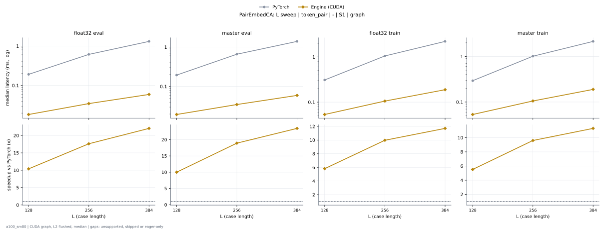
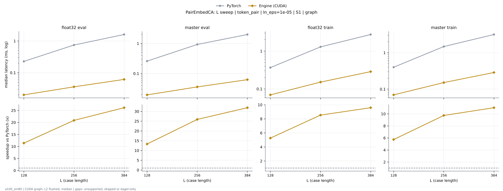

# PairEmbedCA on a100_sm80

Generated by `python -m miniworld_engine.measure.plot` from speed tokens `judge/tokens/a100_sm80/`; do not edit.

### L sweep: token_pair | - | S1 | graph

**float32 eval** (median ms; x = speedup vs PyTorch)

| L | PyTorch | Engine (Triton) | Engine (CUDA) |
|---|---|---|---|
| 128 | 0.191 | 0.01946 (9.82x) | unsupported |
| 256 | 0.6124 | 0.03482 (17.59x) | unsupported |
| 384 | 1.309 | 0.06246 (20.96x) | unsupported |

**master eval** (median ms; x = speedup vs PyTorch)

| L | PyTorch | Engine (Triton) | Engine (CUDA) |
|---|---|---|---|
| 128 | 0.1946 | 0.01946 (10.00x) | unsupported |
| 256 | 0.6584 | 0.03482 (18.91x) | unsupported |
| 384 | 1.395 | 0.06349 (21.97x) | unsupported |

**float32 train** (median ms; x = speedup vs PyTorch)

| L | PyTorch | Engine (Triton) | Engine (CUDA) |
|---|---|---|---|
| 128 | 0.3092 | 0.08704 (3.55x) | unsupported |
| 256 | 1.052 | 0.1403 (7.50x) | unsupported |
| 384 | 2.214 | 0.2191 (10.10x) | unsupported |

**master train** (median ms; x = speedup vs PyTorch)

| L | PyTorch | Engine (Triton) | Engine (CUDA) |
|---|---|---|---|
| 128 | 0.2939 | 0.08806 (3.34x) | unsupported |
| 256 | 1.012 | 0.1403 (7.21x) | unsupported |
| 384 | 2.142 | 0.2202 (9.73x) | unsupported |

### L sweep: token_pair | ln_eps=1e-05 | S1 | graph

**float32 eval** (median ms; x = speedup vs PyTorch)

| L | PyTorch | Engine (Triton) | Engine (CUDA) |
|---|---|---|---|
| 128 | 0.2294 | 0.01946 (11.79x) | unsupported |
| 256 | 0.7475 | 0.03379 (22.12x) | unsupported |
| 384 | 1.606 | 0.06246 (25.70x) | unsupported |

**master eval** (median ms; x = speedup vs PyTorch)

| L | PyTorch | Engine (Triton) | Engine (CUDA) |
|---|---|---|---|
| 128 | 0.2591 | 0.02048 (12.65x) | unsupported |
| 256 | 0.9298 | 0.03482 (26.71x) | unsupported |
| 384 | 1.993 | 0.06349 (31.39x) | unsupported |

**float32 train** (median ms; x = speedup vs PyTorch)

| L | PyTorch | Engine (Triton) | Engine (CUDA) |
|---|---|---|---|
| 128 | 0.3676 | 0.09728 (3.78x) | unsupported |
| 256 | 1.294 | 0.1833 (7.06x) | unsupported |
| 384 | 2.755 | 0.3092 (8.91x) | unsupported |

**master train** (median ms; x = speedup vs PyTorch)

| L | PyTorch | Engine (Triton) | Engine (CUDA) |
|---|---|---|---|
| 128 | 0.3994 | 0.09728 (4.11x) | unsupported |
| 256 | 1.476 | 0.1833 (8.05x) | unsupported |
| 384 | 3.159 | 0.3092 (10.22x) | unsupported |

