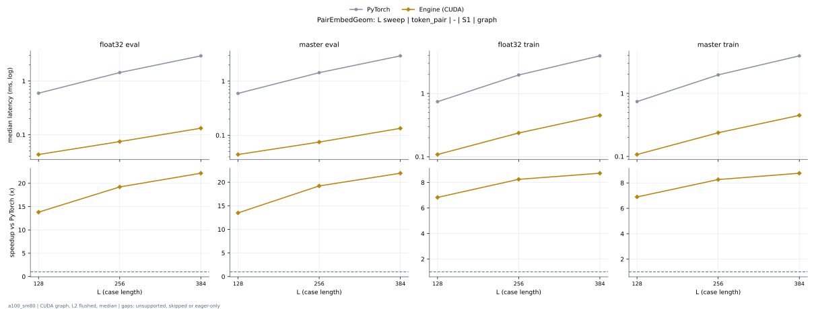
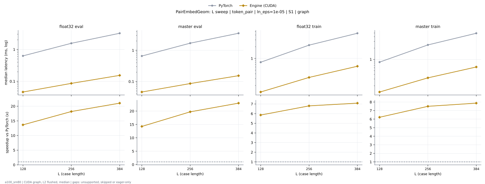

# PairEmbedGeom on a100_sm80

Generated by `python -m foldjet_engine.measure.plot` from speed tokens `judge/tokens/a100_sm80/`; do not edit.

### L sweep: token_pair | - | S1 | graph

**float32 eval** (median ms; x = speedup vs PyTorch)

| L | PyTorch | Engine (Triton) | Engine (CUDA) |
|---|---|---|---|
| 128 | 0.5939 | 0.04403 (13.49x) | 0.04301 (13.81x) |
| 256 | 1.437 | 0.07987 (17.99x) | 0.07475 (19.22x) |
| 384 | 2.939 | 0.1423 (20.65x) | 0.1326 (22.16x) |

**master eval** (median ms; x = speedup vs PyTorch)

| L | PyTorch | Engine (Triton) | Engine (CUDA) |
|---|---|---|---|
| 128 | 0.5939 | 0.04403 (13.49x) | 0.04403 (13.49x) |
| 256 | 1.436 | 0.07987 (17.98x) | 0.07475 (19.21x) |
| 384 | 2.938 | 0.1423 (20.64x) | 0.1341 (21.90x) |

**float32 train** (median ms; x = speedup vs PyTorch)

| L | PyTorch | Engine (Triton) | Engine (CUDA) |
|---|---|---|---|
| 128 | 0.7414 | 0.1782 (4.16x) | 0.1085 (6.83x) |
| 256 | 1.959 | 0.298 (6.57x) | 0.2376 (8.25x) |
| 384 | 3.93 | 0.4915 (8.00x) | 0.4506 (8.72x) |

**master train** (median ms; x = speedup vs PyTorch)

| L | PyTorch | Engine (Triton) | Engine (CUDA) |
|---|---|---|---|
| 128 | 0.7414 | 0.1782 (4.16x) | 0.1075 (6.90x) |
| 256 | 1.963 | 0.298 (6.59x) | 0.2376 (8.26x) |
| 384 | 3.929 | 0.4915 (7.99x) | 0.4485 (8.76x) |

### L sweep: token_pair | ln_eps=1e-05 | S1 | graph

**float32 eval** (median ms; x = speedup vs PyTorch)

| L | PyTorch | Engine (Triton) | Engine (CUDA) |
|---|---|---|---|
| 128 | 0.6287 | 0.0471 (13.35x) | 0.04608 (13.64x) |
| 256 | 1.565 | 0.08909 (17.56x) | 0.08602 (18.19x) |
| 384 | 3.233 | 0.1618 (19.98x) | 0.1536 (21.05x) |

**master eval** (median ms; x = speedup vs PyTorch)

| L | PyTorch | Engine (Triton) | Engine (CUDA) |
|---|---|---|---|
| 128 | 0.6574 | 0.0471 (13.96x) | 0.04608 (14.27x) |
| 256 | 1.697 | 0.08909 (19.05x) | 0.08602 (19.73x) |
| 384 | 3.529 | 0.1618 (21.81x) | 0.1536 (22.97x) |

**float32 train** (median ms; x = speedup vs PyTorch)

| L | PyTorch | Engine (Triton) | Engine (CUDA) |
|---|---|---|---|
| 128 | 0.7977 | 0.1976 (4.04x) | 0.1362 (5.86x) |
| 256 | 2.202 | 0.3717 (5.92x) | 0.3236 (6.81x) |
| 384 | 4.456 | 0.6502 (6.85x) | 0.6287 (7.09x) |

**master train** (median ms; x = speedup vs PyTorch)

| L | PyTorch | Engine (Triton) | Engine (CUDA) |
|---|---|---|---|
| 128 | 0.8468 | 0.1976 (4.28x) | 0.1362 (6.22x) |
| 256 | 2.426 | 0.3717 (6.53x) | 0.3236 (7.50x) |
| 384 | 4.947 | 0.6502 (7.61x) | 0.6287 (7.87x) |

