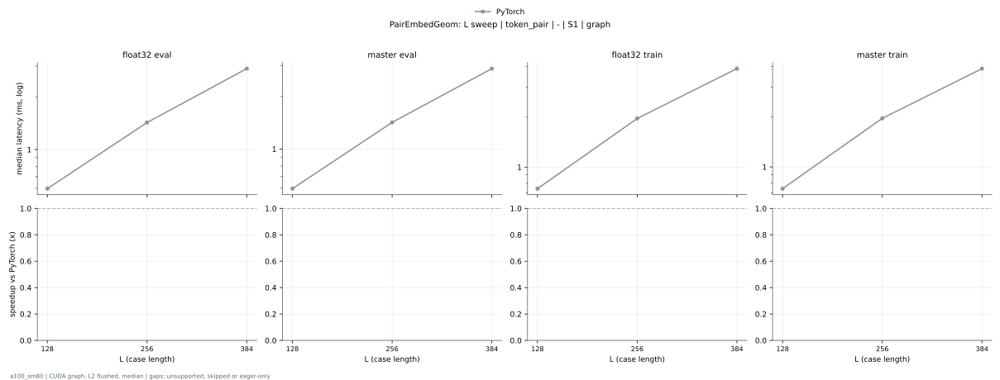
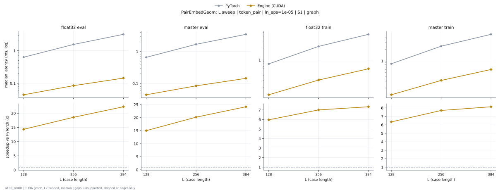

# PairEmbedGeom on a100_sm80

Generated by `python -m miniworld_engine.measure.plot` from speed tokens `judge/tokens/a100_sm80/`; do not edit.

### L sweep: token_pair | - | S1 | graph

**float32 eval** (median ms; x = speedup vs PyTorch)

| L | PyTorch | Engine (Triton) | Engine (CUDA) |
|---|---|---|---|
| 128 | 0.598 | 0.04301 (13.90x) | unsupported |
| 256 | 1.426 | 0.07885 (18.09x) | unsupported |
| 384 | 2.898 | 0.1382 (20.96x) | unsupported |

**master eval** (median ms; x = speedup vs PyTorch)

| L | PyTorch | Engine (Triton) | Engine (CUDA) |
|---|---|---|---|
| 128 | 0.5939 | 0.04403 (13.49x) | unsupported |
| 256 | 1.422 | 0.07885 (18.04x) | unsupported |
| 384 | 2.89 | 0.1382 (20.90x) | unsupported |

**float32 train** (median ms; x = speedup vs PyTorch)

| L | PyTorch | Engine (Triton) | Engine (CUDA) |
|---|---|---|---|
| 128 | 0.7434 | 0.1751 (4.25x) | unsupported |
| 256 | 1.955 | 0.2918 (6.70x) | unsupported |
| 384 | 3.882 | 0.4772 (8.14x) | unsupported |

**master train** (median ms; x = speedup vs PyTorch)

| L | PyTorch | Engine (Triton) | Engine (CUDA) |
|---|---|---|---|
| 128 | 0.7414 | 0.1751 (4.23x) | unsupported |
| 256 | 1.954 | 0.2908 (6.72x) | unsupported |
| 384 | 3.875 | 0.4762 (8.14x) | unsupported |

### L sweep: token_pair | ln_eps=1e-05 | S1 | graph

**float32 eval** (median ms; x = speedup vs PyTorch)

| L | PyTorch | Engine (Triton) | Engine (CUDA) |
|---|---|---|---|
| 128 | 0.6328 | 0.0471 (13.43x) | unsupported |
| 256 | 1.561 | 0.08806 (17.72x) | unsupported |
| 384 | 3.196 | 0.1587 (20.14x) | unsupported |

**master eval** (median ms; x = speedup vs PyTorch)

| L | PyTorch | Engine (Triton) | Engine (CUDA) |
|---|---|---|---|
| 128 | 0.6589 | 0.0471 (13.99x) | unsupported |
| 256 | 1.691 | 0.08806 (19.20x) | unsupported |
| 384 | 3.485 | 0.1577 (22.10x) | unsupported |

**float32 train** (median ms; x = speedup vs PyTorch)

| L | PyTorch | Engine (Triton) | Engine (CUDA) |
|---|---|---|---|
| 128 | 0.8018 | 0.1946 (4.12x) | unsupported |
| 256 | 2.204 | 0.364 (6.05x) | unsupported |
| 384 | 4.423 | 0.6359 (6.95x) | unsupported |

**master train** (median ms; x = speedup vs PyTorch)

| L | PyTorch | Engine (Triton) | Engine (CUDA) |
|---|---|---|---|
| 128 | 0.8468 | 0.1946 (4.35x) | unsupported |
| 256 | 2.415 | 0.3625 (6.66x) | unsupported |
| 384 | 4.898 | 0.6339 (7.73x) | unsupported |

