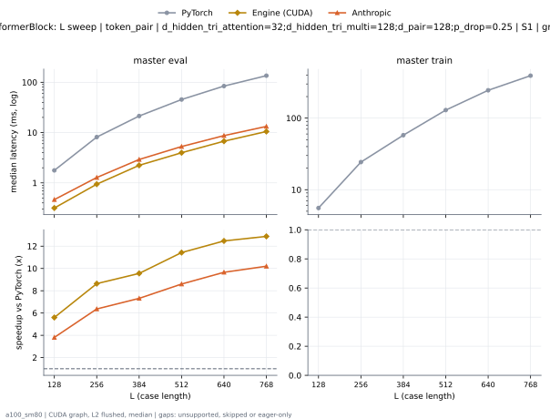
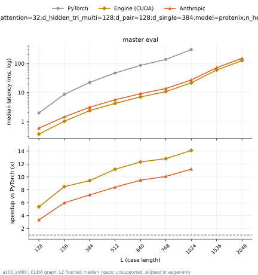

# PairformerBlock on a100_sm80

Generated by `python -m foldjet_engine.measure.plot` from speed tokens `judge/tokens/a100_sm80/`; do not edit.

### L sweep: token_pair | d_hidden_tri_attention=32;d_hidden_tri_multi=128;d_pair=128;p_drop=0.25 | S1 | graph

**master eval** (median ms; x = speedup vs PyTorch)

| L | PyTorch | Engine (Triton) | Engine (CUDA) | Anthropic |
|---|---|---|---|---|
| 128 | 1.772 | 0.6554 (2.70x) | 0.3164 (5.60x) | 0.4649 (3.81x) |
| 256 | 8.137 | 2.099 (3.88x) | 0.9421 (8.64x) | 1.278 (6.36x) |
| 384 | 21.34 | 4.801 (4.45x) | 2.233 (9.56x) | 2.917 (7.32x) |
| 512 | 45.39 | 8.836 (5.14x) | 3.973 (11.43x) | 5.277 (8.60x) |
| 640 | 84.01 | 14.58 (5.76x) | 6.737 (12.47x) | 8.7 (9.66x) |
| 768 | 135.3 | 21.96 (6.16x) | 10.5 (12.88x) | 13.26 (10.20x) |

**master train** (median ms; x = speedup vs PyTorch)

| L | PyTorch | Engine (Triton) | Engine (CUDA) | Anthropic |
|---|---|---|---|---|
| 128 | 5.545 | 2.324 (2.39x) | failed | unsupported |
| 256 | 24.29 | 7.894 (3.08x) | failed | unsupported |
| 384 | 57.75 | 16.95 (3.41x) | failed | unsupported |
| 512 | 129.4 | 31.72 (4.08x) | failed | unsupported |
| 640 | 244.7 | 53.65 (4.56x) | failed | unsupported |
| 768 | 391.7 | 83.11 (4.71x) | failed | unsupported |

### L sweep: protenix | token_pair | d_hidden_tri_attention=32;d_hidden_tri_multi=128;d_pair=128;d_single=384;model=protenix;n_head_single=16;n_head_tri_attention=4;p_drop=0.0 | S1 | graph

**master eval** (median ms; x = speedup vs PyTorch)

| L | PyTorch | Engine (Triton) | Engine (CUDA) | Anthropic |
|---|---|---|---|---|
| 128 | 1.968 | 0.8192 (2.40x) | 0.3666 (5.37x) | 0.5888 (3.34x) |
| 256 | 8.618 | 2.488 (3.46x) | 1.015 (8.49x) | 1.44 (5.98x) |
| 384 | 22.34 | 5.57 (4.01x) | 2.369 (9.43x) | 3.097 (7.21x) |
| 512 | 47.07 | 10.1 (4.66x) | 4.208 (11.19x) | 5.596 (8.41x) |
| 640 | 86.41 | 16.45 (5.25x) | 7.013 (12.32x) | 9.095 (9.50x) |
| 768 | 138.3 | 24.52 (5.64x) | 10.77 (12.84x) | 13.72 (10.08x) |
| 1024 | 303.4 | 47.83 (6.34x) | 21.51 (14.10x) | 27.09 (11.20x) |
| 1536 | skipped | 128.4 | 59.96 | 71.73 |
| 2048 | skipped | 266.4 | 126.3 | 151.6 |

