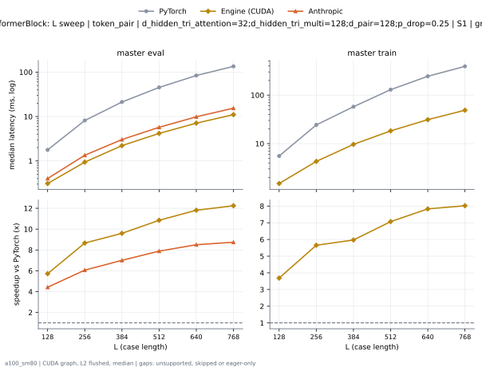

# PairformerBlock on a100_sm80

Generated by `python -m miniworld_engine.measure.plot` from speed tokens `judge/tokens/a100_sm80/`; do not edit.

### L sweep: token_pair | d_hidden_tri_attention=32;d_hidden_tri_multi=128;d_pair=128;p_drop=0.25 | S1 | graph

**master eval** (median ms; x = speedup vs PyTorch)

| L | PyTorch | Engine (Triton) | Engine (CUDA) | Anthropic |
|---|---|---|---|---|
| 128 | 1.772 | 0.6533 (2.71x) | 0.3492 (5.07x) | 0.4014 (4.41x) |
| 256 | 8.144 | 2.097 (3.88x) | 0.9902 (8.22x) | 1.343 (6.06x) |
| 384 | 21.43 | 4.821 (4.44x) | 2.256 (9.50x) | 3.032 (7.07x) |
| 512 | 45.35 | 8.835 (5.13x) | 4.238 (10.70x) | 5.731 (7.91x) |
| 640 | 83.76 | 14.9 (5.62x) | 7.242 (11.56x) | 9.859 (8.50x) |
| 768 | 134.9 | 22.57 (5.98x) | 11.45 (11.78x) | 15.44 (8.74x) |

**master train** (median ms; x = speedup vs PyTorch)

| L | PyTorch | Engine (Triton) | Engine (CUDA) | Anthropic |
|---|---|---|---|---|
| 128 | 5.534 | 2.323 (2.38x) | 5.937 (eager) | unsupported |
| 256 | 24.26 | 7.908 (3.07x) | 5.725 (eager) | unsupported |
| 384 | 57.77 | 16.95 (3.41x) | 9.905 (eager) | unsupported |
| 512 | 129.4 | 31.75 (4.07x) | 18.62 (eager) | unsupported |
| 640 | 244.2 | 54.56 (4.48x) | 32.4 (eager) | unsupported |
| 768 | 390.7 | 84.54 (4.62x) | 50.07 (eager) | unsupported |

