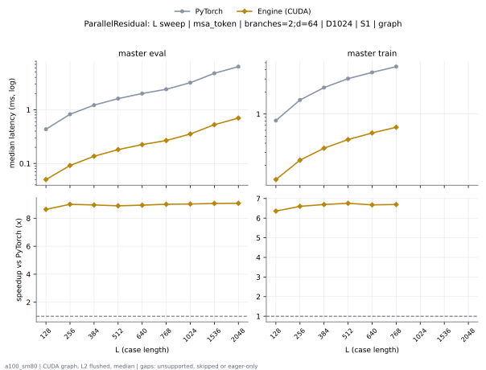
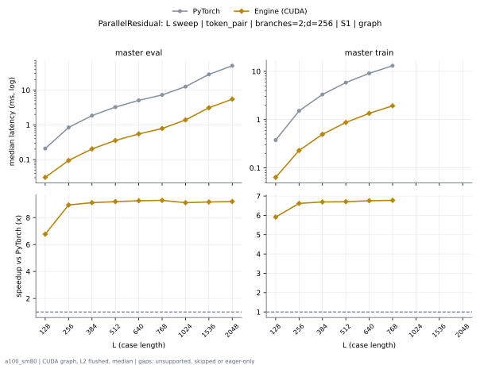
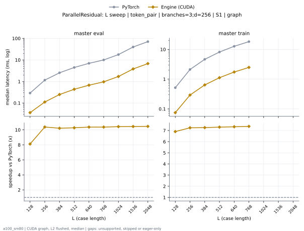

# ParallelResidual on a100_sm80

Generated by `python -m foldjet_engine.measure.plot` from speed tokens `judge/tokens/a100_sm80/`; do not edit.

### L sweep: msa_token | branches=2;d=64 | D1024 | S1 | graph

**master eval** (median ms; x = speedup vs PyTorch)

| L | PyTorch | Engine (Triton) | Engine (CUDA) |
|---|---|---|---|
| 128 | 0.4332 | 0.05222 (8.29x) | 0.05018 (8.63x) |
| 256 | 0.8243 | 0.09216 (8.94x) | 0.09165 (8.99x) |
| 384 | 1.219 | 0.13 (9.37x) | 0.1362 (8.95x) |
| 512 | 1.611 | 0.17 (9.48x) | 0.1812 (8.89x) |
| 640 | 2.003 | 0.2089 (9.59x) | 0.2243 (8.93x) |
| 768 | 2.404 | 0.2529 (9.51x) | 0.2673 (9.00x) |
| 1024 | 3.185 | 0.3328 (9.57x) | 0.3533 (9.01x) |
| 1536 | 4.767 | 0.4915 (9.70x) | 0.5263 (9.06x) |
| 2048 | 6.341 | 0.6502 (9.75x) | 0.6994 (9.07x) |

**master train** (median ms; x = speedup vs PyTorch)

| L | PyTorch | Engine (Triton) | Engine (CUDA) |
|---|---|---|---|
| 128 | 0.8141 | 0.2258 (3.61x) | 0.128 (6.36x) |
| 256 | 1.551 | 0.4229 (3.67x) | 0.235 (6.60x) |
| 384 | 2.29 | 0.6185 (3.70x) | 0.342 (6.69x) |
| 512 | 3.031 | 0.8151 (3.72x) | 0.4485 (6.76x) |
| 640 | 3.685 | 0.9882 (3.73x) | 0.5519 (6.68x) |
| 768 | 4.415 | 1.18 (3.74x) | 0.6595 (6.70x) |
| 1024 |  |  |  |
| 1536 |  |  |  |
| 2048 |  |  |  |

### L sweep: token_pair | branches=2;d=256 | S1 | graph

**master eval** (median ms; x = speedup vs PyTorch)

| L | PyTorch | Engine (Triton) | Engine (CUDA) |
|---|---|---|---|
| 128 | 0.2079 | 0.03174 (6.55x) | 0.03072 (6.77x) |
| 256 | 0.8417 | 0.09421 (8.93x) | 0.09421 (8.93x) |
| 384 | 1.846 | 0.1935 (9.54x) | 0.2028 (9.11x) |
| 512 | 3.253 | 0.3328 (9.78x) | 0.3543 (9.18x) |
| 640 | 5.066 | 0.511 (9.91x) | 0.5478 (9.25x) |
| 768 | 7.277 | 0.7296 (9.97x) | 0.7844 (9.28x) |
| 1024 | 12.64 | 1.286 (9.83x) | 1.388 (9.10x) |
| 1536 | 28.42 | 2.877 (9.88x) | 3.104 (9.16x) |
| 2048 | 50.47 | 5.102 (9.89x) | 5.492 (9.19x) |

**master train** (median ms; x = speedup vs PyTorch)

| L | PyTorch | Engine (Triton) | Engine (CUDA) |
|---|---|---|---|
| 128 | 0.3753 | 0.09728 (3.86x) | 0.06349 (5.91x) |
| 256 | 1.515 | 0.4137 (3.66x) | 0.2289 (6.62x) |
| 384 | 3.321 | 0.8929 (3.72x) | 0.4961 (6.69x) |
| 512 | 5.851 | 1.561 (3.75x) | 0.8724 (6.71x) |
| 640 | 9.113 | 2.42 (3.77x) | 1.349 (6.76x) |
| 768 | 13.09 | 3.478 (3.76x) | 1.931 (6.78x) |
| 1024 |  |  |  |
| 1536 |  |  |  |
| 2048 |  |  |  |

### L sweep: token_pair | branches=3;d=256 | S1 | graph

**master eval** (median ms; x = speedup vs PyTorch)

| L | PyTorch | Engine (Triton) | Engine (CUDA) |
|---|---|---|---|
| 128 | 0.2908 | 0.03789 (7.68x) | 0.03584 (8.11x) |
| 256 | 1.158 | 0.1126 (10.28x) | 0.1116 (10.38x) |
| 384 | 2.542 | 0.2345 (10.84x) | 0.2488 (10.21x) |
| 512 | 4.482 | 0.4116 (10.89x) | 0.4362 (10.27x) |
| 640 | 6.984 | 0.6349 (11.00x) | 0.6738 (10.36x) |
| 768 | 10.03 | 0.9073 (11.06x) | 0.9677 (10.37x) |
| 1024 | 17.8 | 1.601 (11.12x) | 1.707 (10.43x) |
| 1536 | 40.01 | 3.591 (11.14x) | 3.831 (10.44x) |
| 2048 | 71.06 | 6.372 (11.15x) | 6.792 (10.46x) |

**master train** (median ms; x = speedup vs PyTorch)

| L | PyTorch | Engine (Triton) | Engine (CUDA) |
|---|---|---|---|
| 128 | 0.5161 | 0.1075 (4.80x) | 0.07475 (6.90x) |
| 256 | 2.118 | 0.4762 (4.45x) | 0.2924 (7.24x) |
| 384 | 4.646 | 1.029 (4.51x) | 0.64 (7.26x) |
| 512 | 8.188 | 1.802 (4.54x) | 1.121 (7.30x) |
| 640 | 12.75 | 2.796 (4.56x) | 1.738 (7.34x) |
| 768 | 18.32 | 4.013 (4.56x) | 2.485 (7.37x) |
| 1024 |  |  |  |
| 1536 |  |  |  |
| 2048 |  |  |  |

