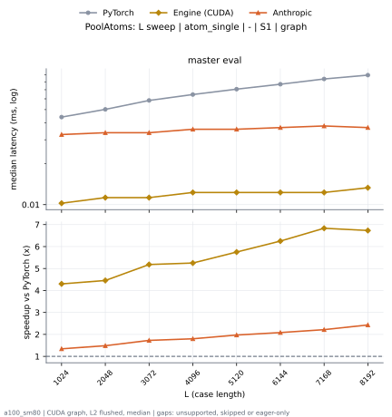

# PoolAtoms on a100_sm80

Generated by `python -m miniworld_engine.measure.plot` from speed tokens `judge/tokens/a100_sm80/`; do not edit.

### L sweep: atom_single | - | S1 | graph

**master eval** (median ms; x = speedup vs PyTorch)

| L | PyTorch | Engine (Triton) | Engine (CUDA) | Anthropic |
|---|---|---|---|---|
| 1024 | 0.04403 | 0.01126 (3.91x) | 0.01024 (4.30x) | 0.03277 (1.34x) |
| 2048 | 0.05018 | 0.01229 (4.08x) | 0.01126 (4.45x) | 0.03379 (1.48x) |
| 3072 | 0.05837 | 0.01229 (4.75x) | 0.01126 (5.18x) | 0.03379 (1.73x) |
| 4096 | 0.06451 | 0.01331 (4.85x) | 0.01229 (5.25x) | 0.03584 (1.80x) |
| 5120 | 0.07066 | 0.01331 (5.31x) | 0.01229 (5.75x) | 0.03584 (1.97x) |
| 6144 | 0.0768 | 0.01331 (5.77x) | 0.01229 (6.25x) | 0.03686 (2.08x) |
| 7168 | 0.08397 | 0.01382 (6.07x) | 0.01229 (6.83x) | 0.03789 (2.22x) |
| 8192 | 0.0896 | 0.01434 (6.25x) | 0.01331 (6.73x) | 0.03686 (2.43x) |

