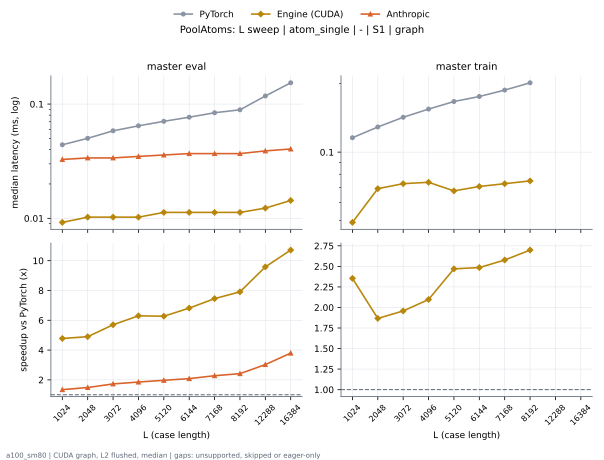

# PoolAtoms on a100_sm80

Generated by `python -m miniworld_engine.measure.plot` from speed tokens `judge/tokens/a100_sm80/`; do not edit.

### L sweep: atom_single | - | S1 | graph

**master eval** (median ms; x = speedup vs PyTorch)

| L | PyTorch | Engine (Triton) | Engine (CUDA) | Anthropic |
|---|---|---|---|---|
| 1024 | 0.04403 | 0.01126 (3.91x) | 0.009216 (4.78x) | 0.03277 (1.34x) |
| 2048 | 0.05018 | 0.01229 (4.08x) | 0.01024 (4.90x) | 0.03379 (1.48x) |
| 3072 | 0.05837 | 0.01229 (4.75x) | 0.01024 (5.70x) | 0.03379 (1.73x) |
| 4096 | 0.06451 | 0.01331 (4.85x) | 0.01024 (6.30x) | 0.03482 (1.85x) |
| 5120 | 0.07066 | 0.01331 (5.31x) | 0.01126 (6.27x) | 0.03584 (1.97x) |
| 6144 | 0.0768 | 0.01331 (5.77x) | 0.01126 (6.82x) | 0.03686 (2.08x) |
| 7168 | 0.08397 | 0.01434 (5.86x) | 0.01126 (7.45x) | 0.03686 (2.28x) |
| 8192 | 0.08909 | 0.01434 (6.21x) | 0.01126 (7.91x) | 0.03686 (2.42x) |
| 12288 | 0.1178 | 0.01536 (7.67x) | 0.01229 (9.58x) | 0.03891 (3.03x) |
| 16384 | 0.1536 | 0.01741 (8.82x) | 0.01434 (10.71x) | 0.04045 (3.80x) |

**master train** (median ms; x = speedup vs PyTorch)

| L | PyTorch | Engine (Triton) | Engine (CUDA) | Anthropic |
|---|---|---|---|---|
| 1024 | 0.1157 | 0.05632 (2.05x) | 0.04915 (2.35x) | unsupported |
| 2048 | 0.129 | 0.07782 (1.66x) | 0.06912 (1.87x) | unsupported |
| 3072 | 0.1423 | 0.08192 (1.74x) | 0.0727 (1.96x) | unsupported |
| 4096 | 0.1546 | 0.08397 (1.84x) | 0.07373 (2.10x) | unsupported |
| 5120 | 0.1669 | 0.07782 (2.14x) | 0.06758 (2.47x) | unsupported |
| 6144 | 0.1756 | 0.07987 (2.20x) | 0.07066 (2.49x) | unsupported |
| 7168 | 0.1874 | 0.08294 (2.26x) | 0.0727 (2.58x) | unsupported |
| 8192 | 0.2017 | 0.08397 (2.40x) | 0.07475 (2.70x) | unsupported |
| 12288 |  |  |  |  |
| 16384 |  |  |  |  |

