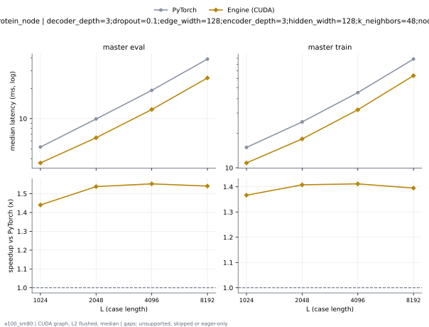

# ProteinMPNN on a100_sm80

Generated by `python -m miniworld_engine.measure.plot` from speed tokens `judge/tokens/a100_sm80/`; do not edit.

### L sweep: protein_node | decoder_depth=3;dropout=0.1;edge_width=128;encoder_depth=3;hidden_width=128;k_neighbors=48;node_width=128 | S1 | graph

**master eval** (median ms; x = speedup vs PyTorch)

| L | PyTorch | Engine (Triton) | Engine (CUDA) |
|---|---|---|---|
| 1024 | 5.218 | 4.131 (1.26x) | 3.624 (1.44x) |
| 2048 | 9.926 | 7.238 (1.37x) | 6.455 (1.54x) |
| 4096 | 19.11 | 13.72 (1.39x) | 12.31 (1.55x) |
| 8192 | 39.09 | 28.49 (1.37x) | 25.38 (1.54x) |

**master train** (median ms; x = speedup vs PyTorch)

| L | PyTorch | Engine (Triton) | Engine (CUDA) |
|---|---|---|---|
| 1024 | 15.07 | 12.01 (1.25x) | 11.02 (1.37x) |
| 2048 | 25.12 | 19.57 (1.28x) | 17.85 (1.41x) |
| 4096 | 45.23 | 35.21 (1.28x) | 32.04 (1.41x) |
| 8192 | 88.62 | 70.38 (1.26x) | 63.54 (1.39x) |

