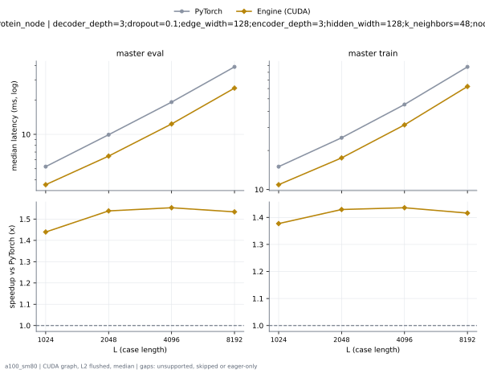

# ProteinMPNN on a100_sm80

Generated by `python -m foldjet_engine.measure.plot` from speed tokens `judge/tokens/a100_sm80/`; do not edit.

### L sweep: protein_node | decoder_depth=3;dropout=0.1;edge_width=128;encoder_depth=3;hidden_width=128;k_neighbors=48;node_width=128 | S1 | graph

**master eval** (median ms; x = speedup vs PyTorch)

| L | PyTorch | Engine (Triton) | Engine (CUDA) |
|---|---|---|---|
| 1024 | 5.22 | 4.161 (1.25x) | 3.627 (1.44x) |
| 2048 | 9.928 | 7.233 (1.37x) | 6.453 (1.54x) |
| 4096 | 19.15 | 13.82 (1.39x) | 12.33 (1.55x) |
| 8192 | 38.95 | 28.64 (1.36x) | 25.4 (1.53x) |

**master train** (median ms; x = speedup vs PyTorch)

| L | PyTorch | Engine (Triton) | Engine (CUDA) |
|---|---|---|---|
| 1024 | 15.02 | 11.97 (1.25x) | 10.91 (1.38x) |
| 2048 | 25.06 | 19.49 (1.29x) | 17.54 (1.43x) |
| 4096 | 45.22 | 35.14 (1.29x) | 31.5 (1.44x) |
| 8192 | 88.13 | 69.82 (1.26x) | 62.24 (1.42x) |

