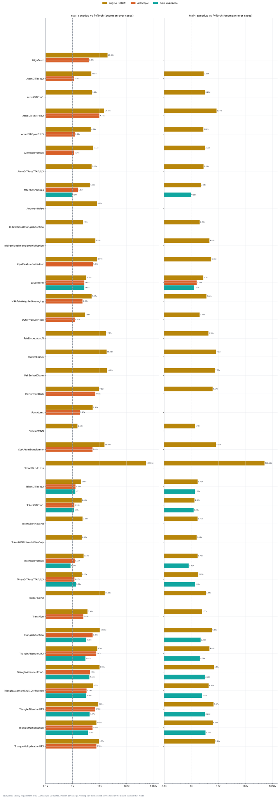
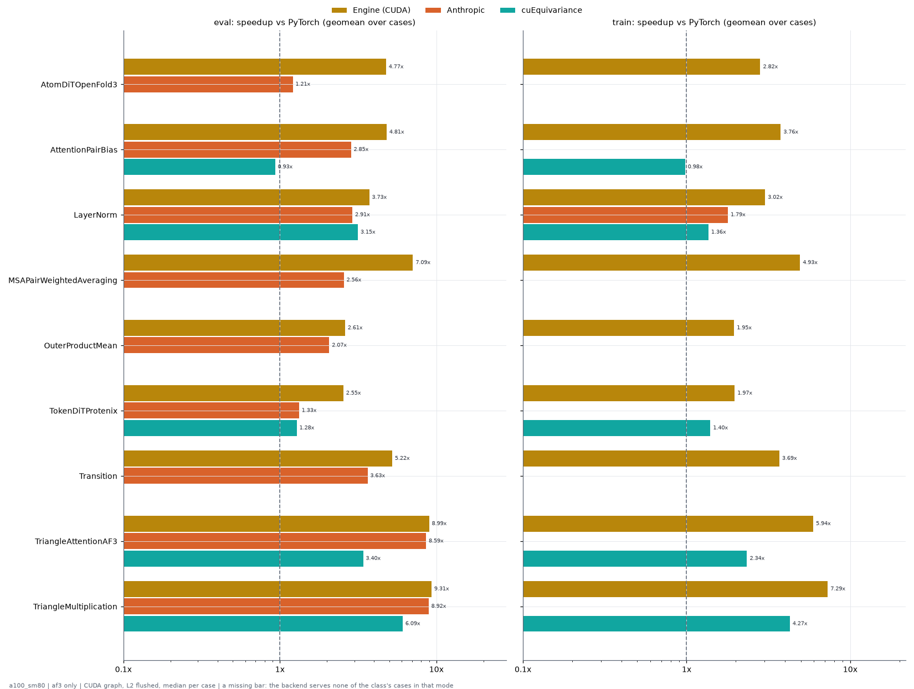

# Benchmarks on a100_sm80

Generated by `python -m miniworld_engine.measure.plot --gpu a100_sm80` from speed tokens `judge/tokens/a100_sm80/` (speed measurer v3); nothing here is measured by the plotter. Timing: CUDA graph, L2 flushed before every call (docs/measure.md).

## Summary

Per class and mode: the geometric mean over its cases of the speedup vs PyTorch (PyTorch time / backend time), over the cases both ran (n = cases).

| class | eval Engine (CUDA) | eval Anthropic | eval cuEquivariance | train Engine (CUDA) | train Anthropic | train cuEquivariance |
|---|---|---|---|---|---|---|
| AlignEuler | 19.65x (n=8) | 3.97x (n=8) |  |  |  |  |
| AtomDiTBoltz2 | 4.93x (n=32) | 1.14x (n=16) |  | 2.89x (n=32) |  |  |
| AtomDiTChai1 | 5.18x (n=32) |  |  | 3.23x (n=32) |  |  |
| AtomDiTESMFold2 | 12.09x (n=16) | 9.75x (n=16) |  | 8.57x (n=16) |  |  |
| AtomDiTOpenFold3 | 4.74x (n=32) | 1.21x (n=32) |  | 2.82x (n=32) |  |  |
| AtomDiTProtenix | 5.77x (n=32) | 1.14x (n=32) |  | 3.20x (n=32) |  |  |
| AtomDiTRoseTTAFold3 | 5.07x (n=32) |  |  | 2.86x (n=32) |  |  |
| AttentionPairBias | 3.68x (n=108) | 1.58x (n=108) | 0.94x (n=108) | 2.30x (n=108) |  | 0.98x (n=108) |
| AugmentNoise | 6.84x (n=16) |  |  |  |  |  |
| BidirectionalTriangleMultiplication | 6.64x (n=30) |  |  | 4.64x (n=30) |  |  |
| InputFeatureEmbedder | 7.15x (n=72) | 5.70x (n=72) |  | 5.44x (n=72) |  |  |
| LayerNorm | 3.19x (n=270) | 2.69x (n=270) | 2.69x (n=270) | 2.76x (n=270) | 1.59x (n=270) | 1.27x (n=270) |
| MSAPairWeightedAveraging | 5.64x (n=36) | 2.34x (n=30) |  | 3.98x (n=36) |  |  |
| OuterProductMean | 2.89x (n=72) | 1.20x (n=24) |  | 2.05x (n=72) |  |  |
| PairformerBlock | 9.13x (n=6) | 6.93x (n=6) |  |  |  |  |
| PoolAtoms | 5.52x (n=8) | 1.85x (n=8) |  |  |  |  |
| ProteinMPNN | 1.52x (n=4) |  |  | 1.40x (n=4) |  |  |
| SWAAtomTransformer | 13.01x (n=48) | 5.51x (n=48) |  | 8.03x (n=43) |  |  |
| SmoothLddtLoss | 202.07x (n=16) |  |  | 146.29x (n=16) |  |  |
| TokenDiTBoltz2 | 2.08x (n=12) | 1.29x (n=12) | 1.25x (n=12) | 1.73x (n=12) |  | 1.37x (n=12) |
| TokenDiTChai1 | 2.18x (n=24) | 1.16x (n=24) | 1.15x (n=24) | 1.31x (n=24) |  | 1.22x (n=24) |
| TokenDiTMiniWorld | 1.16x (n=12) |  |  | 0.78x (n=12) |  |  |
| TokenDiTMiniWorldBiasOnly | 2.19x (n=48) |  |  | 1.59x (n=48) |  |  |
| TokenDiTProtenix | 2.54x (n=84) | 1.20x (n=84) | 0.84x (n=84) | 1.73x (n=84) |  | 0.81x (n=84) |
| TokenDiTRoseTTAFold3 | 2.18x (n=12) | 1.17x (n=12) | 1.31x (n=12) | 1.84x (n=12) |  | 1.40x (n=12) |
| Transition | 3.60x (n=96) | 2.48x (n=90) |  | 2.75x (n=96) |  |  |
| TriangleAttention | 10.00x (n=71) | 5.40x (n=72) | 3.14x (n=70) | 5.91x (n=69) |  | 2.20x (n=67) |
| TriangleAttentionAF3 | 6.67x (n=48) | 7.41x (n=36) | 2.96x (n=46) | 4.72x (n=46) |  | 2.08x (n=44) |
| TriangleAttentionChai1 | 9.61x (n=24) | 4.42x (n=24) | 4.17x (n=24) | 6.93x (n=24) |  | 3.20x (n=24) |
| TriangleAttentionChai1Confidence | 5.64x (n=12) | 3.27x (n=12) | 3.19x (n=12) | 4.43x (n=12) |  | 2.54x (n=12) |
| TriangleAttentionRF3 | 8.61x (n=24) | 6.90x (n=24) | 4.27x (n=24) | 6.66x (n=24) |  | 3.23x (n=24) |
| TriangleMultiplication | 7.07x (n=72) | 5.46x (n=72) | 3.75x (n=70) | 6.07x (n=72) |  | 3.38x (n=70) |
| TriangleMultiplicationRF3 | 8.90x (n=24) | 7.62x (n=24) |  | 7.32x (n=24) |  |  |

## Summary: af3 only

The same over the requirement rows whose `source` names af3 (25 rows).

| class | eval Engine (CUDA) | eval Anthropic | eval cuEquivariance | train Engine (CUDA) | train Anthropic | train cuEquivariance |
|---|---|---|---|---|---|---|
| AtomDiTOpenFold3 | 4.77x (n=16) | 1.21x (n=16) |  | 2.82x (n=16) |  |  |
| AttentionPairBias | 4.81x (n=12) | 2.85x (n=12) | 0.93x (n=12) | 3.76x (n=12) |  | 0.98x (n=12) |
| LayerNorm | 3.73x (n=114) | 2.91x (n=114) | 3.15x (n=114) | 3.02x (n=114) | 1.79x (n=114) | 1.36x (n=114) |
| MSAPairWeightedAveraging | 7.09x (n=6) | 2.56x (n=6) |  | 4.93x (n=6) |  |  |
| OuterProductMean | 2.61x (n=6) | 2.07x (n=6) |  | 1.95x (n=6) |  |  |
| TokenDiTProtenix | 2.55x (n=12) | 1.33x (n=12) | 1.28x (n=12) | 1.97x (n=12) |  | 1.40x (n=12) |
| Transition | 5.22x (n=36) | 3.63x (n=42) |  | 3.69x (n=36) |  |  |
| TriangleAttentionAF3 | 8.99x (n=24) | 8.59x (n=24) | 3.40x (n=22) | 5.94x (n=24) |  | 2.34x (n=22) |
| TriangleMultiplication | 9.31x (n=24) | 8.92x (n=24) | 6.09x (n=24) | 7.29x (n=24) |  | 4.27x (n=24) |

## Classes

| class | cases | L sweeps | D sweeps |
|---|---|---|---|
| [AlignEuler](AlignEuler/README.md) | 8 | 1 | 0 |
| [AtomDiTBoltz2](AtomDiTBoltz2/README.md) | 64 | 2 | 0 |
| [AtomDiTChai1](AtomDiTChai1/README.md) | 64 | 2 | 0 |
| [AtomDiTESMFold2](AtomDiTESMFold2/README.md) | 32 | 1 | 0 |
| [AtomDiTOpenFold3](AtomDiTOpenFold3/README.md) | 64 | 2 | 0 |
| [AtomDiTProtenix](AtomDiTProtenix/README.md) | 64 | 3 | 0 |
| [AtomDiTRoseTTAFold3](AtomDiTRoseTTAFold3/README.md) | 64 | 2 | 0 |
| [AttentionPairBias](AttentionPairBias/README.md) | 216 | 9 | 2 |
| [AugmentNoise](AugmentNoise/README.md) | 16 | 2 | 0 |
| [BidirectionalTriangleAttention](BidirectionalTriangleAttention/README.md) | 12 | 1 | 0 |
| [BidirectionalTriangleMultiplication](BidirectionalTriangleMultiplication/README.md) | 60 | 5 | 1 |
| [InputFeatureEmbedder](InputFeatureEmbedder/README.md) | 144 | 6 | 0 |
| [LayerNorm](LayerNorm/README.md) | 540 | 25 | 4 |
| [MSAPairWeightedAveraging](MSAPairWeightedAveraging/README.md) | 84 | 7 | 3 |
| [OuterProductMean](OuterProductMean/README.md) | 144 | 12 | 3 |
| [PairEmbedAdaLN](PairEmbedAdaLN/README.md) | 12 | 1 | 0 |
| [PairEmbedCA](PairEmbedCA/README.md) | 24 | 2 | 0 |
| [PairEmbedGeom](PairEmbedGeom/README.md) | 24 | 2 | 0 |
| [PairformerBlock](PairformerBlock/README.md) | 12 | 1 | 0 |
| [PoolAtoms](PoolAtoms/README.md) | 8 | 1 | 0 |
| [ProteinMPNN](ProteinMPNN/README.md) | 8 | 1 | 0 |
| [SWAAtomTransformer](SWAAtomTransformer/README.md) | 96 | 6 | 0 |
| [SmoothLddtLoss](SmoothLddtLoss/README.md) | 32 | 1 | 0 |
| [TokenDiTBoltz2](TokenDiTBoltz2/README.md) | 24 | 2 | 0 |
| [TokenDiTChai1](TokenDiTChai1/README.md) | 48 | 4 | 0 |
| [TokenDiTMiniWorld](TokenDiTMiniWorld/README.md) | 24 | 2 | 0 |
| [TokenDiTMiniWorldBiasOnly](TokenDiTMiniWorldBiasOnly/README.md) | 96 | 8 | 0 |
| [TokenDiTProtenix](TokenDiTProtenix/README.md) | 168 | 11 | 3 |
| [TokenDiTRoseTTAFold3](TokenDiTRoseTTAFold3/README.md) | 24 | 2 | 0 |
| [TokenPairInit](TokenPairInit/README.md) | 12 | 1 | 0 |
| [Transition](Transition/README.md) | 252 | 16 | 2 |
| [TriangleAttention](TriangleAttention/README.md) | 144 | 12 | 4 |
| [TriangleAttentionAF3](TriangleAttentionAF3/README.md) | 96 | 8 | 2 |
| [TriangleAttentionChai1](TriangleAttentionChai1/README.md) | 48 | 4 | 0 |
| [TriangleAttentionChai1Confidence](TriangleAttentionChai1Confidence/README.md) | 24 | 2 | 0 |
| [TriangleAttentionRF3](TriangleAttentionRF3/README.md) | 48 | 4 | 0 |
| [TriangleMultiplication](TriangleMultiplication/README.md) | 144 | 12 | 2 |
| [TriangleMultiplicationRF3](TriangleMultiplicationRF3/README.md) | 48 | 4 | 0 |
