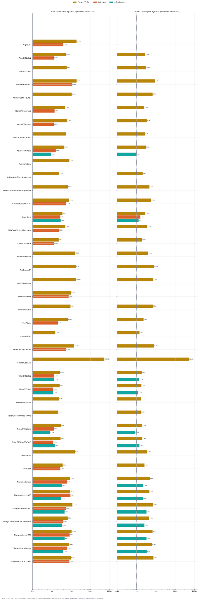
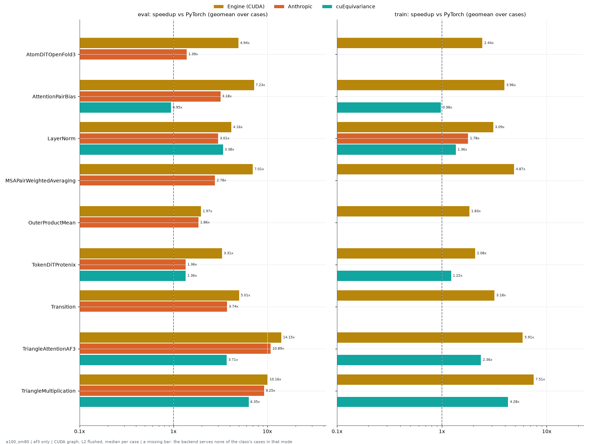

# Benchmarks on a100_sm80

Generated by `python -m foldjet_engine.measure.plot --gpu a100_sm80` from speed tokens `judge/tokens/a100_sm80/` (speed measurer v4); nothing here is measured by the plotter. Timing: CUDA graph, L2 flushed before every call (docs/measure.md).

## Summary

Per class and mode: the geometric mean over its cases of the speedup vs PyTorch (PyTorch time / backend time), over the cases both ran (n = cases).

| class | eval Engine (CUDA) | eval Anthropic | eval cuEquivariance | train Engine (CUDA) | train Anthropic | train cuEquivariance |
|---|---|---|---|---|---|---|
| AlignEuler | 19.14x (n=10) | 3.77x (n=10) |  |  |  |  |
| AtomDiTBoltz2 | 5.34x (n=80) | 1.27x (n=40) |  | 2.78x (n=32) |  |  |
| AtomDiTChai1 | 5.92x (n=120) |  |  | 3.08x (n=32) |  |  |
| AtomDiTESMFold2 | 19.28x (n=20) | 10.93x (n=20) |  | 9.19x (n=16) |  |  |
| AtomDiTESMFold2Pair | 10.68x (n=40) |  |  | 6.74x (n=16) |  |  |
| AtomDiTOpenFold3 | 4.98x (n=76) | 1.38x (n=76) |  | 2.51x (n=34) |  |  |
| AtomDiTProtenix | 6.36x (n=84) | 1.27x (n=84) |  | 3.39x (n=48) |  |  |
| AtomDiTRoseTTAFold3 | 5.62x (n=80) |  |  | 2.75x (n=32) |  |  |
| AttentionPairBias | 4.45x (n=160) | 1.59x (n=160) | 0.95x (n=138) | 3.01x (n=108) |  | 0.98x (n=108) |
| AugmentNoise | 8.11x (n=20) |  |  |  |  |  |
| BidirectionalTriangleAttention | 2.44x (n=6) |  |  | 2.07x (n=6) |  |  |
| BidirectionalTriangleMultiplication | 6.82x (n=30) |  |  | 4.63x (n=30) |  |  |
| InputFeatureEmbedder | 7.86x (n=72) | 5.51x (n=72) |  | 5.58x (n=72) |  |  |
| LayerNorm | 3.57x (n=386) | 2.79x (n=386) | 2.86x (n=386) | 2.84x (n=270) | 1.58x (n=270) | 1.27x (n=270) |
| MSAPairWeightedAveraging | 5.00x (n=56) | 2.32x (n=40) |  | 3.61x (n=42) |  |  |
| OuterProductMean | 2.25x (n=126) | 1.27x (n=45) |  | 1.90x (n=96) |  |  |
| PairEmbedAdaLN | 15.83x (n=6) |  |  | 3.98x (n=6) |  |  |
| PairEmbedCA | 17.57x (n=12) |  |  | 8.03x (n=12) |  |  |
| PairEmbedGeom | 17.96x (n=12) |  |  | 7.36x (n=12) |  |  |
| PairformerBlock | 9.93x (n=13) | 7.39x (n=13) |  |  |  |  |
| ParallelResidual | 9.28x (n=27) |  |  | 6.80x (n=18) |  |  |
| PoolAtoms | 6.82x (n=10) | 2.10x (n=10) |  | 2.30x (n=8) |  |  |
| ProteinMPNN | 1.52x (n=4) |  |  | 1.41x (n=4) |  |  |
| SWAAtomTransformer | 14.47x (n=48) | 5.38x (n=48) |  | 8.09x (n=44) |  |  |
| SmoothLddtLoss | 528.15x (n=16) |  |  | 511.25x (n=16) |  |  |
| TokenDiTBoltz2 | 2.63x (n=36) | 1.32x (n=36) | 1.33x (n=36) | 1.86x (n=12) |  | 1.37x (n=12) |
| TokenDiTChai1 | 2.55x (n=90) | 1.17x (n=90) | 1.19x (n=90) | 1.78x (n=24) |  | 1.22x (n=24) |
| TokenDiTMiniWorld | 2.35x (n=12) |  |  | 1.74x (n=12) |  |  |
| TokenDiTMiniWorldBiasOnly | 2.18x (n=48) |  |  | 1.67x (n=48) |  |  |
| TokenDiTProtenix | 2.89x (n=172) | 1.25x (n=172) | 0.82x (n=172) | 1.97x (n=96) |  | 0.84x (n=96) |
| TokenDiTRoseTTAFold3 | 2.84x (n=36) | 1.19x (n=36) | 1.42x (n=36) | 1.98x (n=12) |  | 1.41x (n=12) |
| TokenPairInit | 15.51x (n=6) |  |  | 3.44x (n=6) |  |  |
| Transition | 3.64x (n=180) | 2.76x (n=119) |  | 2.56x (n=126) |  |  |
| TriangleAttention | 9.06x (n=90) | 6.25x (n=78) | 3.27x (n=76) | 4.77x (n=69) |  | 2.22x (n=67) |
| TriangleAttentionAF3 | 9.20x (n=52) | 9.34x (n=40) | 3.15x (n=50) | 4.51x (n=40) |  | 2.10x (n=44) |
| TriangleAttentionChai1 | 11.71x (n=28) | 5.28x (n=28) | 4.58x (n=28) | 6.90x (n=24) |  | 3.22x (n=24) |
| TriangleAttentionChai1Confidence | 6.79x (n=14) | 3.79x (n=14) | 3.48x (n=14) | 4.39x (n=12) |  | 2.55x (n=12) |
| TriangleAttentionRF3 | 10.84x (n=28) | 8.44x (n=28) | 4.66x (n=28) | 6.59x (n=24) |  | 3.28x (n=24) |
| TriangleMultiplication | 7.69x (n=104) | 6.13x (n=104) | 3.93x (n=102) | 6.18x (n=72) |  | 3.36x (n=70) |
| TriangleMultiplicationRF3 | 9.70x (n=36) | 8.13x (n=36) |  | 7.46x (n=24) |  |  |

## Summary: af3 only

The same over the requirement rows whose `source` names af3 (56 rows).

| class | eval Engine (CUDA) | eval Anthropic | eval cuEquivariance | train Engine (CUDA) | train Anthropic | train cuEquivariance |
|---|---|---|---|---|---|---|
| AtomDiTOpenFold3 | 4.94x (n=44) | 1.39x (n=44) |  | 2.44x (n=18) |  |  |
| AttentionPairBias | 7.23x (n=18) | 3.18x (n=18) | 0.95x (n=18) | 3.96x (n=12) |  | 0.98x (n=12) |
| LayerNorm | 4.16x (n=166) | 3.01x (n=166) | 3.38x (n=166) | 3.09x (n=114) | 1.78x (n=114) | 1.36x (n=114) |
| MSAPairWeightedAveraging | 7.01x (n=8) | 2.78x (n=8) |  | 4.87x (n=6) |  |  |
| OuterProductMean | 1.97x (n=18) | 1.86x (n=18) |  | 1.83x (n=12) |  |  |
| TokenDiTProtenix | 3.31x (n=36) | 1.36x (n=36) | 1.36x (n=36) | 2.08x (n=24) |  | 1.22x (n=24) |
| Transition | 5.01x (n=74) | 3.74x (n=56) |  | 3.18x (n=48) |  |  |
| TriangleAttentionAF3 | 14.15x (n=28) | 10.89x (n=28) | 3.71x (n=26) | 5.91x (n=18) |  | 2.36x (n=22) |
| TriangleMultiplication | 10.16x (n=36) | 9.25x (n=36) | 6.35x (n=36) | 7.51x (n=24) |  | 4.28x (n=24) |

## Classes

| class | cases | L sweeps | D sweeps |
|---|---|---|---|
| [AlignEuler](AlignEuler/README.md) | 10 | 1 | 0 |
| [AtomDiTBoltz2](AtomDiTBoltz2/README.md) | 112 | 4 | 0 |
| [AtomDiTChai1](AtomDiTChai1/README.md) | 152 | 8 | 0 |
| [AtomDiTESMFold2](AtomDiTESMFold2/README.md) | 36 | 1 | 0 |
| [AtomDiTESMFold2Pair](AtomDiTESMFold2Pair/README.md) | 56 | 2 | 0 |
| [AtomDiTOpenFold3](AtomDiTOpenFold3/README.md) | 110 | 4 | 0 |
| [AtomDiTProtenix](AtomDiTProtenix/README.md) | 132 | 8 | 0 |
| [AtomDiTRoseTTAFold3](AtomDiTRoseTTAFold3/README.md) | 112 | 4 | 0 |
| [AttentionPairBias](AttentionPairBias/README.md) | 268 | 10 | 2 |
| [AugmentNoise](AugmentNoise/README.md) | 20 | 2 | 0 |
| [BidirectionalTriangleAttention](BidirectionalTriangleAttention/README.md) | 12 | 1 | 0 |
| [BidirectionalTriangleMultiplication](BidirectionalTriangleMultiplication/README.md) | 60 | 5 | 1 |
| [InputFeatureEmbedder](InputFeatureEmbedder/README.md) | 144 | 6 | 0 |
| [LayerNorm](LayerNorm/README.md) | 656 | 25 | 4 |
| [MSAPairWeightedAveraging](MSAPairWeightedAveraging/README.md) | 98 | 7 | 3 |
| [OuterProductMean](OuterProductMean/README.md) | 222 | 16 | 5 |
| [PairEmbedAdaLN](PairEmbedAdaLN/README.md) | 12 | 1 | 0 |
| [PairEmbedCA](PairEmbedCA/README.md) | 24 | 2 | 0 |
| [PairEmbedGeom](PairEmbedGeom/README.md) | 24 | 2 | 0 |
| [PairformerBlock](PairformerBlock/README.md) | 21 | 2 | 0 |
| [ParallelResidual](ParallelResidual/README.md) | 45 | 3 | 0 |
| [PoolAtoms](PoolAtoms/README.md) | 18 | 1 | 0 |
| [ProteinMPNN](ProteinMPNN/README.md) | 8 | 1 | 0 |
| [SWAAtomTransformer](SWAAtomTransformer/README.md) | 96 | 6 | 0 |
| [SmoothLddtLoss](SmoothLddtLoss/README.md) | 32 | 1 | 0 |
| [TokenDiTBoltz2](TokenDiTBoltz2/README.md) | 48 | 3 | 0 |
| [TokenDiTChai1](TokenDiTChai1/README.md) | 114 | 8 | 0 |
| [TokenDiTMiniWorld](TokenDiTMiniWorld/README.md) | 24 | 2 | 0 |
| [TokenDiTMiniWorldBiasOnly](TokenDiTMiniWorldBiasOnly/README.md) | 96 | 8 | 0 |
| [TokenDiTProtenix](TokenDiTProtenix/README.md) | 268 | 18 | 4 |
| [TokenDiTRoseTTAFold3](TokenDiTRoseTTAFold3/README.md) | 48 | 3 | 0 |
| [TokenPairInit](TokenPairInit/README.md) | 12 | 1 | 0 |
| [Transition](Transition/README.md) | 307 | 16 | 2 |
| [TriangleAttention](TriangleAttention/README.md) | 202 | 14 | 4 |
| [TriangleAttentionAF3](TriangleAttentionAF3/README.md) | 108 | 8 | 2 |
| [TriangleAttentionChai1](TriangleAttentionChai1/README.md) | 60 | 4 | 0 |
| [TriangleAttentionChai1Confidence](TriangleAttentionChai1Confidence/README.md) | 30 | 2 | 0 |
| [TriangleAttentionRF3](TriangleAttentionRF3/README.md) | 60 | 4 | 0 |
| [TriangleMultiplication](TriangleMultiplication/README.md) | 178 | 12 | 2 |
| [TriangleMultiplicationRF3](TriangleMultiplicationRF3/README.md) | 60 | 4 | 0 |
