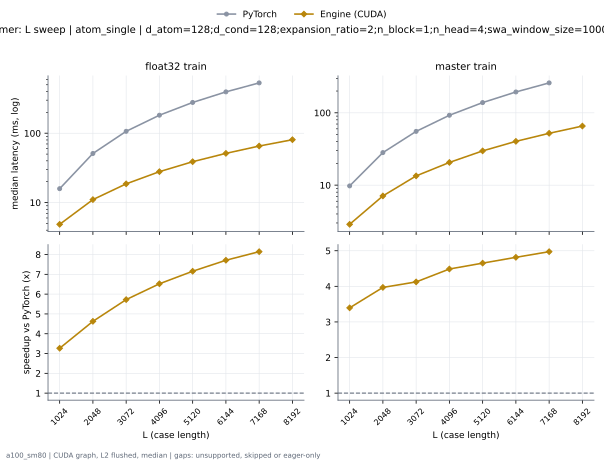
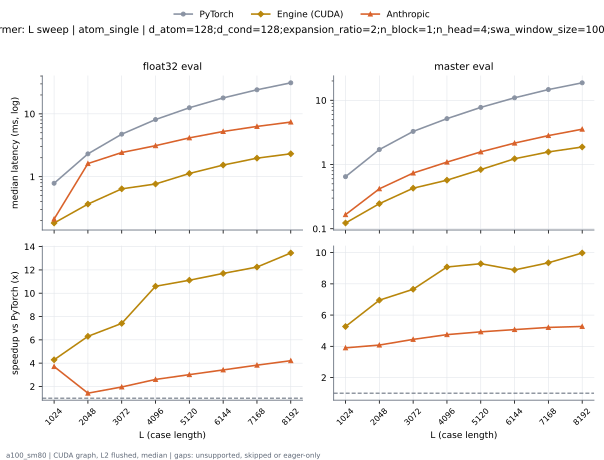
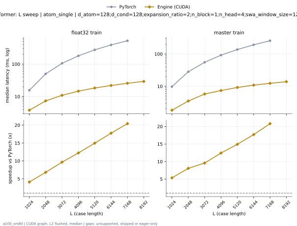
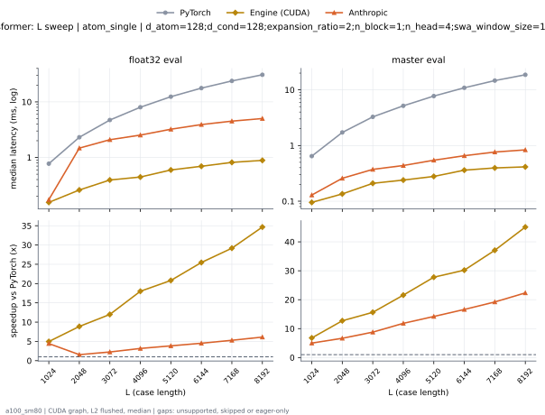
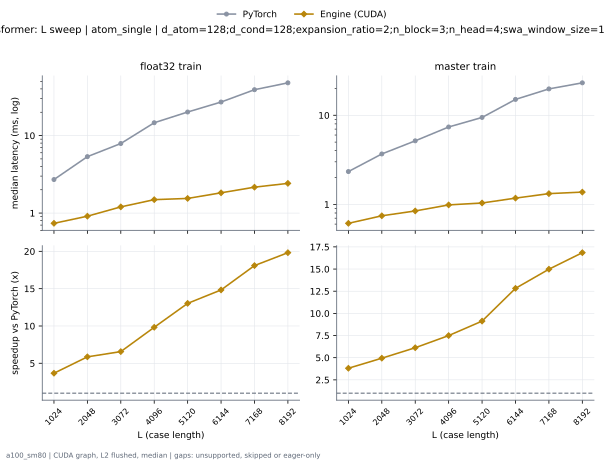
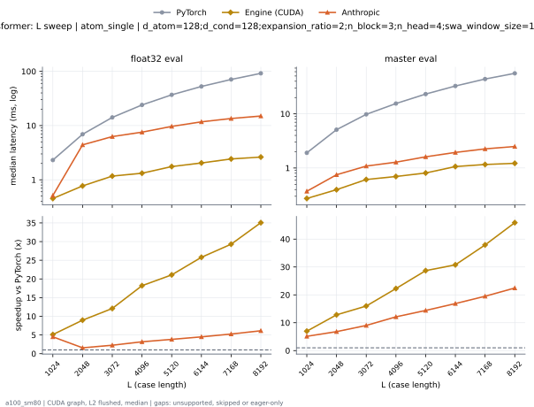

# SWAAtomTransformer on a100_sm80

Generated by `python -m foldjet_engine.measure.plot` from speed tokens `judge/tokens/a100_sm80/`; do not edit.

### L sweep: atom_single | d_atom=128;d_cond=128;expansion_ratio=2;n_block=1;n_head=4;swa_window_size=1000000 | S48 | graph

**float32 train** (median ms; x = speedup vs PyTorch)

| L | PyTorch | Engine (Triton) | Engine (CUDA) | Anthropic |
|---|---|---|---|---|
| 1024 | 15.86 | 5.761 (2.75x) | 4.855 (3.27x) | 16.86 (eager) |
| 2048 | 51.04 | 14.09 (3.62x) | 11.04 (4.62x) | 52.48 (eager) |
| 3072 | 106.6 | 25.23 (4.23x) | 18.63 (5.72x) | 110.7 (eager) |
| 4096 | 182 | 39.06 (4.66x) | 27.91 (6.52x) | 187.7 (eager) |
| 5120 | 278.1 | 55.62 (5.00x) | 38.86 (7.16x) | 293.9 (eager) |
| 6144 | 395.1 | 75.43 (5.24x) | 51.24 (7.71x) | 411.1 (eager) |
| 7168 | 532.4 | 99.83 (5.33x) | 65.38 (8.14x) | 571.1 (eager) |
| 8192 | skipped | 123 | 80.66 | 731.4 (eager) |

**master train** (median ms; x = speedup vs PyTorch)

| L | PyTorch | Engine (Triton) | Engine (CUDA) | Anthropic |
|---|---|---|---|---|
| 1024 | 9.766 | 3.99 (2.45x) | 2.876 (3.40x) | 11.01 (eager) |
| 2048 | 28.19 | 10.59 (2.66x) | 7.102 (3.97x) | 30 (eager) |
| 3072 | 55.39 | 20.6 (2.69x) | 13.43 (4.12x) | 61.1 (eager) |
| 4096 | 92.48 | 32.59 (2.84x) | 20.61 (4.49x) | 98.04 (eager) |
| 5120 | 138.5 | 47.39 (2.92x) | 29.77 (4.65x) | 155.5 (eager) |
| 6144 | 194.1 | 65.62 (2.96x) | 40.32 (4.82x) | 215.8 (eager) |
| 7168 | 259.2 | 87.87 (2.95x) | 52.1 (4.97x) | 304.8 (eager) |
| 8192 | skipped | 109.4 | 65.62 | 390.7 (eager) |

### L sweep: atom_single | d_atom=128;d_cond=128;expansion_ratio=2;n_block=1;n_head=4;swa_window_size=1000000 | S5 | graph

**float32 eval** (median ms; x = speedup vs PyTorch)

| L | PyTorch | Engine (Triton) | Engine (CUDA) | Anthropic |
|---|---|---|---|---|
| 1024 | 0.7864 | 0.2345 (3.35x) | 0.1833 (4.29x) | 0.212 (3.71x) |
| 2048 | 2.31 | 0.447 (5.17x) | 0.3666 (6.30x) | 1.619 (1.43x) |
| 3072 | 4.752 | 0.768 (6.19x) | 0.641 (7.41x) | 2.426 (1.96x) |
| 4096 | 8.117 | 1.115 (7.28x) | 0.766 (10.60x) | 3.117 (2.60x) |
| 5120 | 12.51 | 1.605 (7.79x) | 1.125 (11.12x) | 4.149 (3.02x) |
| 6144 | 17.93 | 2.153 (8.33x) | 1.532 (11.70x) | 5.243 (3.42x) |
| 7168 | 24.16 | 2.784 (8.68x) | 1.973 (12.25x) | 6.308 (3.83x) |
| 8192 | 31.18 | 3.444 (9.05x) | 2.318 (13.45x) | 7.403 (4.21x) |

**master eval** (median ms; x = speedup vs PyTorch)

| L | PyTorch | Engine (Triton) | Engine (CUDA) | Anthropic |
|---|---|---|---|---|
| 1024 | 0.6472 | 0.1423 (4.55x) | 0.1229 (5.27x) | 0.1659 (3.90x) |
| 2048 | 1.709 | 0.3215 (5.32x) | 0.2458 (6.95x) | 0.4188 (4.08x) |
| 3072 | 3.276 | 0.5601 (5.85x) | 0.428 (7.65x) | 0.7373 (4.44x) |
| 4096 | 5.178 | 0.8351 (6.20x) | 0.5704 (9.08x) | 1.091 (4.75x) |
| 5120 | 7.754 | 1.267 (6.12x) | 0.8346 (9.29x) | 1.574 (4.93x) |
| 6144 | 10.93 | 1.724 (6.34x) | 1.23 (8.89x) | 2.157 (5.07x) |
| 7168 | 14.69 | 2.303 (6.38x) | 1.571 (9.35x) | 2.82 (5.21x) |
| 8192 | 18.71 | 2.898 (6.46x) | 1.875 (9.98x) | 3.548 (5.27x) |

### L sweep: atom_single | d_atom=128;d_cond=128;expansion_ratio=2;n_block=1;n_head=4;swa_window_size=128 | S48 | graph

**float32 train** (median ms; x = speedup vs PyTorch)

| L | PyTorch | Engine (Triton) | Engine (CUDA) | Anthropic |
|---|---|---|---|---|
| 1024 | 15.64 | 4.509 (3.47x) | 3.806 (4.11x) | 16.85 (eager) |
| 2048 | 50.27 | 8.773 (5.73x) | 7.374 (6.82x) | 51.76 (eager) |
| 3072 | 105.7 | 13.08 (8.08x) | 10.95 (9.65x) | 84.23 (eager) |
| 4096 | 179.8 | 17.4 (10.33x) | 14.71 (12.22x) | 124.8 (eager) |
| 5120 | 275.1 | 21.67 (12.69x) | 18.4 (14.95x) | 158.8 (eager) |
| 6144 | 390.1 | 25.99 (15.01x) | 21.97 (17.75x) | 199 (eager) |
| 7168 | 525.3 | 30.38 (17.29x) | 25.74 (20.41x) | 233 (eager) |
| 8192 | skipped | 34.8 | 29.35 | 274 (eager) |

**master train** (median ms; x = speedup vs PyTorch)

| L | PyTorch | Engine (Triton) | Engine (CUDA) | Anthropic |
|---|---|---|---|---|
| 1024 | 9.764 | 2.723 (3.59x) | 1.823 (5.36x) | 10.97 (eager) |
| 2048 | 28.26 | 5.296 (5.34x) | 3.504 (8.07x) | 30.01 (eager) |
| 3072 | 55.38 | 8.388 (6.60x) | 5.779 (9.58x) | 48.31 (eager) |
| 4096 | 92.14 | 11.03 (8.35x) | 7.411 (12.43x) | 69.51 (eager) |
| 5120 | 137.4 | 13.62 (10.09x) | 9.211 (14.92x) | 87.87 (eager) |
| 6144 | 192.6 | 16.29 (11.82x) | 10.89 (17.70x) | 109.1 (eager) |
| 7168 | 257.5 | 18.8 (13.70x) | 12.37 (20.81x) | 127.9 (eager) |
| 8192 | skipped | 21.47 | 13.92 | 149.4 (eager) |

### L sweep: atom_single | d_atom=128;d_cond=128;expansion_ratio=2;n_block=1;n_head=4;swa_window_size=128 | S5 | graph

**float32 eval** (median ms; x = speedup vs PyTorch)

| L | PyTorch | Engine (Triton) | Engine (CUDA) | Anthropic |
|---|---|---|---|---|
| 1024 | 0.7731 | 0.2017 (3.83x) | 0.1556 (4.97x) | 0.1741 (4.44x) |
| 2048 | 2.31 | 0.3154 (7.32x) | 0.2601 (8.88x) | 1.474 (1.57x) |
| 3072 | 4.717 | 0.4669 (10.10x) | 0.3932 (11.99x) | 2.087 (2.26x) |
| 4096 | 8.011 | 0.5652 (14.17x) | 0.4449 (18.01x) | 2.527 (3.17x) |
| 5120 | 12.4 | 0.7281 (17.04x) | 0.596 (20.81x) | 3.223 (3.85x) |
| 6144 | 17.68 | 0.8356 (21.16x) | 0.6943 (25.47x) | 3.908 (4.52x) |
| 7168 | 23.81 | 0.9815 (24.26x) | 0.8161 (29.18x) | 4.503 (5.29x) |
| 8192 | 30.74 | 1.106 (27.79x) | 0.8868 (34.66x) | 5.018 (6.13x) |

**master eval** (median ms; x = speedup vs PyTorch)

| L | PyTorch | Engine (Triton) | Engine (CUDA) | Anthropic |
|---|---|---|---|---|
| 1024 | 0.6451 | 0.1106 (5.83x) | 0.09523 (6.77x) | 0.129 (5.00x) |
| 2048 | 1.718 | 0.1905 (9.02x) | 0.1352 (12.71x) | 0.258 (6.66x) |
| 3072 | 3.273 | 0.2632 (12.44x) | 0.2094 (15.63x) | 0.3727 (8.78x) |
| 4096 | 5.169 | 0.2939 (17.59x) | 0.2396 (21.57x) | 0.4372 (11.82x) |
| 5120 | 7.735 | 0.3717 (20.81x) | 0.2785 (27.77x) | 0.5448 (14.20x) |
| 6144 | 10.9 | 0.4403 (24.76x) | 0.361 (30.20x) | 0.6559 (16.62x) |
| 7168 | 14.68 | 0.5028 (29.19x) | 0.3958 (37.08x) | 0.7639 (19.21x) |
| 8192 | 18.66 | 0.554 (33.68x) | 0.4137 (45.11x) | 0.8351 (22.35x) |

### L sweep: atom_single | d_atom=128;d_cond=128;expansion_ratio=2;n_block=3;n_head=4;swa_window_size=128 | S1 | graph

**float32 train** (median ms; x = speedup vs PyTorch)

| L | PyTorch | Engine (Triton) | Engine (CUDA) | Anthropic |
|---|---|---|---|---|
| 1024 | 2.71 | 0.854 (3.17x) | 0.7383 (3.67x) | 10.1 (eager) |
| 2048 | 5.351 | 1.093 (4.90x) | 0.9124 (5.87x) | 10.07 (eager) |
| 3072 | 7.902 | 1.218 (6.49x) | 1.203 (6.57x) | 12.29 (eager) |
| 4096 | 14.65 | 1.838 (7.97x) | 1.491 (9.83x) | 13.06 (eager) |
| 5120 | 20.15 | 1.998 (10.09x) | 1.546 (13.03x) | 15.49 (eager) |
| 6144 | 27.11 | 2.137 (12.68x) | 1.828 (14.83x) | 18.16 (eager) |
| 7168 | 39.1 | 2.68 (14.59x) | 2.161 (18.09x) | 21.21 (eager) |
| 8192 | 47.95 | 2.83 (16.94x) | 2.419 (19.82x) | 24.06 (eager) |

**master train** (median ms; x = speedup vs PyTorch)

| L | PyTorch | Engine (Triton) | Engine (CUDA) | Anthropic |
|---|---|---|---|---|
| 1024 | 2.335 | 0.639 (3.65x) | 0.6129 (3.81x) | 11.83 (eager) |
| 2048 | 3.681 | 0.7731 (4.76x) | 0.7444 (4.94x) | 12.15 (eager) |
| 3072 | 5.168 | 0.8796 (5.88x) | 0.8438 (6.13x) | 14.1 (eager) |
| 4096 | 7.392 | 1.201 (6.15x) | 0.9861 (7.50x) | 14.27 (eager) |
| 5120 | 9.46 | 1.275 (7.42x) | 1.036 (9.13x) | 15.99 (eager) |
| 6144 | 15.07 | 1.395 (10.81x) | 1.176 (12.82x) | 16.02 (eager) |
| 7168 | 19.78 | 1.741 (11.36x) | 1.32 (14.98x) | 17.79 (eager) |
| 8192 | 23.14 | 1.837 (12.59x) | 1.373 (16.85x) | 17.78 (eager) |

### L sweep: atom_single | d_atom=128;d_cond=128;expansion_ratio=2;n_block=3;n_head=4;swa_window_size=128 | S5 | graph

**float32 eval** (median ms; x = speedup vs PyTorch)

| L | PyTorch | Engine (Triton) | Engine (CUDA) | Anthropic |
|---|---|---|---|---|
| 1024 | 2.309 | 0.5939 (3.89x) | 0.4516 (5.11x) | 0.512 (4.51x) |
| 2048 | 6.911 | 0.9339 (7.40x) | 0.7706 (8.97x) | 4.408 (1.57x) |
| 3072 | 14.15 | 1.383 (10.23x) | 1.169 (12.10x) | 6.263 (2.26x) |
| 4096 | 24.02 | 1.688 (14.23x) | 1.32 (18.20x) | 7.557 (3.18x) |
| 5120 | 36.96 | 2.164 (17.08x) | 1.752 (21.09x) | 9.657 (3.83x) |
| 6144 | 52.69 | 2.527 (20.85x) | 2.042 (25.80x) | 11.72 (4.50x) |
| 7168 | 70.94 | 2.979 (23.81x) | 2.421 (29.30x) | 13.5 (5.25x) |
| 8192 | 92.03 | 3.366 (27.34x) | 2.625 (35.06x) | 15 (6.13x) |

**master eval** (median ms; x = speedup vs PyTorch)

| L | PyTorch | Engine (Triton) | Engine (CUDA) | Anthropic |
|---|---|---|---|---|
| 1024 | 1.905 | 0.3236 (5.89x) | 0.2734 (6.97x) | 0.3717 (5.12x) |
| 2048 | 5.098 | 0.5601 (9.10x) | 0.3973 (12.83x) | 0.7496 (6.80x) |
| 3072 | 9.79 | 0.7736 (12.65x) | 0.6124 (15.99x) | 1.084 (9.03x) |
| 4096 | 15.5 | 0.8663 (17.89x) | 0.6963 (22.26x) | 1.279 (12.11x) |
| 5120 | 23.18 | 1.111 (20.87x) | 0.8079 (28.69x) | 1.609 (14.41x) |
| 6144 | 32.69 | 1.295 (25.24x) | 1.062 (30.77x) | 1.937 (16.87x) |
| 7168 | 43.96 | 1.492 (29.47x) | 1.16 (37.91x) | 2.254 (19.50x) |
| 8192 | 56 | 1.672 (33.50x) | 1.22 (45.90x) | 2.494 (22.46x) |

