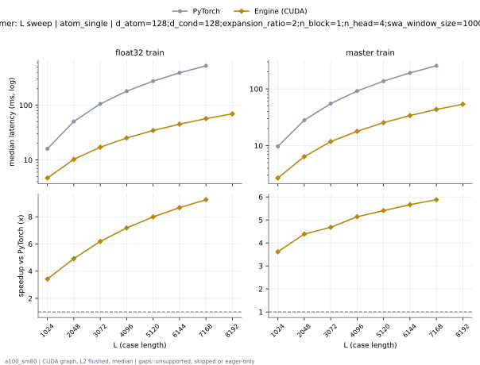
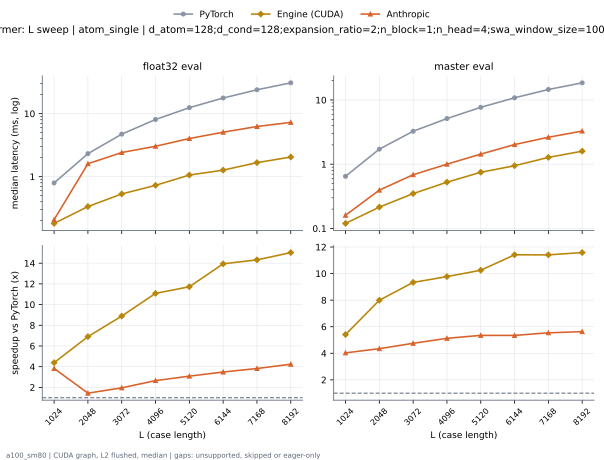
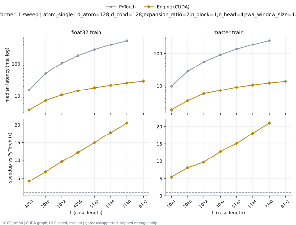
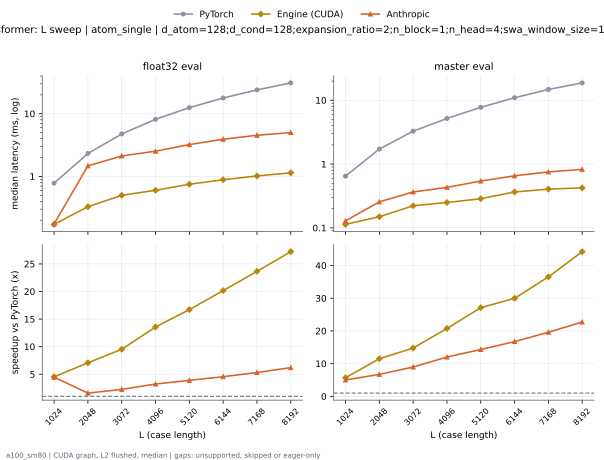
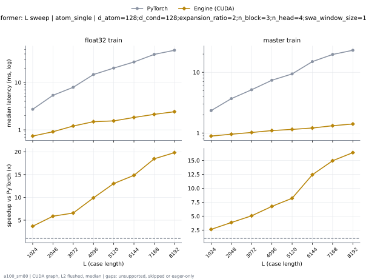
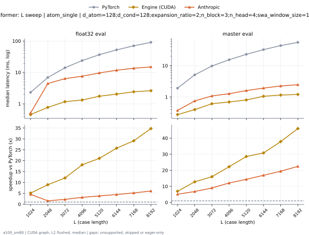

# SWAAtomTransformer on a100_sm80

Generated by `python -m miniworld_engine.measure.plot` from speed tokens `judge/tokens/a100_sm80/`; do not edit.

### L sweep: atom_single | d_atom=128;d_cond=128;expansion_ratio=2;n_block=1;n_head=4;swa_window_size=1000000 | S48 | graph

**float32 train** (median ms; x = speedup vs PyTorch)

| L | PyTorch | Engine (CUDA) | Anthropic |
|---|---|---|---|
| 1024 | 15.76 | 4.658 (3.38x) | 16.77 (eager) |
| 2048 | 50.9 | 10.34 (4.92x) | 52.48 (eager) |
| 3072 | 106.8 | 17.17 (6.22x) | 110.9 (eager) |
| 4096 | 181.7 | 25.23 (7.20x) | 187.3 (eager) |
| 5120 | 278.5 | 34.59 (8.05x) | 294.7 (eager) |
| 6144 | 400.2 | 46.29 (8.64x) | 422.7 (eager) |
| 7168 | 548.9 | 58.42 (9.40x) | 589.2 (eager) |
| 8192 | skipped | 71.41 | 750.1 (eager) |

**master train** (median ms; x = speedup vs PyTorch)

| L | PyTorch | Engine (CUDA) | Anthropic |
|---|---|---|---|
| 1024 | 9.798 | 2.7 (3.63x) | 10.9 (eager) |
| 2048 | 28.31 | 6.43 (4.40x) | 29.96 (eager) |
| 3072 | 55.56 | 11.92 (4.66x) | 61.09 (eager) |
| 4096 | 92.74 | 18.02 (5.15x) | 98.12 (eager) |
| 5120 | 138.1 | 25.51 (5.42x) | 155.3 (eager) |
| 6144 | 198.8 | 35.06 (5.67x) | 220.1 (eager) |
| 7168 | 262.9 | 44.75 (5.87x) | 310.4 (eager) |
| 8192 | skipped | 55.76 | 396 (eager) |

### L sweep: atom_single | d_atom=128;d_cond=128;expansion_ratio=2;n_block=1;n_head=4;swa_window_size=1000000 | S5 | graph

**float32 eval** (median ms; x = speedup vs PyTorch)

| L | PyTorch | Engine (CUDA) | Anthropic |
|---|---|---|---|
| 1024 | 0.7956 | 0.2243 (3.55x) | 0.2079 (3.83x) |
| 2048 | 2.324 | 0.4454 (5.22x) | 1.606 (1.45x) |
| 3072 | 4.77 | 0.6861 (6.95x) | 2.418 (1.97x) |
| 4096 | 8.201 | 0.9431 (8.70x) | 3.043 (2.70x) |
| 5120 | 12.67 | 1.268 (9.99x) | 4.033 (3.14x) |
| 6144 | 17.7 | 1.542 (11.48x) | 5.082 (3.48x) |
| 7168 | 25.21 | 2.053 (12.28x) | 6.256 (4.03x) |
| 8192 | 32.37 | 2.495 (12.97x) | 7.273 (4.45x) |

**master eval** (median ms; x = speedup vs PyTorch)

| L | PyTorch | Engine (CUDA) | Anthropic |
|---|---|---|---|
| 1024 | 0.6472 | 0.1638 (3.95x) | 0.1608 (4.03x) |
| 2048 | 1.726 | 0.2621 (6.59x) | 0.3953 (4.37x) |
| 3072 | 3.287 | 0.4076 (8.07x) | 0.6861 (4.79x) |
| 4096 | 5.197 | 0.5929 (8.77x) | 1.002 (5.18x) |
| 5120 | 7.78 | 0.8049 (9.67x) | 1.438 (5.41x) |
| 6144 | 11.03 | 1.052 (10.49x) | 2.023 (5.45x) |
| 7168 | 14.98 | 1.394 (10.75x) | 2.631 (5.70x) |
| 8192 | 19 | 1.735 (10.95x) | 3.283 (5.79x) |

### L sweep: atom_single | d_atom=128;d_cond=128;expansion_ratio=2;n_block=1;n_head=4;swa_window_size=128 | S48 | graph

**float32 train** (median ms; x = speedup vs PyTorch)

| L | PyTorch | Engine (CUDA) | Anthropic |
|---|---|---|---|
| 1024 | 15.67 | 3.769 (4.16x) | 16.84 (eager) |
| 2048 | 50.26 | 7.448 (6.75x) | 51.97 (eager) |
| 3072 | 105.7 | 11.01 (9.60x) | 84.63 (eager) |
| 4096 | 180.6 | 14.56 (12.40x) | 125.5 (eager) |
| 5120 | 275.4 | 18.18 (15.15x) | 158.4 (eager) |
| 6144 | 390.4 | 21.69 (18.00x) | 199.2 (eager) |
| 7168 | skipped | 25.42 | 233.2 (eager) |
| 8192 | skipped | 29.01 | 275 (eager) |

**master train** (median ms; x = speedup vs PyTorch)

| L | PyTorch | Engine (CUDA) | Anthropic |
|---|---|---|---|
| 1024 | 9.785 | 1.81 (5.40x) | 10.93 (eager) |
| 2048 | 28.39 | 3.577 (7.94x) | 30.08 (eager) |
| 3072 | 55.79 | 5.767 (9.67x) | 48.21 (eager) |
| 4096 | 92.18 | 7.406 (12.45x) | 69.43 (eager) |
| 5120 | 137.4 | 9.159 (15.01x) | 87.76 (eager) |
| 6144 | 192.1 | 10.75 (17.87x) | 109.4 (eager) |
| 7168 | 257.2 | 12.35 (20.82x) | 128.2 (eager) |
| 8192 | skipped | 13.87 | 149.2 (eager) |

### L sweep: atom_single | d_atom=128;d_cond=128;expansion_ratio=2;n_block=1;n_head=4;swa_window_size=128 | S5 | graph

**float32 eval** (median ms; x = speedup vs PyTorch)

| L | PyTorch | Engine (CUDA) | Anthropic |
|---|---|---|---|
| 1024 | 0.7793 | 0.172 (4.53x) | 0.1746 (4.46x) |
| 2048 | 2.324 | 0.3287 (7.07x) | 1.476 (1.58x) |
| 3072 | 4.76 | 0.4997 (9.52x) | 2.119 (2.25x) |
| 4096 | 8.151 | 0.6011 (13.56x) | 2.53 (3.22x) |
| 5120 | 12.53 | 0.7496 (16.72x) | 3.222 (3.89x) |
| 6144 | 17.84 | 0.8847 (20.16x) | 3.92 (4.55x) |
| 7168 | 24.05 | 1.017 (23.65x) | 4.531 (5.31x) |
| 8192 | 31.08 | 1.142 (27.22x) | 5.017 (6.20x) |

**master eval** (median ms; x = speedup vs PyTorch)

| L | PyTorch | Engine (CUDA) | Anthropic |
|---|---|---|---|
| 1024 | 0.6472 | 0.1137 (5.69x) | 0.129 (5.02x) |
| 2048 | 1.721 | 0.1495 (11.51x) | 0.256 (6.72x) |
| 3072 | 3.281 | 0.2222 (14.76x) | 0.3656 (8.97x) |
| 4096 | 5.186 | 0.2499 (20.76x) | 0.4311 (12.03x) |
| 5120 | 7.772 | 0.2867 (27.11x) | 0.5427 (14.32x) |
| 6144 | 10.96 | 0.3656 (29.97x) | 0.6543 (16.74x) |
| 7168 | 14.79 | 0.405 (36.51x) | 0.7542 (19.60x) |
| 8192 | 18.75 | 0.4239 (44.22x) | 0.8253 (22.72x) |

### L sweep: atom_single | d_atom=128;d_cond=128;expansion_ratio=2;n_block=3;n_head=4;swa_window_size=128 | S1 | graph

**float32 train** (median ms; x = speedup vs PyTorch)

| L | PyTorch | Engine (CUDA) | Anthropic |
|---|---|---|---|
| 1024 | 2.727 | 0.7393 (3.69x) | 8.603 (eager) |
| 2048 | 5.372 | 0.9144 (5.87x) | 8.616 (eager) |
| 3072 | 7.943 | 1.212 (6.55x) | 10.41 (eager) |
| 4096 | 14.77 | 1.494 (9.89x) | 12.3 (eager) |
| 5120 | 20.31 | 1.55 (13.10x) | 15.17 (eager) |
| 6144 | 27.25 | 1.831 (14.88x) | 18.01 (eager) |
| 7168 | 39.47 | 2.128 (18.55x) | 21.09 (eager) |
| 8192 | 48.33 | 2.426 (19.92x) | 23.96 (eager) |

**master train** (median ms; x = speedup vs PyTorch)

| L | PyTorch | Engine (CUDA) | Anthropic |
|---|---|---|---|
| 1024 | 2.334 | 0.8909 (2.62x) | 9.935 (eager) |
| 2048 | 3.694 | 0.9564 (3.86x) | 10.27 (eager) |
| 3072 | 5.177 | 1.023 (5.06x) | 11.95 (eager) |
| 4096 | 7.416 | 1.104 (6.72x) | 11.62 (eager) |
| 5120 | 9.502 | 1.149 (8.27x) | 13.36 (eager) |
| 6144 | 15.14 | 1.217 (12.44x) | 13.34 (eager) |
| 7168 | 19.85 | 1.323 (15.00x) | 15.14 (eager) |
| 8192 | 23.28 | 1.415 (16.45x) | 15.33 (eager) |

### L sweep: atom_single | d_atom=128;d_cond=128;expansion_ratio=2;n_block=3;n_head=4;swa_window_size=128 | S5 | graph

**float32 eval** (median ms; x = speedup vs PyTorch)

| L | PyTorch | Engine (CUDA) | Anthropic |
|---|---|---|---|
| 1024 | 2.311 | 0.5048 (4.58x) | 0.51 (4.53x) |
| 2048 | 6.926 | 0.9789 (7.08x) | 4.42 (1.57x) |
| 3072 | 14.26 | 1.491 (9.56x) | 6.347 (2.25x) |
| 4096 | 24.43 | 1.798 (13.59x) | 7.567 (3.23x) |
| 5120 | 37.57 | 2.242 (16.76x) | 9.653 (3.89x) |
| 6144 | 53.53 | 2.642 (20.26x) | 11.74 (4.56x) |
| 7168 | 72.13 | 3.041 (23.72x) | 13.58 (5.31x) |
| 8192 | 92.91 | 3.409 (27.26x) | 15 (6.19x) |

**master eval** (median ms; x = speedup vs PyTorch)

| L | PyTorch | Engine (CUDA) | Anthropic |
|---|---|---|---|
| 1024 | 1.911 | 0.3318 (5.76x) | 0.3727 (5.13x) |
| 2048 | 5.114 | 0.4403 (11.61x) | 0.7496 (6.82x) |
| 3072 | 9.833 | 0.6513 (15.10x) | 1.081 (9.09x) |
| 4096 | 15.56 | 0.7373 (21.11x) | 1.274 (12.22x) |
| 5120 | 23.3 | 0.8392 (27.77x) | 1.601 (14.56x) |
| 6144 | 32.85 | 1.082 (30.35x) | 1.922 (17.09x) |
| 7168 | 44.31 | 1.175 (37.73x) | 2.246 (19.73x) |
| 8192 | 56.19 | 1.23 (45.69x) | 2.467 (22.78x) |

