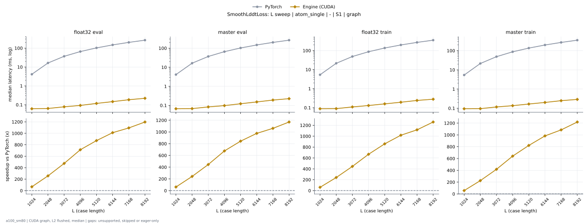

# SmoothLddtLoss on a100_sm80

Generated by `python -m miniworld_engine.measure.plot` from speed tokens `judge/tokens/a100_sm80/`; do not edit.

### L sweep: atom_single | - | S1 | graph

**float32 eval** (median ms; x = speedup vs PyTorch)

| L | PyTorch | Engine (Triton) | Engine (CUDA) |
|---|---|---|---|
| 1024 | 4.137 | 0.07168 (57.71x) | 0.1679 (24.63x) |
| 2048 | 16.4 | 0.1157 (141.76x) | 0.2171 (75.56x) |
| 3072 | 37.06 | 0.1628 (227.61x) | 0.2591 (143.04x) |
| 4096 | 65.81 | 0.2406 (273.46x) | 0.2652 (248.12x) |
| 5120 | 102.8 | 0.3041 (338.10x) | 0.3041 (338.10x) |
| 6144 | 148.2 | 0.3717 (398.56x) | 0.3471 (426.78x) |
| 7168 | 201.7 | 0.6513 (309.77x) | 0.3953 (510.40x) |
| 8192 | 263.7 | 0.7383 (357.18x) | 0.4362 (604.52x) |

**master eval** (median ms; x = speedup vs PyTorch)

| L | PyTorch | Engine (Triton) | Engine (CUDA) |
|---|---|---|---|
| 1024 | 4.142 | 0.07168 (57.79x) | 0.172 (24.08x) |
| 2048 | 16.41 | 0.1137 (144.39x) | 0.2212 (74.20x) |
| 3072 | 37.03 | 0.1597 (231.82x) | 0.2642 (140.17x) |
| 4096 | 65.8 | 0.2335 (281.83x) | 0.2693 (244.33x) |
| 5120 | 102.8 | 0.2939 (349.89x) | 0.3092 (332.51x) |
| 6144 | 148.1 | 0.3584 (413.36x) | 0.3512 (421.79x) |
| 7168 | 201.7 | 0.6318 (319.28x) | 0.3973 (507.72x) |
| 8192 | 263.7 | 0.7393 (356.66x) | 0.4372 (603.07x) |

**float32 train** (median ms; x = speedup vs PyTorch)

| L | PyTorch | Engine (Triton) | Engine (CUDA) |
|---|---|---|---|
| 1024 | 5.395 | 0.1444 (37.37x) | 0.3287 (16.41x) |
| 2048 | 21.53 | 0.254 (84.78x) | 0.4342 (49.59x) |
| 3072 | 48.88 | 0.3666 (133.33x) | 0.5171 (94.52x) |
| 4096 | 87.05 | 0.5714 (152.35x) | 0.4844 (179.73x) |
| 5120 | 136.5 | 0.7148 (190.96x) | 0.5458 (250.08x) |
| 6144 | 197.3 | 0.8632 (228.57x) | 0.6062 (325.47x) |
| 7168 | 269.1 | 1.637 (164.34x) | 0.6728 (399.98x) |
| 8192 | 351.9 | 1.789 (196.68x) | 0.7199 (488.77x) |

**master train** (median ms; x = speedup vs PyTorch)

| L | PyTorch | Engine (Triton) | Engine (CUDA) |
|---|---|---|---|
| 1024 | 5.4 | 0.1444 (37.40x) | 0.3348 (16.13x) |
| 2048 | 21.54 | 0.2529 (85.18x) | 0.4413 (48.82x) |
| 3072 | 48.86 | 0.3645 (134.03x) | 0.5222 (93.56x) |
| 4096 | 87.28 | 0.5652 (154.41x) | 0.4915 (177.57x) |
| 5120 | 136.5 | 0.7066 (193.14x) | 0.5519 (247.25x) |
| 6144 | 197.3 | 0.853 (231.30x) | 0.6113 (322.74x) |
| 7168 | 269.1 | 1.61 (167.16x) | 0.6799 (395.75x) |
| 8192 | 352.1 | 1.806 (194.90x) | 0.727 (484.23x) |

