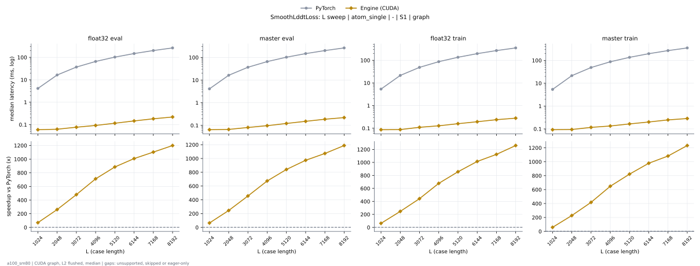

# SmoothLddtLoss on a100_sm80

Generated by `python -m miniworld_engine.measure.plot` from speed tokens `judge/tokens/a100_sm80/`; do not edit.

### L sweep: atom_single | - | S1 | graph

**float32 eval** (median ms; x = speedup vs PyTorch)

| L | PyTorch | Engine (Triton) | Engine (CUDA) |
|---|---|---|---|
| 1024 | 4.112 | 0.07168 (57.37x) | 0.05939 (69.24x) |
| 2048 | 16.32 | 0.1157 (141.05x) | 0.06246 (261.29x) |
| 3072 | 36.89 | 0.1628 (226.55x) | 0.0768 (480.29x) |
| 4096 | 65.56 | 0.2335 (280.79x) | 0.09216 (711.33x) |
| 5120 | 102.4 | 0.2949 (347.36x) | 0.1157 (885.31x) |
| 6144 | 147.6 | 0.3604 (409.56x) | 0.1464 (1008.14x) |
| 7168 | 201.1 | 0.6492 (309.73x) | 0.1823 (1103.20x) |
| 8192 | 262.8 | 0.7363 (356.97x) | 0.2191 (1199.35x) |

**master eval** (median ms; x = speedup vs PyTorch)

| L | PyTorch | Engine (Triton) | Engine (CUDA) |
|---|---|---|---|
| 1024 | 4.115 | 0.07168 (57.41x) | 0.06451 (63.79x) |
| 2048 | 16.33 | 0.1147 (142.36x) | 0.06656 (245.29x) |
| 3072 | 36.89 | 0.1608 (229.47x) | 0.0809 (456.04x) |
| 4096 | 65.56 | 0.2355 (278.37x) | 0.09728 (673.94x) |
| 5120 | 102.4 | 0.299 (342.62x) | 0.1219 (840.71x) |
| 6144 | 147.6 | 0.3635 (406.10x) | 0.1516 (974.10x) |
| 7168 | 201.1 | 0.6369 (315.72x) | 0.1874 (1073.09x) |
| 8192 | 262.8 | 0.7444 (353.05x) | 0.2212 (1188.27x) |

**float32 train** (median ms; x = speedup vs PyTorch)

| L | PyTorch | Engine (Triton) | Engine (CUDA) |
|---|---|---|---|
| 1024 | 5.363 | 0.1444 (37.14x) | 0.08602 (62.35x) |
| 2048 | 21.43 | 0.2529 (84.72x) | 0.08704 (246.19x) |
| 3072 | 48.67 | 0.3656 (133.15x) | 0.1101 (442.18x) |
| 4096 | 86.72 | 0.5622 (154.26x) | 0.128 (677.52x) |
| 5120 | 135.9 | 0.7035 (193.18x) | 0.1587 (856.24x) |
| 6144 | 196.5 | 0.8489 (231.43x) | 0.1935 (1015.11x) |
| 7168 | 268.2 | 1.634 (164.10x) | 0.2386 (1124.06x) |
| 8192 | 351 | 1.793 (195.76x) | 0.2785 (1260.22x) |

**master train** (median ms; x = speedup vs PyTorch)

| L | PyTorch | Engine (Triton) | Engine (CUDA) |
|---|---|---|---|
| 1024 | 5.367 | 0.1434 (37.44x) | 0.09216 (58.23x) |
| 2048 | 21.44 | 0.2529 (84.76x) | 0.09421 (227.57x) |
| 3072 | 48.68 | 0.3635 (133.92x) | 0.1167 (417.03x) |
| 4096 | 86.96 | 0.5663 (153.56x) | 0.1341 (648.24x) |
| 5120 | 136 | 0.7091 (191.80x) | 0.1654 (822.42x) |
| 6144 | 196.4 | 0.855 (229.75x) | 0.2007 (978.77x) |
| 7168 | 268.2 | 1.616 (165.96x) | 0.2478 (1082.17x) |
| 8192 | 351 | 1.79 (196.11x) | 0.2847 (1233.06x) |

