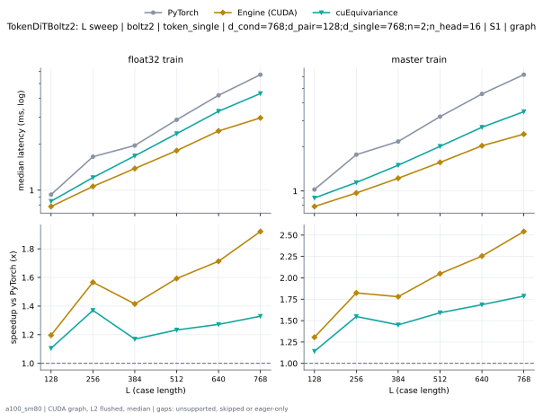
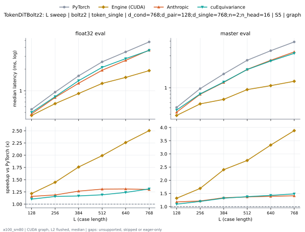

# TokenDiTBoltz2 on a100_sm80

Generated by `python -m miniworld_engine.measure.plot` from speed tokens `judge/tokens/a100_sm80/`; do not edit.

### L sweep: boltz2 | token_single | d_cond=768;d_pair=128;d_single=768;n=2;n_head=16 | S1 | graph

**float32 train** (median ms; x = speedup vs PyTorch)

| L | PyTorch | Engine (Triton) | Engine (CUDA) | Anthropic | cuEquivariance |
|---|---|---|---|---|---|
| 128 | 0.9349 | 0.9155 (1.02x) | 0.7813 (1.20x) | unsupported | 0.8458 (1.11x) |
| 256 | 1.657 | 1.63 (1.02x) | 1.058 (1.57x) | unsupported | 1.209 (1.37x) |
| 384 | 1.962 | 1.905 (1.03x) | 1.386 (1.42x) | unsupported | 1.677 (1.17x) |
| 512 | 2.893 | 2.802 (1.03x) | 1.817 (1.59x) | unsupported | 2.346 (1.23x) |
| 640 | 4.185 | 3.905 (1.07x) | 2.443 (1.71x) | unsupported | 3.29 (1.27x) |
| 768 | 5.715 | 5.309 (1.08x) | 2.976 (1.92x) | unsupported | 4.3 (1.33x) |

**master train** (median ms; x = speedup vs PyTorch)

| L | PyTorch | Engine (Triton) | Engine (CUDA) | Anthropic | cuEquivariance |
|---|---|---|---|---|---|
| 128 | 1.024 | 0.9748 (1.05x) | 0.7844 (1.31x) | unsupported | 0.897 (1.14x) |
| 256 | 1.769 | 1.695 (1.04x) | 0.9697 (1.82x) | unsupported | 1.143 (1.55x) |
| 384 | 2.174 | 2.076 (1.05x) | 1.222 (1.78x) | unsupported | 1.499 (1.45x) |
| 512 | 3.21 | 3.056 (1.05x) | 1.567 (2.05x) | unsupported | 2.016 (1.59x) |
| 640 | 4.582 | 4.296 (1.07x) | 2.033 (2.25x) | unsupported | 2.718 (1.69x) |
| 768 | 6.2 | 5.709 (1.09x) | 2.439 (2.54x) | unsupported | 3.469 (1.79x) |

### L sweep: boltz2 | token_single | d_cond=768;d_pair=128;d_single=768;n=2;n_head=16 | S5 | graph

**float32 eval** (median ms; x = speedup vs PyTorch)

| L | PyTorch | Engine (Triton) | Engine (CUDA) | Anthropic | cuEquivariance |
|---|---|---|---|---|---|
| 128 | 0.553 | 0.5059 (1.09x) | 0.4547 (1.22x) | 0.4772 (1.16x) | 0.5012 (1.10x) |
| 256 | 0.9585 | 0.8387 (1.14x) | 0.6625 (1.45x) | 0.8069 (1.19x) | 0.8284 (1.16x) |
| 384 | 1.612 | 1.319 (1.22x) | 0.9165 (1.76x) | 1.273 (1.27x) | 1.381 (1.17x) |
| 512 | 2.521 | 1.986 (1.27x) | 1.266 (1.99x) | 1.929 (1.31x) | 2.116 (1.19x) |
| 640 | 3.463 | 2.616 (1.32x) | 1.533 (2.26x) | 2.642 (1.31x) | 2.793 (1.24x) |
| 768 | 4.77 | 3.633 (1.31x) | 1.906 (2.50x) | 3.672 (1.30x) | 3.637 (1.31x) |

**master eval** (median ms; x = speedup vs PyTorch)

| L | PyTorch | Engine (Triton) | Engine (CUDA) | Anthropic | cuEquivariance |
|---|---|---|---|---|---|
| 128 | 0.5079 | 0.4495 (1.13x) | 0.385 (1.32x) | 0.4311 (1.18x) | 0.4639 (1.09x) |
| 256 | 0.9697 | 0.811 (1.20x) | 0.5734 (1.69x) | 0.7977 (1.22x) | 0.809 (1.20x) |
| 384 | 1.608 | 1.209 (1.33x) | 0.6697 (2.40x) | 1.202 (1.34x) | 1.218 (1.32x) |
| 512 | 2.579 | 1.908 (1.35x) | 0.938 (2.75x) | 1.884 (1.37x) | 1.872 (1.38x) |
| 640 | 3.585 | 2.551 (1.41x) | 1.075 (3.33x) | 2.576 (1.39x) | 2.512 (1.43x) |
| 768 | 4.853 | 3.358 (1.45x) | 1.25 (3.88x) | 3.437 (1.41x) | 3.273 (1.48x) |

