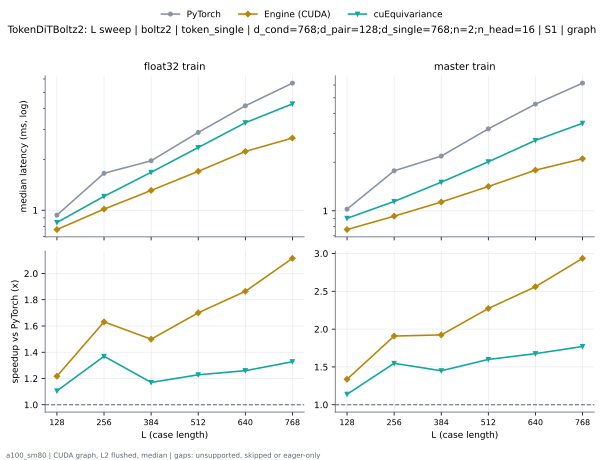
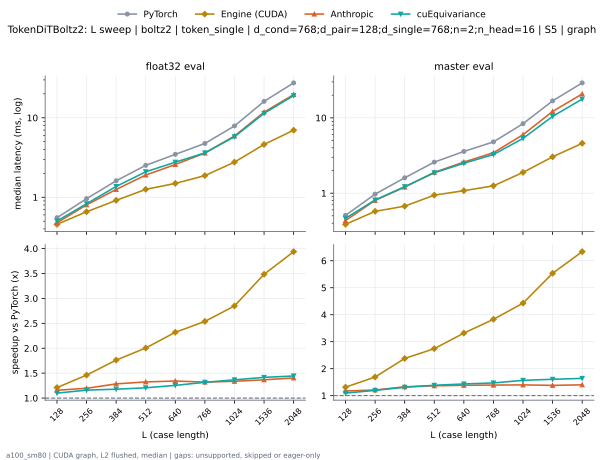
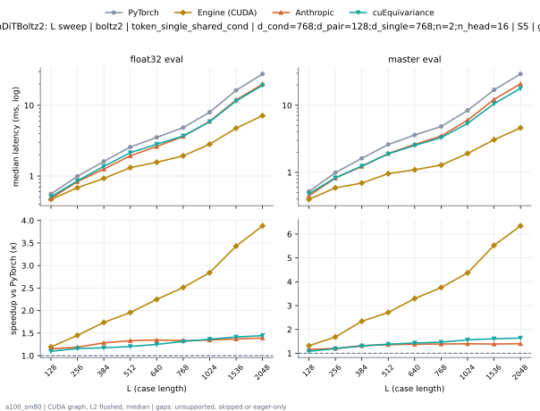

# TokenDiTBoltz2 on a100_sm80

Generated by `python -m foldjet_engine.measure.plot` from speed tokens `judge/tokens/a100_sm80/`; do not edit.

### L sweep: boltz2 | token_single | d_cond=768;d_pair=128;d_single=768;n=2;n_head=16 | S1 | graph

**float32 train** (median ms; x = speedup vs PyTorch)

| L | PyTorch | Engine (Triton) | Engine (CUDA) | Anthropic | cuEquivariance |
|---|---|---|---|---|---|
| 128 | 0.9349 | 0.9165 (1.02x) | 0.768 (1.22x) | unsupported | 0.8458 (1.11x) |
| 256 | 1.655 | 1.629 (1.02x) | 1.015 (1.63x) | unsupported | 1.209 (1.37x) |
| 384 | 1.964 | 1.911 (1.03x) | 1.31 (1.50x) | unsupported | 1.678 (1.17x) |
| 512 | 2.891 | 2.8 (1.03x) | 1.7 (1.70x) | unsupported | 2.354 (1.23x) |
| 640 | 4.157 | 3.898 (1.07x) | 2.23 (1.86x) | unsupported | 3.3 (1.26x) |
| 768 | 5.667 | 5.276 (1.07x) | 2.679 (2.12x) | unsupported | 4.268 (1.33x) |

**master train** (median ms; x = speedup vs PyTorch)

| L | PyTorch | Engine (Triton) | Engine (CUDA) | Anthropic | cuEquivariance |
|---|---|---|---|---|---|
| 128 | 1.024 | 0.9759 (1.05x) | 0.766 (1.34x) | unsupported | 0.8991 (1.14x) |
| 256 | 1.768 | 1.695 (1.04x) | 0.9267 (1.91x) | unsupported | 1.143 (1.55x) |
| 384 | 2.18 | 2.077 (1.05x) | 1.134 (1.92x) | unsupported | 1.504 (1.45x) |
| 512 | 3.214 | 3.061 (1.05x) | 1.414 (2.27x) | unsupported | 2.01 (1.60x) |
| 640 | 4.57 | 4.291 (1.07x) | 1.785 (2.56x) | unsupported | 2.727 (1.68x) |
| 768 | 6.162 | 5.697 (1.08x) | 2.099 (2.94x) | unsupported | 3.481 (1.77x) |

### L sweep: boltz2 | token_single | d_cond=768;d_pair=128;d_single=768;n=2;n_head=16 | S5 | graph

**float32 eval** (median ms; x = speedup vs PyTorch)

| L | PyTorch | Engine (Triton) | Engine (CUDA) | Anthropic | cuEquivariance |
|---|---|---|---|---|---|
| 128 | 0.553 | 0.5079 (1.09x) | 0.4567 (1.21x) | 0.4777 (1.16x) | 0.5028 (1.10x) |
| 256 | 0.9605 | 0.8397 (1.14x) | 0.6574 (1.46x) | 0.8028 (1.20x) | 0.8284 (1.16x) |
| 384 | 1.612 | 1.337 (1.21x) | 0.9144 (1.76x) | 1.254 (1.28x) | 1.368 (1.18x) |
| 512 | 2.523 | 2.001 (1.26x) | 1.258 (2.00x) | 1.906 (1.32x) | 2.092 (1.21x) |
| 640 | 3.469 | 2.624 (1.32x) | 1.495 (2.32x) | 2.585 (1.34x) | 2.764 (1.26x) |
| 768 | 4.759 | 3.633 (1.31x) | 1.874 (2.54x) | 3.603 (1.32x) | 3.616 (1.32x) |
| 1024 | 7.895 | 5.96 (1.32x) | 2.771 (2.85x) | 5.906 (1.34x) | 5.779 (1.37x) |
| 1536 | 16.1 | 11.86 (1.36x) | 4.621 (3.48x) | 11.78 (1.37x) | 11.38 (1.42x) |
| 2048 | 27.5 | 19.58 (1.40x) | 6.982 (3.94x) | 19.59 (1.40x) | 19.04 (1.44x) |

**master eval** (median ms; x = speedup vs PyTorch)

| L | PyTorch | Engine (Triton) | Engine (CUDA) | Anthropic | cuEquivariance |
|---|---|---|---|---|---|
| 128 | 0.5079 | 0.4485 (1.13x) | 0.386 (1.32x) | 0.4332 (1.17x) | 0.4639 (1.09x) |
| 256 | 0.9718 | 0.8131 (1.20x) | 0.5745 (1.69x) | 0.8028 (1.21x) | 0.8131 (1.20x) |
| 384 | 1.601 | 1.214 (1.32x) | 0.6728 (2.38x) | 1.205 (1.33x) | 1.22 (1.31x) |
| 512 | 2.584 | 1.912 (1.35x) | 0.9421 (2.74x) | 1.891 (1.37x) | 1.866 (1.38x) |
| 640 | 3.581 | 2.554 (1.40x) | 1.079 (3.32x) | 2.589 (1.38x) | 2.498 (1.43x) |
| 768 | 4.796 | 3.365 (1.43x) | 1.252 (3.83x) | 3.445 (1.39x) | 3.26 (1.47x) |
| 1024 | 8.365 | 5.835 (1.43x) | 1.889 (4.43x) | 5.979 (1.40x) | 5.338 (1.57x) |
| 1536 | 16.81 | 11.71 (1.44x) | 3.037 (5.54x) | 12.17 (1.38x) | 10.46 (1.61x) |
| 2048 | 29.12 | 19.93 (1.46x) | 4.596 (6.34x) | 20.78 (1.40x) | 17.75 (1.64x) |

### L sweep: boltz2 | token_single_shared_cond | d_cond=768;d_pair=128;d_single=768;n=2;n_head=16 | S5 | graph

**float32 eval** (median ms; x = speedup vs PyTorch)

| L | PyTorch | Engine (Triton) | Engine (CUDA) | Anthropic | cuEquivariance |
|---|---|---|---|---|---|
| 128 | 0.5571 | 0.512 (1.09x) | 0.4669 (1.19x) | 0.4833 (1.15x) | 0.5079 (1.10x) |
| 256 | 0.9902 | 0.8684 (1.14x) | 0.683 (1.45x) | 0.8335 (1.19x) | 0.855 (1.16x) |
| 384 | 1.608 | 1.336 (1.20x) | 0.9257 (1.74x) | 1.253 (1.28x) | 1.371 (1.17x) |
| 512 | 2.572 | 2.052 (1.25x) | 1.314 (1.96x) | 1.932 (1.33x) | 2.139 (1.20x) |
| 640 | 3.524 | 2.69 (1.31x) | 1.567 (2.25x) | 2.616 (1.35x) | 2.82 (1.25x) |
| 768 | 4.845 | 3.721 (1.30x) | 1.928 (2.51x) | 3.632 (1.33x) | 3.683 (1.32x) |
| 1024 | 7.998 | 6.081 (1.32x) | 2.815 (2.84x) | 5.94 (1.35x) | 5.862 (1.36x) |
| 1536 | 16.29 | 12.07 (1.35x) | 4.749 (3.43x) | 11.9 (1.37x) | 11.52 (1.41x) |
| 2048 | 27.76 | 20.1 (1.38x) | 7.155 (3.88x) | 19.94 (1.39x) | 19.22 (1.44x) |

**master eval** (median ms; x = speedup vs PyTorch)

| L | PyTorch | Engine (Triton) | Engine (CUDA) | Anthropic | cuEquivariance |
|---|---|---|---|---|---|
| 128 | 0.5212 | 0.4649 (1.12x) | 0.3963 (1.32x) | 0.4495 (1.16x) | 0.4813 (1.08x) |
| 256 | 0.9912 | 0.8325 (1.19x) | 0.5888 (1.68x) | 0.8233 (1.20x) | 0.8315 (1.19x) |
| 384 | 1.623 | 1.236 (1.31x) | 0.6932 (2.34x) | 1.23 (1.32x) | 1.242 (1.31x) |
| 512 | 2.604 | 1.933 (1.35x) | 0.9595 (2.71x) | 1.913 (1.36x) | 1.887 (1.38x) |
| 640 | 3.609 | 2.58 (1.40x) | 1.095 (3.30x) | 2.615 (1.38x) | 2.524 (1.43x) |
| 768 | 4.83 | 3.398 (1.42x) | 1.285 (3.76x) | 3.479 (1.39x) | 3.298 (1.46x) |
| 1024 | 8.381 | 5.857 (1.43x) | 1.917 (4.37x) | 5.999 (1.40x) | 5.361 (1.56x) |
| 1536 | 16.95 | 11.78 (1.44x) | 3.066 (5.53x) | 12.22 (1.39x) | 10.55 (1.61x) |
| 2048 | 29.22 | 20.02 (1.46x) | 4.605 (6.34x) | 20.86 (1.40x) | 17.84 (1.64x) |

