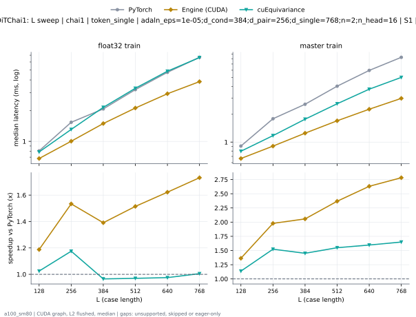
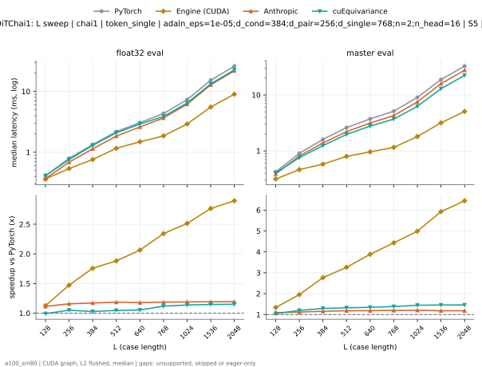
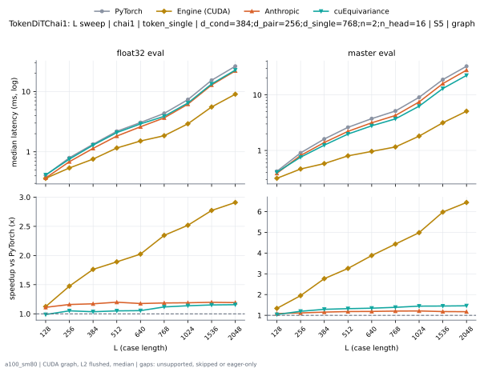
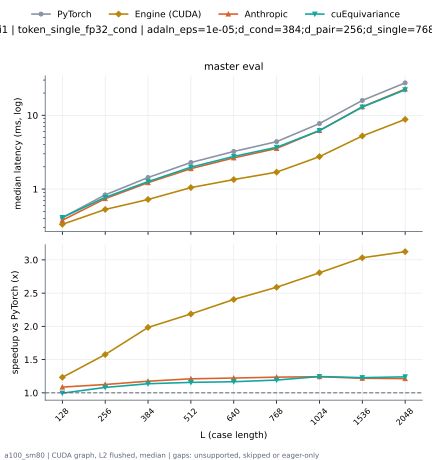
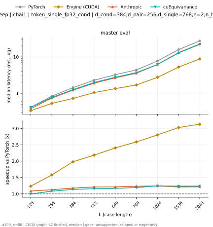
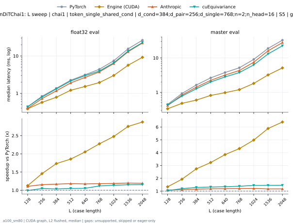

# TokenDiTChai1 on a100_sm80

Generated by `python -m foldjet_engine.measure.plot` from speed tokens `judge/tokens/a100_sm80/`; do not edit.

### L sweep: chai1 | token_single | adaln_eps=1e-05;d_cond=384;d_pair=256;d_single=768;n=2;n_head=16 | S1 | graph

**float32 train** (median ms; x = speedup vs PyTorch)

| L | PyTorch | Engine (Triton) | Engine (CUDA) | Anthropic | cuEquivariance |
|---|---|---|---|---|---|
| 128 | 0.8069 | 0.7982 (1.01x) | 0.6794 (1.19x) | unsupported | 0.7875 (1.02x) |
| 256 | 1.539 | 1.534 (1.00x) | 1.004 (1.53x) | unsupported | 1.31 (1.18x) |
| 384 | 2.081 | 2.062 (1.01x) | 1.496 (1.39x) | unsupported | 2.156 (0.97x) |
| 512 | 3.216 | 3.181 (1.01x) | 2.124 (1.51x) | unsupported | 3.317 (0.97x) |
| 640 | 4.756 | 4.624 (1.03x) | 2.932 (1.62x) | unsupported | 4.877 (0.98x) |
| 768 | 6.673 | 6.459 (1.03x) | 3.853 (1.73x) | unsupported | 6.639 (1.01x) |

**master train** (median ms; x = speedup vs PyTorch)

| L | PyTorch | Engine (Triton) | Engine (CUDA) | Anthropic | cuEquivariance |
|---|---|---|---|---|---|
| 128 | 0.9062 | 0.8704 (1.04x) | 0.6646 (1.36x) | unsupported | 0.7967 (1.14x) |
| 256 | 1.791 | 1.734 (1.03x) | 0.9052 (1.98x) | unsupported | 1.176 (1.52x) |
| 384 | 2.57 | 2.5 (1.03x) | 1.249 (2.06x) | unsupported | 1.77 (1.45x) |
| 512 | 4.03 | 3.921 (1.03x) | 1.702 (2.37x) | unsupported | 2.601 (1.55x) |
| 640 | 5.974 | 5.759 (1.04x) | 2.27 (2.63x) | unsupported | 3.741 (1.60x) |
| 768 | 8.281 | 7.911 (1.05x) | 2.976 (2.78x) | unsupported | 5.02 (1.65x) |

### L sweep: chai1 | token_single | adaln_eps=1e-05;d_cond=384;d_pair=256;d_single=768;n=2;n_head=16 | S5 | graph

**float32 eval** (median ms; x = speedup vs PyTorch)

| L | PyTorch | Engine (Triton) | Engine (CUDA) | Anthropic | cuEquivariance |
|---|---|---|---|---|---|
| 128 | 0.4096 | 0.3773 (1.09x) | 0.3635 (1.13x) | 0.3676 (1.11x) | 0.4127 (0.99x) |
| 256 | 0.7946 | 0.7188 (1.11x) | 0.5396 (1.47x) | 0.6861 (1.16x) | 0.7567 (1.05x) |
| 384 | 1.334 | 1.176 (1.14x) | 0.7593 (1.76x) | 1.139 (1.17x) | 1.298 (1.03x) |
| 512 | 2.187 | 1.862 (1.17x) | 1.162 (1.88x) | 1.845 (1.19x) | 2.09 (1.05x) |
| 640 | 3.066 | 2.601 (1.18x) | 1.486 (2.06x) | 2.603 (1.18x) | 2.909 (1.05x) |
| 768 | 4.344 | 3.699 (1.17x) | 1.855 (2.34x) | 3.663 (1.19x) | 3.881 (1.12x) |
| 1024 | 7.345 | 6.161 (1.19x) | 2.922 (2.51x) | 6.175 (1.19x) | 6.455 (1.14x) |
| 1536 | 15.3 | 12.87 (1.19x) | 5.534 (2.76x) | 12.83 (1.19x) | 13.33 (1.15x) |
| 2048 | 26.1 | 21.91 (1.19x) | 9.015 (2.89x) | 21.87 (1.19x) | 22.69 (1.15x) |

**master eval** (median ms; x = speedup vs PyTorch)

| L | PyTorch | Engine (Triton) | Engine (CUDA) | Anthropic | cuEquivariance |
|---|---|---|---|---|---|
| 128 | 0.4219 | 0.3738 (1.13x) | 0.3154 (1.34x) | 0.3871 (1.09x) | 0.4045 (1.04x) |
| 256 | 0.9062 | 0.7731 (1.17x) | 0.4639 (1.95x) | 0.812 (1.12x) | 0.7578 (1.20x) |
| 384 | 1.607 | 1.295 (1.24x) | 0.5806 (2.77x) | 1.391 (1.16x) | 1.245 (1.29x) |
| 512 | 2.607 | 2.085 (1.25x) | 0.7997 (3.26x) | 2.207 (1.18x) | 1.971 (1.32x) |
| 640 | 3.735 | 2.94 (1.27x) | 0.9615 (3.88x) | 3.149 (1.19x) | 2.777 (1.34x) |
| 768 | 5.124 | 4.023 (1.27x) | 1.156 (4.43x) | 4.283 (1.20x) | 3.702 (1.38x) |
| 1024 | 9.032 | 7.091 (1.27x) | 1.81 (4.99x) | 7.505 (1.20x) | 6.257 (1.44x) |
| 1536 | 18.81 | 15.07 (1.25x) | 3.174 (5.93x) | 15.93 (1.18x) | 12.92 (1.46x) |
| 2048 | 32.69 | 26.08 (1.25x) | 5.071 (6.45x) | 27.66 (1.18x) | 22.4 (1.46x) |

### L sweep: chai1 | token_single | d_cond=384;d_pair=256;d_single=768;n=2;n_head=16 | S1 | graph

**float32 train** (median ms; x = speedup vs PyTorch)

| L | PyTorch | Engine (Triton) | Engine (CUDA) | Anthropic | cuEquivariance |
|---|---|---|---|---|---|
| 128 | 0.8059 | 0.7977 (1.01x) | 0.6789 (1.19x) | unsupported | 0.7869 (1.02x) |
| 256 | 1.537 | 1.533 (1.00x) | 1.002 (1.53x) | unsupported | 1.311 (1.17x) |
| 384 | 2.081 | 2.063 (1.01x) | 1.496 (1.39x) | unsupported | 2.156 (0.97x) |
| 512 | 3.205 | 3.172 (1.01x) | 2.125 (1.51x) | unsupported | 3.316 (0.97x) |
| 640 | 4.753 | 4.588 (1.04x) | 2.928 (1.62x) | unsupported | 4.872 (0.98x) |
| 768 | 6.669 | 6.447 (1.03x) | 3.857 (1.73x) | unsupported | 6.641 (1.00x) |

**master train** (median ms; x = speedup vs PyTorch)

| L | PyTorch | Engine (Triton) | Engine (CUDA) | Anthropic | cuEquivariance |
|---|---|---|---|---|---|
| 128 | 0.9062 | 0.8694 (1.04x) | 0.6666 (1.36x) | unsupported | 0.7936 (1.14x) |
| 256 | 1.793 | 1.736 (1.03x) | 0.9083 (1.97x) | unsupported | 1.176 (1.53x) |
| 384 | 2.566 | 2.499 (1.03x) | 1.25 (2.05x) | unsupported | 1.768 (1.45x) |
| 512 | 4.029 | 3.92 (1.03x) | 1.703 (2.37x) | unsupported | 2.603 (1.55x) |
| 640 | 5.974 | 5.759 (1.04x) | 2.273 (2.63x) | unsupported | 3.746 (1.59x) |
| 768 | 8.281 | 7.911 (1.05x) | 2.976 (2.78x) | unsupported | 5.016 (1.65x) |

### L sweep: chai1 | token_single | d_cond=384;d_pair=256;d_single=768;n=2;n_head=16 | S5 | graph

**float32 eval** (median ms; x = speedup vs PyTorch)

| L | PyTorch | Engine (Triton) | Engine (CUDA) | Anthropic | cuEquivariance |
|---|---|---|---|---|---|
| 128 | 0.4086 | 0.3779 (1.08x) | 0.3635 (1.12x) | 0.3676 (1.11x) | 0.4137 (0.99x) |
| 256 | 0.7956 | 0.7209 (1.10x) | 0.5396 (1.47x) | 0.6861 (1.16x) | 0.7567 (1.05x) |
| 384 | 1.335 | 1.171 (1.14x) | 0.7578 (1.76x) | 1.14 (1.17x) | 1.289 (1.04x) |
| 512 | 2.188 | 1.848 (1.18x) | 1.157 (1.89x) | 1.825 (1.20x) | 2.083 (1.05x) |
| 640 | 3.06 | 2.6 (1.18x) | 1.512 (2.02x) | 2.601 (1.18x) | 2.902 (1.05x) |
| 768 | 4.34 | 3.701 (1.17x) | 1.85 (2.35x) | 3.659 (1.19x) | 3.881 (1.12x) |
| 1024 | 7.344 | 6.216 (1.18x) | 2.916 (2.52x) | 6.175 (1.19x) | 6.451 (1.14x) |
| 1536 | 15.37 | 12.88 (1.19x) | 5.544 (2.77x) | 12.83 (1.20x) | 13.34 (1.15x) |
| 2048 | 26.24 | 21.92 (1.20x) | 9.02 (2.91x) | 22.01 (1.19x) | 22.69 (1.16x) |

**master eval** (median ms; x = speedup vs PyTorch)

| L | PyTorch | Engine (Triton) | Engine (CUDA) | Anthropic | cuEquivariance |
|---|---|---|---|---|---|
| 128 | 0.4209 | 0.3738 (1.13x) | 0.3154 (1.33x) | 0.3881 (1.08x) | 0.4055 (1.04x) |
| 256 | 0.9042 | 0.7731 (1.17x) | 0.4639 (1.95x) | 0.811 (1.11x) | 0.7567 (1.19x) |
| 384 | 1.607 | 1.297 (1.24x) | 0.5806 (2.77x) | 1.391 (1.16x) | 1.246 (1.29x) |
| 512 | 2.607 | 2.084 (1.25x) | 0.7997 (3.26x) | 2.207 (1.18x) | 1.973 (1.32x) |
| 640 | 3.732 | 2.94 (1.27x) | 0.9615 (3.88x) | 3.143 (1.19x) | 2.777 (1.34x) |
| 768 | 5.124 | 4.024 (1.27x) | 1.156 (4.43x) | 4.256 (1.20x) | 3.7 (1.38x) |
| 1024 | 9.03 | 7.09 (1.27x) | 1.811 (4.99x) | 7.46 (1.21x) | 6.257 (1.44x) |
| 1536 | 18.81 | 15.07 (1.25x) | 3.147 (5.98x) | 15.93 (1.18x) | 12.99 (1.45x) |
| 2048 | 32.69 | 26.07 (1.25x) | 5.078 (6.44x) | 27.85 (1.17x) | 22.4 (1.46x) |

### L sweep: chai1 | token_single_fp32_cond | adaln_eps=1e-05;d_cond=384;d_pair=256;d_single=768;n=2;n_head=16 | S5 | graph

**master eval** (median ms; x = speedup vs PyTorch)

| L | PyTorch | Engine (Triton) | Engine (CUDA) | Anthropic | cuEquivariance |
|---|---|---|---|---|---|
| 128 | 0.4106 | 0.3625 (1.13x) | 0.3328 (1.23x) | 0.3779 (1.09x) | 0.4122 (1.00x) |
| 256 | 0.8346 | 0.7014 (1.19x) | 0.5294 (1.58x) | 0.7414 (1.13x) | 0.7716 (1.08x) |
| 384 | 1.435 | 1.123 (1.28x) | 0.7229 (1.98x) | 1.221 (1.18x) | 1.262 (1.14x) |
| 512 | 2.291 | 1.77 (1.29x) | 1.048 (2.19x) | 1.891 (1.21x) | 1.979 (1.16x) |
| 640 | 3.233 | 2.438 (1.33x) | 1.345 (2.40x) | 2.644 (1.22x) | 2.769 (1.17x) |
| 768 | 4.389 | 3.292 (1.33x) | 1.696 (2.59x) | 3.55 (1.24x) | 3.681 (1.19x) |
| 1024 | 7.722 | 5.782 (1.34x) | 2.752 (2.81x) | 6.213 (1.24x) | 6.202 (1.25x) |
| 1536 | 15.89 | 12.14 (1.31x) | 5.242 (3.03x) | 13.04 (1.22x) | 12.93 (1.23x) |
| 2048 | 27.48 | 20.86 (1.32x) | 8.799 (3.12x) | 22.64 (1.21x) | 22.15 (1.24x) |

### L sweep: chai1 | token_single_fp32_cond | d_cond=384;d_pair=256;d_single=768;n=2;n_head=16 | S5 | graph

**master eval** (median ms; x = speedup vs PyTorch)

| L | PyTorch | Engine (Triton) | Engine (CUDA) | Anthropic | cuEquivariance |
|---|---|---|---|---|---|
| 128 | 0.4106 | 0.3625 (1.13x) | 0.3328 (1.23x) | 0.3779 (1.09x) | 0.4127 (1.00x) |
| 256 | 0.8346 | 0.7025 (1.19x) | 0.5284 (1.58x) | 0.7414 (1.13x) | 0.7711 (1.08x) |
| 384 | 1.435 | 1.123 (1.28x) | 0.724 (1.98x) | 1.22 (1.18x) | 1.263 (1.14x) |
| 512 | 2.289 | 1.77 (1.29x) | 1.048 (2.18x) | 1.891 (1.21x) | 1.979 (1.16x) |
| 640 | 3.234 | 2.437 (1.33x) | 1.345 (2.41x) | 2.665 (1.21x) | 2.767 (1.17x) |
| 768 | 4.39 | 3.291 (1.33x) | 1.696 (2.59x) | 3.56 (1.23x) | 3.681 (1.19x) |
| 1024 | 7.718 | 5.784 (1.33x) | 2.753 (2.80x) | 6.214 (1.24x) | 6.198 (1.25x) |
| 1536 | 15.89 | 12.14 (1.31x) | 5.244 (3.03x) | 13.12 (1.21x) | 12.86 (1.24x) |
| 2048 | 27.48 | 20.86 (1.32x) | 8.776 (3.13x) | 22.64 (1.21x) | 22.2 (1.24x) |

### L sweep: chai1 | token_single_shared_cond | adaln_eps=1e-05;d_cond=384;d_pair=256;d_single=768;n=2;n_head=16 | S5 | graph

**float32 eval** (median ms; x = speedup vs PyTorch)

| L | PyTorch | Engine (Triton) | Engine (CUDA) | Anthropic | cuEquivariance |
|---|---|---|---|---|---|
| 128 | 0.4332 | 0.4014 (1.08x) | 0.385 (1.12x) | 0.3912 (1.11x) | 0.4372 (0.99x) |
| 256 | 0.8294 | 0.7547 (1.10x) | 0.5704 (1.45x) | 0.7209 (1.15x) | 0.7926 (1.05x) |
| 384 | 1.358 | 1.193 (1.14x) | 0.7875 (1.72x) | 1.162 (1.17x) | 1.309 (1.04x) |
| 512 | 2.241 | 1.913 (1.17x) | 1.214 (1.84x) | 1.877 (1.19x) | 2.133 (1.05x) |
| 640 | 3.125 | 2.641 (1.18x) | 1.516 (2.06x) | 2.635 (1.19x) | 2.952 (1.06x) |
| 768 | 4.405 | 3.768 (1.17x) | 1.935 (2.28x) | 3.731 (1.18x) | 3.952 (1.11x) |
| 1024 | 7.425 | 6.297 (1.18x) | 2.984 (2.49x) | 6.258 (1.19x) | 6.537 (1.14x) |
| 1536 | 15.5 | 12.99 (1.19x) | 5.631 (2.75x) | 12.95 (1.20x) | 13.48 (1.15x) |
| 2048 | 26.42 | 22.17 (1.19x) | 9.159 (2.89x) | 22.16 (1.19x) | 22.91 (1.15x) |

**master eval** (median ms; x = speedup vs PyTorch)

| L | PyTorch | Engine (Triton) | Engine (CUDA) | Anthropic | cuEquivariance |
|---|---|---|---|---|---|
| 128 | 0.4465 | 0.3994 (1.12x) | 0.3338 (1.34x) | 0.4137 (1.08x) | 0.428 (1.04x) |
| 256 | 0.9277 | 0.7936 (1.17x) | 0.4803 (1.93x) | 0.8346 (1.11x) | 0.7782 (1.19x) |
| 384 | 1.63 | 1.319 (1.24x) | 0.596 (2.74x) | 1.415 (1.15x) | 1.269 (1.28x) |
| 512 | 2.63 | 2.109 (1.25x) | 0.8161 (3.22x) | 2.233 (1.18x) | 1.998 (1.32x) |
| 640 | 3.764 | 2.972 (1.27x) | 0.981 (3.84x) | 3.175 (1.19x) | 2.809 (1.34x) |
| 768 | 5.175 | 4.076 (1.27x) | 1.199 (4.32x) | 4.312 (1.20x) | 3.754 (1.38x) |
| 1024 | 9.046 | 7.103 (1.27x) | 1.815 (4.99x) | 7.47 (1.21x) | 6.27 (1.44x) |
| 1536 | 18.85 | 15.11 (1.25x) | 3.203 (5.89x) | 16.03 (1.18x) | 13.04 (1.45x) |
| 2048 | 32.72 | 26.1 (1.25x) | 5.117 (6.39x) | 27.87 (1.17x) | 22.43 (1.46x) |

### L sweep: chai1 | token_single_shared_cond | d_cond=384;d_pair=256;d_single=768;n=2;n_head=16 | S5 | graph

**float32 eval** (median ms; x = speedup vs PyTorch)

| L | PyTorch | Engine (Triton) | Engine (CUDA) | Anthropic | cuEquivariance |
|---|---|---|---|---|---|
| 128 | 0.4332 | 0.4014 (1.08x) | 0.385 (1.12x) | 0.3912 (1.11x) | 0.4372 (0.99x) |
| 256 | 0.8305 | 0.7557 (1.10x) | 0.5704 (1.46x) | 0.7199 (1.15x) | 0.7926 (1.05x) |
| 384 | 1.357 | 1.193 (1.14x) | 0.7834 (1.73x) | 1.162 (1.17x) | 1.311 (1.04x) |
| 512 | 2.238 | 1.908 (1.17x) | 1.206 (1.86x) | 1.895 (1.18x) | 2.134 (1.05x) |
| 640 | 3.12 | 2.63 (1.19x) | 1.52 (2.05x) | 2.66 (1.17x) | 2.963 (1.05x) |
| 768 | 4.408 | 3.768 (1.17x) | 1.937 (2.28x) | 3.734 (1.18x) | 3.943 (1.12x) |
| 1024 | 7.425 | 6.298 (1.18x) | 2.997 (2.48x) | 6.259 (1.19x) | 6.537 (1.14x) |
| 1536 | 15.51 | 12.99 (1.19x) | 5.632 (2.75x) | 12.95 (1.20x) | 13.48 (1.15x) |
| 2048 | 26.42 | 22.2 (1.19x) | 9.189 (2.87x) | 22.19 (1.19x) | 22.87 (1.16x) |

**master eval** (median ms; x = speedup vs PyTorch)

| L | PyTorch | Engine (Triton) | Engine (CUDA) | Anthropic | cuEquivariance |
|---|---|---|---|---|---|
| 128 | 0.4454 | 0.3983 (1.12x) | 0.3338 (1.33x) | 0.4127 (1.08x) | 0.428 (1.04x) |
| 256 | 0.9267 | 0.7936 (1.17x) | 0.4803 (1.93x) | 0.8346 (1.11x) | 0.7782 (1.19x) |
| 384 | 1.63 | 1.317 (1.24x) | 0.5955 (2.74x) | 1.415 (1.15x) | 1.27 (1.28x) |
| 512 | 2.632 | 2.111 (1.25x) | 0.8151 (3.23x) | 2.233 (1.18x) | 1.998 (1.32x) |
| 640 | 3.764 | 2.97 (1.27x) | 0.9784 (3.85x) | 3.174 (1.19x) | 2.808 (1.34x) |
| 768 | 5.174 | 4.076 (1.27x) | 1.198 (4.32x) | 4.319 (1.20x) | 3.753 (1.38x) |
| 1024 | 9.045 | 7.105 (1.27x) | 1.816 (4.98x) | 7.496 (1.21x) | 6.269 (1.44x) |
| 1536 | 18.85 | 15.11 (1.25x) | 3.203 (5.89x) | 16.09 (1.17x) | 13.04 (1.45x) |
| 2048 | 32.71 | 26.16 (1.25x) | 5.117 (6.39x) | 27.88 (1.17x) | 22.51 (1.45x) |

