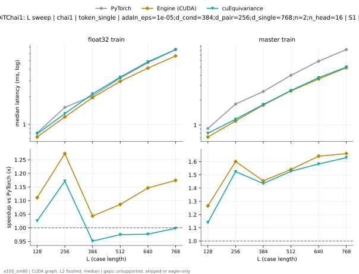
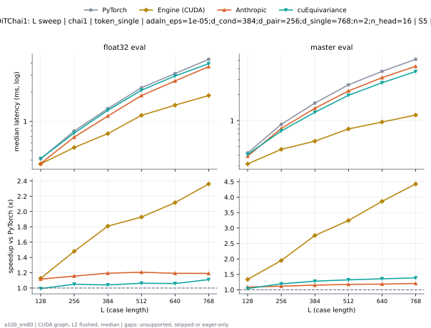
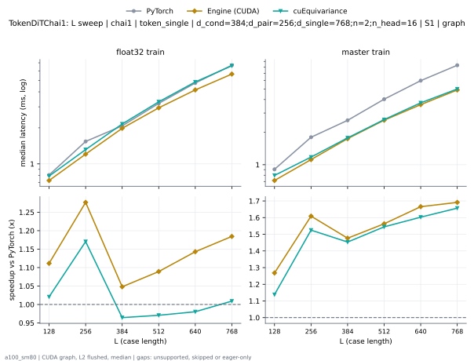
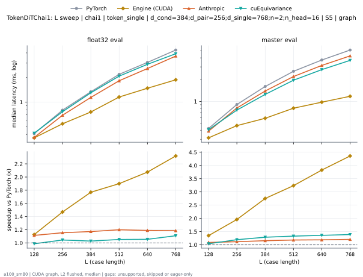

# TokenDiTChai1 on a100_sm80

Generated by `python -m miniworld_engine.measure.plot` from speed tokens `judge/tokens/a100_sm80/`; do not edit.

### L sweep: chai1 | token_single | adaln_eps=1e-05;d_cond=384;d_pair=256;d_single=768;n=2;n_head=16 | S1 | graph

**float32 train** (median ms; x = speedup vs PyTorch)

| L | PyTorch | Engine (Triton) | Engine (CUDA) | Anthropic | cuEquivariance |
|---|---|---|---|---|---|
| 128 | 0.809 | 0.809 (1.00x) | 0.7281 (1.11x) | unsupported | 0.7885 (1.03x) |
| 256 | 1.539 | 1.55 (0.99x) | 1.209 (1.27x) | unsupported | 1.314 (1.17x) |
| 384 | 2.055 | 2.071 (0.99x) | 1.969 (1.04x) | unsupported | 2.16 (0.95x) |
| 512 | 3.223 | 3.224 (1.00x) | 2.968 (1.09x) | unsupported | 3.305 (0.98x) |
| 640 | 4.756 | 4.664 (1.02x) | 4.149 (1.15x) | unsupported | 4.869 (0.98x) |
| 768 | 6.618 | 6.574 (1.01x) | 5.636 (1.17x) | unsupported | 6.629 (1.00x) |

**master train** (median ms; x = speedup vs PyTorch)

| L | PyTorch | Engine (Triton) | Engine (CUDA) | Anthropic | cuEquivariance |
|---|---|---|---|---|---|
| 128 | 0.9073 | 0.894 (1.01x) | 0.7168 (1.27x) | unsupported | 0.7956 (1.14x) |
| 256 | 1.792 | 1.798 (1.00x) | 1.119 (1.60x) | unsupported | 1.176 (1.52x) |
| 384 | 2.538 | 2.596 (0.98x) | 1.745 (1.45x) | unsupported | 1.769 (1.43x) |
| 512 | 3.984 | 4.071 (0.98x) | 2.586 (1.54x) | unsupported | 2.609 (1.53x) |
| 640 | 5.905 | 5.946 (0.99x) | 3.598 (1.64x) | unsupported | 3.732 (1.58x) |
| 768 | 8.163 | 8.194 (1.00x) | 4.916 (1.66x) | unsupported | 5.009 (1.63x) |

### L sweep: chai1 | token_single | adaln_eps=1e-05;d_cond=384;d_pair=256;d_single=768;n=2;n_head=16 | S5 | graph

**float32 eval** (median ms; x = speedup vs PyTorch)

| L | PyTorch | Engine (Triton) | Engine (CUDA) | Anthropic | cuEquivariance |
|---|---|---|---|---|---|
| 128 | 0.4106 | 0.3789 (1.08x) | 0.3645 (1.13x) | 0.3676 (1.12x) | 0.4137 (0.99x) |
| 256 | 0.7956 | 0.724 (1.10x) | 0.5376 (1.48x) | 0.6881 (1.16x) | 0.7578 (1.05x) |
| 384 | 1.353 | 1.183 (1.14x) | 0.7475 (1.81x) | 1.134 (1.19x) | 1.3 (1.04x) |
| 512 | 2.222 | 1.896 (1.17x) | 1.153 (1.93x) | 1.842 (1.21x) | 2.091 (1.06x) |
| 640 | 3.106 | 2.643 (1.17x) | 1.467 (2.12x) | 2.606 (1.19x) | 2.934 (1.06x) |
| 768 | 4.357 | 3.732 (1.17x) | 1.846 (2.36x) | 3.66 (1.19x) | 3.926 (1.11x) |

**master eval** (median ms; x = speedup vs PyTorch)

| L | PyTorch | Engine (Triton) | Engine (CUDA) | Anthropic | cuEquivariance |
|---|---|---|---|---|---|
| 128 | 0.4219 | 0.3738 (1.13x) | 0.3154 (1.34x) | 0.3881 (1.09x) | 0.406 (1.04x) |
| 256 | 0.9052 | 0.7762 (1.17x) | 0.4649 (1.95x) | 0.81 (1.12x) | 0.7588 (1.19x) |
| 384 | 1.596 | 1.292 (1.24x) | 0.5786 (2.76x) | 1.389 (1.15x) | 1.248 (1.28x) |
| 512 | 2.598 | 2.089 (1.24x) | 0.8008 (3.24x) | 2.209 (1.18x) | 1.965 (1.32x) |
| 640 | 3.723 | 2.939 (1.27x) | 0.9636 (3.86x) | 3.145 (1.18x) | 2.744 (1.36x) |
| 768 | 5.132 | 4.017 (1.28x) | 1.159 (4.43x) | 4.26 (1.20x) | 3.707 (1.38x) |

### L sweep: chai1 | token_single | d_cond=384;d_pair=256;d_single=768;n=2;n_head=16 | S1 | graph

**float32 train** (median ms; x = speedup vs PyTorch)

| L | PyTorch | Engine (Triton) | Engine (CUDA) | Anthropic | cuEquivariance |
|---|---|---|---|---|---|
| 128 | 0.809 | 0.8125 (1.00x) | 0.7291 (1.11x) | unsupported | 0.7905 (1.02x) |
| 256 | 1.541 | 1.554 (0.99x) | 1.212 (1.27x) | unsupported | 1.316 (1.17x) |
| 384 | 2.051 | 2.061 (1.00x) | 1.961 (1.05x) | unsupported | 2.156 (0.95x) |
| 512 | 3.201 | 3.223 (0.99x) | 2.949 (1.09x) | unsupported | 3.301 (0.97x) |
| 640 | 4.74 | 4.671 (1.01x) | 4.154 (1.14x) | unsupported | 4.841 (0.98x) |
| 768 | 6.644 | 6.562 (1.01x) | 5.626 (1.18x) | unsupported | 6.616 (1.00x) |

**master train** (median ms; x = speedup vs PyTorch)

| L | PyTorch | Engine (Triton) | Engine (CUDA) | Anthropic | cuEquivariance |
|---|---|---|---|---|---|
| 128 | 0.9073 | 0.894 (1.01x) | 0.7168 (1.27x) | unsupported | 0.7962 (1.14x) |
| 256 | 1.792 | 1.798 (1.00x) | 1.119 (1.60x) | unsupported | 1.177 (1.52x) |
| 384 | 2.544 | 2.595 (0.98x) | 1.747 (1.46x) | unsupported | 1.768 (1.44x) |
| 512 | 3.986 | 4.08 (0.98x) | 2.587 (1.54x) | unsupported | 2.609 (1.53x) |
| 640 | 5.902 | 5.949 (0.99x) | 3.592 (1.64x) | unsupported | 3.73 (1.58x) |
| 768 | 8.164 | 8.194 (1.00x) | 4.919 (1.66x) | unsupported | 5.006 (1.63x) |

### L sweep: chai1 | token_single | d_cond=384;d_pair=256;d_single=768;n=2;n_head=16 | S5 | graph

**float32 eval** (median ms; x = speedup vs PyTorch)

| L | PyTorch | Engine (Triton) | Engine (CUDA) | Anthropic | cuEquivariance |
|---|---|---|---|---|---|
| 128 | 0.4106 | 0.3799 (1.08x) | 0.3635 (1.13x) | 0.3676 (1.12x) | 0.4147 (0.99x) |
| 256 | 0.7956 | 0.724 (1.10x) | 0.5386 (1.48x) | 0.6881 (1.16x) | 0.7608 (1.05x) |
| 384 | 1.335 | 1.185 (1.13x) | 0.7485 (1.78x) | 1.139 (1.17x) | 1.298 (1.03x) |
| 512 | 2.203 | 1.873 (1.18x) | 1.137 (1.94x) | 1.823 (1.21x) | 2.078 (1.06x) |
| 640 | 3.103 | 2.614 (1.19x) | 1.441 (2.15x) | 2.574 (1.21x) | 2.902 (1.07x) |
| 768 | 4.357 | 3.732 (1.17x) | 1.847 (2.36x) | 3.661 (1.19x) | 3.915 (1.11x) |

**master eval** (median ms; x = speedup vs PyTorch)

| L | PyTorch | Engine (Triton) | Engine (CUDA) | Anthropic | cuEquivariance |
|---|---|---|---|---|---|
| 128 | 0.4229 | 0.3758 (1.13x) | 0.3154 (1.34x) | 0.3881 (1.09x) | 0.4065 (1.04x) |
| 256 | 0.9062 | 0.7762 (1.17x) | 0.4649 (1.95x) | 0.811 (1.12x) | 0.7588 (1.19x) |
| 384 | 1.599 | 1.293 (1.24x) | 0.5816 (2.75x) | 1.393 (1.15x) | 1.25 (1.28x) |
| 512 | 2.6 | 2.089 (1.24x) | 0.8008 (3.25x) | 2.208 (1.18x) | 1.964 (1.32x) |
| 640 | 3.725 | 2.939 (1.27x) | 0.9631 (3.87x) | 3.144 (1.18x) | 2.75 (1.35x) |
| 768 | 5.132 | 4.014 (1.28x) | 1.177 (4.36x) | 4.258 (1.21x) | 3.695 (1.39x) |

