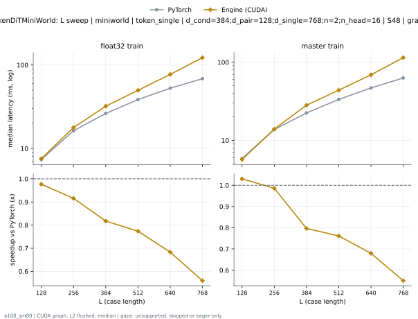
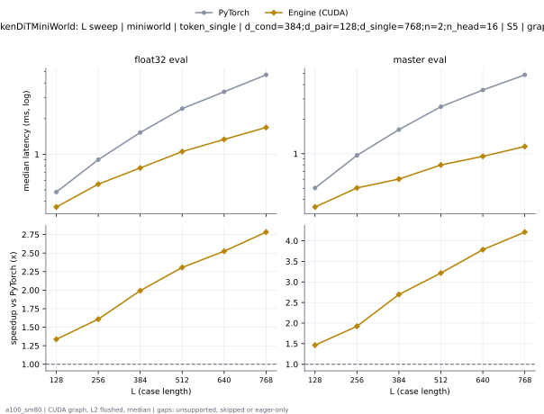

# TokenDiTMiniWorld on a100_sm80

Generated by `python -m miniworld_engine.measure.plot` from speed tokens `judge/tokens/a100_sm80/`; do not edit.

### L sweep: miniworld | token_single | d_cond=384;d_pair=128;d_single=768;n=2;n_head=16 | S48 | graph

**float32 train** (median ms; x = speedup vs PyTorch)

| L | PyTorch | Engine (Triton) | Engine (CUDA) |
|---|---|---|---|
| 128 | 7.392 | 6.602 (1.12x) | 5.858 (1.26x) |
| 256 | 16.33 | 13.98 (1.17x) | 11.76 (1.39x) |
| 384 | 26.26 | 21.26 (1.24x) | 17.79 (1.48x) |
| 512 | 38.72 | 30.08 (1.29x) | 24.76 (1.56x) |
| 640 | 52.85 | 39.87 (1.33x) | 32.19 (1.64x) |
| 768 | 68.85 | 49.72 (1.38x) | 40.12 (1.72x) |

**master train** (median ms; x = speedup vs PyTorch)

| L | PyTorch | Engine (Triton) | Engine (CUDA) |
|---|---|---|---|
| 128 | 5.894 | 5.187 (1.14x) | 4.125 (1.43x) |
| 256 | 13.79 | 11 (1.25x) | 7.867 (1.75x) |
| 384 | 22.56 | 16.96 (1.33x) | 11.83 (1.91x) |
| 512 | 33.5 | 24.14 (1.39x) | 16.2 (2.07x) |
| 640 | 46.98 | 32.37 (1.45x) | 20.51 (2.29x) |
| 768 | 63.03 | 41.61 (1.51x) | 25.48 (2.47x) |

### L sweep: miniworld | token_single | d_cond=384;d_pair=128;d_single=768;n=2;n_head=16 | S5 | graph

**float32 eval** (median ms; x = speedup vs PyTorch)

| L | PyTorch | Engine (Triton) | Engine (CUDA) |
|---|---|---|---|
| 128 | 0.4792 | 0.4332 (1.11x) | 0.3584 (1.34x) |
| 256 | 0.8991 | 0.7782 (1.16x) | 0.5591 (1.61x) |
| 384 | 1.527 | 1.249 (1.22x) | 0.766 (1.99x) |
| 512 | 2.428 | 1.893 (1.28x) | 1.053 (2.31x) |
| 640 | 3.369 | 2.546 (1.32x) | 1.334 (2.52x) |
| 768 | 4.684 | 3.558 (1.32x) | 1.683 (2.78x) |

**master eval** (median ms; x = speedup vs PyTorch)

| L | PyTorch | Engine (Triton) | Engine (CUDA) |
|---|---|---|---|
| 128 | 0.5028 | 0.4588 (1.10x) | 0.3436 (1.46x) |
| 256 | 0.9687 | 0.853 (1.14x) | 0.5038 (1.92x) |
| 384 | 1.623 | 1.32 (1.23x) | 0.6021 (2.70x) |
| 512 | 2.569 | 2.026 (1.27x) | 0.7987 (3.22x) |
| 640 | 3.592 | 2.796 (1.28x) | 0.9492 (3.78x) |
| 768 | 4.871 | 3.933 (1.24x) | 1.157 (4.21x) |

