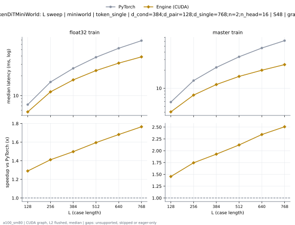
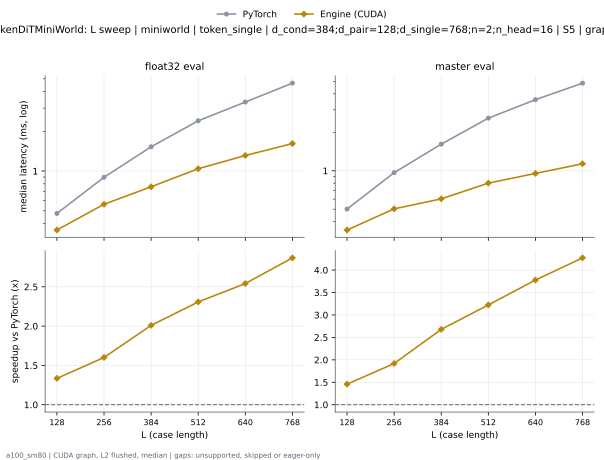

# TokenDiTMiniWorld on a100_sm80

Generated by `python -m miniworld_engine.measure.plot` from speed tokens `judge/tokens/a100_sm80/`; do not edit.

### L sweep: miniworld | token_single | d_cond=384;d_pair=128;d_single=768;n=2;n_head=16 | S48 | graph

**float32 train** (median ms; x = speedup vs PyTorch)

| L | PyTorch | Engine (Triton) | Engine (CUDA) |
|---|---|---|---|
| 128 | 7.295 | 6.471 (1.13x) | 5.654 (1.29x) |
| 256 | 16.09 | 13.75 (1.17x) | 11.4 (1.41x) |
| 384 | 25.98 | 20.81 (1.25x) | 17.34 (1.50x) |
| 512 | 38.33 | 29.35 (1.31x) | 24.03 (1.60x) |
| 640 | 52.52 | 38.95 (1.35x) | 31.22 (1.68x) |
| 768 | 68.59 | 49.01 (1.40x) | 38.85 (1.77x) |

**master train** (median ms; x = speedup vs PyTorch)

| L | PyTorch | Engine (Triton) | Engine (CUDA) |
|---|---|---|---|
| 128 | 5.875 | 5.156 (1.14x) | 4.04 (1.45x) |
| 256 | 13.41 | 10.85 (1.24x) | 7.685 (1.74x) |
| 384 | 22.22 | 16.76 (1.33x) | 11.53 (1.93x) |
| 512 | 33.4 | 23.88 (1.40x) | 15.74 (2.12x) |
| 640 | 46.75 | 32.1 (1.46x) | 19.96 (2.34x) |
| 768 | 62.03 | 41.26 (1.50x) | 24.75 (2.51x) |

### L sweep: miniworld | token_single | d_cond=384;d_pair=128;d_single=768;n=2;n_head=16 | S5 | graph

**float32 eval** (median ms; x = speedup vs PyTorch)

| L | PyTorch | Engine (Triton) | Engine (CUDA) |
|---|---|---|---|
| 128 | 0.4772 | 0.4321 (1.10x) | 0.3574 (1.34x) |
| 256 | 0.897 | 0.7762 (1.16x) | 0.5601 (1.60x) |
| 384 | 1.527 | 1.234 (1.24x) | 0.7598 (2.01x) |
| 512 | 2.403 | 1.886 (1.27x) | 1.041 (2.31x) |
| 640 | 3.334 | 2.511 (1.33x) | 1.312 (2.54x) |
| 768 | 4.635 | 3.507 (1.32x) | 1.616 (2.87x) |

**master eval** (median ms; x = speedup vs PyTorch)

| L | PyTorch | Engine (Triton) | Engine (CUDA) |
|---|---|---|---|
| 128 | 0.5018 | 0.4577 (1.10x) | 0.3441 (1.46x) |
| 256 | 0.9667 | 0.853 (1.13x) | 0.5038 (1.92x) |
| 384 | 1.616 | 1.319 (1.23x) | 0.6031 (2.68x) |
| 512 | 2.582 | 2.028 (1.27x) | 0.8008 (3.22x) |
| 640 | 3.601 | 2.794 (1.29x) | 0.9533 (3.78x) |
| 768 | 4.849 | 3.944 (1.23x) | 1.135 (4.27x) |

